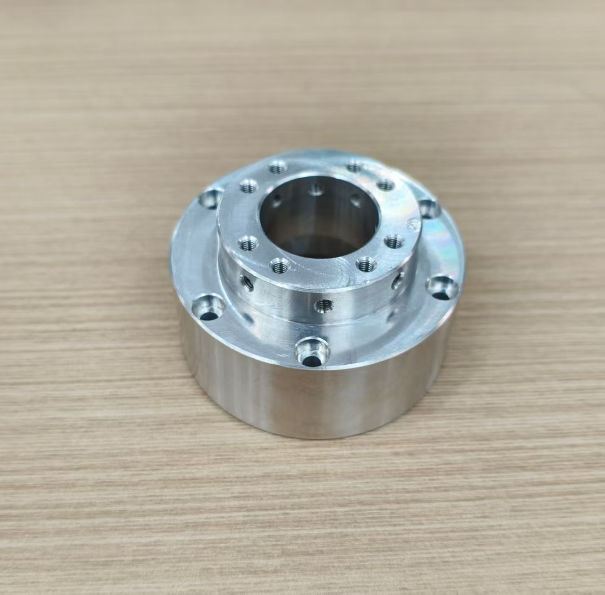
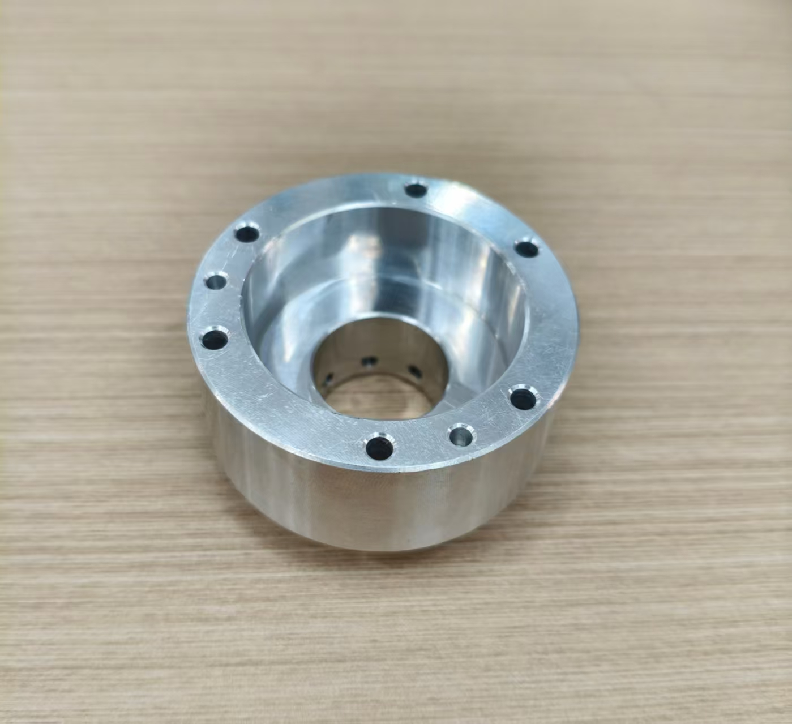
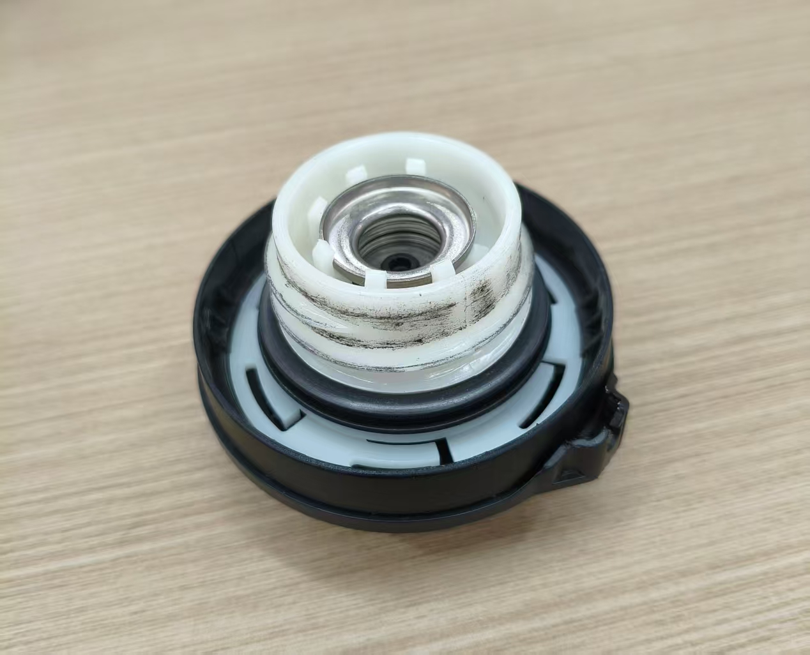
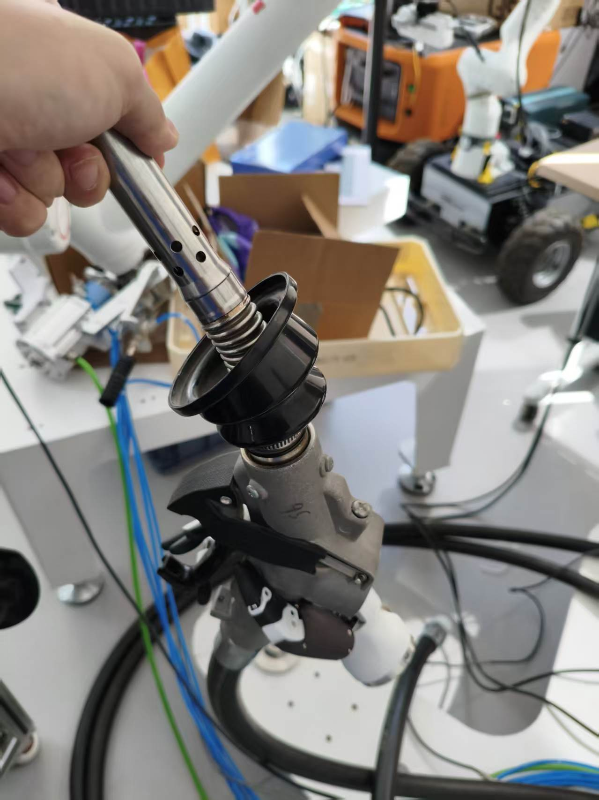
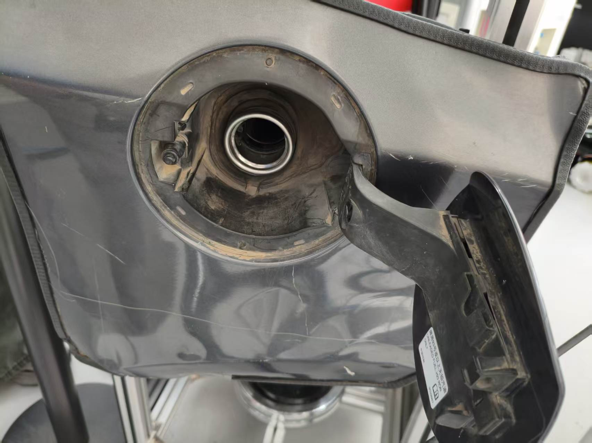
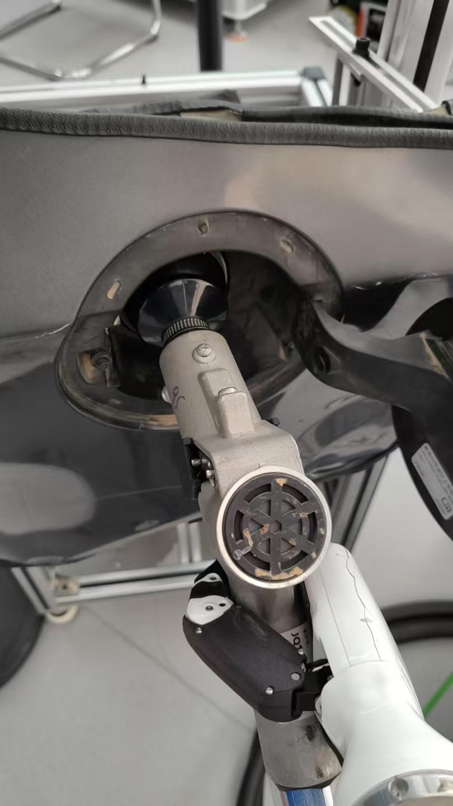
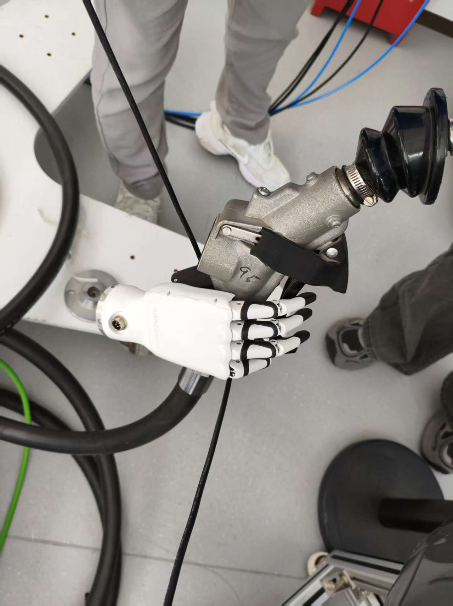

# 硬件照片与观察记录

整理日期：2026-09-15。共八张照片由用户分两批提供，原位于工作空间根目录。
按用途移动、重命名，未裁剪、压缩或改动图像；原始文件名和 SHA-256 见 [manifest.json](manifest.json)。
正面/反面沿用原文件命名，不代表已确认的机械臂侧/灵巧手侧。

当前单臂 MVP 默认油箱口敞开；adapter、油枪、油箱口和目标姿势照片作为当前参考，油箱盖照片仅保留为后续扩展资料，不作为当前建模和验收前置条件。

| 原文件名 | 整理后文件 | 用途 |
| --- | --- | --- |
| adapter正面近似.jpg | [adapter/front_reference.jpg](adapter/front_reference.jpg) | 转接件近似正面外观 |
| adapter反面近似.jpg | [adapter/back_reference.jpg](adapter/back_reference.jpg) | 转接件近似反面外观 |
| 油箱盖正面.jpg | [fuel_cap/front.jpg](fuel_cap/front.jpg) | 盖体抓握外形参考 |
| 油箱盖反面.jpg | [fuel_cap/back.jpg](fuel_cap/back.jpg) | 盖体配合端外形参考 |
| 油箱——灵巧手——油管一体展示.jpg | [fuel_nozzle/hand_nozzle_overview.jpg](fuel_nozzle/hand_nozzle_overview.jpg) | 油枪、灵巧手与软管整体外观 |
| 油箱口.jpg | [fuel_tank/filler_opening.jpg](fuel_tank/filler_opening.jpg) | 敞开油箱口及周边外形 |
| 理想加油姿势.jpg | [reference_poses/refueling_pose.jpg](reference_poses/refueling_pose.jpg) | 用户提供的理想加油姿势参考 |
| 理想手部抓握姿势.jpg | [reference_poses/hand_grasp_pose.jpg](reference_poses/hand_grasp_pose.jpg) | 用户提供的理想手部抓握姿势参考 |

## adapter

- 可见圆形台阶结构、中央孔腔、端面孔与侧面孔。
- 用户将 i10 与 RH56 之间的转接件命名为 `adapter`；照片原名标注“近似”，按外形参考保存。
- 不从照片判定材料牌号、孔径、分度圆、螺纹规格或哪一端接 i10/RH56。
- 后续需要 CAD 或尺寸图、两侧配合面与孔位、安装方向、质量和惯量；不复用 FR3 旧转接件数值。

## 油箱盖

- 正面可见圆形盖体和横向凸起握持部；反面可见白色圆柱状配合部、中央金属结构和黑色环状件。
- 正面有弧形箭头和锁形标识；反面的沟槽及内部结构仅凭照片不足以确定锁止、密封或拆卸机制。
- **此前对盖体机构的确认：开启时先旋转再拔出，关闭时先插入再旋转。** 此信息作为后续盖体操作参考保留；当前 MVP 不操作盖体。
- 后续扩展时再确认：配合口结构和尺寸、旋转轴/方向/角度、轴向行程、夹持区域及解锁/锁紧条件。不仅凭照片把机构判定为螺纹或卡口。
- 持盖或暂存策略留到后续阶段；当前不需要第二臂管理盖体。

## 油枪与灵巧手整体外观

- 原名为“油箱——灵巧手——油管一体展示.jpg”；可见枪嘴、枪体、手部、软管及人工辅助持握，用于理解部件相对布局。
- 此图不能证明灵巧手已能独立稳定持枪，也不作为出油或自主执行成功记录。
- 软管出现在照片中，但当前 MVP 仍忽略软管建模，不因照片内容扩大范围。

## 敞开的油箱口

- 可见中央加油口、周围凹入区域和已打开的外门，用于油箱口与周边碰撞外形参考。
- 当前仍默认油箱口敞开；外门开启动作不纳入 MVP。
- 用户于 2026-09-20 提供尺寸：油箱内部凹槽直径约 **120 mm**；油箱口外径 **60 mm**、内径 **50 mm**。来源为用户提供，非照片推算；测量方法与公差尚未提供。
- 孔轴、凹槽深度、油箱口轴向尺寸与世界坐标位姿仍需另行测量；上述直径不代表插入深度或 `refueling_pose` 已冻结。

## 理想加油姿势参考

- 用户原名“理想加油姿势”作为目标外观标签保留；照片展示枪体、手部与油箱口的相对姿态。
- 枪嘴前端在加油口区域受到遮挡，不能从单张照片得到精确插入深度或接触状态。
- 用户已确认本图描述 `refueling_pose`：枪嘴插入油箱后的目标姿势。当前 MVP 必须达到该插入状态，不能只停在口外；精确位姿、插入深度和容差仍需测量定义。
- 当前演示全程无液体，照片不作为实际出油的要求或验收证据。

## 理想手部抓握姿势参考

- 可见手部相对枪体的朝向、手指布置与握把/扳机区域，可用作任务专用抓型的参考。
- 中指、无名指、小指向下压扳机、停止时松开，已明确为当前动作。静态照片不能验证实际接触、按压行程、回位、握持力或动态稳定性。
- 尚需枪体与扳机尺寸、各指接触位置和动作观察来确认抓型，不将示意姿势直接当作关节目标值。

## 使用边界

照片没有标尺，不能据此生成可信的尺寸、安装变换或动力学参数。当前仅用于需求对接和后续建模参考，照片整理不等于已生成 adapter、枪体、扳机或油箱口的可运行 CAD/MJCF 资产。
