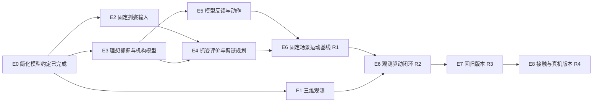

# 油箱盖项目：需求、工程计划与进度

本项目用 AUBO i10 机械臂和 RH56DFX 右手拧开油箱盖，将盖完全取下并持续持住。先完成仿真，再接真机。

本文维护当前需求、参数、工程计划和开发进度。具体操作见各工具说明；实验数据保存在 `artifacts/`。

## 任务要求

| 项目 | 约定 |
| --- | --- |
| 初始状态 | 油箱门已打开，盖体初始松紧程度对执行器未知；仿真通过初始剩余啮合行程设置工况 |
| 完成状态 | 盖体完全脱离油箱口，由手持续持住 |
| 装配链 | AUBO i10 → 传感器 → adapter → RH56DFX 右手 |
| 动作分工 | 每段内拇指、食指和中指保持抓握，由机械臂旋转 |
| 旋松方向 | 从手侧正对盖体看，逆时针；盖体系外向 +Z 的正转角 |
| 参考转角 | 最紧状态下约 225°（0.625 圈）；螺纹退出啮合后还需轴向拔出，实际阶段切换由反馈决定 |
| 重新抓握 | 一段结束后，确认机构仍可靠支撑盖体，才松手、退开、重新观察和抓握 |
| 失败处理 | 停止并等待人工，保持已有抓握，不自动重试或释放 |
| 当前范围 | 旋松、取下、持盖；不做装回、放置、开关门或加油，全程无液体 |

盖体松手后不会自行回转，这是用户提供的机构说明。轴向支撑状态仍需要执行反馈确认。

## 当前简化仿真约定

当前版本先验证臂手运动、螺纹运动和任务流程。抓握成功后建立手与盖体的固定相对关系，假设不打滑、不掉落；螺纹脱开、机构支撑和持盖反馈可来自明确标注的模型状态。仍需检查关节限位、可达性、碰撞、累计运动和阶段衔接。

固定抓姿、螺纹占位参数和拔出距离已确定，E0 的本阶段设计约定已齐备。执行配置接入、模型实现和回归验证属于后续开发任务。运行速度、观察时长和数值容差由实现阶段配置，正式回归前固定。

抓持承载、摩擦与阻力辨识、柔顺控制、传感器脱开判据及设备能力核对在后续接触与真机阶段完成；当前仿真可使用已有模型的数值属性运行，实际物理参数继续保持其原有确认状态。

## 螺纹运动与拔出参数

盖体采用螺纹连接，旋松后仍需沿盖轴向外拔出。当前先采用用户指定的轴向随动占位值：

| 项目 | 当前约定 | 来源与用途 |
| --- | --- | --- |
| 旋转—轴向关系 | 旋松方向每转 90°，沿盖体外向 +Z 移动 1 mm | 用户指定的仿真假设 |
| 等效导程 | 4 mm/圈，即 `thread_lead_m_per_turn=0.004` m/圈 | 由上述关系换算，实物导程仍待核对 |
| 旋拧阶段轴向增量 | `delta_z_m = 0.004 * delta_angle_deg / 360` | 在螺纹啮合阶段使用，角度与位移采用同一参考起点 |
| 最紧标称啮合行程 | 2.5 mm，即 0.0025 m，对应占位导程下继续旋松 225° | 用户接受的仿真假设，实物仍待核对 |
| 初始剩余啮合行程 | `e0_m` 在 `[0, 0.0025]` m 内，场景初始化时设置 | 最紧取上限，较松取更小值；0 表示螺纹已脱开但盖体尚未拔出 |
| 旋松后的动作 | 保持抓握，沿盖轴向外拔出，再确认已离开开口 | 用户确认的工序 |
| 拔出距离 | 从螺纹脱开并停稳时的位置，沿盖体外向 +Z 再移动 0.100 m | 用户指定的仿真占位值；不含此前啮合阶段的轴向位移 |

较松初态按剩余啮合行程计算，不要求每次从首次抓稳起点旋转 225°。啮合阶段的仿真关系为：

```text
e_remaining_m = max(0, e0_m - 0.004 * delta_cap_angle_deg / 360)
remaining_rotation_deg = 360 * e0_m / 0.004
```

`delta_cap_angle_deg` 为相对场景初始化时刻的累计实际盖角，与 `e0_m` 使用同一参考起点；模型余量跨重新抓握连续保留。任务接口的 `MotionProgress` 另以首次抓稳为参考，接近或闭合期间若盖体已运动，需保留两者的参考偏置。模型依据盖体实际运动消耗啮合余量，余量归零时解除螺纹耦合；0 初态从开始即无螺纹耦合。初始化较松场景时，盖体相对最紧基准的轴向位置和绕轴朝向也按导程一致地设置。

| 初始工况示例 | 初始剩余啮合行程 | 继续旋松到螺纹脱开所需转角 |
| --- | --- | --- |
| 最紧 | 2.5 mm | 225° |
| 较松示例 | 1.0 mm | 90° |
| 接近脱开示例 | 0.5 mm | 45° |

场景中的 `e0_m` 用于模型初始化与独立评价，执行器不要求预先知道它。当前 E5 使用明确标注的模型状态反馈切换阶段，真实观测与力反馈判据在后续接触与真机阶段实现。

螺纹退出啮合后，保持抓握并按上述拔出距离完成轴向退出。该拔出距离与重新抓握前手部外退的 0.100 m 分属两段动作，参数分别管理。螺纹脱开后尚未拔出时的支撑状态继续待核对。

E3 仿真后端接入时显式配置上述占位导程、最紧标称行程、场景初态及拔出距离；通用 `TaskParameters` 的未知物理参数默认值继续保持 `None`，由调用方区分仿真假设与实物参数。当前预览模型仍只有旋转自由度，轴向耦合与拔出执行尚待实现。

## 当前进度

| 模块 | 已有能力 | 接下来要做 |
| --- | --- | --- |
| 感知 | 本机微调 Grounding DINO 定位、SAM 2 分割、人工框/点诊断、仿真 RGB-D、彩色点云、表面体素与真实 PCD 检查；真实 XYZ 已确认是相机系毫米 | 补独立拍摄评价、采集时机器人位姿及图像映射，接盖轴/朝向估计和观测障碍场景 |
| 抓姿输入 | 已有人工选定的固定相对抓姿及独立读取、校验与来源记录；SpaHybGen 原示例与 RH56 适配 | 统一接入规划与执行调用，核对执行模型适配；自动抓姿作为后续升级 |
| 运动规划 | 完整臂手规划模型；单场景 MTC 接近、重新接近、构型筛选和旋转空间诊断 | 固定抓姿接观测目标，加入螺纹轴向行程和持盖退出评价 |
| 执行 | 固定夹具闭合实验；执行接口和模拟反馈 | 理想抓握连接、螺纹轴向耦合、模型脱开反馈与拔出执行 |
| 任务流程 | 提前脱离、支撑检查、条件重新抓握、累计进度、异常停止 | 接实际感知、规划和仿真执行后端 |
| 真机 | SDK 0.23.1 已读通 RPC/RTDE；配置与两段状态已保存，13 组控制器模型计算与本地 URDF 一致 | 示教器与实物核对、实时状态桥、安装标定、轨迹执行与停止反馈接入 |

目前能运行二维定位与分割、观测点云重建、表面体素化、几何规划和软件流程演示。理想抓握下的完整取盖流程尚待接通。

### 近期真机目标

近期先完成末端相机观测油箱盖、生成预抓取位姿、由 MoveIt 规划并通过 AUBO SDK 到位停止；抓握与旋拧留待后续。代码运行在上位机，通过网络连接控制柜。

AUBO SDK `0.23.1` Linux x86_64 开发包位于 `tools/sdk/aubo_sdk-0.23.1-Linux_x86_64+71831e1/`，版本与现场照片显示的 SDK 版本号相同。控制柜 IP `192.168.1.32`、RPC 端口 `30004` 已连通；随包示例的默认 RPC 认证参数 `aubo` / `123456` 已验证可用，无需另行申请账户。已读取机器人 `rob1` 的六个有限关节角、TCP/法兰位姿和运行状态，相关只读接口已验证，运动接口尚未执行。

控制器返回型号 `aubo_i10_JY`、仿真开关 `false`；本次查询时为 Running、Normal、静止。读取到的当前 TCP 偏移六项均为零，TCP 位姿与法兰位姿相同；实际手部工具点仍待核对，不能将当前零偏移直接视为手部标定结果。用户已提供并确认相机到法兰变换，参数见[末端相机外参](#末端相机外参)。

只读工具 `tools/aubo_sdk_probe/` 已通过本地编译、链接和客户端初始化，动态库依赖齐全；默认离线，在线模式显式提供 IP，使用随包示例的默认 RPC 认证参数。认证参数经现场修改时，可覆盖用户名并在终端隐藏输入密码。命令见[只读检查说明](../tools/aubo_sdk_probe/README.md)。本包提供 `servoJoint` 与路径缓存/`movePathBuffer`，没有声明较新文档中的 `trackJoint`，后续适配以本地头文件和控制器支持为准。

已核对官方 ROS2 硬件驱动所用的 26 个主要 SDK 符号，本地 0.23.1 可编译并链接这些接口。官方驱动构建配置目前默认下载 0.24.1-rc.3，接入时需调整开发包选择；完整驱动构建、驱动内的 RTDE 接入与轨迹执行仍待验证。独立采集工具的 RTDE 已读通。源码依据与仅引用符号的检查工具见上述说明。厂家开发包保留在本机，Git 中保存[下载入口和逐文件校验摘要](../tools/sdk/README.md)，不提交共享库和调试库。

已完成两批只读采集：第一批 71 项 RPC 查询、785 帧 RTDE，第二批 73 项查询、779 帧 RTDE；RPC 均成功，RTDE 解析异常均为零。每批请求 50 Hz、15 秒，主机收包统计约 52.44 Hz 与 52.02 Hz，不将其解释为控制周期或无丢包证明。原始记录、CSV、质量统计、源码/URDF 快照与压缩包入口见[真机查询与资料采集](hardware/aubo_sdk_connection.md#本次保存的资料)。采集程序已退出，后续整理可断开网线。

本次读取的控制器版本码为 `29004`、接口版本码 `23001`、版本 hash `02301bb`，控制周期为 `0.005 s`。控制器负载配置为 `8 kg`、重心 `[0, -0.06, 0.24] m`，重力配置为 `[-0.1052734378, 9.7992055571, -0.0669921910]`；这些是控制器配置，实际装配参数仍需独立核对。控制器报告 TCP 力传感器 `kw_ftsensor`，原始 TCP 传感器读数为六个零、关节力矩传感器接口为空；TCP 力值不能直接作为已完成重力补偿的接触力。

已保存 DH 理论/实际参数、20℃补偿查询与关节/TCP 限位。理论和实际 DH 相同，补偿查询为空，尚未取得有效的独立校准补偿。13 组假设关节构型的控制器正运动学计算，与本地 `aubo_i10_JY.urdf` 在数值舍入范围内一致，最大位置差约 `5.61e-16 m`；它验证了模型计算与数组顺序，不是实物精度试验。SDK 坐标变换探针与固定轴 XYZ 的 RPY（`Rz Ry Rx`）一致，最大矩阵元素差约 `2.33e-15`，本次六维位姿按该约定转换。

两批 RTDE 的控制器时间戳均经当前 SDK 解析为非有限值并保存为 `null`，不能用于相机时钟对齐；主机收包时间完整保留。数据包含近静止状态与纯计算探针，没有采集多姿态相机标定观测，也未发送运动或改写控制器配置。

下一步对照示教器与实物核对模型及实际工具点，把已读通的关节状态接入 MoveIt，再接整条轨迹执行及停止反馈。已有规划仍为几何路径，真机入口需要补执行时间，并在预抓取位结束。

近期真机所需工作按以下顺序推进；完整取盖计划继续保留在后文。

1. 配对相机观测与机器人状态。记录点云采集时的关节角或基座到法兰变换、相机采集时间和主机时钟；静止扫描可先锁定观察姿态并记录扫描前后状态。历史 PCD 的采集位姿目前未知，不能套用后来读取的机器人位姿。
2. 生成基座系预抓取目标。按下文外参转换观测，估计盖体位置、外向轴与握梁朝向，再结合实际法兰到工具变换和显式预抓取距离计算完整六维目标；首版可人工圈选点云，像素映射在使用图像掩膜时补齐。
3. 接入实时状态与真实场景。将 SDK 状态映射为 ROS 关节名和 `/joint_states`，以真机当前姿态规划；补齐相机、工具、安装件与现场油箱/门板等碰撞几何，局部盖体点云未覆盖的空间保持未知。
4. 打通 MoveIt 到 SDK 的执行。先适配现成驱动；将几何路径补上时间参数，接通整条轨迹、反馈、取消、超时和停止处理。现有 MTC 接近还会继续进入抓取位置，真机首版需增加只到预抓取位结束的入口。
5. 完成实物复核和小范围到位试验。核对工具安装、外参精度、保守速度及到位误差；先验证状态、坐标与空旷区域运动，再执行观测目标。当前不要求手指抓取、力控或旋拧。

## 工程计划

工程目标是由观测自动定位盖体，套用已选定的固定相对抓姿并求解机械臂构型，接近并抓稳，通过反馈旋松、完全取下并持续持盖。先交付可重复的仿真系统，再交付真机系统。本计划按功能、依赖、结果和工作量安排。

当前 E2 简化为固定抓姿输入，参数见[手动候选](#手动候选)。固定量为手根在盖体系中的位姿与手部预型/闭合指令；每次根据当前盖体观测重新计算空间目标、求解 IK 并检查路径。SpaHybGen 接触预测和抓姿优化保留为后续升级，当前版本按固定抓姿完成工程验收。

当前仿真验收采用[理想抓握约定](#当前简化仿真约定)，完成后再开展接触可靠性和真机验证。

### 交付里程碑

| 里程碑 | 交付内容 | 完成条件 |
| --- | --- | --- |
| R1 固定场景运动基线 | 已知盖体位姿、固定抓姿和理想抓握连接，完整执行接近、抓握、旋拧、取出和持盖 | 从初始化运行到结束；运动满足模型约束，阶段反馈明确标注来源 |
| R2 观测驱动取盖仿真 | RGB-D → 位姿与场景 → 固定相对抓姿 → 完整臂链评价 → 路径与局部执行 | 根据观测自动更新抓取目标和臂构型，完成取盖；失败时返回具体原因并停止 |
| R3 多场景仿真版本 | 固定配置、场景集合、基线对照、异常回归和可复现运行入口 | 达到冻结的成功率与失败行为指标，能在记录的环境中复现 |
| R4 接触验证与真机版本 | 补齐接触可靠性、物理参数、实际反馈判据、标定与设备适配，再重复取盖 | 在声明的场景和初始条件内达到真机验收指标，结果和配置完整保存 |

R1 验证机构运动、路径和任务流程，R2 接入图像/深度观测并沿用同一固定抓姿；接触可靠性和真机交付在 R4 完成。

### 阶段与依赖

当前按以下功能依赖推进。E3 的首个可运行版本形成后，再按实际实现范围估算剩余工期；接触验证、设备等待、加工和额外数据采集单独安排。

| 阶段 | 工程工作 | 必要依赖 | 当前情况 |
| --- | --- | --- | --- |
| E0 | 明确简化模型、输入反馈、流程与检查范围 | 本文现有约定 | 当前简化仿真约定已完成 |
| E1 | 盖体三维位姿、场景与观测适配 | E0 中的观测约定 | 已有二维、点云和表面体素 |
| E2 | 固定抓姿载入、坐标变换与接口适配 | 现有候选与坐标约定；观测驱动模式接 E1 | 候选、观测与目标计算已统一接入预览、MTC 请求及回放；当前模型的变化场景和失败检查已完成，执行后端待 E3 |
| E3 | 理想抓握、螺纹耦合、脱开与运动执行模型 | E0 | 当前为预览模型、固定夹具闭合 |
| E4 | 固定抓姿几何可行性和完整运动规划 | E2、E3 | 已有人工候选几何规划 |
| E5 | 基于模型状态的阶段反馈与动作执行 | E3、E4 | 当前只有 mock 阶段反馈 |
| E6 | 状态机与仿真后端集成 | 基线需 E2/E3/E4/E5；观测驱动版本另需 E1 | 已有状态机、mock 和离线路径 |
| E7 | 多场景回归、基线对照与版本交付 | E6 观测驱动版本 | 尚无完整闭环回归 |
| E8 | 接触验证、设备核对、标定与真机实验 | E7；独立设备资料核对可提前 | 模型、照片和部分 SDK 资料可用 |



E0 的本阶段设计约定已齐备，当前主要工作是 E2 的接口接入、E3 的模型实现及后续任务集成。E2 可先用已知盖体位姿接通基线，E1 随后提供观测目标。场景表示优先服务障碍与路径检查，网络专用局部体素/TSDF 在自动抓姿升级时接入。

### E0：简化仿真约定已完成

- [x] **E0.1 模型约定。** 固定相对抓姿，抓握后采用可靠固定连接；螺纹导程、最紧行程、较松初态范围及拔出距离采用[机构参数](#螺纹运动与拔出参数)。
- [x] **E0.2 输入与反馈来源。** R1 使用已知位姿，R2 接仿真 RGB-D 的位姿估计；抓握、啮合、支撑和持盖可使用标明来源的模型状态。真实设备接口和传感器判据归入 E8。
- [x] **E0.3 流程与控制分工。** 接近、抓握连接、旋拧、脱开、拔出和持盖的顺序已明确；条件重新抓握保留，松手需模型明确报告机构支撑，未知则停止。参数配置接入和后端实现分别在 E2/E3/E5 完成。
- [x] **E0.4 当前检查范围。** 检查可达性、关节限位、碰撞、螺纹运动关系、提前脱开、拔出距离及状态机衔接；工程数值设置与试运行指标在实现、回归阶段配置和固定。

**交付：** 本文中的简化模型、参数、输入反馈来源和流程约定，已足够开始本阶段实现。

**完成范围：** 当前简化仿真的设计前置条件已齐备。模型与接口尚待实现，接触可靠性和真机参数在 E8 验证。

### E1：输出规划可用的观测

- [ ] **E1.1 统一观测。** 将同一时刻的 RGB、配准深度/点云、标定、机器人状态和时钟信息适配到同一观测记录；点云保留像素对应。按实际相机输出选择适配路径。

  已增加真实二进制 PCD 的读取与独立查看，原字段、点序和来源摘要保留；实测输入已确认是相机系毫米，并取得相机到法兰外参。像素映射、采集时间和采集时机器人位姿仍待补齐，外参需做实物精度复核。
- [ ] **E1.2 估计盖体位姿。** 从掩膜选择有效三维点，拟合盖体范围、旋转轴及握梁朝向，输出基座系 `CapEstimate`。处理 180° 对称、遮挡和深度缺失；条件不足时返回无效。
- [ ] **E1.3 建立规划场景。** 保留凹槽、门板与周边障碍，过滤机器人自身，保存未知区域与观测来源；记录场景版本和采集时刻，供规划与执行核对。
- [ ] **E1.4 评价定位。** 增加远景、有盖/无盖、遮挡及新拍摄批次，按拍摄批次划分数据。固定独立测试集后报告漏检、误检、位姿误差、无效返回率和耗时；依据失败工况决定是否补数据或训练。

**交付：** 三维位姿入口、场景快照入口、离线观测样例与评价报告。拟新增 `cap_pose.py` 和观测适配模块，复用现有感知、反投影与体素代码。

**通过标准：** 观测具备来源、时间、单位、坐标和有效性，误差及有效覆盖率达到回归前固定的指标。估计流程使用传感输入；仿真真值仅用于独立评价。数据失效时不产生有效运动目标。

### E2：使用固定相对抓姿

- [x] **E2.1 载入固定候选。** 使用[当前固定候选](../config/fixed_grasp.json)中的 `cap_from_hand`、`pregrasp_channels` 和 `grasp_channels`，参数统一见[手动候选](#手动候选)与[闭合指令](#闭合指令)。公共读取器完成格式、来源和运行版本检查，预览及 MTC 准备入口共用读取结果。
- [x] **E2.2 接入当前盖体位姿。** 模型位姿同步读取及异步接口已实现，输出带来源、时间与有效性的 `CapEstimate`；`GraspPreparation` 统一保存候选、观测、手根/法兰及接近目标，已接入预览、MTC 请求和回放复核。R1 使用模型位姿；R2 的 E1 输入须先显式转换到 `world`，重新抓握使用新观测。
- [ ] **E2.3 衔接规划与执行。** 规划采用一个固定手盖候选，仍允许搜索机械臂 IK 构型和绕数。请求分别携带接近预型与闭合目标；`GraspPreparation.task_parameters()` 已适配现有任务参数。E3 后端接入后，在到位及抓握阶段执行闭合、建立固定手盖关系并记录模型抓握状态。
- [ ] **E2.4 核对适配与变换。** 当前模型已核对基准、平移、整箱偏航、盖体自转和混合变化的目标及 IK，完成基准与混合场景的真实路径复核，并检查无效输入、目标误传和障碍导致的规划失败。E3 模型变化后仍需重新验证并保存适配后的候选记录，保留原实验和来源检查。

**交付：** 可从配置载入的固定抓姿输入、当前观测到规划目标的适配，以及基准/变更位姿的复核入口与结果。公共目标计算已通过 `GraspPreparation` 接入工具与 MTC；E1 观测适配及 E3 执行后端继续完成。

**通过标准：** 固定手盖关系随当前盖体位姿正确变换；固定抓姿不可达或发生干涉时返回失败。已有固定夹具三指接触结果保留；当前版本按理想抓握连接推进，实际承载与传矩在 E8 验证。

**后续自动抓姿升级：** 依次接入匹配上游约定的局部体素/TSDF、空间接触预测、RH56 优化与几何筛选，再通过同一候选接口与固定抓姿比较。已有 SpaHybGen 复现和 RH56 适配继续保留。

### E3：建立理想抓握与机构运动仿真

- [ ] **E3.1 建立机构模型。** 按[机构参数](#螺纹运动与拔出参数)建立旋转—轴向耦合，支持不同初始剩余啮合行程；模型余量归零后解除螺纹耦合，允许轴向拔出。明确每个阶段的机构支撑状态，未知时返回未知。
- [ ] **E3.2 实现理想抓握。** 到达固定抓姿并进入抓握阶段后，将盖体固定到手上，保持给定相对关系；计划释放时解除连接。分别管理手盖连接与盖体机构约束，保留几何和碰撞检查。
- [ ] **E3.3 实现运动执行。** 跟踪已有规划轨迹，记录目标与实际关节、末端误差、饱和和停止响应。直接状态写入限定在初始化与几何检查。
- [ ] **E3.4 输出模型反馈。** 提供时间一致的关节、手盖位姿、抓握连接、剩余啮合、机构支撑和运动停止状态，标明模型来源；实现控制权交接与停止保持。

**交付：** 独立执行场景生成器、仿真执行配置、臂手控制后端和原始反馈记录。拟新增执行场景工具及 `sim_execution.py`，复用现有模型来源和接口。

**通过标准：** 手盖连接与机构约束正确切换，运动满足占位导程；脱开后可拔出并保持固定抓握；轨迹和停止行为符合所选执行方式，重置可复现，同一关节组只有一个控制方。几何回放与执行器跟踪分别注明实现方式。

### E4：评价固定抓姿并规划完整臂链

- [ ] **E4.1 检查固定抓姿几何。** 核对手盖相对位姿、手部预型与闭合后的几何，区分预期抓取接触和不允许的干涉，检查安装件及环境碰撞。
- [ ] **E4.2 评价完整臂链。** 检查可达、关节限位、自碰和环境碰撞，比较可转范围与方向可操作度。使用实际路径末态评价后续旋拧，并计入执行停止余量。
- [ ] **E4.3 输出阶段运动方案。** 规划接近、外退、调整和再次接近；取出阶段包含盖体随手运动的几何和碰撞检查。接触阶段轨迹依据机构轴向关系生成，交由局部执行器跟踪。
- [ ] **E4.4 支持在线更新。** 路径绑定观测与场景版本。发生重新观察、盖体运动或障碍变化时更新并复核；重新抓握保留同一起点的累计盖角。

**交付：** 固定抓姿的几何可行性报告、机械臂构型选择器和带阶段范围的运动方案，扩展现有构型筛选、MTC 与路径复核模块。

**通过标准：** 在基准场景找到满足关节、碰撞和运动约束的方案，实际路径末态和阶段衔接一致；无方案时保存具体拒绝原因。

### E5：实现模型反馈与阶段动作

- [ ] **E5.1 抓握反馈。** 建立固定手盖连接后返回理想抓握成立，反馈明确注明模型假设；连接未建立或输入无效时停止。
- [ ] **E5.2 旋拧动作。** 根据占位导程与连续臂构型执行绕轴旋转和轴向随动，处理本段行程边界及停稳交接。
- [ ] **E5.3 运动与脱开反馈。** 从模型读取实际盖角、轴向进度及螺纹耦合状态，支持未知初始松紧下提前脱开。转角命令发出后仍需读取模型状态，反馈未知或矛盾时停止。
- [ ] **E5.4 支撑与重新抓握。** 保持抓握读取模型的机构支撑状态，明确允许释放后才解除手盖连接、外退、重新观察并抓握。螺纹已脱开时保持抓握转入取出，支撑未知时停止。
- [ ] **E5.5 取出与持续持盖。** 确认螺纹退出啮合并停稳后保持抓握，从当前位置按[拔出占位距离](#螺纹运动与拔出参数)沿盖轴向外移动，执行含盖体的退出方案并确认离开开口，再观察持盖状态；阶段结束后保持控制仍有效。

**交付：** 基于模型状态的动作执行器、来源明确的阶段回执，接入 `execution_contract.py`。

**通过标准：** 正常旋拧、较松初态提前脱开、拔出和持盖能够完成；路径失败、无效反馈及未知支撑时能够停止。R1/R2 当前均可使用模型阶段反馈，真实传感器判据在 E8 实现。

### E6：交付可运行的完整仿真任务

- [ ] **E6.1 串联人工抓姿流程。** 用已知位姿和人工候选串联接近、停稳交接、闭合、旋拧、脱离、取出与持盖。
- [ ] **E6.2 接入重新抓握。** 演示段末支撑确认、释放、外退、重新估计和再次抓握；遇到提前脱离直接取出。核对累计进度、实际构型和场景更新，完成人工抓姿基线 R1。
- [ ] **E6.3 接入观测输入。** 用 E1 位姿与场景更新 E2 固定抓姿的目标并重算 E4 方案，交付 R2。沿用相同固定手盖关系、执行器和评价方法。
- [ ] **E6.4 完善运行入口。** 明确 `mock` 与仿真后端，提供初始化、单次执行、取消和人工重置入口；记录模型、观测、候选、规划、控制配置、事件和最终结果，检查观测超时与进程失联。

**交付：** 可配置的完整任务入口、已知位姿基线与观测驱动模式，以及可重复运行的固定场景。

**通过标准：** 达到 R1/R2 试运行指标；任务结束条件来自实际反馈；任一阶段失败都进入停止等待人工。需要重新运行时先明确重置，失败路径不自动恢复或释放。

### E7：回归、对照和仿真交付

- [ ] **E7.1 固定试验集合。** 覆盖场景位置/朝向、初始剩余啮合、观测与标定误差。将设计上不可达的工况和运行中规划失败分别报告，保存全部试验的分母。
- [ ] **E7.2 做基线对照。** 使用同一固定抓姿，对照已知位姿与视觉估计、不同臂构型以及旋转空间筛选。使用同一批工况和重置条件，定位性能变化的来源；自动抓姿对照在后续升级时增加。
- [ ] **E7.3 故障回归。** 覆盖无盖、漏检、深度缺失、多候选、过期观测、无路径、提前脱开、未知支撑、取消及通信超时。打滑和受力卡滞的物理检测在 E8 验证，当前可注入故障回执检查停止分支。
- [ ] **E7.4 打包版本。** 保存运行配置、依赖与模型来源、批量入口和摘要报告；从约定环境重新初始化运行并核对结果。

**交付：** R3 仿真版本、全量试验表和基线报告。核心指标包括任务成功率、各阶段失败率、任务时长、轨迹误差、碰撞检查与停止行为。

**通过标准：** 达到冻结的回归指标，全部结果可追溯；任务失败与正确停止分别计数，正确停止仍属于未完成取盖。

### E8：接触验证、真机接入和重复实验

本阶段补齐质量惯量、摩擦与阻力、实际抓持承载与传矩、柔顺控制、力觉脱开/打滑/卡滞判据和设备接口。先在接触仿真中验证，再逐步接入设备；这些项目不再作为当前 E0 的前置要求。

- [ ] **E8.1 完成安装与标定。** 核实安装链、TCP、相机到基座变换、负载和力传感器零偏补偿；标定误差纳入观测与控制预算。
- [ ] **E8.2 适配实际设备。** 接入 i10、RH56、相机的指令和反馈，核对单位、关节顺序、时钟、周期和控制权，实测取消、通信超时及停止保持行为。
- [ ] **E8.3 分阶段验证。** 按空载轨迹、接近、闭合保持、小范围旋拧、轴向运动、脱离取出、条件重新抓握的顺序开展设备试验；每阶段使用该设备已核实的参数。
- [ ] **E8.4 重复评价。** 在声明的初态和场景集合上运行自动流程，保存全部成功、停止与失败结果，对照仿真误差并回修模型和参数。

**交付：** R4 真机配置、驱动与标定结果、完整任务入口、重复实验报告及操作说明。

**通过标准：** 设备能力、参数及标定齐备，实物持续持盖，达到冻结的真机指标。SDK、控制接口或相机能力不满足时先解决适配或设备方案，再恢复对应阶段。

### 拟定验收指标与参数状态

下表为试运行和后续交付的初始建议。当前简化仿真的运行数值与回归指标在 E3/E6/E7 中配置和固定；真实物理限值在 E8 核对。下面的次数和成功率不自动写入执行参数。

| 项目 | 建议指标或确定方法 |
| --- | --- |
| 单次成功 | 当前仿真中盖体按机构关系脱开，沿退出方案离开开口，理想抓握连接持续保持并完成观察；关节和碰撞检查通过 |
| 持盖观察 | 初步建议连续 10 s，作为 E6 中可配置的观察时长，回归前固定；观察结束后保持控制继续有效 |
| R1/R2 固定场景 | 各 10 次独立重置全部完成，记录初始啮合、微小位姿扰动及种子，覆盖提前脱离和段末继续旋拧 |
| 重新抓握 | 必须有完整支撑检查、释放、外退、再观察与抓握后继续推进的成功案例，另有支撑未知时停止案例 |
| R3 多场景 | 初步采用现有 17 个几何场景 × 3 个初始啮合/松紧状态 × 2 组观测误差条件，共 102 次；条件数值在 E3/E7 中固定；总体成功率≥90%，逐工况报告分子分母 |
| 异常处理 | 每种故障均按预期停止并报告原因；有限测试集中不出现未知支撑下释放、失效反馈下继续运动或重复控制；记录停止时间及运动余量 |
| R4 真机 | 初步建议至少 20 次任务、成功率≥90%，覆盖不同初始松紧和至少两个允许位置；逐条件报告结果及失败原因 |
| 位姿与场景 | 根据实际间隙分配位置、轴向、朝向及标定误差，记录有效覆盖率、尾部误差和耗时；既有 IK 几何容差继续用于其原检查 |
| 载荷与停止 | 当前仿真检查运动范围和停止分支；物理载荷限值与实测停止响应在 E8 确定 |

初步回归次数用于版本试运行；罕见误释放的概率需要更大规模试验评价。独立数据与工况在调参前固定，改变模型或阈值后重新运行受影响的回归。

### 首批可直接开展的工作

1. **E2.1/E2.2：** 载入已有固定抓姿，核对参数和来源，接入当前盖体位姿到手根/法兰目标的变换。
2. **E3.1/E3.2：** 实现理想抓握连接、螺纹轴向耦合和按剩余啮合量脱开，覆盖最紧与较松初态。
3. **E5/E6：** 以模型反馈接通旋拧、拔出和持盖，验证提前脱开及条件重新抓握。
4. **E1.1/E1.2：** 复用已有 RGB-D 和点云，接分割掩膜提取盖体点，输出带有效性的三维位姿；先用保存观测完成离线评价。

设备到位及真实物理参数的核对在 E8 补齐；当前按已确定的仿真假设推进。完成实现后更新相应阶段状态。

## 四模块架构

| 模块 | 输入 | 输出与职责 |
| --- | --- | --- |
| 感知 | RGB-D、相机标定、目标描述 | 盖体位姿、目标范围、场景和空间接触特征 |
| 规划 | 观测、手模型、完整臂链、任务要求 | 候选抓姿、构型评价、接近/重新抓握/取出路径 |
| 执行 | 阶段请求与运动方案 | 驱动臂手，读取运动、抓持、力、支撑和脱离反馈 |
| 任务流程 | 观测与阶段回执 | 调用各模块，管理进度与分支，处理停止 |

任务层不发送关节命令。MTC 负责无接触运动，局部执行层负责机构阶段动作；后续接触控制沿用这一分工。同一组关节同时只有一个控制方，切换时先停稳并确认交接。

方法和数据流见[技术路线](current_technical_route.md)。

## 旋拧与重新抓握流程

1. 估计盖体位姿，生成抓姿，规划并执行接近。
2. 停稳并交接控制，闭合手指，确认抓稳。
3. 在固定手盖关系下沿盖轴旋拧，按[占位导程](#螺纹运动与拔出参数)轴向随动，读取模型运动、抓握连接和螺纹状态。
4. 确认螺纹退出啮合后结束旋拧并停稳，保持抓握，从当前位置沿轴向外拔出 0.100 m，确认离开开口后持续持盖。
5. 若到达本段旋转边界仍未脱离，停稳后检查支撑。允许释放时，松手并沿盖轴外向退开 0.100 m，重新观察、调整和抓握，再继续旋拧。
6. 反馈未知、矛盾或失败时停止，等待人工。

累计进度记录盖体相对首次抓稳起点的实际运动，跨重新观测保留。朝向展开及握梁的 180° 对称歧义由观测提供方处理。

### 支撑检查

当前简化版本读取模型的机构支撑状态，只有明确允许释放才进行重新抓握；未知时停止。下面的试拉与载荷卸载方法用于后续接触验证阶段。

停转后手继续抓握，沿轴做受限试拉，再减小主动轴向拉力，观察盖体位移、回弹和手盖滑移。“卸载”只减小主动拉力，手指仍保持抓握。

释放判断要确认盖体在手离开后仍由机构可靠支撑。手仍可能承担盖重，因此卸载后不动只是辅助信息。这个判据需用能解除支撑、允许盖体自由运动的模型验证，重点统计释放后滑落的误判。

当前状态机使用模拟支撑结论；后续试拉载荷、速度、允许位移、观察时长及判定阈值在 E8 确定。

## 手部通道与坐标

### 闭合指令

闭合目标为 `[0, 0, 440, 390, 660, 0]`，按以下顺序读取：

| 通道 | 手指/动作 |
| --- | --- |
| 1 | 小指 |
| 2 | 无名指 |
| 3 | 中指 |
| 4 | 食指 |
| 5 | 拇指弯曲 |
| 6 | 拇指旋转 |

参考控制脚本的范围为 0～1000：1000 张开，0 最大弯曲，-1 保持当前状态。通道值是设备指令；实物关节映射待标定。新抓姿先独立保存，采用前再核对执行指令。

### 仿真映射

执行器顺序为 `pinky / ring / middle / index / thumb_proximal / thumb_yaw`。驱动范围取执行器、主动关节及从动关节限位的交集；通道 1000 映射下端，0 映射上端，中间线性插值。

| 执行器 | 通道 1000（rad） | 通道 0（rad） |
| --- | --- | --- |
| pinky / ring | 0.093607306 | 1.531023368 |
| middle | 0.093607306 | 1.500000000 |
| index | 0.067150148 | 1.500000000 |
| thumb_proximal | 0.100000000 | 0.488721805 |
| thumb_yaw | 0.000000000 | 1.308000000 |

这是当前模型的预览映射。RH56 适配用 `q_full = A @ q_driver + b` 将六驱动角展开为十二关节角。

### 盖体坐标系

统一使用握梁几何中心 `cap_grip_center` 作为盖体参考坐标系；X 沿握梁，Z 朝开口外侧，Y 按右手规则确定。URDF/MJCF 中该参考标记的轴与抓姿、感知接口一致，直接读取其世界旋转，不再做额外的盖体系轴转换。其他参考点采用相同轴方向，几何形状及安装位置保持不变。

位置使用米，四元数顺序为 XYZW。手根是 `base`，机器人基座是 `base_link`，法兰是 `wrist3_Link`。`cap_from_hand` 表示手根在盖体系中的位姿：

```text
world_from_hand = world_from_cap @ cap_from_hand
world_from_flange = world_from_hand @ inverse(flange_from_hand)
```

公共入口为 [grasp_targets.py](../src/fuel_cap_task/grasp_targets.py) 中的 `calculate_grasp_targets(cap, cap_from_hand, *, flange_from_hand, world_from_base)`。输入是世界系 `CapEstimate`、候选读取器返回的 `FixedGrasp.cap_from_hand`、法兰到手根的安装变换和基座在世界系中的位姿。输出 `GraspTargets`，保留 `world_from_cap`、世界系手根/法兰目标和基座系手根/法兰目标，矩阵均为 4×4。无效观测或非 `world` 参考系抛出 `TaskFailure`，错误的相对参考系或安装/基座矩阵抛出 `ValueError`；不隐式换轴或修正输入。来源与时间继续随原始 `CapEstimate` 保存。

计算时先将盖体系中的手根偏移旋转到世界系，再加盖体位置：`p_wh = p_wc + R_wc @ p_ch`。基准场景中，候选偏移 `(-20, 75, 160)` mm 对应世界偏移 `(-75, -160, -20)` mm，所以手根目标为世界系 `(-75, 847, 580)` mm。安装链满足 `world_from_hand = world_from_flange @ flange_from_hand`，求法兰需在右侧乘安装变换的逆；当前 43.5 mm 安装高度沿法兰局部 Z，不能直接沿世界 Z 扣除。基座系目标使用 `inverse(world_from_base) @ world_from_target`，也不能把 `world` 和 `base_link` 当成同一个坐标系。

当前模型位姿入口为 [MujocoCapEstimator](../src/fuel_cap_task/mujoco_scene.py)：同步调用 `scene.estimator.read()`，异步任务调用 `await scene.estimator.estimate()`。二者读取同一份模型状态，返回 `CapEstimate`；位姿在 `world` 中表达，时间为同一份 `data.time`，来源为 `simulation_ground_truth`，时钟为 `simulation`。非法状态或位姿返回 `valid=False`，消费方先调用 `validate_estimate()` 再计算目标。查看当前场景输出：

```bash
.venv/bin/python tools/read_cap_estimate.py
```

命令在仓库根目录运行。默认场景的初始握梁中心为世界系 `(0, 1.007, 0.6)` m，项目盖体系 +X 沿世界 +Z、+Z 沿世界 -Y。读取更新派生坐标并返回快照，不推进仿真时间；共享场景时由调用方持有场景锁。

查看第 2～4 步的完整数据流及手盖、安装链和基座转换的矩阵残差：

```bash
.venv/bin/python tools/read_grasp_targets.py
```

[查看工具](../tools/read_grasp_targets.py) 读取并检查候选来源，从同一场景快照提取盖体、安装链及基座位姿，再打印中间矩阵。矩阵残差用于核对计算关系；实际到位由 IK 和执行反馈另行判断。

接近目标入口为同模块的 `calculate_approach_targets(targets, *, approach_distance_m)`，输入第 4 步的 `GraspTargets` 和以米为单位的有限正距离。距离由调用方显式配置，不设默认值；查看工具通过 `--distance` 传入，与已有规划请求的距离单位一致。

函数使用盖体外向轴 `axis_world = targets.world_from_cap[:3, 2]`，按 `p_pregrasp = p_grasp + approach_distance_m * axis_world` 同时平移手根与法兰，保持各自朝向及安装关系。返回 `ApproachTargets`，包含距离、世界系外向轴、世界系接近手根位姿 `world_from_pregrasp_hand` 和接近法兰位姿 `world_from_pregrasp_flange`。接近时从该位置沿 `-axis_world` 到达抓取目标。

查看第 5 步输出的示例，距离 0.1 m 仅用于本次数值查看：

```bash
.venv/bin/python tools/read_grasp_targets.py --distance 0.1
```

基准场景中盖体外向轴为世界 `-Y`，因此手根接近位置为世界系 `(-75, 747, 580)` mm。外向轴随盖体朝向更新；绕盖体自身 Z 轴转动不会改变该轴在世界中的方向。

公共适配位于 [grasp_preparation.py](../src/fuel_cap_task/grasp_preparation.py)：`prepare_grasp()` 接收已读取的 `FixedGrasp`、`CapEstimate` 和装配/基座变换，返回一份 `GraspPreparation`。`with_approach(distance_m)` 只增加接近目标，不重新采样；`task_parameters(existing_parameters)` 把相对抓姿、接近预型和闭合目标写入现有 `TaskParameters`，保留旋拧、拔出参数及未知值。

当前调用链为：`ArmIKPreview` → 公共候选读取与 `prepare_grasp()` → `preparation.with_approach()` → `mtc_fields()` → MTC → `ApproachReplay` 的 `check_mtc_fields()`。查看工具也使用 `prepare_grasp()`；重新接近在新观测下调用同一入口。`preview_cap_ik.py --distance` 可把接近目标一起保存到预览报告。

| 消费方 | 使用的位姿或指令 | 使用时机 |
| --- | --- | --- |
| 数值 `ArmIKPreview` | 世界系法兰 `wrist3_Link` 目标 | 求解六个臂关节的端点 IK |
| MTC `MoveTo` / `MoveRelative` | 世界系手根 `base` 目标，`setIKFrame("base")` | 先到接近目标，再沿负外向轴接近 |
| 手部预型 | `pregrasp_channels` → `TaskParameters.approach_channels` | 无接触接近阶段；MTC 固定手部关节 |
| 手部闭合 | `grasp_channels` → `TaskParameters.grasp_channels` | 状态机确认到位、停稳并交接控制后，由 E3 后端在 grasp 阶段使用 |

MTC 请求保留既有位置、朝向、距离及来源字段，增加 `target_frame_id="world"`、`target_link="base"`、闭合指令及候选来源记录。回放对当前候选重算并检查手根位置、朝向、接近位置、外向轴和两组指令；保持手部预型，不执行闭合。模型生成来源包含公共计算及适配模块，代码变化后重新生成模型和规划请求。

变化与失败检查入口为 [check_grasp_scenarios.py](../tools/check_grasp_scenarios.py)，针对当前固定候选和基准数值运行。先冻结并保存整组目标随物体刚体运动的独立预测，再检查基准、世界平移、整箱偏航、盖体自转、固定种子混合及远距不可达场景。改变候选或基准布局时应先更新本文约定与检查数值。

```bash
.venv/bin/python tools/check_grasp_scenarios.py --distance 0.1 \
  --output artifacts/e2_checks/current/scenarios.json
```

输出包含预测、实际目标、矩阵残差、全部端点 IK 结果及无效输入的拒绝原因；`.predictions.json` 在求解前保存。`--render-dir` 可保存各场景的 MuJoCo 端点图片。目标不符合预测属于坐标计算问题；`ik_not_found` 表示既定搜索预算内未找到数值解，只有超出保守臂长上界的远距案例另有不可达依据；`endpoint_clear` 只表示当前启用几何下找到无诊断干涉的端点构型。路径仍需实际 MTC 规划并用 `ApproachReplay.validate()` 检查，规划器失败不等于数学上证明无路径。

当前模型的检查记录、规划日志与可视化见 [E2 变化与失败检查](../artifacts/e2_checks/fixed_grasp_20261020/README.md)。障碍失败案例显式注入诊断障碍，直接测试规划节点；正常入口的场景来源与形状检查保持有效。当前结果覆盖几何计算和路径回放，闭合、理想抓握和动力学执行在 E3 接入。

### 手动候选

当前 E2 采用的固定相对抓姿保存在 [config/fixed_grasp.json](../config/fixed_grasp.json)：

| 项目 | 值 |
| --- | --- |
| 手根位置（盖体系） | `[-20, 75, 160] mm` |
| 固定轴 XYZ RPY | `[180, 50, 90] deg`，旋转矩阵 Rz·Ry·Rx |
| 接近预型 | `[0, 0, 800, 800, 900, 0]` |

闭合目标采用[闭合指令](#闭合指令)。JSON 位置使用米、旋转使用 XYZW 四元数，上表的 RPY 是同一旋转的显示形式。固定的是手根相对盖体的关系；盖体变化后更新空间目标并重算机械臂构型。

固定手根和盖体的闭合实验已观测到三指接触。该候选用于当前固定抓姿版本；本版采用理想抓握连接，自由持稳和传矩能力在 E8 验证。现有 `preview_cap_ik.py` 与 `prepare_cap_approach.py` 默认读取这份候选。

原始选取及接触记录保留在 [user_selected_20260930.json](../artifacts/manual_grasp/user_selected_20260930.json)。当前候选另存模型适配来源，抓姿数值与六通道保持一致；所继承的闭合关节位置仅用于几何显示。模型参考轴统一后重新核对几何与空间目标，并生成 `config/arm_ik_current.json` 作为当前 IK 记录。旧实验仍绑定原模型，历史规划结果需在当前模型下重新生成后使用。

独立读取入口为 [fixed_grasp.py](../src/fuel_cap_task/fixed_grasp.py) 中的 `load_fixed_grasp(candidate_path, *, source_scene_path=None, expected_mujoco_version=None)`。输入为候选 JSON 路径；返回不可变的 `FixedGrasp`，包含盖体系中的手根 `Pose`、接近/闭合六通道指令和 `provenance` 来源记录。来源包括候选文件路径与摘要、原记录及实际检查的场景路径、场景 XML 摘要、格式、选取来源及 MuJoCo 版本。

读取时检查格式 v1、有限位置、单位 XYZW 四元数、六个 0～1000 的整数通道及源场景 XML 摘要。固定候选需给出完整目标，不接受 `-1` 保持指令。源场景迁移后可显式指定新路径，内容摘要仍须匹配；传入 `expected_mujoco_version` 时才检查运行版本一致性。文件不存在抛出 `FileNotFoundError`，内容或来源无效抛出 `ValueError`，不自动修正参数。`ArmIKPreview` 与查看工具均复用该读取器；原始 JSON 的闭合实验记录仅用于显示。

## 装配与场景参数

以下装配尺寸来自 CAD，放置关系用于当前预览；实物安装仍需标定。

| 资产 | 模型尺寸 | 来源 |
| --- | --- | --- |
| 传感器 | 外径 75 mm，总高 33.5 mm | [STEP/STL 与转换说明](../assets/robots/sensor/README.md) |
| adapter | 底盘外径 63 mm、厚 10 mm；凸台外径 38 mm，总高 25 mm | [STEP/STL 与转换说明](../assets/robots/adapter/README.md) |
| RH56 右手 | 十二活动关节、六驱动 | `assets/reference/aviation/third_party/correlllab_rh56_controller_h12/mujoco_inspire/inspire_right.xml` |
| i10 | 六活动关节 | [模型与驱动来源](hardware/aubo_i10_sources.md) |

### 当前装配变换

表示子坐标系在父坐标系中的位姿。平移单位为米，RPY 为弧度，均采用固定轴 XYZ。

| 父坐标系 | 子坐标系 | xyz（m） | rpy（rad） |
| --- | --- | --- | --- |
| `wrist3_Link` | `sensor_link` | `[0, 0, 0]` | `[0, 0, 0]` |
| `sensor_link` | `sensor_output_frame` | `[0, 0, 0.0335]` | `[0, 0, 0]` |
| `sensor_output_frame` | `adapter` | `[0, 0, 0]` | `[0, 0, 0]` |
| `adapter` | `rh56_provisional_mount` | `[0, 0, 0.010]` | `[0, 0, 0]` |
| `rh56_provisional_mount` | 手模型 `base` | `[0, 0, 0]` | `[0, 0, 0]` |

凸台插入深度为 25 − 10 = 15 mm，手安装原点距法兰沿局部 +Z 为 43.5 mm。这个原点还不是标定后的 TCP。

传感器与 adapter 在 MuJoCo 中只有显示几何，质量惯量及碰撞模型待补；MoveIt 已增加两者的表面碰撞网格和地面。

### 场景参数

| 项目 | 当前设置 | 来源 |
| --- | --- | --- |
| 完整场景 | `assets/scenes/i10_rh56_fuel_cap_preview.xml`，20 关节、6 手部执行器 | 组合模型 |
| 油箱外形 | 宽/高/厚 0.8/1.0/0.4 m，底面中心世界位置 `(0, 1.2, 0)` m，开口朝 -Y | 用户指定粗模与预览布局 |
| 开孔中心 | 世界位置 `(0, 1.0, 0.6)` m，轴指向世界 +X/+Z/-Y | 当前布局 |
| 凹槽 | 入口直径 220 mm，槽底直径 80 mm，深度 40 mm | 直径为用户指定，深度为建模假设 |
| 环口 | 外/内径 60/50 mm，凸起 3 mm | 用户指定 |
| 内腔 | 直径 50 mm 的孔贯通箱体 | 建模简化 |
| 机械臂 | 底座在世界原点，绕世界 Z 转 180°，距开孔外表面水平 1 m | 预览布局 |
| 盖体 | 灰色肩面贴环口，白色下部直径 40 mm、伸入 20 mm | 几何粗模 |
| 门板 | 默认向外打开 135°，正对油箱时铰链在右侧 | 用户指定初态 |
| 门板占位几何 | 170 × 170 × 3 mm，质量 0.15 kg；箱体局部铰链位置 `(0.085, 0, 0.405)` m，闭合中面距开孔表面 5 mm | 软件占位模型 |
| 门铰链占位属性 | 范围 0°～180°，0°为关闭；阻尼 0.015 N·m·s/rad，干摩擦 0.002 N·m | 当前生成器与场景 |

门板的占位质量、铰链等设置见[模型说明](mjcf_inspection.md#门板占位模型)。`cap_twist` 当前只有旋转自由度；螺纹、轴向运动和自由脱离模型待做。

### 随机场景范围

在机器人 `base_link` 系中，开孔中心 X∈[0, 0.20] m、Y∈[-1.0, -0.80] m、Z=0.6 m，水平距离≤1 m。油箱绕几何中心竖直轴偏航 ±30°，盖体绕开口轴转 ±30°；门随箱体保持相对打开姿态。

默认种子 0，位置、偏航、盖朝向及混合四组各 4 样本，另加基线，共 17 个。当前样本都找到启用几何下无明显干涉的端点解，多场景路径回归待做。

## 感知模型与数据

### 定位与分割

当前本机入口为 `tools/segment_cap_local.py`：独立 MMDetection 环境运行微调 Grounding DINO，随后共享环境运行 SAM 2。自动框覆盖整个可见盖体，包括握梁，排除凹槽、门板和连接带。

| 项目 | 当前采用 |
| --- | --- |
| 检测模型 | MMDetection Grounding DINO Swin-T，回传包中的第 4 轮最佳权重 |
| 模型目录 | `artifacts/perception/cloud_model_20261010/unpacked/` |
| 最佳权重 | `outputs/train/best_coco_bbox_mAP_epoch_4.pth` |
| 权重 SHA-256 | `3e351fd88a60227f1175b458a8eb88c25af46b7c46af6e78fb3ad48177d03edb` |
| 分割模型 | SAM 2.1 Hiera tiny |
| SAM 2 源码提交 | `2b90b9f5ceec907a1c18123530e92e794ad901a4` |
| 分数阈值、输入尺度及训练参数 | 见 `config/grounding_dino_cloud.json`；模型运行读取回传包的配套配置 |
| 原预训练对照 | Transformers `grounding-dino-tiny`，revision `a2bb814dd30d776dcf7e30523b00659f4f141c71`；框/文本阈值 0.35/0.25 |
| CPU 图像推理 | float32，4 线程 |

原预训练定位在安装场景误检面板；人工框交给 SAM 2 后，用户确认盖体分割准确。因此当前优先改进定位，沿用 SAM 权重。

本机微调模型在原四张验证图上的结果：

| 图片 | 结果 |
| --- | --- |
| 带盖右下 | 一个盖体候选及非空掩膜 |
| 带盖正面 | 一个盖体候选及非空掩膜 |
| 带盖远景 | 漏检 |
| 无盖正右 | 无候选 |

结果页：`artifacts/perception/local_dino_sam_20261012_02/index.html`。当前输出为二维框和掩膜，尚未提供三维位姿或接入任务流程。

新增两张现场照片使用原模型与固定阈值运行：`fuel_cap_01.jpg` 检出一个候选并得到非空掩膜，`fuel_cap_02.jpg` 漏检。结果保留在 `artifacts/perception/neisai_rgb_20261022/`，未据此调整阈值；本批次尚未建立冻结标注与位姿评价。

### 定位数据与评价

原图目录为 `pic/`。18 张照片来自同一次拍摄、同一场景；两张正右遮挡照片暂不参与训练。已导出 16 图、11 个整盖框、5 张无盖空标注。

| 用途 | 数量 |
| --- | --- |
| 训练 | 12 张：8 有盖、4 无盖 |
| 验证 | 4 张：3 有盖、1 无盖 |
| 独立测试 | 尚无，需另采批次 |

标注目录为 `artifacts/perception/cap_annotations_20261010_004032/`，划分文件随训练包保存为 `split.json`。云端采用固定 20 轮配置，第 4 轮为最佳权重。

同一验证集上的检测 bbox mAP 从 0.077 提升到 0.681，AP50/AP75 从 0.120 提升到 0.865。结果反映同场景定位改善。远景正确框最高分约 0.115，而无盖错误框最高分约 0.226，单独降低统一阈值无法同时解决这两张图。

数据打包见[数据说明](cap_training_data.md)，训练操作见[云端训练](cap_dino_cloud_training.md)。

### RGB-D 与三维接口

仿真采集设置：640×480，lookat 世界位置 `(0, 0.86, 0.42)` m，distance 0.65 m，azimuth 90°，elevation −20°。采集保存 RGB、配准深度、内参和 `world_from_optical`；深度为光轴 Z 值。

点云重建入口为 `tools/reconstruct_cap_point_cloud.py`：读取同份观测的 RGB、光轴 Z 深度和标定，输出相机系与世界系的彩色点云，并保留原图像素索引。相机光学系为 X 向右、Y 向下、Z 向前，长度统一为米；当前入口要求针孔图像已去畸变且 RGB 与深度对齐。网页最多显示 30000 点以便交互，NPZ 和 PLY 保存全部有效点。重建不读取场景几何或 `evaluation_only.npz`；无效深度不补点，无点区域不据此认定为自由空间。操作与计算说明见[RGB-D 点云工具](rgbd_point_cloud.md)。

已保存的虚拟观测与点云示例为 `artifacts/perception/rgbd_point_cloud_20261016/`，包括原始 RGB-D、完整点云、查看页面和独立位置复核。

首次体素化实验采用边长 0.005 m、世界系固定网格原点 `[0,0,0]`、索引轴顺序 XYZ。索引由 `floor((point_world-origin)/voxel_size)` 计算，同格点合并并记录点数、平均 RGB 与原点云的对应关系；未列出的格子保持未知。查看器全景最多显示 30000 个中心点，点击后显示该格周围半宽 8 格、最多 3000 个真实大小立方体，完整输出不裁剪。该设置用于观察体素尺度和表面信息损失，尚未确定真实相机分辨率；全场景稀疏网格也尚未转换成 SpaHybGen 的固定大小网络输入。

体素入口为 `tools/voxelize_cap_point_cloud.py`，已保存示例在上述目录的 `voxels_5mm/`，包括逐点归属核对、测试记录和实现快照。按步骤讲解和查看方法见[点云转体素](point_cloud_voxelization.md)。

精细观察对照使用虚拟相机 1280×960、lookat 世界位置 `(0,0.94,0.62)` m、distance 0.90 m、azimuth 90°、elevation −20°，扩大门板的画面范围并保留像素密度。新观测分别比较 5 mm 与 2 mm 网格，原点固定为各轴 `-voxel_size/2`，将世界原点置于格子中心，减少本例轴对齐表面恰在边界上的分层；这只平移网格，不平移或平滑观测点。旧观测和零原点结果保留。

虚拟几何观测显式使用离屏 `offsamples=0`，圆柱等基本形状的显示圆周细分 `numslices=128`，实际设置保存到元数据。渲染使用的基本形状网格与碰撞计算的解析曲面不同，提高显示细分可减少边缘的几何近似；这不改变物理模型。边界与渲染设置的对照保留在实验结果中，不据此推断真实相机精度。

新查看器从原始 RGB 的像素直接定位体素，局部默认半宽 0.040 m，可在页面调整；最多显示 8000 个立方格，超出时明确提示显示限制。半宽使用米而不是格数，因此改变分辨率时观察范围保持相同。对照结果保存在 `artifacts/perception/rgbd_voxel_detail_20261016/`，包含完整观测、两种网格、像素对应复核和诊断。相机取景和体素边长均为仿真诊断设置，真实相机参数及网络输入设置另行核对。

真实点云输入为 `doc/fuel_cap_01_ascii.pcd`、`doc/fuel_cap_02_ascii.pcd`，分别有 28897、28914 个点，采用 PCD 0.7 的 `DATA ascii`。字段为标量 `x y z rgb`，类型为 `F F F U`，`HEIGHT=1`，无图像像素索引。ASCII 版本已与原二进制输入逐点核对，XYZ、RGB、点数和顺序完全一致；按用户要求，输入文件只保留这两份 ASCII，删除根目录及 `doc/` 下的二进制副本和 XYZ 文本。全部点的 XYZ 有限、无零坐标点和重复 XYZ；这些检查不衡量表面完整性。用户已确认 XYZ 为相机坐标系下的位置，长度单位为 **mm**，转米乘 `0.001`；原坐标范围约为 X `[20,180]`、Y `[-50,65]`、Z `[574,702]` mm。轴的物理方向另行核对，不仅凭“相机系”认定符合 ROS optical 轴约定。按 PCL 的 `0xRRGGBB` 规则解码时只有 R 通道变化，G/B 为零；真实颜色及字段来源待核对。

配套参考照片为根目录的 `fuel_cap_01.jpg`、`fuel_cap_02.jpg`，均为 3120×4096。用户已确认第一组照片对应第一组 PCD；第二组按剩余文件统一编号，配对仍待确认。相机内参、畸变、逐像素映射、采集时间及采集时机器人位姿仍待核实。照片与点云中可分辨盖体和握梁，但不据此认定已经配准。真实 PCD 检查入口为 `tools/inspect_pcd.py`；通用工具默认未知单位与坐标系，本批输入显式传入 `--length-unit mm --frame-id camera`。输出完整数组、检查报告、原坐标三视图和交互页。操作及关键读取代码见[真实 PCD 检查](pcd_inspection.md)。

点云检查结果保存在 `artifacts/perception/neisai_pcd_20261022/`。Open3D 0.17.0 独立读取的两份 XYZ 与解码颜色均逐点一致；该复核只确认读取结果。归档页面和报告保留生成时尚未知的单位、坐标系、文件名与配对状态，不回写历史结果。原输入名称与摘要、当前 ASCII 路径及摘要见[输入名称与格式映射](../config/fuel_cap_input_names.json)，当前单位、坐标和外参见[相机配置](../config/fuel_cap_camera_calibration.json)，文件配对以上述说明为准。

下一步补采集时机器人位姿，并复核外参，提取盖体点、估计盖轴与朝向，将观测障碍接入规划场景。首版可在点云中人工选区；使用图像分割掩膜选点时，再补逐像素映射。已有仿真 RGB-D 可直接复用保留的像素索引。网络专用局部范围、输入约定及 TSDF 路径在自动抓姿升级时核对。遮挡或无效深度区域保持未知，点云均值只表示可见点的中心。

任务估计接口要求位置、轴/朝向、坐标系、时间戳、来源和有效性。现有规划工具使用 `simulation_ground_truth` 观测；图像结果失效时返回无效状态。

### 相机

计划使用伟景 `VZ-AR-1920-130N3K`，铭牌工作距离 300–1500 mm。Linux x64 SDK 已完成编译、链接及库加载检查，设备型号对应、RGB 能力及本程序实际采集仍待核对。相机到法兰参数已由用户提供，数值和确认状态如下。资料及接入步骤见[相机说明](hardware/vizum_camera_sdk_notes.md)。

### 末端相机外参

用户于 2026-10-24 提供平移与姿态截图，并确认三项约定：变换将相机坐标点映射到法兰坐标；RPY 采用固定轴 XYZ，`R = Rz(yaw) Ry(pitch) Rx(roll)`；外参中的相机系就是当前 PCD 的 XYZ 坐标系。原值、米制平移及派生齐次矩阵保存在[相机配置](../config/fuel_cap_camera_calibration.json)。

| 参数 | 提供值 | 计算使用值 |
| --- | --- | --- |
| X | 66.81574800613885 mm | 0.06681574800613885 m |
| Y | 125.865040163263 mm | 0.125865040163263 m |
| Z | 109.32585323244238 mm | 0.10932585323244238 m |
| Roll | 0.167457449599 rad | 同左 |
| Pitch | -0.000210802337 rad | 同左 |
| Yaw | 3.119940514551 rad | 同左 |

定义 `flange_from_camera` 为相机到法兰的齐次变换。先将 PCD 的毫米坐标转米，再按以下顺序计算；`base_from_flange` 必须来自该次采集时的关节状态或法兰位姿。

```text
p_camera_m = 0.001 * p_pcd_mm
p_flange_m = R_flange_camera * p_camera_m + t_flange_camera_m
base_from_camera = base_from_flange(q_capture) * flange_from_camera
```

这组参数已取得并确认含义，尚未通过本项目的实物精度复核，也没有历史 PCD 对应的 `q_capture`。配置当前用于记录和后续接入，没有自动接到真机执行入口。相机固定安装后若发生拆装或位移，需重新复核。SDK 返回的法兰位姿须与此处标定法兰一致，不能用带工具偏移的 TCP 位姿直接替代。

## SpaHybGen 与 RH56

| 项目 | 当前设置 |
| --- | --- |
| 上游源码 | `39e5794506bbbf2fd41804f73c93b7b393be550e` |
| 原示例 | 默认体素、Robotiq-2F；体积边长 0.4 m、80³、体素边长 5 mm |
| 原示例优化 | 64 候选、120 次迭代、种子 20261008、CPU 4 线程 |
| RH56 优化 | 16 候选、120 次迭代、种子 20261008、CPU 4 线程 |
| 指面选择 | 三角面中心距指尖 site ≤15 mm，外法向与闭合方向点积≥0.5，每指最多 3 面 |
| RH56 输出 | 手根位姿、六驱动角、十二完整关节角、接触采样和损失 |

原示例结果为 `artifacts/spahybgen/original_20261008_v2/`；RH56 模型和候选分别为 `artifacts/rh56_spahybgen/model_20261008/`、`artifacts/rh56_spahybgen/original_20261008/`。已检查 FK、驱动耦合、限位和梯度。

RH56 优化每步做硬投影，并重算末态损失后排序。油箱盖空间输入、自动候选及其筛选作为后续升级，当前工程版本采用 E2 固定抓姿。操作见[原示例](spahybgen_reproduction.md)和[RH56 适配](rh56_spahybgen_adapter.md)。

## 几何规划与局部实验设置

以下数值服务于仿真诊断。执行速度、力矩和停止阈值需要另行确定。

| 工具 | 设置 |
| --- | --- |
| 端点 IK | 24 初值、种子 0，每初值最多 250 次；位置/姿态收敛 0.1 mm/0.1°；旋转权重 0.2 m/rad、阻尼 0.01、单步增量范数≤0.2 rad |
| 初次接近 | 臂关节 `[0, -0.5, 1.2, 0, 0, 0]` rad；沿盖轴从外侧 0.100 m 接近，保持候选预型 |
| MTC | FixedState → MoveTo（RRTConnect）→ MoveRelative（CartesianPath）；笛卡尔步长 0.002 m，相对关节跳变阈值 1.5 |
| 路径复核 | 关节加密步进≤0.02 rad；终点位置/姿态误差≤0.0001 m/0.002 rad；轴向段侧偏≤0.0002 m |
| 旋转扫描 | 步长 1°，预算 225°；相邻解各关节变化≤0.1 rad；加密≤0.02 rad；位姿≤0.0001 m/0.002 rad |
| MuJoCo 干涉诊断 | 穿透尺度 0.0001 m |
| 分段几何实验 | 90°＋90°＋45°；重新接近容差 0.0002 m/0.005 rad，旧请求使用其保存的原容差 |
| 构型筛选 | 24 IK 初值，原始角距离<0.01 rad 合并，单关节 ±2π 生成候选，最多扫描 12 个；每候选最多一次 MTC |
| 构型路径一致性 | 实际原始关节角差≤0.01 rad；初始预抓取目标细化最多 100 次，残差 0.000001 m/0.00002 rad |
| KDL 与模型审计 | 搜索分辨率 0.005、超时 0.05 s；FK 矩阵元素误差≤1e-8，位置限位舍入差≤1e-5 rad |
| 局部闭合 | 固定手根、盖体和门；0.5 ms 步长、implicitfast；1 s 目标渐变＋1 s 观察，末段 0.2 s 采样 |
| 接触标记 | 法向力>1e-6 N 记录为接触，抓稳阈值待定 |
| 搜索几何代理 | 表面距离 1 mm、指尖邻域 12 mm、侧边余量 1 mm；闭合形状进度 0.4/0.6/0.8/1.0，外向偏移 0/10/20/40/60 mm |
| 搜索接近预型 | 在全通道 1000 与闭合目标间，按闭合进度 0/0.25/0.5/0.75 探索 |

i10 碰撞过滤导入 SRDF 中经父子关系核对的 6 对 `Adjacent`，保留 RH56 规则。MoveIt 规划覆盖增加安装件和地面，MuJoCo 原场景的碰撞覆盖较少；工具分别复核两种覆盖。

已有单场景结果集中如下，逐状态数据见相应目录：

| 结果 | 路径/报告 | 结论 |
| --- | --- | --- |
| 基线接近 | `artifacts/planning/approach.json` | 两段 MTC 接近路径 |
| 单随机场景接近 | `artifacts/planning/random_single/` | 种子 20261002 的混合样本 |
| 初始构型筛选 | `artifacts/planning/initial_selection_single_v2/report.md` | 几何可转前缀从 189° 增至 224° |
| 重新抓握构型筛选 | `artifacts/planning/regrasp_selection_single/report.md` | 同一累计 90° 节点的追加范围从 99° 增至 134° |

旋转诊断固定轴向深度、手盖关系和接近预型。自由抓稳、螺纹轴向运动及执行停止余量在后续物理阶段验证。

## 任务接口

代码位于 `src/fuel_cap_task/`，主要类型为：

| 文件/类型 | 内容 |
| --- | --- |
| `interfaces.py` / `CapEstimate` | 位姿、参考系、时间、来源、有效性和可选置信度 |
| `interfaces.py` / `TaskParameters` | 任务参数；当前只镜像闭合通道和参考转角；占位导程由后续仿真调用方显式传入 |
| `execution_contract.py` / `FeedbackContext` | 执行反馈的来源、时间、时钟域、有效性及说明 |
| `MotionProgress` | 相对首次抓稳起点的累计盖角（度）及可选轴向进度（米） |
| `RunLimits` | 最大旋拧段数和总软件等待时间，运行时显式传入 |
| `state_machine.py` | 状态与分支管理 |
| `validation.py` | 观测及阶段回执校验 |

阶段为 `check_ready → estimate → approach → grasp → twist`。脱离后走 `retreat → hold → completed`；段末尚未脱离时走 `check_support`，允许释放后走 `release → withdraw → estimate`。失败、超时或取消走 `stopping → waiting_for_operator`。

回执分别确认抓持、脱离、停稳和允许释放；未知使用 `None`。估计四元数范数误差≤1e-6，置信度在 [0,1]，数值为有限实数；时间、来源和时钟域明确。累计进度保持同一参考起点和坐标系。

`thread_released` 用于确认螺纹已退出啮合；取出阶段的 `clear_of_opening` 另行确认盖体已拔出并离开开口。

现有执行器是 `mock`，只产生合成反馈。实际后端需在 `check_ready` 检查所需物理参数和控制条件，`stop_and_hold` 停止后续运动并报告已有抓握的保持状态。

## 运行环境

| 用途 | 入口 | 依赖记录 |
| --- | --- | --- |
| 仿真、SAM 2、原预训练定位 | `~/mujoco-env`；`.venv`、`.venv-perception` 为软链接 | `dependencies/python310-requirements.txt`，MuJoCo 3.13.0 |
| 本机微调定位 | `tools/cap_dino_runtime/.venv`，Python 3.10 CPU | `tools/cap_dino_runtime/requirements.txt` |
| SpaHybGen | `.venv-spahybgen`，Python 3.8.20 CPU | `dependencies/spahybgen-reproduction.txt` |

新结果记录实际模型、源码和依赖摘要；已有结果用对应工具的 `--verify-only` 检查。日常编辑使用 `refueling-lite.code-workspace`，终端从项目根目录运行。

## 后续接触与真机阶段需要补齐的输入

以下输入用于 E8，保持待核对状态，不阻塞当前简化仿真实现。

- 实物螺纹导程、有效螺纹行程、初始啮合和支撑解除方式；仿真的导程、最紧行程、较松初态范围及拔出距离已按[机构参数](#螺纹运动与拔出参数)确定。
- 盖体、手和安装件质量惯量、摩擦及实际手部驱动映射。
- 轴向拉力、力/力矩限值、旋转与轴向速度、柔顺参数、检测阈值和停止余量。
- 力传感器测量维度、单位、坐标系、采样和读取接口；零偏与负载补偿；控制器停止保持行为。
- 真机取出距离的复核、持盖终态位姿、持稳时间和任务评价指标；仿真取出距离已采用上述占位值。

机械臂自带力传感器已由用户确认。它与装配模型 `sensor_link` 的关系，以及原生力控能力，仍需设备核对。阻力和力矩限值暂缓细化，数值保持未知。

## 研究方向

围绕整盖接触生成、接触对齐、完整臂手构型评价和柔顺旋拧开展研究，与手动抓姿基线比较。重点包括传矩裕度、方向可操作度、局部运动空间和误差鲁棒性。

[合作方路线原文](research_route_reference.md)保存研究依据，[报告目录](refueling_twisting_report_outline.md)组织章节。
