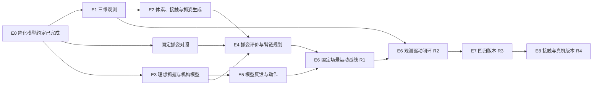

# 油箱盖项目：需求、工程计划与进度

本文行数：800行，预期阅读时长：57分钟

本项目采用双臂：左臂安装相机，负责观察油箱口；右臂负责抓握、旋拧、完全取下油箱盖并持续持住。两臂由中间的 T 型架固定。当前旋拧仿真采用 AUBO i10 和 RH56DFX 右手，先完成仿真，再接真机。

本文维护当前需求、参数、工程计划和开发进度。具体操作见各工具说明；实验数据保存在 `artifacts/`。

## 任务要求

| 项目 | 约定 |
| --- | --- |
| 初始状态 | 油箱门已打开，盖体初始松紧程度对执行器未知；仿真通过初始剩余啮合行程设置工况 |
| 完成状态 | 盖体完全脱离油箱口，由手持续持住 |
| 设备分工 | 左臂携带相机，右臂负责旋拧，两臂由中间的 T 型架固定 |
| 旋拧臂模型装配链 | AUBO i10 → 传感器 → adapter → RH56DFX 右手；实际右臂安装和工具变换仍需核对 |
| 双臂动作顺序 | 左臂移到油箱口正前方，停稳采集后让位；确认左臂让位并停稳，再由右臂接近和旋拧 |
| 动作分工 | 每段内保持经验证的抓握，由机械臂旋转；不强制固定三指组合 |
| 旋松方向 | 从手侧正对盖体看，逆时针；盖体系外向 +Z 的正转角 |
| 参考转角 | 最紧状态下约 225°（0.625 圈）；螺纹退出啮合后还需轴向拔出，实际阶段切换由反馈决定 |
| 重新抓握 | 一段结束后，确认机构仍可靠支撑盖体，才松手、退开、重新观察和抓握 |
| 失败处理 | 停止并等待人工，保持已有抓握，不自动重试或释放 |
| 当前范围 | 旋松、取下、持盖；不做装回、放置、开关门或加油，全程无液体 |

盖体松手后不会自行回转，这是用户提供的机构说明。轴向支撑状态仍需要执行反馈确认。

## 双臂分工与坐标传递

用户确认，原有两批 AUBO 资料来自左侧拍照臂的控制盒。该控制盒地址为 `192.168.1.32`；已有 DH、负载、重力、TCP、力传感器读数和状态验证均属于左臂。近期相机配对观测和状态桥联机记录也使用此地址，不能作为右臂参数或右臂反馈。

用户于 2026 年 11 月 2 日确认 `192.168.1.253` 为右臂控制盒；左臂为 `192.168.1.32`。两台均返回 `aubo_i10_JY`、`rob1`、非仿真模式。右臂 TCP 偏移为 `[0.004, 0.0153, 0.5038, 0, 0, -0.044]`（平移 m、姿态保留 SDK 原值）；左臂 TCP 偏移为零。历史发现记录见[双臂设备发现记录](../artifacts/hardware/aubo_dual_arm_discovery_20261026T073239Z/README.md)，其中右臂 `PowerOff` 为当时状态；本次只读查询右臂为 `Running`、`Normal` 且静止。两台的 `rob1` 和 RTDE `R1` 都是各控制盒内部标识，设备侧别按控制盒 IP 绑定。

左臂的相机到法兰标定继续使用。用户已提供并确认左臂基座在右臂基座中的六维位姿、姿态约定及基座原点与安装面的对应，见[双臂与 T 型架安装参数](#双臂与-t-型架安装参数)。该位姿定义 `right_base_from_left_base`，将左臂基座坐标转换到右臂基座。T 型架用于固定相对安装，模型装配参数与实物精度复核分别记录。

统一以 `A_from_B` 表示将 B 系坐标映射到 A 系。双臂观测传递为：

```text
left_base_from_cap = left_base_from_left_flange_at_capture @ left_flange_from_camera @ camera_from_cap
right_base_from_cap = right_base_from_left_base @ left_base_from_cap
```

其中左臂法兰位姿必须使用采集时的记录。左臂让位后，只要盖体、场景和双臂安装保持不变，就可继续使用该次观测；不能改用让位后的左臂法兰位姿重新解释旧点云。观测文件中的 `base_from_flange` 和基座系候选仍指左臂基座；双臂场景生成器已沿安装链将候选和地图一起转换到规划世界系。

流程按顺序交接：右臂保持等待 → 左臂到观察位并停稳采集 → 保存观测与左臂位姿 → 左臂让位并确认停稳 → 使用右臂自身实时状态规划接近 → 右臂抓握、旋拧、取下并持盖。需要重新观察时，由任务层先安排两臂姿态再采集。观察位、让位位姿和路径仍需确定；规划场景要覆盖另一机械臂、相机、T 型架及现场障碍。

双臂与 T 型架模型已接入实测 MTC，安装查看器见[双臂和 T 型架查看](../src/i10_rh56_moveit_config/README.md#双臂和-t-型架查看)，实际规划场景与轨迹使用[RViz 入口](point_cloud_voxelization.md#实测场景接入-mtc)。现有单臂仿真和规划工具继续用于旋拧算法验证。接真机前需分别绑定两臂控制盒、模型和状态来源，补齐右臂配置、工具安装复核、相机几何及让位交接反馈。

## 当前优先：人工点云与裸法兰规划

右臂当前为裸法兰，没有安装 RH56、外接传感器或转接板。现场接近使用独立裸法兰入口，完成盖体几何估计、双臂坐标转换、无接触规划与 RViz 预览；裸法兰不能执行手根抓姿或手指控制。

RH56 是必须保留的条件。当前离线验证优先人工确认握梁顶面中心、握梁长轴和朝外法向，复用已有固定相对抓姿与 650 接近预型，先检查真实场景中的适用性；本阶段不要求完全自动定位。标注允许人工修正，原点与坐标不能混用内部模型中心；保留 0°/180° 两方向检查。操作与结果见[人工参考与固定抓姿](manual_cap_reference.md)。现有 SpaHybGen 接口和实验保留为对照；用户确认双侧占据后已授权阈值0.1的一批离线候选，设置见本文“几何规划与局部实验设置”。任务程序默认生成入口尚未切换。

当前已把用户以前确认的整手相对抓姿复用到634610点的多视角场景，完成[一组静态参考抓姿](../tools/artifacts/cap_single_reference_20261111_001/index.html)。手根微移0.85mm、转动0.45°后，拇指/食指/中指到单列人工假设侧面的距离为0.96/0.96/0.69mm，朝向偏差18.54°/0.58°/1.48°；完整实测场景、自碰及已接受假设面均无超出0.1mm容差的侵入。结果已独立复核，修正另存，原固定抓姿配置只读。原650预张开构型仍有轻微环境侵入，当前下一步是检查并修正接近与闭合过程，再验证接触和抓稳。

此前单次采集的初始六点标注已获用户确认，原始点号、顶面中心、三轴与相对抓姿另存[确认版本与接近复核](../tools/artifacts/cap_manual_reference_confirmed_001/index.html)。该旧场景中0°抓姿从外退0.100m接近的101个位置未检出原始点侵入，1mm表面格的末端预警经0.25mm运动加密后排除；这不是当前多视角场景的接近结果。旧采集未配对机器人状态，只在原生相机系表达。

本模式使用独立的 `dual_arm_bare_flange` 模型，右臂链末端为 `wrist3_Link`；左臂、已有左臂工具、T 型架和观测环境继续参与碰撞检查。法兰目标由用户显式提供的 `cap_from_flange` 定义，平移为米，旋转为固定轴 XYZ RPY 弧度；预接近位沿盖体外向 +Z 再外退指定距离。法兰不能直接使用 RH56 的手根目标，也不套用控制柜保存的历史 TCP 偏移。当前模式只生成几何路径，实际抓握、轨迹时间参数化和真机轨迹执行仍需后续接入。

输入点云保持 SDK 原生相机系与毫米单位，裁出的整盖必须是同一次采集的原始子集，并携带采集时的左臂前后状态和外参。环境使用同次采集的完整场景或人工清理后的子集，不只加载盖体。抓姿准备的几何表面体素、网络输入与优化坐标间距统一为 **0.001 m（1 mm）**；几何表面按原始观测点保存稀疏占据格，未观测格保持未知。局部网络范围与预训练尺度适配见[油箱盖离线迁移](#油箱盖离线迁移)，历史规划场景不改写。路径复核沿用关节 0.002 rad、几何估计位移 0.001 m。右臂起点和法兰相对盖体位姿每次显式输入，不能将左臂拍照状态作为右臂起点。

用户可在拍照后手动移动左臂让位。点云继续使用采集时的左法兰位姿转换；规划通过 `--left-state` 单独读取让位后停稳的左臂 SDK 快照，以该姿态固定左臂并检查右臂路径。未提供该选项时沿用采集姿态。场景、盖体和基座安装须保持不变；让位过程的路径与执行由当前操作方负责，本入口只规划让位后的右臂。

已实现独立模型、人工整盖到法兰目标的请求准备及规划/RViz 接口。裸法兰模型已同步当前单刚体左工具及已确认的安装变换，并完成 ROS 安装同步。使用 10 月 28 日归档点云、原离线右臂起点及示例法兰目标，左臂保持拍照姿态时已通过预抓取规划、全模型加密碰撞和末态检查。`cap_roi_004` 保存的左臂姿态也已通过离线模型检查，未报告自碰撞；此前约 5.7 mm 的臂体碰撞报告仅对应 11 月 4 日的另一份归档姿态，不能据此判断当前实物相交。结果见[模型同步与规划复核](../artifacts/planning/bare_flange_sync_20261106_001/README.md)及[ROI 采集姿态复核](../artifacts/planning/bare_flange_sync_20261106_001/roi_004_saved_pose/summary.json)。下一步先人工确认本次握梁参考，得到可核对的盖体位姿；自动盖面与握梁分层留待后续。操作入口见[人工点云与裸法兰规划](manual_flange_planning.md)。后续完整取盖任务仍使用下述臂手和接触流程。

## 当前简化仿真约定

当前版本先验证臂手运动、螺纹运动和任务流程。抓握成功后建立手与盖体的固定相对关系，假设不打滑、不掉落；螺纹脱开、机构支撑和持盖反馈可来自明确标注的模型状态。仍需检查关节限位、可达性、碰撞、累计运动和阶段衔接。

固定抓姿、螺纹占位参数和拔出距离已确定，E0 的本阶段设计约定已齐备。执行配置接入、模型实现和回归验证属于后续开发任务。运行速度、观察时长和数值容差由实现阶段配置，正式回归前固定。

抓持承载、摩擦与阻力辨识、柔顺控制、传感器脱开判据及设备能力核对在后续接触与真机阶段完成；当前仿真可使用已有模型的数值属性运行，实际物理参数继续保持其原有确认状态。

## 螺纹运动与拔出参数

盖体采用螺纹连接，旋松后仍需沿盖轴向外拔出。当前先采用用户指定的轴向随动占位值：

| 项目 | 当前约定 | 来源与用途 |
| --- | --- | --- |
| 旋转—轴向关系 | 旋松方向每转 90°，沿盖体外向 +Z 移动 1 mm | 用户指定的仿真假设 |
| 等效导程 | 4 mm/圈，即 `thread_lead_m_per_turn=0.004` m/圈 | 由上述关系换算，实物导程仍待核对 |
| 旋拧阶段轴向增量 | `delta_z_m = 0.004 * delta_angle_deg / 360` | 在螺纹啮合阶段使用，角度与位移采用同一参考起点 |
| 最紧标称啮合行程 | 2.5 mm，即 0.0025 m，对应占位导程下继续旋松 225° | 用户接受的仿真假设，实物仍待核对 |
| 初始剩余啮合行程 | `e0_m` 在 `[0, 0.0025]` m 内，场景初始化时设置 | 最紧取上限，较松取更小值；0 表示螺纹已脱开但盖体尚未拔出 |
| 旋松后的动作 | 保持抓握，沿盖轴向外拔出，再确认已离开开口 | 用户确认的工序 |
| 拔出距离 | 从螺纹脱开并停稳时的位置，沿盖体外向 +Z 再移动 0.100 m | 用户指定的仿真占位值；不含此前啮合阶段的轴向位移 |

较松初态按剩余啮合行程计算，不要求每次从首次抓稳起点旋转 225°。啮合阶段的仿真关系为：

```text
e_remaining_m = max(0, e0_m - 0.004 * delta_cap_angle_deg / 360)
remaining_rotation_deg = 360 * e0_m / 0.004
```

`delta_cap_angle_deg` 为相对场景初始化时刻的累计实际盖角，与 `e0_m` 使用同一参考起点；模型余量跨重新抓握连续保留。任务接口的 `MotionProgress` 另以首次抓稳为参考，接近或闭合期间若盖体已运动，需保留两者的参考偏置。模型依据盖体实际运动消耗啮合余量，余量归零时解除螺纹耦合；0 初态从开始即无螺纹耦合。初始化较松场景时，盖体相对最紧基准的轴向位置和绕轴朝向也按导程一致地设置。

| 初始工况示例 | 初始剩余啮合行程 | 继续旋松到螺纹脱开所需转角 |
| --- | --- | --- |
| 最紧 | 2.5 mm | 225° |
| 较松示例 | 1.0 mm | 90° |
| 接近脱开示例 | 0.5 mm | 45° |

场景中的 `e0_m` 用于模型初始化与独立评价，执行器不要求预先知道它。当前 E5 使用明确标注的模型状态反馈切换阶段，真实观测与力反馈判据在后续接触与真机阶段实现。

螺纹退出啮合后，保持抓握并按上述拔出距离完成轴向退出。该拔出距离与重新抓握前手部外退的 0.100 m 分属两段动作，参数分别管理。螺纹脱开后尚未拔出时的支撑状态继续待核对。

E3 仿真后端接入时显式配置上述占位导程、最紧标称行程、场景初态及拔出距离；通用 `TaskParameters` 的未知物理参数默认值继续保持 `None`，由调用方区分仿真假设与实物参数。当前预览模型仍只有旋转自由度，轴向耦合与拔出执行尚待实现。

## 当前进度

当前实测 MTC 默认使用 `dual_arm/robot.urdf`、`robot.srdf` 和对应 KDL 配置，右臂用 `arm` 组，左臂及 T 型架参与整机碰撞。地图与候选一起按 `world_from_right_base @ right_base_from_left_base @ left_base_from_camera_at_capture` 转入双臂世界系，不复用单臂临时对齐。当前采用 10 月 28 日装回油枪后的过滤点云，盖体参考中心约为 `[-0.3105028,-1.1251944,0.8576473]` m。右臂默认起点见[右臂初始关节角](#右臂初始关节角)；左臂固定为该次采集前记录的 `[1.09037213774,-0.710088017536,2.12567985878,-1.1991929404,-0.953951769865,-1.18109972982]` rad，尚未指定让位姿态。新场景与结果在 [28 日点云离线更新](../artifacts/perception/observed_scene_update_20261029_001/README.md)，两个方向均完成仅到预抓取位的规划和核对。原 26 日场景及完整接近结果保留为历史基线，其结论不用于新场景。左臂全路径保持不动，模型 FK 与采集法兰位姿一致；这用于核对坐标与关节顺序，不代表实物定位精度。相机、油枪及安装件外形仍待用户提供，本阶段仅离线验证。

实测 MTC 使用 `config/active_point_cloud_scene.json` 的 `collision_scene.mtc_manifest`，当前与 `config/point_cloud_scene_20261028.json` 一致；`source_split_manifest` 绑定新观测的相机系拆分数据，`single_arm_mtc_manifest` 保留旧单臂基线。环境 OctoMap 和独立 `fuel_cap` 在同一份 PlanningScene 中替换旧油箱、门板、盖体，保留地面与完整模型。预抓取外退距离为 0.100 m，手采用 650 预型。路径复核限制关节插值步长 0.002 rad、相邻状态几何估计位移 0.001 m，并检查全模型；这是加密离散检查，不是连续碰撞证明。仅保留原安装接口及架子与地面的固定支撑接触例外；右臂与左臂、架子、盖体和环境的碰撞均正常检查。模型、场景摘要和坐标类型绑定，拒绝将双臂世界坐标用于旧单臂模型。碰撞对照、规划和 RViz 共用加载函数，原单臂归档与入口保留。

RViz 双臂查看采用 20 帧/秒，默认启用 `Move Camera` 工具和轨迹循环播放：左键拖动旋转、鼠标中键拖动平移、滚轮缩放。静态完整场景在新查看器连接时发送一次，避免反复重建全部占据格和盖体 box；这也兼容 RViz 的 volatile 订阅。轻量轨迹消息在有订阅者时每 5 秒补发，切换显示后可继续收到；场景服务在发布时段内继续响应。

接近规划通过 `approach.launch.py stop_at:=pregrasp` 选择仅到预抓取位：终点仍为抓取位沿盖轴外退 0.100 m 的手根位姿，只规划 `move to pregrasp`，不添加 `axial approach`。默认 `stop_at:=grasp` 保留完整接近。两种模式均检查整条路径的全模型碰撞、限位和各自终点；预抓取结果标记为 `mtc_geometric_pregrasp_not_execution`，由同一个实测 RViz 入口回放，不作为已到抓取位的结果。两种模式当前都只生成几何路径；时间参数、真机执行和到位停止反馈仍待接入。

仅到预抓取位的模式已核对独立 FK、模拟实时起点及实际 RViz 显示消息；模式回归保存在[26 日观测预抓取验证](../artifacts/planning/dual_arm_pregrasp_20261029_001/README.md)。当前新场景的两个方向预抓取路径及显示消息另存于[28 日点云离线更新](../artifacts/perception/observed_scene_update_20261029_001/README.md)，左臂保持新采集姿态。

| 模块 | 已有能力 | 接下来要做 |
| --- | --- | --- |
| 感知 | 本机微调 Grounding DINO 定位、SAM 2 分割、仿真 RGB-D、表面体素与真实 PCD 检查；官方 Linux SDK 单次采集、像素对齐与可选前后机器人状态已封装，自动掩膜已接入点云提取及离线回放 | 改善当前相机图像上的漏检，补连续状态监测、独立拍摄与定位精度评价 |
| 抓姿输入 | 已将观测、1 mm 几何体素、网络输入、接触预测、RH56 优化及筛选接口接入状态机；保存 SDK 观测可离线生成体素与原始候选，旧固定入口保留 | 接入实测候选的独立几何筛选、MTC 请求、手部执行映射及独立盖轴 |
| 运动规划 | 双臂和 T 型架已接入 MTC；28 日新点云的两个方向均到预抓取位，左臂保持新拍照姿态 | 补相机、油枪及安装件外形，确定左臂让位姿态；在新场景验证最后接近，再加入旋拧与持盖退出评价 |
| 执行 | 固定夹具闭合实验；执行接口和模拟反馈 | 理想抓握连接、螺纹轴向耦合、模型脱开反馈与拔出执行 |
| 任务流程 | 提前脱离、支撑检查、条件重新抓握、累计进度、异常停止 | 接实际感知、规划和仿真执行后端 |
| 真机 | 左右臂控制盒 IP 已由用户确认；左臂 SDK 0.23.1 已读通 RPC/RTDE，右臂第 6 关节 +5° 的 SDK 单次运动及到位反馈已验证；历史模型计算与状态桥验证已保存 | 复核实物安装链、相机几何和让位交接，再接完整轨迹、取消与停止反馈 |

目前能运行二维定位与分割、观测点云重建、表面体素化、几何规划和软件流程演示。理想抓握下的完整取盖流程尚待接通。

### 近期真机目标

近期先完成左臂末端相机观测油箱盖并让位，将观测转换到右臂规划坐标系，由 MoveIt 规划右臂并通过其 AUBO 控制盒到预抓取位停止；抓握与旋拧留待后续。代码运行在上位机，通过网络分别连接两臂控制柜。以下既有配置与联机验证结果来自左臂；右臂接入前需完成自身核对，见[双臂分工与坐标传递](#双臂分工与坐标传递)。

用户已确认通过网线成功连接机械臂。下述长序列 RPC/RTDE 数值来自已保存的采集；常规点云采集动作可另存当次左臂前后 RPC 状态，已完成本机联机验证。

AUBO SDK `0.23.1` Linux x86_64 开发包位于 `tools/sdk/aubo_sdk-0.23.1-Linux_x86_64+71831e1/`，版本与现场照片显示的 SDK 版本号相同。控制柜 IP `192.168.1.32`、RPC 端口 `30004` 已连通；随包示例的默认 RPC 认证参数 `aubo` / `123456` 已验证可用，无需另行申请账户。已读取机器人 `rob1` 的六个有限关节角、TCP/法兰位姿和运行状态，相关只读接口已验证；右臂运动接口的验证见[右臂 SDK 单轴验证](#右臂-sdk-单轴验证)。

左臂控制器返回型号 `aubo_i10_JY`、仿真开关 `false`；本次查询时为 Running、Normal、静止。读取到的左臂 TCP 偏移六项均为零，TCP 位姿与法兰位姿相同；右臂实际手部工具点仍待核对，不能沿用左臂的零偏移。用户已提供并确认左臂相机到法兰变换，参数见[末端相机外参](#末端相机外参)。

只读工具 `tools/aubo_sdk_probe/` 已通过本地编译、链接和客户端初始化，动态库依赖齐全；默认离线，在线模式显式提供 IP，使用随包示例的默认 RPC 认证参数。认证参数经现场修改时，可覆盖用户名并在终端隐藏输入密码。命令见[只读检查说明](../tools/aubo_sdk_probe/README.md)。本包提供 `servoJoint` 与路径缓存/`movePathBuffer`，没有声明较新文档中的 `trackJoint`，后续适配以本地头文件和控制器支持为准。

已核对官方 ROS2 硬件驱动所用的 26 个主要 SDK 符号，本地 0.23.1 可编译并链接这些接口。官方驱动构建配置目前默认下载 0.24.1-rc.3，接入时需调整开发包选择；完整驱动构建、驱动内的 RTDE 接入与轨迹执行仍待验证。独立采集工具的 RTDE 已读通。源码依据与仅引用符号的检查工具见上述说明。厂家开发包保留在本机，Git 中保存[下载入口和逐文件校验摘要](../tools/sdk/README.md)，不提交共享库和调试库。

已完成两批只读采集：第一批 71 项 RPC 查询、785 帧 RTDE，第二批 73 项查询、779 帧 RTDE；RPC 均成功，RTDE 解析异常均为零。每批请求 50 Hz、15 秒，主机收包统计约 52.44 Hz 与 52.02 Hz，不将其解释为控制周期或无丢包证明。原始记录、CSV、质量统计、源码/URDF 快照与压缩包入口见[真机查询与资料采集](hardware/aubo_sdk_connection.md#本次保存的资料)。

本次读取的控制器版本码为 `29004`、接口版本码 `23001`、版本 hash `02301bb`，控制周期为 `0.005 s`。控制器负载配置为 `8 kg`、重心 `[0, -0.06, 0.24] m`，重力配置为 `[-0.1052734378, 9.7992055571, -0.0669921910]`；这些是控制器配置，实际装配参数仍需独立核对。控制器报告 TCP 力传感器 `kw_ftsensor`，原始 TCP 传感器读数为六个零、关节力矩传感器接口为空；TCP 力值不能直接作为已完成重力补偿的接触力。

已保存 DH 理论/实际参数、20℃补偿查询与关节/TCP 限位。理论和实际 DH 相同，补偿查询为空，尚未取得有效的独立校准补偿。13 组假设关节构型的控制器正运动学计算，与本地 `aubo_i10_JY.urdf` 在数值舍入范围内一致，最大位置差约 `5.61e-16 m`；它验证了模型计算与数组顺序，不是实物精度试验。SDK 坐标变换探针与固定轴 XYZ 的 RPY（`Rz Ry Rx`）一致，最大矩阵元素差约 `2.33e-15`，本次六维位姿按该约定转换。

两批 RTDE 的控制器时间戳均经当前 SDK 解析为非有限值并保存为 `null`，不能用于相机时钟对齐；主机收包时间完整保留。数据包含近静止状态与纯计算探针，没有采集多姿态相机标定观测，也未发送运动或改写控制器配置。

已实现六轴 RTDE → ROS `/joint_states` → MoveIt 状态读取，以及接近规划显式选择当前臂起点；启动与验证见[状态桥说明](../src/aubo_joint_state_bridge/README.md)。本地构建、数据校验和历史状态回放到 MoveIt 的检查已通过，MTC 已验证从接收到的臂状态开始。静止状态下的 RTDE→ROS 诊断话题已联机验证，收到 617 帧，消息接收约 52.2 Hz，角度与 RPC 一致；记录见 `artifacts/hardware/aubo_live_state_20261026T063552Z/`。MoveIt 实时读取、示教移动跟随和断流行为仍待现场验证。下一步核对实物模型、实际工具点和状态桥，再接整条轨迹执行及停止反馈。已有规划仍为几何路径，真机入口需要补执行时间，并在预抓取位结束。

实时状态桥采用独立 ROS 2 包 `aubo_joint_state_bridge`：只订阅 RTDE 输出 `R1_actual_q` 和可用的 `R1_actual_qd`，按 SDK 顺序映射到 `shoulder_joint`、`upperArm_joint`、`foreArm_joint`、`wrist1_joint`、`wrist2_joint`、`wrist3_joint`，位置保持 rad、速度保持 rad/s，不改符号、零点或绕数。默认请求 50 Hz，首帧等待上限 3 s，有效帧间隔上限 0.5 s；只有新有效帧才发布。消息时间为上位机接收时的 ROS 系统时间，不作为控制器采样时间或相机曝光时间。启动必须显式提供控制柜地址；无效帧、断流或连接失败时退出，不自动重连。

离线验证使用采集器格式的 JSONL 回放，话题与真机 `/joint_states` 分开，明确注明历史数据。MoveIt 只接收六轴实测状态，不补造手指反馈；`approach.launch.py start_source:=joint_states` 显式使用当前臂起点，手部预型与环境仍使用请求中的模型假设。默认 `start_source:=request` 保留离线入口，已选构型与重新抓握入口仍使用原请求起点。离线跨进程验证采用本机已安装的 CycloneDDS，中间件使用限制见状态桥说明。

近期真机所需工作按以下顺序推进；完整取盖计划继续保留在后文。

1. 使用已验证的[采集动作](#点云采集动作封装)获取新的目标观测，并补连续状态监测。按[停稳采集约定](#停稳采集与机器人位姿记录)，在机器人保持观察姿态期间采集点云，并保存采集前后的关节角、基座到法兰变换及主机时间。已有相机到法兰标定可直接用于坐标转换；历史 PCD 的采集位姿仍未知，只有确认当时姿态及安装关系一致时才可使用相应变换。
2. 使用已确认的两臂基座固定变换，生成右臂基座系预抓取目标。通过现成的 SDK 像素映射用图像掩膜选择盖体点，按左臂外参和采集姿态恢复盖体，再转换到右臂基座，结合右臂实际法兰到工具变换和显式预抓取距离计算完整六维目标。
3. 分别复核两臂实时状态并接入真实场景。读取右臂自身配置，核对各臂模型、发布频率、关节值及断流行为；补齐两臂、相机、T 型架、工具、安装件与现场油箱/门板等碰撞几何，局部盖体点云未覆盖的空间保持未知。先确定左臂观察位、让位位姿和交接反馈，再允许右臂接近。
4. 分别打通 MoveIt 到两臂 SDK 的执行。先适配现成驱动；将几何路径补上时间参数，接通整条轨迹、反馈、取消、超时和停止处理。左臂执行观察与让位，右臂从自身当前状态接近；真机首版使用仅到预抓取位的规划模式，到位停止反馈由后续执行层接入。
5. 完成实物复核和小范围到位试验。核对工具安装、外参精度、保守速度及到位误差；先验证状态、坐标与空旷区域运动，再执行观测目标。当前不要求手指抓取、力控或旋拧。

## 工程计划

工程目标是由观测定位整盖，经局部体素、SpaHybGen 接触预测和 RH56 优化生成抓姿，筛选机械臂构型和路径，接近并抓稳，通过反馈旋松、完全取下并持续持盖。先交付可重复的仿真系统，再交付真机系统。

E2 主流程改为生成抓姿准备，已有固定抓姿保留为显式对照基线，参数见[手动候选](#手动候选)。生成分支不要求先定义握梁坐标系，旋拧仍需独立有效盖轴。准备失败时停止，不自动改用固定抓姿。已有固定候选与 MTC 适配保持可用，生成候选的规划与实际执行继续接入。

当前仿真验收采用[理想抓握约定](#当前简化仿真约定)，完成后再开展接触可靠性和真机验证。

### 交付里程碑

| 里程碑 | 交付内容 | 完成条件 |
| --- | --- | --- |
| R1 固定场景运动基线 | 已知盖体位姿、固定抓姿和理想抓握连接，完整执行接近、抓握、旋拧、取出和持盖 | 从初始化运行到结束；运动满足模型约束，阶段反馈明确标注来源 |
| R2 观测驱动取盖仿真 | 整盖观测 → 体素 → 接触预测 → RH56 候选 → 完整臂链评价 → 路径与局部执行 | 根据新观测生成抓姿和臂构型，完成取盖；失败时返回具体原因并停止 |
| R3 多场景仿真版本 | 固定配置、场景集合、基线对照、异常回归和可复现运行入口 | 达到冻结的成功率与失败行为指标，能在记录的环境中复现 |
| R4 接触验证与真机版本 | 补齐接触可靠性、物理参数、实际反馈判据、标定与设备适配，再重复取盖 | 在声明的场景和初始条件内达到真机验收指标，结果和配置完整保存 |

R1 保留固定抓姿验证机构运动和任务流程；R2 接入观测生成抓姿，固定入口用于对照。接触可靠性和真机交付在 R4 完成。

### 阶段与依赖

当前按以下功能依赖推进。E3 的首个可运行版本形成后，再按实际实现范围估算剩余工期；接触验证、设备等待、加工和额外数据采集单独安排。

| 阶段 | 工程工作 | 必要依赖 | 当前情况 |
| --- | --- | --- | --- |
| E0 | 明确简化模型、输入反馈、流程与检查范围 | 本文现有约定 | 当前简化仿真约定已完成 |
| E1 | 盖体三维位姿、场景与观测适配 | E0 中的观测约定 | 已有二维、点云和表面体素 |
| E2 | 体素、接触预测、RH56 生成与筛选适配；固定抓姿对照 | E1 观测、独立手模型与权重 | 准备状态及保存 SDK 后端已接通；实测几何筛选和生成候选到 MTC 的适配待完成 |
| E3 | 理想抓握、螺纹耦合、脱开与运动执行模型 | E0 | 当前为预览模型、固定夹具闭合 |
| E4 | 候选几何可行性和完整运动规划 | E2、E3 | 已有固定候选几何规划；自动候选待接入 |
| E5 | 基于模型状态的阶段反馈与动作执行 | E3、E4 | 当前只有 mock 阶段反馈 |
| E6 | 状态机与仿真后端集成 | 基线需 E2/E3/E4/E5；观测驱动版本另需 E1 | 已有状态机、mock 和离线路径 |
| E7 | 多场景回归、基线对照与版本交付 | E6 观测驱动版本 | 尚无完整闭环回归 |
| E8 | 接触验证、设备核对、标定与真机实验 | E7；独立设备资料核对可提前 | 模型、照片和部分 SDK 资料可用 |



当前先核对保存 SDK 观测的一毫米几何格及网络输入，再改善 E2 自动候选的几何可行性并接 E4。E3 机构模型和物理执行按各阶段继续完成，不能将离线准备状态作为完整取盖结果。

### E0：简化仿真约定已完成

- [x] **E0.1 模型约定。** 固定相对抓姿，抓握后采用可靠固定连接；螺纹导程、最紧行程、较松初态范围及拔出距离采用[机构参数](#螺纹运动与拔出参数)。
- [x] **E0.2 输入与反馈来源。** R1 使用已知位姿，R2 接仿真 RGB-D 的位姿估计；抓握、啮合、支撑和持盖可使用标明来源的模型状态。真实设备接口和传感器判据归入 E8。
- [x] **E0.3 流程与控制分工。** 接近、抓握连接、旋拧、脱开、拔出和持盖的顺序已明确；条件重新抓握保留，松手需模型明确报告机构支撑，未知则停止。参数配置接入和后端实现分别在 E2/E3/E5 完成。
- [x] **E0.4 当前检查范围。** 检查可达性、关节限位、碰撞、螺纹运动关系、提前脱开、拔出距离及状态机衔接；工程数值设置与试运行指标在实现、回归阶段配置和固定。

**交付：** 本文中的简化模型、参数、输入反馈来源和流程约定，已足够开始本阶段实现。

**完成范围：** 当前简化仿真的设计前置条件已齐备。模型与接口尚待实现，接触可靠性和真机参数在 E8 验证。

### E1：输出规划可用的观测

- [ ] **E1.1 统一观测。** 将同一停稳观测的 RGB、原始点云、SDK 标定与像素映射、机器人状态和时间信息适配到同一观测记录；保留原始点号和像素对应。

  同事已完成 SDK 点云到 RGB 的逐点投影、离线复现和掩膜选点；本机真实样本回放已通过，见[RGB 与点云像素对应](#rgb-与点云像素对应)。官方 Linux SDK 采集、校验、像素对齐与可选前后 RPC 状态已接成统一动作，支持终端和 Python 调用，本机真实采集已验证。自动定位与分割已接入该动作，当前相机图像试跑为未检出；后续改善漏检、接连续状态监测并复核实物精度。
- [ ] **E1.2 估计盖体位姿。** 从掩膜选择有效三维点，拟合盖体范围、旋转轴及握梁朝向，输出基座系 `CapEstimate`。处理 180° 对称、遮挡和深度缺失；条件不足时返回无效。 已实现人工整盖裁剪后的相机系离线几何基线，保存两个方向候选和模型参考中心；SDK 原生 XYZ 的停稳观测绑定及左臂基座系换算已接入；多视角一致性和现场精度仍待完成，见[盖体几何估计](cap_geometry.md)。
- [ ] **E1.3 建立规划场景。** 保留凹槽、门板与周边障碍，过滤机器人自身，保存未知区域与观测来源；记录场景版本和采集时刻，供规划与执行核对。
- [ ] **E1.4 评价定位。** 增加远景、有盖/无盖、遮挡及新拍摄批次，按拍摄批次划分数据。固定独立测试集后报告漏检、误检、位姿误差、无效返回率和耗时；依据失败工况决定是否补数据或训练。

**交付：** 三维位姿入口、场景快照入口、离线观测样例与评价报告。拟新增 `cap_pose.py` 和观测适配模块，复用现有感知、反投影与体素代码。

**通过标准：** 观测具备来源、时间、单位、坐标和有效性，误差及有效覆盖率达到回归前固定的指标。估计流程使用传感输入；仿真真值仅用于独立评价。数据失效时不产生有效运动目标。

### E2：体素与自动抓姿准备，保留固定对照

- [x] **生成准备编排。** `observe → voxelize → infer_contacts → generate_grasps → select_grasp` 接入任务；各产物绑定同次观测、坐标与摘要。重新抓握重新运行全部阶段。
- [x] **保存 SDK 后端。** 从原生毫米点云和目标原点号生成 1 mm 稀疏几何格，单独构建预训练网络输入，接触预测与 RH56 优化复用现有实现；支持仅准备的独立终态。
- [ ] **实测候选筛选与执行适配。** 用完整臂链与实测障碍检查候选及预抓取路径，输出筛选证据和预抓取位姿；执行器确认手根变换、模型角映射和控制交接。

以下为保留的固定抓姿基线：

- [x] **E2.1 载入固定候选。** 使用[当前固定候选](../config/fixed_grasp.json)中的 `cap_from_hand`、`pregrasp_channels` 和 `grasp_channels`，参数统一见[手动候选](#手动候选)与[闭合指令](#闭合指令)。公共读取器完成格式、来源和运行版本检查，预览及 MTC 准备入口共用读取结果。
- [x] **E2.2 接入当前盖体位姿。** 模型位姿同步读取及异步接口已实现，输出带来源、时间与有效性的 `CapEstimate`；`GraspPreparation` 统一保存候选、观测、手根/法兰及接近目标，已接入预览、MTC 请求和回放复核。R1 使用模型位姿；R2 的 E1 输入须先显式转换到 `world`，重新抓握使用新观测。
- [ ] **E2.3 衔接规划与执行。** 规划采用一个固定手盖候选，仍允许搜索机械臂 IK 构型和绕数。请求分别携带接近预型与闭合目标；`GraspPreparation.task_parameters()` 已适配现有任务参数。E3 后端接入后，在到位及抓握阶段执行闭合、建立固定手盖关系并记录模型抓握状态。
- [ ] **E2.4 核对适配与变换。** 当前模型已核对基准、平移、整箱偏航、盖体自转和混合变化的目标及 IK，完成基准与混合场景的真实路径复核，并检查无效输入、目标误传和障碍导致的规划失败。E3 模型变化后仍需重新验证并保存适配后的候选记录，保留原实验和来源检查。

**交付：** 可从配置载入的固定抓姿输入、当前观测到规划目标的适配，以及基准/变更位姿的复核入口与结果。公共目标计算已通过 `GraspPreparation` 接入工具与 MTC；E1 观测适配及 E3 执行后端继续完成。

**通过标准：** 固定手盖关系随当前盖体位姿正确变换；固定抓姿不可达或发生干涉时返回失败。已有固定夹具三指接触结果保留；当前版本按理想抓握连接推进，实际承载与传矩在 E8 验证。

**自动抓姿下一步：** 准备接口已接入，继续实测候选的几何筛选与规划适配；不得仅凭网络得分或模型限位通过就执行。

### E3：建立理想抓握与机构运动仿真

- [ ] **E3.1 建立机构模型。** 按[机构参数](#螺纹运动与拔出参数)建立旋转—轴向耦合，支持不同初始剩余啮合行程；模型余量归零后解除螺纹耦合，允许轴向拔出。明确每个阶段的机构支撑状态，未知时返回未知。
- [ ] **E3.2 实现理想抓握。** 到达固定抓姿并进入抓握阶段后，将盖体固定到手上，保持给定相对关系；计划释放时解除连接。分别管理手盖连接与盖体机构约束，保留几何和碰撞检查。
- [ ] **E3.3 实现运动执行。** 跟踪已有规划轨迹，记录目标与实际关节、末端误差、饱和和停止响应。直接状态写入限定在初始化与几何检查。
- [ ] **E3.4 输出模型反馈。** 提供时间一致的关节、手盖位姿、抓握连接、剩余啮合、机构支撑和运动停止状态，标明模型来源；实现控制权交接与停止保持。

**交付：** 独立执行场景生成器、仿真执行配置、臂手控制后端和原始反馈记录。拟新增执行场景工具及 `sim_execution.py`，复用现有模型来源和接口。

**通过标准：** 手盖连接与机构约束正确切换，运动满足占位导程；脱开后可拔出并保持固定抓握；轨迹和停止行为符合所选执行方式，重置可复现，同一关节组只有一个控制方。几何回放与执行器跟踪分别注明实现方式。

### E4：评价固定抓姿并规划完整臂链

- [ ] **E4.1 检查固定抓姿几何。** 核对手盖相对位姿、手部预型与闭合后的几何，区分预期抓取接触和不允许的干涉，检查安装件及环境碰撞。
- [ ] **E4.2 评价完整臂链。** 检查可达、关节限位、自碰和环境碰撞，比较可转范围与方向可操作度。使用实际路径末态评价后续旋拧，并计入执行停止余量。
- [ ] **E4.3 输出阶段运动方案。** 规划接近、外退、调整和再次接近；取出阶段包含盖体随手运动的几何和碰撞检查。接触阶段轨迹依据机构轴向关系生成，交由局部执行器跟踪。
- [ ] **E4.4 支持在线更新。** 路径绑定观测与场景版本。发生重新观察、盖体运动或障碍变化时更新并复核；重新抓握保留同一起点的累计盖角。

**交付：** 固定抓姿的几何可行性报告、机械臂构型选择器和带阶段范围的运动方案，扩展现有构型筛选、MTC 与路径复核模块。

**通过标准：** 在基准场景找到满足关节、碰撞和运动约束的方案，实际路径末态和阶段衔接一致；无方案时保存具体拒绝原因。

### E5：实现模型反馈与阶段动作

- [ ] **E5.1 抓握反馈。** 建立固定手盖连接后返回理想抓握成立，反馈明确注明模型假设；连接未建立或输入无效时停止。
- [ ] **E5.2 旋拧动作。** 根据占位导程与连续臂构型执行绕轴旋转和轴向随动，处理本段行程边界及停稳交接。
- [ ] **E5.3 运动与脱开反馈。** 从模型读取实际盖角、轴向进度及螺纹耦合状态，支持未知初始松紧下提前脱开。转角命令发出后仍需读取模型状态，反馈未知或矛盾时停止。
- [ ] **E5.4 支撑与重新抓握。** 保持抓握读取模型的机构支撑状态，明确允许释放后才解除手盖连接、外退、重新观察并抓握。螺纹已脱开时保持抓握转入取出，支撑未知时停止。
- [ ] **E5.5 取出与持续持盖。** 确认螺纹退出啮合并停稳后保持抓握，从当前位置按[拔出占位距离](#螺纹运动与拔出参数)沿盖轴向外移动，执行含盖体的退出方案并确认离开开口，再观察持盖状态；阶段结束后保持控制仍有效。

**交付：** 基于模型状态的动作执行器、来源明确的阶段回执，接入 `execution_contract.py`。

**通过标准：** 正常旋拧、较松初态提前脱开、拔出和持盖能够完成；路径失败、无效反馈及未知支撑时能够停止。R1/R2 当前均可使用模型阶段反馈，真实传感器判据在 E8 实现。

### E6：交付可运行的完整仿真任务

- [ ] **E6.1 串联人工抓姿流程。** 用已知位姿和人工候选串联接近、停稳交接、闭合、旋拧、脱离、取出与持盖。
- [ ] **E6.2 接入重新抓握。** 演示段末支撑确认、释放、外退、重新估计和再次抓握；遇到提前脱离直接取出。核对累计进度、实际构型和场景更新，完成人工抓姿基线 R1。
- [ ] **E6.3 接入观测输入。** 已完成准备状态和保存观测后端；继续用 E1 新观测重建体素、生成并筛选 E2 候选，重算 E4 方案并接执行器，交付 R2。
- [ ] **E6.4 完善运行入口。** 明确 `mock` 与仿真后端，提供初始化、单次执行、取消和人工重置入口；记录模型、观测、候选、规划、控制配置、事件和最终结果，检查观测超时与进程失联。

**交付：** 可配置的完整任务入口、已知位姿基线与观测驱动模式，以及可重复运行的固定场景。

**通过标准：** 达到 R1/R2 试运行指标；任务结束条件来自实际反馈；任一阶段失败都进入停止等待人工。需要重新运行时先明确重置，失败路径不自动恢复或释放。

### E7：回归、对照和仿真交付

- [ ] **E7.1 固定试验集合。** 覆盖场景位置/朝向、初始剩余啮合、观测与标定误差。将设计上不可达的工况和运行中规划失败分别报告，保存全部试验的分母。
- [ ] **E7.2 做基线对照。** 使用同一固定抓姿，对照已知位姿与视觉估计、不同臂构型以及旋转空间筛选。使用同一批工况和重置条件，定位性能变化的来源；自动抓姿对照在后续升级时增加。
- [ ] **E7.3 故障回归。** 覆盖无盖、漏检、深度缺失、多候选、过期观测、无路径、提前脱开、未知支撑、取消及通信超时。打滑和受力卡滞的物理检测在 E8 验证，当前可注入故障回执检查停止分支。
- [ ] **E7.4 打包版本。** 保存运行配置、依赖与模型来源、批量入口和摘要报告；从约定环境重新初始化运行并核对结果。

**交付：** R3 仿真版本、全量试验表和基线报告。核心指标包括任务成功率、各阶段失败率、任务时长、轨迹误差、碰撞检查与停止行为。

**通过标准：** 达到冻结的回归指标，全部结果可追溯；任务失败与正确停止分别计数，正确停止仍属于未完成取盖。

### E8：接触验证、真机接入和重复实验

本阶段补齐质量惯量、摩擦与阻力、实际抓持承载与传矩、柔顺控制、力觉脱开/打滑/卡滞判据和设备接口。先在接触仿真中验证，再逐步接入设备；这些项目不再作为当前 E0 的前置要求。

- [ ] **E8.1 完成安装与标定。** 核实安装链、TCP、相机到基座变换、负载和力传感器零偏补偿；标定误差纳入观测与控制预算。
- [ ] **E8.2 适配实际设备。** 接入 i10、RH56、相机的指令和反馈，核对单位、关节顺序、时钟、周期和控制权，实测取消、通信超时及停止保持行为。
- [ ] **E8.3 分阶段验证。** 按空载轨迹、接近、闭合保持、小范围旋拧、轴向运动、脱离取出、条件重新抓握的顺序开展设备试验；每阶段使用该设备已核实的参数。
- [ ] **E8.4 重复评价。** 在声明的初态和场景集合上运行自动流程，保存全部成功、停止与失败结果，对照仿真误差并回修模型和参数。

**交付：** R4 真机配置、驱动与标定结果、完整任务入口、重复实验报告及操作说明。

**通过标准：** 设备能力、参数及标定齐备，实物持续持盖，达到冻结的真机指标。SDK、控制接口或相机能力不满足时先解决适配或设备方案，再恢复对应阶段。

### 拟定验收指标与参数状态

下表为试运行和后续交付的初始建议。当前简化仿真的运行数值与回归指标在 E3/E6/E7 中配置和固定；真实物理限值在 E8 核对。下面的次数和成功率不自动写入执行参数。

| 项目 | 建议指标或确定方法 |
| --- | --- |
| 单次成功 | 当前仿真中盖体按机构关系脱开，沿退出方案离开开口，理想抓握连接持续保持并完成观察；关节和碰撞检查通过 |
| 持盖观察 | 初步建议连续 10 s，作为 E6 中可配置的观察时长，回归前固定；观察结束后保持控制继续有效 |
| R1/R2 固定场景 | 各 10 次独立重置全部完成，记录初始啮合、微小位姿扰动及种子，覆盖提前脱离和段末继续旋拧 |
| 重新抓握 | 必须有完整支撑检查、释放、外退、再观察与抓握后继续推进的成功案例，另有支撑未知时停止案例 |
| R3 多场景 | 初步采用现有 17 个几何场景 × 3 个初始啮合/松紧状态 × 2 组观测误差条件，共 102 次；条件数值在 E3/E7 中固定；总体成功率≥90%，逐工况报告分子分母 |
| 异常处理 | 每种故障均按预期停止并报告原因；有限测试集中不出现未知支撑下释放、失效反馈下继续运动或重复控制；记录停止时间及运动余量 |
| R4 真机 | 初步建议至少 20 次任务、成功率≥90%，覆盖不同初始松紧和至少两个允许位置；逐条件报告结果及失败原因 |
| 位姿与场景 | 根据实际间隙分配位置、轴向、朝向及标定误差，记录有效覆盖率、尾部误差和耗时；既有 IK 几何容差继续用于其原检查 |
| 载荷与停止 | 当前仿真检查运动范围和停止分支；物理载荷限值与实测停止响应在 E8 确定 |

初步回归次数用于版本试运行；罕见误释放的概率需要更大规模试验评价。独立数据与工况在调参前固定，改变模型或阈值后重新运行受影响的回归。

### 首批可直接开展的工作

1. **E2：** 核对一毫米几何格和目标归属，运行真实观测的接触预测与 RH56 优化，补实测候选的独立几何筛选和 MTC 请求适配。
2. **E3.1/E3.2：** 实现理想抓握连接、螺纹轴向耦合和按剩余啮合量脱开，覆盖最紧与较松初态。
3. **E5/E6：** 以模型反馈接通旋拧、拔出和持盖，验证提前脱开及条件重新抓握。
4. **E1.1/E1.2：** 复用已有 RGB-D 和点云，接分割掩膜提取盖体点，输出带有效性的三维位姿；先用保存观测完成离线评价。

设备到位及真实物理参数的核对在 E8 补齐；当前按已确定的仿真假设推进。完成实现后更新相应阶段状态。

## 四模块架构

| 模块 | 输入 | 输出与职责 |
| --- | --- | --- |
| 感知 | RGB-D、相机标定、目标描述 | 盖体位姿、目标范围、场景和空间接触特征 |
| 规划 | 观测、手模型、完整臂链、任务要求 | 候选抓姿、构型评价、接近/重新抓握/取出路径 |
| 执行 | 阶段请求与运动方案 | 驱动臂手，读取运动、抓持、力、支撑和脱离反馈 |
| 任务流程 | 观测与阶段回执 | 调用各模块，管理进度与分支，处理停止 |

任务层不发送关节命令。MTC 负责无接触运动，局部执行层负责机构阶段动作；后续接触控制沿用这一分工。同一组关节同时只有一个控制方，切换时先停稳并确认交接。

方法和数据流见[技术路线](current_technical_route.md)。

## 旋拧与重新抓握流程

1. 获取整盖及周边的同次观测，生成 1 mm 几何体素和网络输入，进行接触预测、RH56 优化与几何筛选。取得独立盖轴后规划并执行接近；握梁坐标不作为生成前置条件。
2. 停稳并交接控制，闭合手指，确认抓稳。
3. 在固定手盖关系下沿盖轴旋拧，按[占位导程](#螺纹运动与拔出参数)轴向随动，读取模型运动、抓握连接和螺纹状态。
4. 确认螺纹退出啮合后结束旋拧并停稳，保持抓握，从当前位置沿轴向外拔出 0.100 m，确认离开开口后持续持盖。
5. 若到达本段旋转边界仍未脱离，停稳后检查支撑。允许释放时，松手并沿盖轴外向退开 0.100 m，重新观测、体素化、预测、优化、筛选，再调整和抓握，继续旋拧。
6. 反馈未知、矛盾或失败时停止，等待人工。

累计进度记录盖体相对首次抓稳起点的实际运动，跨重新观测保留。朝向展开及握梁的 180° 对称歧义由观测提供方处理。

### 支撑检查

当前简化版本读取模型的机构支撑状态，只有明确允许释放才进行重新抓握；未知时停止。下面的试拉与载荷卸载方法用于后续接触验证阶段。

停转后手继续抓握，沿轴做受限试拉，再减小主动轴向拉力，观察盖体位移、回弹和手盖滑移。“卸载”只减小主动拉力，手指仍保持抓握。

释放判断要确认盖体在手离开后仍由机构可靠支撑。手仍可能承担盖重，因此卸载后不动只是辅助信息。这个判据需用能解除支撑、允许盖体自由运动的模型验证，重点统计释放后滑落的误判。

当前状态机使用模拟支撑结论；后续试拉载荷、速度、允许位移、观察时长及判定阈值在 E8 确定。

## 手部通道与坐标

### 闭合指令

闭合目标为 `[0, 0, 440, 390, 660, 0]`，按以下顺序读取：

| 通道 | 手指/动作 |
| --- | --- |
| 1 | 小指 |
| 2 | 无名指 |
| 3 | 中指 |
| 4 | 食指 |
| 5 | 拇指弯曲 |
| 6 | 拇指旋转 |

参考控制脚本的范围为 0～1000：1000 张开，0 最大弯曲，-1 保持当前状态。通道值是设备指令；实物关节映射待标定。新抓姿先独立保存，采用前再核对执行指令。

### 仿真映射

执行器顺序为 `pinky / ring / middle / index / thumb_proximal / thumb_yaw`。驱动范围取执行器、主动关节及从动关节限位的交集；通道 1000 映射下端，0 映射上端，中间线性插值。

| 执行器 | 通道 1000（rad） | 通道 0（rad） |
| --- | --- | --- |
| pinky / ring | 0.093607306 | 1.531023368 |
| middle | 0.093607306 | 1.500000000 |
| index | 0.067150148 | 1.500000000 |
| thumb_proximal | 0.100000000 | 0.488721805 |
| thumb_yaw | 0.000000000 | 1.308000000 |

这是当前模型的预览映射。RH56 适配用 `q_full = A @ q_driver + b` 将六驱动角展开为十二关节角。

### 盖体坐标系

抓取与任务位姿统一使用握梁顶面中心 `cap_grip_top_center`：X 沿握梁，Z 朝开口外侧，Y 按右手规则确定。URDF/MJCF 已有该参考帧；内部 `cap_grip_center` 保留原含义，用于模型几何和历史结果解释。当前模型中顶面沿局部 +Z 比内部中心高 8.5 mm；默认手根偏移迁移为 `[-20, 75, 151.5] mm`，朝向和手的实际抓取位置保持一致。新的感知候选直接使用观测顶面；单独握梁顶面定位算法仍待实现，现有整盖拟合暂保留原检查。迁移范围见[顶面参考迁移](cap_top_reference_migration.md)。

位置使用米，四元数顺序为 XYZW。当前单臂旋拧模型的手根是 `base`，机器人基座是 `base_link`，法兰是 `wrist3_Link`；这些名称不区分双臂，真机观测需先按[双臂坐标传递](#双臂分工与坐标传递)转换到所用规划坐标系。`cap_from_hand` 表示手根在盖体系中的位姿：

```text
world_from_hand = world_from_cap @ cap_from_hand
world_from_flange = world_from_hand @ inverse(flange_from_hand)
```

公共入口为 [grasp_targets.py](../src/fuel_cap_task/grasp_targets.py) 中的 `calculate_grasp_targets(cap, cap_from_hand, *, flange_from_hand, world_from_base)`。输入是世界系 `CapEstimate`、候选读取器返回的 `FixedGrasp.cap_from_hand`、法兰到手根的安装变换和基座在世界系中的位姿。输出 `GraspTargets`，保留 `world_from_cap`、世界系手根/法兰目标和基座系手根/法兰目标，矩阵均为 4×4。无效观测或非 `world` 参考系抛出 `TaskFailure`，错误的相对参考系或安装/基座矩阵抛出 `ValueError`；不隐式换轴或修正输入。来源与时间继续随原始 `CapEstimate` 保存。

计算时先将盖体系中的手根偏移旋转到世界系，再加盖体位置：`p_wh = p_wc + R_wc @ p_ch`。基准场景中，顶面系偏移 `(-20, 75, 151.5)` mm 对应世界偏移 `(-75, -151.5, -20)` mm，顶面原点为世界系 `(0, 998.5, 600)` mm，手根目标仍为世界系 `(-75, 847, 580)` mm。安装链满足 `world_from_hand = world_from_flange @ flange_from_hand`，求法兰需在右侧乘安装变换的逆；当前 43.5 mm 安装高度沿法兰局部 Z，不能直接沿世界 Z 扣除。基座系目标使用 `inverse(world_from_base) @ world_from_target`，也不能把 `world` 和 `base_link` 当成同一个坐标系。

当前模型位姿入口为 [MujocoCapEstimator](../src/fuel_cap_task/mujoco_scene.py)：同步调用 `scene.estimator.read()`，异步任务调用 `await scene.estimator.estimate()`。二者读取同一份模型状态，返回 `CapEstimate`；位姿在 `world` 中表达，时间为同一份 `data.time`，来源为 `simulation_ground_truth`，时钟为 `simulation`。非法状态或位姿返回 `valid=False`，消费方先调用 `validate_estimate()` 再计算目标。查看当前场景输出：

```bash
.venv/bin/python tools/read_cap_estimate.py
```

命令在仓库根目录运行。默认场景的初始握梁中心为世界系 `(0, 1.007, 0.6)` m，项目盖体系 +X 沿世界 +Z、+Z 沿世界 -Y。读取更新派生坐标并返回快照，不推进仿真时间；共享场景时由调用方持有场景锁。

查看第 2～4 步的完整数据流及手盖、安装链和基座转换的矩阵残差：

```bash
.venv/bin/python tools/read_grasp_targets.py
```

[查看工具](../tools/read_grasp_targets.py) 读取并检查候选来源，从同一场景快照提取盖体、安装链及基座位姿，再打印中间矩阵。矩阵残差用于核对计算关系；实际到位由 IK 和执行反馈另行判断。

接近目标入口为同模块的 `calculate_approach_targets(targets, *, approach_distance_m)`，输入第 4 步的 `GraspTargets` 和以米为单位的有限正距离。距离由调用方显式配置，不设默认值；查看工具通过 `--distance` 传入，与已有规划请求的距离单位一致。

函数使用盖体外向轴 `axis_world = targets.world_from_cap[:3, 2]`，按 `p_pregrasp = p_grasp + approach_distance_m * axis_world` 同时平移手根与法兰，保持各自朝向及安装关系。返回 `ApproachTargets`，包含距离、世界系外向轴、世界系接近手根位姿 `world_from_pregrasp_hand` 和接近法兰位姿 `world_from_pregrasp_flange`。接近时从该位置沿 `-axis_world` 到达抓取目标。

查看第 5 步输出的示例，距离 0.1 m 仅用于本次数值查看：

```bash
.venv/bin/python tools/read_grasp_targets.py --distance 0.1
```

基准场景中盖体外向轴为世界 `-Y`，因此手根接近位置为世界系 `(-75, 747, 580)` mm。外向轴随盖体朝向更新；绕盖体自身 Z 轴转动不会改变该轴在世界中的方向。

公共适配位于 [grasp_preparation.py](../src/fuel_cap_task/grasp_preparation.py)：`prepare_grasp()` 接收已读取的 `FixedGrasp`、`CapEstimate` 和装配/基座变换，返回一份 `GraspPreparation`。`with_approach(distance_m)` 只增加接近目标，不重新采样；`task_parameters(existing_parameters)` 把相对抓姿、接近预型和闭合目标写入现有 `TaskParameters`，保留旋拧、拔出参数及未知值。

当前调用链为：`ArmIKPreview` → 公共候选读取与 `prepare_grasp()` → `preparation.with_approach()` → `mtc_fields()` → MTC → `ApproachReplay` 的 `check_mtc_fields()`。查看工具也使用 `prepare_grasp()`；重新接近在新观测下调用同一入口。`preview_cap_ik.py --distance` 可把接近目标一起保存到预览报告。

| 消费方 | 使用的位姿或指令 | 使用时机 |
| --- | --- | --- |
| 数值 `ArmIKPreview` | 世界系法兰 `wrist3_Link` 目标 | 求解六个臂关节的端点 IK |
| MTC `MoveTo` / `MoveRelative` | 世界系手根 `base` 目标，`setIKFrame("base")` | 先到接近目标，再沿负外向轴接近 |
| 手部预型 | `pregrasp_channels` → `TaskParameters.approach_channels` | 无接触接近阶段；MTC 固定手部关节 |
| 手部闭合 | `grasp_channels` → `TaskParameters.grasp_channels` | 状态机确认到位、停稳并交接控制后，由 E3 后端在 grasp 阶段使用 |

MTC 请求保留既有位置、朝向、距离及来源字段，增加 `target_frame_id="world"`、`target_link="base"`、闭合指令及候选来源记录。回放对当前候选重算并检查手根位置、朝向、接近位置、外向轴和两组指令；保持手部预型，不执行闭合。模型生成来源包含公共计算及适配模块，代码变化后重新生成模型和规划请求。

变化与失败检查入口为 [check_grasp_scenarios.py](../tools/check_grasp_scenarios.py)，针对当前固定候选和基准数值运行。先冻结并保存整组目标随物体刚体运动的独立预测，再检查基准、世界平移、整箱偏航、盖体自转、固定种子混合及远距不可达场景。改变候选或基准布局时应先更新本文约定与检查数值。

```bash
.venv/bin/python tools/check_grasp_scenarios.py --distance 0.1 \
  --output artifacts/e2_checks/current/scenarios.json
```

输出包含预测、实际目标、矩阵残差、全部端点 IK 结果及无效输入的拒绝原因；`.predictions.json` 在求解前保存。`--render-dir` 可保存各场景的 MuJoCo 端点图片。目标不符合预测属于坐标计算问题；`ik_not_found` 表示既定搜索预算内未找到数值解，只有超出保守臂长上界的远距案例另有不可达依据；`endpoint_clear` 只表示当前启用几何下找到无诊断干涉的端点构型。路径仍需实际 MTC 规划并用 `ApproachReplay.validate()` 检查，规划器失败不等于数学上证明无路径。

当前模型的检查记录、规划日志与可视化见 [E2 变化与失败检查](../artifacts/e2_checks/fixed_grasp_20261020/README.md)。障碍失败案例显式注入诊断障碍，直接测试规划节点；正常入口的场景来源与形状检查保持有效。当前结果覆盖几何计算和路径回放，闭合、理想抓握和动力学执行在 E3 接入。

### 手动候选

当前 E2 采用的固定相对抓姿保存在 [config/fixed_grasp.json](../config/fixed_grasp.json)：

| 项目 | 值 |
| --- | --- |
| 手根位置（握梁顶面系） | `[-20, 75, 151.5] mm` |
| 固定轴 XYZ RPY | `[180, 50, 90] deg`，旋转矩阵 Rz·Ry·Rx |
| 接近预型 | `[0, 0, 650, 650, 900, 0]`，用户指定 |

闭合目标采用[闭合指令](#闭合指令)。默认候选使用 `schema_version=2`，`cap_from_hand.frame_id=cap_grip_top_center`；位置使用米、旋转使用 XYZW 四元数，上表的 RPY 是同一旋转的显示形式。v1 历史候选按原内部中心含义读取，并在内存中转换到顶面。固定的是手根相对盖体的关系；盖体变化后更新空间目标并重算机械臂构型。

当前采用的接近预型为用户指定的 `[0, 0, 650, 650, 900, 0]`。用户已查看该预型在 `scene_cleaned.pcd` 中的叠加，确认静态抓取位目视未见干涉。相较原 800 预型，仅中指、食指接近通道改变，手根抓取位和闭合目标保持不变。现有手动调型工具 `tools/tune_cap_grasp.py` 与批量局部闭合探索工具 `tools/search_cap_grasp.py` 均保留，历史参数与实验保留在对应归档中。

650 预型的两个方向已重新生成手模型，核对手根位姿、掌部、拇指、小指及无名指几何保持一致，仅中指、食指及对应耦合关节改变。[当前静态叠加页](../artifacts/perception/cleaned_scene_grasps_20261027_650_001/index.html)使用新网格和同一份清理点云，用户已确认静态叠加目视未见干涉。[接近回放页](../artifacts/perception/cleaned_scene_approach_20261027_001/index.html)保持该手型与朝向，从沿盖体外向轴外退 0.100 m 的位置直线返回抓取位，支持方向切换、播放、暂停和进度拖动。0% 为外退起点，100% 为原抓取位；手根接近线与盖轴平行。播放速度仅用于观察。静态叠加与直线回放用于目视观察；整臂可达性及定量碰撞检查已由双臂 MTC 完成，结果见当前进度，闭合和抓稳评价仍待完成。

固定手根和盖体的闭合实验已观测到三指接触。该候选用于当前固定抓姿版本；本版采用理想抓握连接，自由持稳和传矩能力在 E8 验证。现有 `preview_cap_ik.py` 与 `prepare_cap_approach.py` 默认读取这份候选。

原始选取及接触记录保留在 [user_selected_20260930.json](../artifacts/manual_grasp/user_selected_20260930.json)。当前候选另存模型适配来源，抓姿数值与六通道保持一致；所继承的闭合关节位置仅用于几何显示。顶面参考迁移后重新核对空间目标，新生成 `config/arm_ik_top_reference.json` 作为当前 IK 记录，`config/arm_ik_current.json` 保留为旧内部中心报告。当前 MoveIt 模型由新的顶面记录重新导出并核对来源；历史规划结果继续绑定原配置，需重新生成后使用。

独立读取入口为 [fixed_grasp.py](../src/fuel_cap_task/fixed_grasp.py) 中的 `load_fixed_grasp(candidate_path, *, source_scene_path=None, expected_mujoco_version=None)`。输入为候选 JSON 路径；返回不可变的 `FixedGrasp`，包含盖体系中的手根 `Pose`、接近/闭合六通道指令和 `provenance` 来源记录。来源包括候选文件路径与摘要、原记录及实际检查的场景路径、场景 XML 摘要、格式、选取来源及 MuJoCo 版本。

读取时检查格式 v1、有限位置、单位 XYZW 四元数、六个 0～1000 的整数通道及源场景 XML 摘要。固定候选需给出完整目标，不接受 `-1` 保持指令。源场景迁移后可显式指定新路径，内容摘要仍须匹配；传入 `expected_mujoco_version` 时才检查运行版本一致性。文件不存在抛出 `FileNotFoundError`，内容或来源无效抛出 `ValueError`，不自动修正参数。`ArmIKPreview` 与查看工具均复用该读取器；原始 JSON 的闭合实验记录仅用于显示。

## 装配与场景参数

以下装配尺寸来自 CAD，放置关系用于当前预览；实物安装仍需标定。

| 资产 | 模型尺寸 | 来源 |
| --- | --- | --- |
| 传感器 | 外径 75 mm，总高 33.5 mm | [STEP/STL 与转换说明](../assets/robots/sensor/README.md) |
| adapter | 底盘外径 63 mm、厚 10 mm；凸台外径 38 mm，总高 25 mm | [STEP/STL 与转换说明](../assets/robots/adapter/README.md) |
| RH56 右手 | 十二活动关节、六驱动 | `assets/reference/aviation/third_party/correlllab_rh56_controller_h12/mujoco_inspire/inspire_right.xml` |
| i10 | 六活动关节 | [模型与驱动来源](hardware/aubo_i10_sources.md) |

### 双臂与 T 型架安装参数

本次模型调整范围为增加另一台 i10、T 型架及两臂基座安装关系。现有旋拧臂的内部关节、传感器、adapter 和 RH56 右手装配参数保持原值。

| 项目 | 用户提供的数据或派生值 | 状态 |
| --- | --- | --- |
| 横梁外形 | 圆柱，两端圆面连接机械臂基座 | 用户指定的几何近似 |
| 横梁半径 | 0.075 m | 用户提供 |
| 左臂基座在右臂基座中的平移 | `[0.0027, 0.0025, -0.3034]` m | 用户确认基座原点位于安装面中心 |
| 左臂基座在右臂基座中的姿态 | `[3.1388, -0.0008, -3.1168]` rad | 用户确认固定轴 XYZ 的 RPY，`R = Rz Ry Rx` |
| 横梁长度 | `sqrt(0.0027² + 0.0025² + (-0.3034)²) = 0.30342231295671057 m` | 两端面中心的距离 |
| 横梁中心在右臂基座中的位置 | `[0.00135, 0.00125, -0.1517]` m | 两基座原点的中点 |
| T 型架整体高度，含横梁 | 1.27 m | 用户确认从地面到横梁最上缘 |
| 右臂基座系中的竖直向上方向 | 约 `[0.01404095, -0.99985515, -0.00961974]` | 按左臂控制器重力配置和两基座旋转推算 |
| 立柱 | 圆柱，半径 0.075 m，竖直连接横梁中点下方 | 用户允许几何近似；上端伸至横梁轴心 |
| 立柱长度、横梁轴心离地高度 | 约 1.19477163 m | 保留横梁约 0.08628° 的倾斜，按有限圆柱最上缘计算 |

参数保存在 `config/dual_arm_mount.json`。竖直方向使用两批左臂采集记录 `RobotConfig.getGravity` 的一致值 `[-0.10527343775827445, 9.799205557066411, -0.06699219104753168]`；按 `up_right = -R_right_left @ gravity_left / norm(gravity_left)` 推算。[厂家接口说明](https://docs.aubo-robotics.cn/arcs_api/zh/robot__config_8h_source.html)指出，该值可能来自底座姿态传感器，也可能来自用户设置；本项目尚未独立复核。`getMountingPose` 的六个零不用于确定安装竖直方向。

双臂装配输出到 `src/i10_rh56_moveit_config/dual_arm/robot.urdf`。右臂保留现有关节和末端名称，左臂名称增加 `left_` 前缀。世界系 +Z 朝推算竖直上方，+X 沿右基座指向左基座的水平投影，原点在横梁中点正下方地面。给定的两基座相对位姿保留原值，不强行改为完全对称。实测 MTC 已使用该双臂模型及世界系；原有单臂输入、地图和归档继续使用原世界系，由模型类型与摘要检查防止混用。

### 左臂加油枪与相机装配

左臂工具采用用户提供的 `src/jiayouqiang+xiangji(1).zip`，其中 STEP 包含加油枪、相机和连接板。网格保留 CAD 装配坐标，毫米统一乘 `0.001` 转米；工具安装到法兰的变换见下文完整单文件装配。原 STEP 和来源摘要保存到 `src/i10_rh56_moveit_config/cad/left_refueling_tool/`。

工具来源与安装参数统一放在 `config/left_refueling_tool.json`。构建器直接载入已确认的独立工具 URDF；各零件显示网格保留 CAD 装配位置，包围盒中心只用于网格局部坐标，不作为枪口 TCP。加油枪碰撞体沿最长轴按不大于 50 mm 分段取凸包，相机和连接板分别取凸包；凸包增加 1 mm 几何余量以覆盖粗网格边界，该数值不是实物安全距离。工具用于碰撞与几何显示，不补造质量和惯量。

加油枪、相机和连接板整体固定，无内部自由度。独立模型见 [refueling_tool_description](../src/refueling_tool_description/README.md)，将三者放入同一个 `tool_base_link`，零关节；复用校验值与用户原 STEP 一致的网格，保留原 CAD 坐标。该包可单独用于 ROS 2 / RViz，不依赖双臂模型。

正式完整装配为 [dual_arm/robot.urdf](../src/i10_rh56_moveit_config/dual_arm/robot.urdf)，替换原双臂模型；[full_robot.urdf](../src/refueling_tool_description/urdf/full_robot.urdf) 保留相同内容，供此前的临时预览命令读取。模型复用现有支架与双臂，将单刚体 `left_refueling_tool` 通过 `left_refueling_tool_fixed` 直接接到 `left_wrist3_Link`。已确认的安装平移为 `[0, 0, 0] m`，RPY 为 `[0, -1.5707963267948966, 0] rad`：绕工具自身 Y 轴旋转，使旋转前的 +X 指向旋转前的 +Z，原点不动。构建配置保留该安装变换，重新生成不会恢复旧朝向。关节预览姿态采用 `config/dual_arm_initial_view_request.json`，仅用于离线显示。

相机观测系单独使用已有 `config/fuel_cap_camera_calibration.json` 中的 `flange_from_camera`，不拿 CAD 外壳中心替代。新增工具几何后，已有轨迹须按新碰撞模型重新复核；原始实验记录保留。

### 实物质量

| 部件 | 质量 | 计算用值 | 来源 |
| --- | --- | --- | --- |
| 油箱盖 | 70 g | 0.070 kg | 用户提供，2026-10-26 |
| RH56 灵巧手 | 540 g | 0.540 kg | 用户提供，2026-10-26 |

以上为已记录的部件质量，重心、惯量及安装件质量仍待核对。本次仅记录参数，尚未将其写入仿真模型或控制器负载配置。

### 当前装配变换

表示子坐标系在父坐标系中的位姿。平移单位为米，RPY 为弧度，均采用固定轴 XYZ。

| 父坐标系 | 子坐标系 | xyz（m） | rpy（rad） |
| --- | --- | --- | --- |
| `wrist3_Link` | `sensor_link` | `[0, 0, 0]` | `[0, 0, 0]` |
| `sensor_link` | `sensor_output_frame` | `[0, 0, 0.0335]` | `[0, 0, 0]` |
| `sensor_output_frame` | `adapter` | `[0, 0, 0]` | `[0, 0, 0]` |
| `adapter` | `rh56_provisional_mount` | `[0, 0, 0.047]` | `[0, 0, 0]` |
| `rh56_provisional_mount` | 手模型 `base` | `[0, 0, 0]` | `[0, 0, 0]` |

adapter 当前唯一目标尺寸为底盘厚 20 mm、凸台高 27 mm、总高 47 mm。按用户确认的连接方式，手模型 `base` 原点与 `rh56_provisional_mount` 重合，位于 adapter 轴线和凸台顶面（adapter 局部 Z=47 mm）的交点；手最下缘的接合参考平面与凸台顶面重合，二者刚体固定。手安装原点距法兰沿局部 +Z 为 80.5 mm，这个原点还不是标定后的 TCP。生成位置见 `tools/build_i10_hand_preview.py`，MoveIt 单臂和双臂 URDF 沿生成链同步；旧轨迹须按更新后的安装变换重新复核。

手根显示网格底部具有中央开口／凹部，入口直径约 38 mm，周围为接合端面，并非完整实心平面。当前模型将凸台顶面放在手 `base` 的接合参考平面，不按凹部设置插入深度；凹部有效深度、装配间隙及实物配合尚未核对。手根碰撞模型使用简化实心圆柱等几何，不表达该凹部。

传感器与 adapter 在 MuJoCo 中只有显示几何，质量惯量及碰撞模型待补；MoveIt 已增加两者的表面碰撞网格和地面。

### 场景参数

| 项目 | 当前设置 | 来源 |
| --- | --- | --- |
| 完整场景 | `assets/scenes/i10_rh56_fuel_cap_preview.xml`，20 关节、6 手部执行器 | 组合模型 |
| 油箱外形 | 宽/高/厚 0.8/1.0/0.4 m，底面中心世界位置 `(0, 1.2, 0)` m，开口朝 -Y | 用户指定粗模与预览布局 |
| 开孔中心 | 世界位置 `(0, 1.0, 0.6)` m，轴指向世界 +X/+Z/-Y | 当前布局 |
| 凹槽 | 入口直径 220 mm，槽底直径 80 mm，深度 40 mm | 直径为用户指定，深度为建模假设 |
| 环口 | 外/内径 60/50 mm，凸起 3 mm | 用户指定 |
| 内腔 | 直径 50 mm 的孔贯通箱体 | 建模简化 |
| 机械臂 | 底座在世界原点，绕世界 Z 转 180°，距开孔外表面水平 1 m | 预览布局 |
| 盖体 | 灰色肩面贴环口，白色下部直径 40 mm、伸入 20 mm | 几何粗模 |
| 门板 | 默认向外打开 135°，正对油箱时铰链在右侧 | 用户指定初态 |
| 门板占位几何 | 170 × 170 × 3 mm，质量 0.15 kg；箱体局部铰链位置 `(0.085, 0, 0.405)` m，闭合中面距开孔表面 5 mm | 软件占位模型 |
| 门铰链占位属性 | 范围 0°～180°，0°为关闭；阻尼 0.015 N·m·s/rad，干摩擦 0.002 N·m | 当前生成器与场景 |

门板的占位质量、铰链等设置见[模型说明](mjcf_inspection.md#门板占位模型)。`cap_twist` 当前只有旋转自由度；螺纹、轴向运动和自由脱离模型待做。

### 随机场景范围

在机器人 `base_link` 系中，开孔中心 X∈[0, 0.20] m、Y∈[-1.0, -0.80] m、Z=0.6 m，水平距离≤1 m。油箱绕几何中心竖直轴偏航 ±30°，盖体绕开口轴转 ±30°；门随箱体保持相对打开姿态。

默认种子 0，位置、偏航、盖朝向及混合四组各 4 样本，另加基线，共 17 个。当前样本都找到启用几何下无明显干涉的端点解，多场景路径回归待做。

## 感知模型与数据

### 定位与分割

当前本机入口为 `tools/segment_cap_local.py`：独立 MMDetection 环境运行微调 Grounding DINO，随后共享环境运行 SAM 2。自动框覆盖整个可见盖体，包括握梁，排除凹槽、门板和连接带。

统一点云采集入口通过 `--recognize-cap` 接入同一套本机模型，也支持对已保存采集使用 `--replay`。流程为原始 RGB → Grounding DINO 整盖框 → SAM 2 原图掩膜 → 有效、可见且通过油枪过滤的原始点。只有唯一非空候选才自动提取目标；未检出、多候选和没有有效深度点分别记录，不按最高分强行选盖。`perception/` 保存二维推理与叠加图，`alignment/target_points_ascii.pcd` 保存相机 SDK 原生毫米坐标中的目标观测点，`target_source_indices.npy` 保留原始点号。此输出为油箱盖点云候选，三维位姿与独立识别精度评价仍待补齐。

当前 `my_capture` 的离线试跑已完成采集文件回放、过滤、模型检测与像素对齐，检测状态为未检出，没有框交给 SAM 2，也没有生成目标 PCD。输入图像的盖体区域明显偏暗，仍需改善拍摄或检测泛化；结果保存在[本次识别页](../artifacts/hardware/my_capture_cap_recognition_20261102_001/perception/index.html)。

| 项目 | 当前采用 |
| --- | --- |
| 检测模型 | MMDetection Grounding DINO Swin-T，回传包中的第 4 轮最佳权重 |
| 模型目录 | `artifacts/perception/cloud_model_20261010/unpacked/` |
| 最佳权重 | `outputs/train/best_coco_bbox_mAP_epoch_4.pth` |
| 权重 SHA-256 | `3e351fd88a60227f1175b458a8eb88c25af46b7c46af6e78fb3ad48177d03edb` |
| 分割模型 | SAM 2.1 Hiera tiny |
| SAM 2 源码提交 | `2b90b9f5ceec907a1c18123530e92e794ad901a4` |
| 分数阈值、输入尺度及训练参数 | 见 `config/grounding_dino_cloud.json`；模型运行读取回传包的配套配置 |
| 原预训练对照 | Transformers `grounding-dino-tiny`，revision `a2bb814dd30d776dcf7e30523b00659f4f141c71`；框/文本阈值 0.35/0.25 |
| CPU 图像推理 | float32，4 线程 |

原预训练定位在安装场景误检面板；人工框交给 SAM 2 后，用户确认盖体分割准确。因此当前优先改进定位，沿用 SAM 权重。

本机微调模型在原四张验证图上的结果：

| 图片 | 结果 |
| --- | --- |
| 带盖右下 | 一个盖体候选及非空掩膜 |
| 带盖正面 | 一个盖体候选及非空掩膜 |
| 带盖远景 | 漏检 |
| 无盖正右 | 无候选 |

结果页：`artifacts/perception/local_dino_sam_20261012_02/index.html`。该批次输出为二维框和掩膜；当前已将自动掩膜接入统一采集的点云提取，三维位姿仍待实现。

新增两张现场照片使用原模型与固定阈值运行：`fuel_cap_01.jpg` 检出一个候选并得到非空掩膜，`fuel_cap_02.jpg` 漏检。结果保留在 `artifacts/perception/neisai_rgb_20261022/`，未据此调整阈值；本批次尚未建立冻结标注与位姿评价。

新增手机复杂场景照片的固定模型诊断中，较亮环境下仍有大量漏检，也出现桌上零件误检；后续需对照背景范围、目标像素大小和视角的影响，不能仅凭跨设备照片分解光照与背景的占比。收到的微信 JPEG、原文件名映射、真实预测及逐图结果保存在[手机复杂场景诊断](../artifacts/perception/phone_complex_detection_20261103_001/index.html)；参考框由助手目视估计并经原图坐标复核，尚未经用户确认，本批用于初步排查。

### 定位数据与评价

原图目录为 `pic/`。18 张照片来自同一次拍摄、同一场景；两张正右遮挡照片暂不参与训练。已导出 16 图、11 个整盖框、5 张无盖空标注。

| 用途 | 数量 |
| --- | --- |
| 训练 | 12 张：8 有盖、4 无盖 |
| 验证 | 4 张：3 有盖、1 无盖 |
| 独立测试 | 尚无，需另采批次 |

标注目录为 `artifacts/perception/cap_annotations_20261010_004032/`，划分文件随训练包保存为 `split.json`。云端采用固定 20 轮配置，第 4 轮为最佳权重。

现场补样使用 `tools/capture_rgb.py`，默认保存到 `artifacts/perception/cap_rgb_dataset/<scene>/`。默认回车采一张、输入 `q` 结束；可用 `--count` 限制本次张数、`--interval` 启用定时采样。原尺寸 PNG 按 `<scene>_0001.png` 编号，重复运行同一场景时续号并保留已有图片。每次重新布置背景后更换 `--scene`，后续按场景划分数据；脚本不自动标注或分配训练/验证用途。相机身份和分辨率沿用 `config/point_cloud_capture.json` 指向的原 INI，不另设相机参数。

RGB 补样在一次相机会话内连续取图，只临时调整 RGB 取图所需开关、触发和全幅 ROI，退出时恢复并读回核对。默认沿用设备曝光与增益；`--camera-info` 只查询实际 RGB 自动曝光、曝光值和增益，不取图或改配置。可选 `--rgb-exposure` 指定手动曝光、`--rgb-exposure-scale` 按本次读取的曝光乘倍数，或 `--rgb-auto-exposure` 开启自动曝光，三者互斥。手动曝光期间关闭自动曝光，退出时恢复原模式与原手动值；原模式为自动时，恢复后不要求动态曝光值不变。曝光原始值范围 20～100000 来自官方 `VZNL_RGBConfig.h`；该头文件未注明时间单位，因此 CLI 和记录保留 SDK 原值，不标为微秒。

`--rgb-gain` 可独立指定本次采图增益，也可与曝光选项一起使用。本机相机通过 `VzNL_QueryParamRange(keDeviceParamType_RGBGain)` 返回的原始值范围为 1～255，未确认与倍数或 dB 的换算关系。设置前再次查询设备范围并读取原增益，设置后核对实际值；退出时恢复并核对原增益。未知原值、越界、设置失败或读回不一致时停止，不保存不确定设置的样本。白平衡继续沿用设备设置。

RGB 补样不启动激光检测或点云扫描，不导出 K/T/Map，不运行检测、分割或机械臂操作。`samples.jsonl` 保存场景、编号、主机采集时间、实际尺寸，以及取图前读取的 RGB 曝光设置；这些设置读数不冒充逐帧硬件曝光元数据。`sessions/` 保存当次 SDK 日志及恢复结果。操作见 [RGB 补样](hardware/vizum_rgb_alignment.md#只采集-rgb-训练样本)；曝光对照的实际改善程度仍需现场试拍确认。

RGB 补样默认使用 `single` 模式，在同一相机会话内逐张调用 `VzNL_GetRGBImage`，每张保存后通过 `VzNL_ReleaseImage` 释放图像；回车与定时采样均沿用这条路径。该接口没有外部等待时间参数，`--rgb-frame-timeout` 对它无效。单帧路径已有真机保存记录，也出现过设备超时，连续补样稳定性仍需现场复核。

`--rgb-capture-mode callback` 保留回调接口用于诊断，现有本机真机记录均为等待完整帧超时，延长等待也未解决，因此不作为默认采图方式。此模式调用 `VzNL_StartRGBCapture` / `VzNL_StopRGBCapture`，`--rgb-frame-timeout` 默认 15 s、允许 0.001～60 s。借用像素在回调内复制，停止回调后保存，不调用 `VzNL_ReleaseImage` 释放借用指针。两种方式退出时均恢复并核对设置，失败不自动重试或切换接口。

同一验证集上的检测 bbox mAP 从 0.077 提升到 0.681，AP50/AP75 从 0.120 提升到 0.865。结果反映同场景定位改善。远景正确框最高分约 0.115，而无盖错误框最高分约 0.226，单独降低统一阈值无法同时解决这两张图。

数据打包见[数据说明](cap_training_data.md)，训练操作见[云端训练](cap_dino_cloud_training.md)。

### RGB-D 与三维接口

仿真采集设置：640×480，lookat 世界位置 `(0, 0.86, 0.42)` m，distance 0.65 m，azimuth 90°，elevation −20°。采集保存 RGB、配准深度、内参和 `world_from_optical`；深度为光轴 Z 值。

仿真 RGB-D 点云重建入口为 `tools/reconstruct_cap_point_cloud.py`：读取同份观测的 RGB、光轴 Z 深度和标定，输出相机系与世界系的彩色点云，并保留原图像素索引。相机光学系为 X 向右、Y 向下、Z 向前，长度统一为米；当前入口要求针孔图像已去畸变且 RGB 与深度对齐。网页最多显示 30000 点以便交互，NPZ 和 PLY 保存全部有效点。重建不读取场景几何或 `evaluation_only.npz`；无效深度不补点，无点区域不据此认定为自由空间。操作与计算说明见[RGB-D 点云工具](rgbd_point_cloud.md)。真实伟景相机直接使用 SDK XYZ，再经 SDK 标定和校正 Map 取得 RGB 像素，见[像素对应](#rgb-与点云像素对应)。

已保存的虚拟观测与点云示例为 `artifacts/perception/rgbd_point_cloud_20261016/`，包括原始 RGB-D、完整点云、查看页面和独立位置复核。

首次体素化实验采用边长 0.005 m、世界系固定网格原点 `[0,0,0]`、索引轴顺序 XYZ。索引由 `floor((point_world-origin)/voxel_size)` 计算，同格点合并并记录点数、平均 RGB 与原点云的对应关系；未列出的格子保持未知。查看器全景最多显示 30000 个中心点，点击后显示该格周围半宽 8 格、最多 3000 个真实大小立方体，完整输出不裁剪。该设置用于观察体素尺度和表面信息损失，尚未确定真实相机分辨率；全场景稀疏网格也尚未转换成 SpaHybGen 的固定大小网络输入。

体素入口为 `tools/voxelize_cap_point_cloud.py`，已保存示例在上述目录的 `voxels_5mm/`，包括逐点归属核对、测试记录和实现快照。按步骤讲解和查看方法见[点云转体素](point_cloud_voxelization.md)。

精细观察对照使用虚拟相机 1280×960、lookat 世界位置 `(0,0.94,0.62)` m、distance 0.90 m、azimuth 90°、elevation −20°，扩大门板的画面范围并保留像素密度。新观测分别比较 5 mm 与 2 mm 网格，原点固定为各轴 `-voxel_size/2`，将世界原点置于格子中心，减少本例轴对齐表面恰在边界上的分层；这只平移网格，不平移或平滑观测点。旧观测和零原点结果保留。

虚拟几何观测显式使用离屏 `offsamples=0`，圆柱等基本形状的显示圆周细分 `numslices=128`，实际设置保存到元数据。渲染使用的基本形状网格与碰撞计算的解析曲面不同，提高显示细分可减少边缘的几何近似；这不改变物理模型。边界与渲染设置的对照保留在实验结果中，不据此推断真实相机精度。

新查看器从原始 RGB 的像素直接定位体素，局部默认半宽 0.040 m，可在页面调整；最多显示 8000 个立方格，超出时明确提示显示限制。半宽使用米而不是格数，因此改变分辨率时观察范围保持相同。对照结果保存在 `artifacts/perception/rgbd_voxel_detail_20261016/`，包含完整观测、两种网格、像素对应复核和诊断。相机取景和体素边长均为仿真诊断设置，真实相机参数及网络输入设置另行核对。

历史点云检查输入为 `doc/fuel_cap_01_ascii.pcd`、`doc/fuel_cap_02_ascii.pcd`，分别有 28897、28914 个点，采用 PCD 0.7 的 `DATA ascii`。字段为标量 `x y z rgb`，类型为 `F F F U`，`HEIGHT=1`，文件本身无图像像素索引。ASCII 版本已与原二进制输入逐点核对，XYZ、RGB、点数和顺序完全一致；这两组旧输入保留 ASCII 版本及来源摘要。全部点的 XYZ 有限、无零坐标点和重复 XYZ；这些检查不衡量表面完整性。用户已确认 XYZ 为相机坐标系下的位置，长度单位为 **mm**，转米乘 `0.001`；原坐标范围约为 X `[20,180]`、Y `[-50,65]`、Z `[574,702]` mm。轴的物理方向另行核对，不仅凭“相机系”认定符合 ROS optical 轴约定。这批旧文件按 PCL 的 `0xRRGGBB` 规则解码时只有 R 通道变化，G/B 为零；新 SDK 对齐入口从真实 RGB 图像重新采样颜色。

历史参考照片为根目录的 `fuel_cap_01.jpg`、`fuel_cap_02.jpg`，均为 3120×4096。用户已确认第一组照片对应第一组 PCD；第二组配对及这两组旧数据的采集位姿尚无完整记录。新的 SDK 观测保存当次 RGB、原始 XYZ、K/T/Map 和逐点像素表，按下文现成方法对齐，不再将像素映射列为待解决的算法。真实 PCD 检查入口为 `tools/inspect_pcd.py`；通用工具默认未知单位与坐标系，本批输入显式传入 `--length-unit mm --frame-id camera`。输出完整数组、检查报告、原坐标三视图和交互页。操作及关键读取代码见[真实 PCD 检查](pcd_inspection.md)。

点云检查结果保存在 `artifacts/perception/neisai_pcd_20261022/`。当前页面和报告按已确认的相机坐标系、毫米单位及现有 ASCII 输入重新生成，三维坐标轴、悬停读数和预览图均标注 `mm`；完整数组同时保存原始毫米坐标 `xyz_raw` 和乘 `0.001` 的米制坐标 `xyz_m`。原始检查归档保存在该目录的 `original_inspection.tar.gz`，其中 Open3D 0.17.0 独立读取的两份 XYZ 与解码颜色均逐点一致；该复核只确认读取结果。重新生成时核对原始坐标、颜色和点序与原归档一致。原输入名称与摘要、当前 ASCII 路径及摘要见[输入名称与格式映射](../config/fuel_cap_input_names.json)，当前单位、坐标和外参见[相机配置](../config/fuel_cap_camera_calibration.json)，文件配对以上述说明为准。

人工整盖裁剪后的盖轴、握梁朝向和模型参考中心离线估计已实现，停稳观测绑定、基座系换算及观测障碍也已接入当前离线规划，见下节。新图像分割掩膜使用 SDK 像素表选择原始点，再接现有几何估计；外参实物精度和多视角一致性继续复核。已有仿真 RGB-D 可直接复用保留的像素索引。网络专用局部范围、输入约定及 TSDF 路径在自动抓姿升级时核对。遮挡或无效深度区域保持未知，点云均值只表示可见点的中心。

任务估计接口要求位置、轴/朝向、坐标系、时间戳、来源和有效性。现有规划工具使用 `simulation_ground_truth` 观测；图像结果失效时返回无效状态。

### 盖体几何估计

已实现 `tools/estimate_cap_geometry.py`：从人工裁出的整盖点云分离握梁和盖面，用观测外轮廓拟合圆与法向、用握梁主方向估计绕轴朝向。保留两个相差 180° 的候选，不伪造历史采集姿态或时间。首份输入为 `doc/fuel_cap_01_cap_region_ascii.pcd`，5,378 点；完整原始输入继续保留为 `doc/fuel_cap_01_ascii.pcd`，28,897 点。来源摘要见[输入索引](../config/fuel_cap_input_names.json)。

握梁尺寸读取 [URDF](../assets/objects/fuel_cap/urdf/fuel_cap.urdf)，用户确认 URDF 的宽度表示梯形根部宽度、顶面总宽比根部少 2 mm。URDF 仍用 box 包络表示握梁，模型几何保持不变。新抓取参考直接使用顶面，旧内部中心诊断另行保留。

| 量 | 数值与方向 | 来源 |
| --- | --- | --- |
| 握梁长度 | 沿盖体 X 为 60 mm | URDF 占位尺寸 |
| 梯形根部宽 | 沿盖体 Y 为 19 mm | URDF 数值与用户对根部宽的确认 |
| 梯形顶面宽 | 19−2=17 mm，每侧收窄 1 mm | 用户提供顶面比根部窄 2 mm |
| 握梁高度 | 沿盖体 Z 为 17 mm | URDF 占位尺寸 |
| 顶面到旧内部中心 | 沿 −Z 回退 8.5 mm | URDF 顶面 Z=38.5 mm、中心 Z=30 mm（相对 cap_body） |

宽度收窄与轴向高度是不同方向的尺寸；内部 `cap_grip_center` 保持高度中点定义。新几何结果使用 `reference_frame=cap_grip_top_center`，`pose_candidates_camera` 和配对后的 `pose_candidates_base` 表示顶面位姿；旧 `_model_based` 字段仍表示内部中心。几何先验配置 [fuel_cap_geometry_prior.json](../config/fuel_cap_geometry_prior.json)仅用于旧中心诊断；当前整盖拟合尚未替换为独立握梁顶面定位。

首份观测轮廓拟合直径约 72.00 mm，不能用占位模型直径强制改写实测轮廓。历史内部中心结合了模型高度偏移；新抓取候选直接使用观测顶面。历史结果保留原参考，不改写。结果、拒绝条件、公式和核对入口见[盖体几何估计](cap_geometry.md)，首份记录见 `artifacts/perception/cap_geometry_initial/`。尚未接入有效基座系 `CapEstimate` 或运动执行。`tools/preview_cap_cloud_grasp.py` 可读取新旧几何结果并生成顶面参考的手模型叠加，输出毫米制 PLY/PCD。两个方向的使用说明见[固定抓姿叠加](cap_geometry.md#固定抓姿叠加)。

已补齐两个相差 180° 的抓取位候选，位置与方向读取同一份观测。手模型只用于前向运动学和静态显示。历史[两方向对比](../artifacts/perception/cap_grasp_candidates_20261026_001/index.html)仍记录旧内部中心；新生成候选使用顶面参考，保持同一观测下的手根和网格物理位置一致，不增加外退距离。尚未选定执行方向或完成真实抓稳验证。

当前新观测通过显式 ROI 和三维种子辅助提取整盖，保留原始点行号；没有按已知圆半径截断点云。`tools/crop_cap_observation.py` 输出裁剪清单，`tools/estimate_cap_geometry.py --observation ... --crop-manifest ...` 核对来源后按 `base_from_flange @ flange_from_camera @ camera_from_cap` 计算左臂基座系候选。用户说明已有拍摄点云也来自 SDK；当前采集代码明确使用 `keFlipType_None`。项目采用 SDK 原生 XYZ，只将毫米换算成米，不增加 Y 镜像，旧导出方式的猜测不作为当前定位的前置条件。整盖候选 5,742 点、观测轮廓直径约 76.36 mm；当前原生坐标结果见 `artifacts/perception/cap_observation_20261026_002/`，旧结果保留在 `artifacts/perception/cap_observation_20261026_001/`。位置和盖轴已有左臂基座系换算，握梁保留两个相差 180° 的方向候选。外参实物精度、多视角一致性和模型参考点仍待复核，当前离线工具输出保持 `motion_target_valid=false`。

### 相机

当前场景点云统一使用用户清理后的 `doc/scene_cleaned.pcd`，入口配置为 `config/active_point_cloud_scene.json`。清理后有 247,103 点，原始扫描及历史实验继续保留。已核对清理后的坐标与原始 SDK 扫描在文件保存精度范围内一致，5,742 个盖体观测点全部保留，因此继续沿用现有两方向手根抓取位和相机系毫米坐标。后续场景叠加与接近检查以清理版为环境输入。

当前实测场景的表面体素边长采用用户指定的 **2 mm（0.002 m）**，网格原点固定为相机系 `[0, 0, 0]` m，配置保存在 `config/active_point_cloud_scene.json` 的 `surface_voxelization`。只记录观测点命中的格子，保留逐点归属；MuJoCo 查看场景以相机 SDK 原生坐标作为模型 world，毫米换算成米。每格使用一个完整边长为 2 mm 的独立 box，盖体所在格子单独标红，不添加占位油箱或填充凹槽。

已将当前体素导出为 OctoMap，沿用全部原始占据格与 2 mm 分辨率，不做射线更新、自由空间推断或重新体素化。`.bt` 只保存占据八叉树，坐标和整图刚体变换另存于 `octomap_scene.json`。当前双臂地图位于 `artifacts/perception/observed_scene_update_20261029_001/dual_arm/`，按新采集姿态与安装链恢复位置。旧单臂基线及其临时摆放配置保留，原 26 日双臂地图在 `artifacts/perception/dual_arm_collision_scene_20261027_001/`；两者均不替代当前观测。导出及查看方法见[OctoMap 与地图摆放](point_cloud_voxelization.md#octomap-与地图摆放)。

盖体与环境按原始点归属拆分，设置由 `config/active_point_cloud_scene.json` 的 `collision_scene` 管理。独立盖体对象 ID 为 `fuel_cap`，采用原体素组成的多 box `CollisionObject`，不取凸包。混合格采用 `keep_in_environment`：格内全部点均来自盖体裁剪时才归入盖体；含裁剪外点的格子留在环境并记录归属未定。当前新观测无混合格，独立盖体为 1,421 格、环境为 60,816 格，两部分不重叠，并集保持原 62,237 格。实测入口替换旧油箱、盖体和门板，保留地面及模型安装件，没有增加接触放行。两个方向均只验证到预抓取位；新场景最后 0.100 m 接近尚未验证。结果与查看入口见[实测场景接入 MTC](point_cloud_voxelization.md#实测场景接入-mtc)。

当前新观测使用 `voxelize_cleaned_scene.py --voxel-data-only` 导出体素、XML 和逐点归属，经过原生 OctoMap 复读与 MoveIt FCL 检查，未编译 MuJoCo 大体素模型。旧 26 日清理点云的 [MuJoCo 预览与编译缓存](../artifacts/perception/cleaned_scene_voxels_2mm_20261027_001/)继续作为显示基线；启动方法见[实测体素查看](point_cloud_voxelization.md#当前实测清理点云的-mujoco-查看)。

体素交互查看采用按原材质合批的表面网格，保持 2 mm 网格和全部占据格，只移除相邻占据格之间不可见的内部面，以减少八万个 box 分别绘制造成的交互负担。[交互显示版](../artifacts/perception/cleaned_scene_voxels_2mm_20261027_001_display/README.md)包含 33 个显示网格，已逐三角形核对格角，并实测鼠标旋转、平移和缩放会改变相机状态。显示网格的碰撞掩码关闭，原始独立 box 碰撞场景与体素数据继续保留。取景快捷键采用 7/8/9，分别为完整场景、盖体区域和格子细节，避开 MuJoCo 原生 F/G/D 功能；Esc 返回自由相机。

当前使用伟景 `VZ-AR-1920-130N3K`，铭牌工作距离 300–1500 mm；目标设备为 `192.168.1.20`、序列号 `Ik256431`，实际 RGB 输出 3120×4096。项目已有 268,852 点静态扫描及采集前后机器人状态配对，记录见 `artifacts/hardware/vizum_i10_capture_20261026T055151Z/`；旧独立 RGB 单帧见 `artifacts/hardware/vizum_rgb_20261026T062431Z/`。原 Linux SDK 分发包名为 3.6.20.119，运行库自报 3.6.20.112；同事复现包使用 Windows x64 SDK 3.6.20.119，各自保留版本来源。资料及接入步骤见[相机说明](hardware/vizum_camera_sdk_notes.md)。

原始扫描全量点云与定位用的 5,742 点整盖裁剪分开保留。[26号点云查看页](../artifacts/perception/vizum_scene_review_20261026_001/point_cloud_viewer.html)可离线切换本次扫描全部 268,852 点、盖体周围 600×600×500 mm 观察窗口和整盖裁剪，红色标记定位所用观测点。用户已查看原始点云并确认关键油箱门板清晰可辨。当前清理版已用于两方向手模型的静态叠加和 0.100 m 直线接近回放，供目视观察手掌、手指与门板和开口边缘的关系；盖体保持单独红色标记。接近过程可在双臂 RViz 中查看；定量碰撞检查已由整臂规划接入，单视角未观测区域继续保持未知。

装回油枪后的新单帧扫描已保存到 `artifacts/hardware/vizum_i10_capture_20261028T090946Z/`，包含原始点云、前后左臂状态和外参副本。原始 238,060 点，按[固定油枪框](#油枪点云自动过滤)删除 22,751 点，保留 215,309 点；坐标、原始行号和文件摘要已独立复核。前后状态均返回静止，最大关节角差约 `1.35e-6 rad`，仍为两个快照。当前已从新扫描提取并保留全部 5,815 个盖体点，重新拟合并绑定新姿态，生成 62,237 个 2 mm 占据格：60,816 格环境及 1,421 格独立盖体，无混合格。该结果已用于默认离线规划，两个方向均到预抓取位；原始观测归档保持不变。查看[过滤前后对照](../artifacts/hardware/vizum_i10_capture_20261028T090946Z/depth_preview.png)、[新盖体选区](../artifacts/perception/observed_scene_update_20261029_001/crop_selection_review.png)和[离线更新结果](../artifacts/perception/observed_scene_update_20261029_001/README.md)。

### RGB 与点云像素对应

已接入手动 ROI 识别输入：继续全幅采集 RGB 与点云，用户在预览中框选后仅裁剪识别输入，检测框和掩膜还原到原图坐标再提取点云。原始 RGB、XYZ、点号与 K/T/Map 保持完整，不配置 SDK 硬件 ROI。图片与统一采集入口均支持 `--select-roi`；原图整数边界使用 `[left, top, right, bottom)`，右、下边界不含。Python 调用可传 `recognition_roi=(left, top, right, bottom)`，与交互框选互斥且要求启用识别。取消框选停止识别并保留原始输入。裁剪内容、坐标还原及小型点云回放已通过软件检查；桌面实际框选和真实模型置信度改善尚待使用时核对。操作见[图像 ROI](grounded_sam_perception.md#手动框选识别范围)及[统一采集动作](hardware/vizum_rgb_alignment.md#统一采集动作)。

同事交付的 `X3_RGB_Standalone_20261102_r4/X3_RGB_Standalone` 已实现独立 SDK 采集、逐点 RGB 投影、离线复现和掩膜选点。项目在 `tools/vizum_rgb_alignment/` 复用其离线脚本，并接入采集过滤后的原始点号；配置增加下述 SDK 全局降噪开关，其余参数沿用原值，原文件摘要与项目改动均保留来源记录。目录位置、运行命令和输入输出见[SDK 像素对齐复现](hardware/vizum_rgb_alignment.md)。

采集端通过 `VZNL_GetRGBCalibParam` 导出当次 K、`T_RGB_from_point_cloud` 和校正 Map，通过 `VzNL_CalcColor2DFrom3D` 保存 SDK 逐点参考像素。离线先将原生 XYZ 转入 RGB 相机系，再用 K 投影并查 Map；XYZ 和 T 中的平移均为 mm。Map 为小端 `uint16`、形状 `(3120,4096,2)`，按 `Map[floor(u_ideal),floor(v_ideal)]` 查询，图像按 `image[v,u]` 访问。无需先将点云改为有组织结构，也不额外翻转 XYZ。

输出 `point_uv.npz` 为每个原始点保存 `source_index`、`uv`、`valid`、`visible` 和 RGB 相机系深度；`cloud_rgb_source_indices.npy` 将着色点云的行号映射回原始点号。选点使用原图同尺寸掩膜和可见性筛选，同一 RGB 整数像素内的深度容差为 **5 mm**；旧 X3 空间裁剪默认关闭，参数见随脚本保留的 `config/x3_camera.ini`。无效或遮挡位置不补点，着色 PCD 的 `HEIGHT=1` 不影响使用独立像素表。

已有 `my_capture` 的[交互像素选点页](../tools/vizum_rgb_alignment/artifacts/pixel_mapping_inspection_001/index.html)可离线查看原图投影，点击查询原始点号、原图 UV 与 SDK 相机系 XYZ，并切换过滤和可见性条件。页面内映射已与保存的像素表及 SDK 参考记录核对；默认选点仅为演示位置。其他采集可用 `tools/vizum_rgb_alignment/build_mapping_viewer.py` 生成同类页面，操作见[对应关系可视化](hardware/vizum_rgb_alignment.md#对应关系可视化)。

本机复跑随包真实样本：184,168 个原始点、173,146 个图像内有效点、3,087 个掩膜选点；选点索引与保存的 SDK 结果完全一致，候选原始记录逐字节一致。可比较点的整数像素一致比例为 **99.9746%**，最大差异 **1 像素**。这是与 SDK 投影的数值复现检查，实物几何精度另用独立对应评价。

本机已通过官方 Linux SDK 完成独立采集及同一套离线像素映射，使用下节的统一动作入口。该入口先拍 RGB、再做单次扫描，采集期间保持机器人和场景静止，不作为同步曝光 RGB-D。

### 点云采集动作封装

采集动作统一为 `tools/capture_point_cloud.py` 和 Python 接口 `capture_point_cloud()`，设置保存在 `config/point_cloud_capture.json`。底层使用 `tools/vizum_camera_sdk/` 的原生 Linux C++ 程序，直接链接官方 SDK 的 Linux x64 `.so`。头文件和运行库从用户提供的 `doc/7eb218e20133372f59f9c90c77028098 (1).zip` 提取到 `tools/sdk/vizum_nlsdk_3.6.20.119/`，保留原始字节和校验摘要；运行不依赖 Windows、DLL 或 Windows 挂载盘。设备及扫描参数继续读取原 `x3_camera.ini`，不另设一份相机参数。动作负责保存原始 RGB、XYZ、K/T/Map，核对 SDK 完成与配置恢复状态，再执行已有像素对齐并生成 `observation.json`。

输出只写入新目录。可选记录左侧拍照臂采集前后的结构化 RPC 状态，并保存当次相机到法兰外参；前后快照不作为全程静止证明，输出保持 `valid_for_motion_target=false`。`--replay` 仅处理已保存的采集，不访问相机或机械臂，也不将当前机器人姿态绑定到历史点云。采集失败保留原始输出和错误，不自动重试；封装不发送机器人运动、不强制抢占相机，也不强杀 SDK 采集进程而跳过其设备恢复过程。

本机原生 Linux 真实采集已取得 **171,191** 个原始点、**158,201** 个图像内着色点，同时保存左臂前后静止状态和当次外参。点序、XYZ 与原始扫描对应，RGB 与像素表逐点核对一致；离线整数像素与 SDK 一致比例为 **99.9779%**，每轴最大差异 **1 像素**，二维距离最大约 **1.4142 像素**。SDK 正常完成、静态配置恢复读回一致，未发送机器人运动指令。[真实采集记录](../artifacts/hardware/vizum_linux_capture_20261102_001/README.md)保留原始文件、源码与 SDK 来源；使用方法和 Python 示例见[采集动作入口](hardware/vizum_rgb_alignment.md#统一采集动作)。

### 油枪点云自动过滤

10 月 28 日观测的离线场景更新使用独立配置 `config/point_cloud_scene_20261028.json`，输出到 `artifacts/perception/observed_scene_update_20261029_001/`，已通过场景与预抓取规划检查并同步默认入口。新盖体选区在当前原始点云中按三维连通分量提取：相机系毫米 ROI 为 X `[-25,95]`、Y `[-35,85]`、Z `[595,675]`，连通半径 1.8 mm，盖面种子 `[42.14453125,17.30859375,636.671875]`，握梁种子 `[39.2890625,27.8046875,617.7890625]`。这些参数由当前点云选取，不是通用检测器；重新拟合盖体并绑定新采集姿态，不沿用旧相机系目标。用户确认本阶段先做离线场景更新，相机、油枪及安装件外形和左臂让位姿态仍待提供。

左臂承担观察和后续加油，保留加油枪。上位机在采集后按相机 SDK 原生坐标排除油枪所在的三维框，长度单位为 mm，参数固定在 `config/vizum_point_cloud_filter.json`：X 为 `[20, 160]`、Y 为 `[105, 175]`、Z 为 `[290, 450]`。包含区间边界，仅当三个坐标同时落入对应区间时删除该点，不分别删除三个坐标区间。

统一采集动作在原始数据保存后自动调用 `tools/filter_vizum_point_cloud.py`，真实采集与离线回放都使用上述配置。`filtering/` 保存过滤后的 `cloud_filtered.pcd`、`cloud_filtered_ascii.pcd`、完整原始点的 `cloud_raw_ascii.pcd`、被删点和原始行号；返回值 `filtered_cloud` 指向过滤后的 ASCII PCD。像素表仍对应全部原始点，着色点云和掩膜目标点仅输出过滤后保留的点。原始二进制 PCD 与 SDK 逐点参考表保持原样。

过滤不平移、旋转或补点，不改写相机中的过滤设置。历史验证使用 X 下限 30 mm：旧扫描对照与手工删除的 21,749 点一致；新扫描已独立核对按框删除 22,751 点，5,815 个盖体观测点全部保留。油枪和相机的相对安装变化后需重新查看范围。过滤后的环境点云不替代油枪自身的碰撞模型。

### SDK 扫描降噪

统一采集流程在扫描前按相机配置的 `[denoise] global_enabled=1` 调用 `VzNL_EnableGlobalDenoise` 开启全局降噪，并用 `VzNL_IsEnableGlobalDenoise` 读回核对。开关读取、设置或核对失败则停止采集；设置前登记恢复操作，结束或中途失败时恢复原开关并核对。固定的是每次采集时应用该配置，不永久改写其他相机使用方的设置。旧配置未包含该项时保留设备原开关。

扫描噪点阈值与平滑门限通过 `VzNL_GetScanDenoiseTh`、`VzNL_GetSmoothingTh` 读取并记录，读取不支持时保存返回码与未知值；当前不猜测阈值，不设置最大偏差，也不主动设置平滑门限。`raw/denoise_settings.json` 保存采集前和实际使用的降噪状态，`raw/restore_verification.json` 同时核对采集结束后的恢复状态。SDK 处理作用于新扫描，不能对历史 PCD 补做同一设备处理；保存的原始点云是此次 SDK 返回的点，后续像素映射及软件过滤仍基于这些点建立。

### 到点云均值的距离过滤

新增独立点云粗筛：用输入中所有有限 XYZ 点的算术平均作为固定中心，按三维欧氏距离保留 `distance <= max_distance` 的点，只计算一次中心，不迭代重算。输入单位由 `--length-unit mm|m` 显式指定，距离阈值由 `--max-distance-mm` 显式提供，没有默认半径。NaN/Inf 点不参与中心计算，归入删除点并单独记录。输出保留原始坐标、字段、点序及输入行号；可通过 `--source-indices` 传入与输入逐行对应的原始点号 `.npy`，输出筛选后的原始点号。该工具不自动改动采集、规划入口或原始文件；距离中心较近的凹槽仍可能保留，均值也可能受混入点影响。使用说明见[点云检查](pcd_inspection.md#按到均值中心的距离过滤)。

当前 `cap_roi_004` 的人工复核半径调整为 **38 mm**，从原始 6,152 个目标点重新计算同一个均值中心后筛选，不从 40 mm 结果重算中心。此数值用于本次观察，不作为新点云的隐式默认值；SDK 降噪与该目标点范围筛选分别处理。

### 右臂 SDK 单轴验证

用户指定本次仅将右臂第 6 关节在当前角度上增加 **5°**，其余五轴保持当前关节目标；这不是保持 TCP 位置的局部 X 轴旋转。入口为 `tools/aubo_joint_jog/`，使用本地 SDK 0.23.1 的 `moveJoint(q,a,v,0,0)`，只发送一个目标，不自动返回或重试。

本次请求速度 **1°/s**、加速度 **2°/s²**，沿用控制器已有速度比例；启动前复核控制盒、关节限位、静止与空队列、正常安全状态、六轴位置伺服、规划器 `Stopped`，并确认伺服指令模式、拖动、力控和柔浮均关闭。总控制模式实测返回 `Unknown`，保留该原值，不能单独用它判断控制权。计划与执行分开，计划超过 5 分钟或起点变化超过 0.05° 时拒绝执行。到位要求六轴目标误差均不超过 **0.1°** 且连续三次反馈静止、队列为空；异常时以 **10°/s²** 请求 `stopJoint`，停止结果另行记录。用户已确认现场末端与线缆具有旋转净空、人员离开运动范围且可以急停。

已于 2026 年 11 月 2 日完成一次真机验证：第 6 关节从 **94.610922°** 到 **99.611850°**，实际增加 **5.000928°**，耗时 **8.31 s**；控制器原速度比例为 0.6，未修改。`moveJoint` 返回 0，最终六轴目标最大误差 **0.000928°**，反馈为静止、队列为空且安全状态 `Normal`。前后读数与全程采样见[执行记录](../artifacts/hardware/aubo_right_j6_sdk_20261102_001/execution.json)，源码和复用命令见[单轴工具说明](../tools/aubo_joint_jog/README.md)。本次验证了 SDK 单目标关节运动与到位反馈；完整轨迹执行、取消和异常停止仍需单独联调。

### 停稳采集与机器人位姿记录

首版采用左臂停稳后采集点云，右臂在采集期间保持等待。观察期间保持机械臂、相机安装、目标及周边场景不变，使用左臂该稳定姿态下的基座到法兰变换和已有相机到法兰标定，将点云转换到左臂基座系。已保存一组真实停稳观测；采集原型与调用记录随该观测归档。盖体几何工具可读取该次 `observation.json`，校验原始点云子集、外参摘要及前后状态，再输出左臂基座系诊断候选。两基座固定变换已接入双臂规划场景，见[双臂分工与坐标传递](#双臂分工与坐标传递)。常规采集入口已封装，可追加 `--record-robot-state` 保存前后状态；连续状态监测及多视角一致性仍待补齐。

1. 机械臂到达已确认的观察姿态，依据设备反馈确认停稳，并保持姿态。
2. 采集前读取六轴关节角、基座到法兰变换和主机时间，保存读取来源。
3. 触发相机采集，保存原始点云；使用 RGB 时同时记录图像及其与深度/点云的配准状态。整个采集过程保持上述静止条件。
4. 采集后再次读取机器人状态与主机时间，结合设备反馈复核采集期间保持静止。停稳等待时间及允许的状态变化量依据设备实测确定，尚不预设数值；状态无效、发现移动或无法确认静止时，该次观测不能作为有效运动目标。
5. 将点云、采集前后机器人状态、主机时间、坐标系、单位和外参版本保存到同一份观测记录，再执行坐标转换。

这一方式暂不要求相机与控制器的硬件时钟同步；设备时间戳有效时保留其来源与时钟说明，主机收包时间不冒充曝光时间。以后若需要运动中采集，再单独实现时间对齐与运动补偿。历史 PCD 继续保留采集姿态未知的状态，不因采用新流程而补写推测值。

### 末端相机外参

该外参属于左臂相机，目标法兰为左臂法兰。用户于 2026-10-24 提供平移与姿态截图，并确认三项约定：变换将相机坐标点映射到法兰坐标；RPY 采用固定轴 XYZ，`R = Rz(yaw) Ry(pitch) Rx(roll)`；外参中的相机系就是当前 PCD 的 XYZ 坐标系。原值、米制平移及派生齐次矩阵保存在[相机配置](../config/fuel_cap_camera_calibration.json)。

| 参数 | 提供值 | 计算使用值 |
| --- | --- | --- |
| X | 66.81574800613885 mm | 0.06681574800613885 m |
| Y | 125.865040163263 mm | 0.125865040163263 m |
| Z | 109.32585323244238 mm | 0.10932585323244238 m |
| Roll | 0.167457449599 rad | 同左 |
| Pitch | -0.000210802337 rad | 同左 |
| Yaw | 3.119940514551 rad | 同左 |

定义 `flange_from_camera` 为相机到法兰的齐次变换。先将 PCD 的毫米坐标转米，再按以下顺序计算；`base_from_flange` 必须来自该次采集时的关节状态或法兰位姿。

```text
p_camera_m = 0.001 * p_pcd_mm
p_flange_m = R_flange_camera * p_camera_m + t_flange_camera_m
base_from_camera = base_from_flange(q_capture) * flange_from_camera
```

这组参数已取得并确认含义，尚未通过本项目的实物精度复核，也没有历史 PCD 对应的 `q_capture`。配置当前用于记录和后续接入，没有自动接到真机执行入口。相机固定安装后若发生拆装或位移，需重新复核。SDK 返回的法兰位姿须与此处标定法兰一致，不能用带工具偏移的 TCP 位姿直接替代。

## SpaHybGen 与 RH56

| 项目 | 当前设置 |
| --- | --- |
| 上游源码 | `39e5794506bbbf2fd41804f73c93b7b393be550e` |
| 原示例 | 默认体素、Robotiq-2F；体积边长 0.4 m、80³、体素边长 5 mm |
| 原示例优化 | 64 候选、120 次迭代、种子 20261008、CPU 4 线程 |
| RH56 优化 | 16 候选、120 次迭代、种子 20261008、CPU 4 线程 |
| 指面选择 | 三角面中心距指尖 site ≤15 mm，外法向与闭合方向点积≥0.5，每指最多 3 面 |
| RH56 输出 | 手根位姿、六驱动角、十二完整关节角、接触采样和损失 |

原示例结果为 `artifacts/spahybgen/original_20261008_v2/`；RH56 模型和候选分别为 `artifacts/rh56_spahybgen/model_20261008/`、`artifacts/rh56_spahybgen/original_20261008/`。已检查 FK、驱动耦合、限位和梯度。

原示例的来源与输出复核通过。当前已从更新后的项目模型重新派生独立 RH56，并复核六驱动耦合、FK、指面和梯度。新结果位于 `artifacts/rh56_spahybgen/cap_rgbd_20261024_001/hand_model/`；原来的 RH56 结果继续作为历史示例保留。

RH56 优化每步做硬投影，并重算末态损失后排序。已有仿真 RGB-D 归档生成 16 个满足关节范围和位姿数值条件的候选，几何通过 0 个，仍存在盖体和环境干涉。当前主状态机已加入自动准备，固定抓姿保留为对照；真实 SDK 原始候选已补独立的实测表面/手自碰筛选工具，自动择优及执行尚待接入。操作见[油箱盖离线迁移](cap_spahybgen_migration.md)、[原示例](spahybgen_reproduction.md)和[RH56 适配](rh56_spahybgen_adapter.md)。

固定手指模式使用 finger_policy.fixed_closed_fingers 指定收拢手指，未列出的手指参与抓取接触优化，至少保留两指。闭合位置读取独立手模型的驱动上限，按原耦合关系展开从动关节；初始化及每次优化更新均保持该位置。固定手指从接触吸引、接触朝向、接触中心和力闭合计算中移除，但仍保留完整手部碰撞几何。该模型端位不换算成真机闭合指令，收拢姿态仍需通过自碰和环境干涉检查。三指示例配置为 config/spahybgen_cap_tripod.json：固定无名指和小指，拇指、食指、中指参与抓取；原五指配置保留不变。

固定无名指、小指的真实观测对照已完成，轨迹端位及活动接触隔离检查通过；当前三指候选仍全部因干涉被拒绝，尚未获得可接受抓姿。命令、逐候选结果及展示见[固定手指对照](../artifacts/rh56_spahybgen/cap_roi_002_tripod_20261107_001/README.md)。

### 油箱盖离线迁移

自动准备支持保存的真实 SDK 观测与既有仿真 RGB-D 实验。真实入口为 `tools/run_cap_grasp_preparation.py`：沿任务状态机生成一毫米几何格、原方法网络体积、接触预测及 RH56 原始候选。实际场景的独立筛选和机械臂规划继续接入，固定抓姿作为显式对照保留。

- 几何表面、网络预测与抓姿优化统一使用 **1 mm** 间距，以保留内塞握梁细节。几何表面范围为 0.4 m，对应 400³ 稀疏索引；网络使用目标附近 0.16 m 立方体、160³ 密集网格，保存各自变换与摘要。1 mm 是格子尺寸，相机测量误差另行评价。
- 真实 SDK 输入使用同次采集的目标原始点号，不需要人工点握梁种子；校验原始、目标、过滤点云的点号对应、配对状态及标定摘要。通过保存 K/T 得到理想针孔虚拟深度，不补洞。当前保存观测提供方不能代替真机重新采集。

- 桌面 `cap_roi_002` 已完整复制到 `artifacts/hardware/cap_roi_002_20261106_001/`，全部文件摘要及目标点号对应已核对。SpaHybGen 单手复现使用显式 `--reference-frame rgb_camera_optical`，体素、预测和候选统一在 RGB 相机坐标下进行，不要求机械臂位姿或手眼标定。默认 world 模式继续要求同次采集的配对状态与手眼标定，不能借用其他采集姿态。输入检查见[桌面观测归档](../artifacts/validation/cap_roi_002_20261106_001/README.md)。
- 用户检查确认这批 `alignment/target_points_ascii.pcd` 的 6,618 个目标点混入部分凹槽。已有文件摘要、原点号对应和坐标检查未覆盖“盖体/环境”语义归属，当前目标子集不能当作干净盖体。后续先修正同次采集的目标点号并核对盖体边界，再重建局部体积、接触限制和候选；从目标移出的凹槽点继续保留为环境障碍。此前五指、三指及持续整手避障结果均绑定这批混入点的目标，保留原始实验，不据其失败认定纯净盖体输入下的方法无效；其他采集的 38 mm 人工粗筛参数不直接套用。
- 用户人工清理后的文件为 `artifacts/hardware/manual_cap_capture_20261104_001/target_points_ascii.pcd`，ASCII PCD，保留 6,197 点、从原目标移出 421 点。已与 `cap_roi_002_20261106_001` 原始点云逐点唯一匹配并恢复原点号，坐标差在 ASCII 导出舍入量级，未混用文件所在目录的 11 月 4 日采集。对应点号及文件摘要见[清理核对](../tools/artifacts/cap_target_cleanup_check_20261108_001/verification.json)。当前重跑使用该人工清理目标和原 cap_roi_002 的完整环境与相机数据。
- 人工清理目标重跑已完成，使用 `tools/artifacts/cap_clean_target_20261108_001/capture/` 的独立派生快照；完整场景仍为 332,506 点，移出的 421 个目标点全部保留为环境。沿用 1 mm、160³、16 候选、240 次迭代、种子 20261008、原权重与持续整手避障，五指和三指分别有 4 和 5 个候选达到至少两活动指邻近目标，但几何均通过 0/16，自碰候选分别为 5 和 4 个。生成、筛选和体素展示脚本继续保留，复现命令、同策略清理前后对照及全部输入核对见[清理目标后的结果](../tools/artifacts/cap_clean_target_20261108_001/index.html)。

- cap_roi_002 的相机系复现已完成毫米深度雕刻、网络预测与 16 候选 × 240 次迭代，准备终态为 candidates_ready。当前手模型从新规划源目录独立派生，六驱动、FK、指面与梯度检查通过；历史目录保持原样。10 个候选通过接近方向及手根所在侧检查，6 个背侧候选排序移后，网页默认从采集侧观察。邻近诊断只有 4 个候选达到至少两指进入目标 5 mm 内；后续独立实测几何初筛已检查全部 16 个，全部因干涉拒绝。当前结果、命令和展示见[真实观测方向修正](../artifacts/rh56_spahybgen/cap_roi_002_capture_side_20261107_001/README.md)。
- 输入为独立保存的 RGB、光轴 Z 深度和相机内外参。初版人工标注整盖可见范围，不读取 `evaluation_only.npz` 或盖体模型位姿生成候选；周边观测继续用于场景表示。重新采集发生图像摘要变化时，须查看新图后复核标注，保留该次图像绑定与复核记录。
- 局部网络体积按整盖可见点中位数放置，必须覆盖完整目标及 20 mm 预测邻域；覆盖不足时停止，不能裁掉目标或自动改为粗格。物体和 RH56 保持真实物理尺寸，优化器从输入读取 0.001 m 和 160 格。Z 轴朝相机，X 轴与相机 X 相同，保存体积到相机、世界的刚体变换。
- 接近方向显式从相机系 +Z 转换到体积系（当前为体积 -Z）。候选分别检查模型接近轴朝向场景、手根位于目标中位点的采集侧；方向通过者优先，再按优化损失排序，背侧候选保留并标明未通过。此处采用相机观察射线确定所在侧，不替代车体表面、手部整体碰撞检查。网页默认从采集侧观察，相机 -Y 朝上，标出接近箭头；原始点云和配准变换不因网页视角而旋转。关节范围/耦合及数值检查与方向检查分别报告。
- 实测静态初筛入口为 tools/check_saved_cap_grasp_geometry.py：从现有 MJCF 只提取 RH56 手部碰撞原语及凸网格，保留原允许碰撞排除对，先与独立手的已存 FK 对照。逐候选检查手自碰、目标/周边原始观测点是否进入手实体超过 0.1 mm，以及至少两指在目标 5 mm 内；不使用仿真车体/盖体几何，不要求机械臂位姿。单视角未观测空间保持未知，观测初筛不赋予执行有效标记。当前 16 个均因观测表面侵入拒绝，其中 2 个还存在自碰；[筛选报告与命令](../artifacts/rh56_spahybgen/cap_roi_002_capture_side_20261107_001/observed_geometry_001/README.md)及[带侵入证据的候选页](../artifacts/rh56_spahybgen/cap_roi_002_capture_side_20261107_001/views_geometry_001/index.html)单独保留，原生成结果不改写。
- 既有 UNet 权重可接受新的网格形状，但其原训练间距为 5 mm；1 mm 下的物理感受野和目标像素尺度改变，需要重新评价预测、抓姿和几何效果，可能需要微调。旧 5 mm 实验保留为历史对照，不把插值后的粗预测当作毫米预测。
- 网络模式对照发现，当前权重在 `eval()` 下连原示例的接触得分也接近零；迁移基线因此沿用作者默认的训练模式前向计算，固定随机源并记录模式。前向使用 `no_grad()`，不训练网络权重、不改写权重文件。接触与中心预测峰值均至少 0.1 才标为具有初步网络证据；该门槛是工程筛选值，不是抓取成功概率。仅将接触质量与中心候选限制在整盖观测邻域，不预先指定握梁为接触区域。
- 首轮固定种子 20261008、16 候选、120 次迭代、CPU 4 线程，末态重新计算和排序。接触邻域取 10 mm，中心候选邻域取 20 mm；独立几何检查的穿透容差为 0.1 mm，近接触距离为 5 mm，至少两个不同手指靠近目标。
- 持续整手避障已接入油箱盖入口，保持 1 mm 输入、160³ 网络、16 候选及 240 次迭代；所有手 link 的 1,664 个表面采样（含掌部和固定手指）从第一次更新到末态持续参与，使用网络内部 0/1 格真实界面切平面的米制内侧距离，容差沿用 0.1 mm。它仍是采样软惩罚，独立实体侵入和自碰筛选继续保留。五指和三指均已跑完，原始几何/网络输入与预测逐数组相同；至少两活动指邻近目标的候选分别为 8 和 5 个，几何均通过 0/16，自碰分别为 7 和 6 个。新查看器显示全部一毫米实测表面格，并提供实际雕刻输入及预测的完整三轴切片，不把遮挡填充当作实测实体。[新结果与体素入口](../tools/artifacts/cap_full_hand_20261108_001/index.html)及[实现检查](cap_voxel_avoidance_plan.md)保留输入一致性、每步启用和覆盖核对；改进仍未获得可接受抓姿。
- 初始手型范围对照保留上述首轮结果；后续有界尝试将关节初始化扩展到完整可行范围、学习率设为 0.003、迭代设为 240，其余设置保持一致。这样增加 RH56 弯曲手型的搜索机会，候选继续按相同几何标准评价。
- 输出观测与标注、输入体积与变换、网络预测、候选与优化轨迹、几何筛选原因、交互页、接触分布图和优化过程动画。生成过程与实际执行分别说明。
- 几何检查使用当前独立手和已知仿真场景，检查手自身及手与环境的干涉、目标邻近程度。结果单独记录，接触承载、抓稳、旋拧传矩和实际执行仍待后续验证。

- 双视角离线适配已提取新观测 A／B 的整盖目标初稿（6,339／5,474 点，语义待人工复查），在共同 left_base、1 mm、160³ 体积上生成有效深度雕刻＋实测表面保护的 A／B／双帧输入并完成固定权重前向。原始采集、历史实验和生产入口保留。双帧按当前稀疏深度中心采样规则仍有约 94.1% 未知，接触／中心峰值均位于未知格；下一步先核对实测射线覆盖，不能仅凭网络高分推进有效抓姿。入口及独立逐点／逐格核对见[双视角目标与输入](../tools/artifacts/cap_multiview_target_20261109_001/README.md)。

- 射线逐格遍历的离线对照已完成：沿用共同1mm/160³体积、光轴Z前1mm余量和表面保护，双帧未知由94.10%降至56.80%，全部59,030表面格保留；表面/空闲冲突由907增至15,884格并全部按表面处理。固定权重前向的接触峰值位于空闲证据格、中心峰值仍未知，预测质量与抓姿效果待评价。全部602,647条源射线已用格面交点排序独立复算；当前仅新增实验入口，原采集、基线和生产代码保留。结果与前后切片见[射线雕刻对照](../tools/artifacts/cap_ray_carving_20261109_001/README.md)。

- 射线版双帧AB的三态体素查看及候选重生成已完成：提供实际1mm格的分类开关、范围裁剪及薄层剖切，并保留全部16个候选。沿用原五指、16×240预算和生产优化器，实测几何通过0/16：16个环境侵入、13个目标侵入、12个活动指邻近不足、2个自碰、2个方向拒绝。末态手部内部格中心的未知/体积外比例为18.6%～100%，每个候选均有手部超出160mm网络范围，体积外另列未观测。新批保存实际整手采样、来源映射及独立核对；原采集、历史结果和权重保留，当前没有可执行抓姿。入口见[双视角候选与三态查看](../tools/artifacts/cap_ray_candidates_20261109_001/README.md)。

- 用户指出握梁两侧缺少可见体素后，另做原点云和精确不透明横截面诊断。可见顶面两边下方的两个中段诊断窗（长40mm、高度3～13mm、各宽4mm）无A/B原始点和实测表面格；AB分别100%及99.50%未知，后者另有8个空闲证据格。窗口不是已确定的真实侧壁，不能推广为全部侧面均无点。原三维页未知透明度0.12且省去同类内部面，视觉透明不能判定类别。输入、网络及历史结果不改，来源/坐标/分类和截面几何已独立核对；见[握梁两侧证据检查](../tools/artifacts/cap_grip_evidence_20261110_001/README.md)。

- 用户设备暂不可用，已按请求做人工补侧面的独立探索测试：以现有可见握梁定位、既有60mm长/17mm高/17mm顶宽/19mm根宽的梯形假设补两侧，紫色单列为人工几何。命中3,134格，其中2,575未知格仅辅助搜索支持、521空闲冲突保留且不采用、38格与实测表面重合。原二值输入和原始网络响应逐格/逐数组不变，重新计算接触/中心邻域并生成16×240候选；实测几何仍0/16通过（目标侵入16、环境侵入16、邻近不足10、自碰3、方向拒绝1）。不同手指分别接近两侧假设面5mm内的候选原批及新批均2个，尚无明确改善；随机整手采样已保存但未强制历史配对，不能归因全部差异。111项来源摘要、约709万诊断格、8,192内部中心抽查及末态避障独立重算通过；此为人工几何辅助搜索，未声称网络识别出侧面，原采集、权重和历史保留。入口见[人工补握梁两侧测试](../tools/artifacts/cap_manual_grip_20261110_001/README.md)。

## 几何规划与局部实验设置

当前先按用户提出的简化方式验证：由SpaHybGen原高分区域选择单个拇指锚点，复用整手参考摆放，其余四指实际闭合，只要求拇指与至少另一指对握。用户确认本阶段可把握梁视为固定，闭合对握以接触受力判断；后续旋拧、脱离与持盖仍按任务阶段分别处理。该小试不使用逐指朝向角或到指定高分点距离作成功判据，整手避障、关节驱动关系及原0.1mm几何容差继续保留。正式优化器默认行为尚未变更。

自动选点已实现为独立入口 `tools/run_thumb_anchor.py`，设置集中在 `config/thumb_anchor_trial.json`：最多3个空间分离的原网络锚点，每个最多24步几何调整，找到可行预型后只进行一次固定梁接触试验。按预型四指相对拇指的长轴排列留出握梁长度，四指全部容纳不作硬条件；预型相对握梁保存，可随本次定位变换。四指均检查沿限位展开的路径采样，从可行预型开始实际积分闭合，不再用20mm当前距离取消参与。仿真按拇指确认接触→四指闭合→连续对握0.2s推进，保持阶段维持位置指令。输入支持当前确认侧面、相机系顶面定位结果，或从已分离整盖PCD直接估计握梁位姿；相机输入需绑定本次网络摘要，已知两侧尺寸仍为几何先验。现场定位精度、真实接触反馈与柔顺控制、整臂IK和接近路径尚未完成。使用方式和关键计算见[自动拇指锚点入口](thumb_anchor_pipeline.md)。

当前入口的[单锚点复核](../tools/artifacts/cap_auto_thumb_anchor_20261113_003/README.md)约20.5秒完成24步几何更新和一次闭合：程序自行选出原网络格 `[59,89,98]`，拇指0.225s先接触，0.9s形成与中指的侧面对握，连续保持0.225s。末态拇指/中指法向力约2.10/6.14N；小指碰到端角，单列且不计入侧面对握，无名指实际闭合但未接触。45个完整场景检查点通过，三个关键状态的667868点直接复核通过，控制时序重放关节误差为0、受力一致。当前实测样例沿用点云推定握梁坐标与经确认的双侧补全；新PCD定位衔接另用已知几何合成样本检查单位和坐标变换。查看[实际积分HTML](../tools/artifacts/cap_auto_thumb_anchor_20261113_003/index.html)。

“人工确认定位”的准确含义为：沿用当前点云推定的握梁坐标，并采用用户确认实体存在后补全的双侧几何；握梁位姿精度尚未实物标定，拇指锚点由程序选择。已完成[同观测八组批量测验](../tools/artifacts/cap_thumb_anchor_batch_20261113_001/README.md)：固定这套几何、原网络分数、相对预型、每组24步求解和一次闭合，预先登记8个至少相隔4mm的程序选点，再逐组独立调用原 `tools/run_thumb_anchor.py`，不按结果调参或补点。总耗时196.7秒，5/8形成持续至少0.2s的侧面对握；其中一组食指和中指承力，另四组为中指。3组拇指接触后四指闭合但未形成对握，均非碰撞退出。8组400个实际状态检查点通过，关键状态各用完整667868点直接复核；控制时序重放关节误差均为0、末态受力一致。全部成功和失败均可在[汇总HTML](../tools/artifacts/cap_thumb_anchor_batch_20261113_001/index.html)切换。该批仅比较同一场景下不同锚点的抓握结果，现场定位精度与实物抓稳仍待评价。

进一步的[靠端锚点与四指可选目标小试](../tools/artifacts/cap_thumb_optional_targets_spike_20261112_001/README.md)已完成：只复用一个靠端的原网络锚点，四指向对侧203个原高分格的侧面投影靠近，超过20mm局部吸引范围允许放弃；没有逐指朝向项或四指全接触要求。求解精确保持带1.3mm外侧间隙的拇指预型点，允许整手绕该点和六驱动调整。最多24步与一次固定握梁闭合的预算下，实际5步接受2步后提前停止，求解约30s；仍有拇指中/末节和中指中节共43个环境点超差，最大侵入1.269mm，原0.1mm容差保留。完整667868点独立复核一致，可用[离线三维HTML](../tools/artifacts/cap_thumb_optional_targets_spike_20261112_001/index.html)查看保存步骤、候选点及全部碰撞证据。未找到可用预型，因此未进入闭合、没有新受力结果；这一个起点的局部失败不能认定靠端抓握整体不可行。未增加网络推理、候选或硬件动作。

用户通过三维查看指出右手抓在长轴错误端部，导致其余手指沿梁外排列。坐标复核后改选同侧面另一端的一个原SpaHybGen候选，锚点由X=-18.10mm换到+22.55mm，中指/无名指/小指样本长轴位置约为+10/-6/-26mm，进入握梁±30mm长度范围。保持一个锚点与24步预算，最后一步用原间隙约束消除软修复的边界残差，未放宽0.1mm容差；随后唯一一次固定握梁闭合形成拇指与对侧中指持续0.20s承力，末态法向力约8.37/4.15N。35个闭合检查点通过，首次对握与末态的完整667868点独立复核通过，同一闭合精确重放的关节误差为0、受力一致。选靠端点需先按右手四指排列留出梁长，不能直接使用视图左右；本次仅验证固定握梁的局部对握，未标定力值与后续旋拧/持盖分别评价。新结果、实际积分末态和三维查看见[换端后的小试](../tools/artifacts/cap_thumb_correct_end_spike_20261113_001/README.md)及[离线HTML](../tools/artifacts/cap_thumb_correct_end_spike_20261113_001/index.html)。

上述无名指和小指未参与的直接原因是当前距离门槛，并非碰撞拒绝：参考预型已收拢两指，当前距目标约60/54mm，超过20mm后吸引梯度、预张开和新增闭合均被跳过，两路初始与目标指令相同。这不能说明两指不可达；后续检验“四指先尝试、够不到再放弃”时，应先给两指实际张开与闭合机会，不能用单个收拢姿态的距离代替可达性判断。已有拇指与中指对握结果保留。

[单拇指锚点小试](../tools/artifacts/cap_thumb_anchor_spike_20261112_001/README.md)限定3个选点，修正临时支撑后只复核其中1个靠中部锚点：实际闭合形成拇指与对侧中指持续0.20s承力，闭合检查点无超差场景侵入。原闭合精确复现后，固定握梁末态拇指/中指法向力为8.37/8.79N，完整接触合力与力矩另存[固定受力报告](../tools/artifacts/cap_thumb_anchor_spike_20261112_001/fixed_force_report.json)。解除支撑的额外试验出现11.32mm位移、22.18°转动，不用于否定当前固定握梁的对握结果；靠端抓握与实际抓稳尚未验证。握梁凸棱柱、50g质量、零重力、摩擦及驱动限力均为独立小试的未标定假设，详情集中在实验说明；没有追加候选、修改网络或执行硬件。以下联合优化与多指条件继续绑定各自历史实验。

已实现碰撞约束下直接改善抓取几何的联合动作：近邻带3mm、每实体每类16个最深见证点及各法向限制保持；新模式从原q重新双精度计算完整碰撞，硬容差仍0.1mm。局部动作改为直接最小化拇指/配合指位置、四指超出45°的朝向及判侧误差；位置尺度5mm、朝向尺度为45°对应法线弦长，逐组按样本数归一化，步长阻尼0.01。手根平移/6D旋转列/六驱动每列初始范围分别3mm/0.05/0.08rad，3mm平移范数上限保持；按实际与预测下降调整范围，完整碰撞和真实几何目标下降共同决定接受。实施与复核见[联合更新方案](cap_joint_collision_update_plan.md)，[三维结果页](../tools/artifacts/cap_joint_collision_update_20261112_002/index.html)和[实验说明](../tools/artifacts/cap_joint_collision_update_20261112_002/README.md)另存。

同5个安全起点、两种侧别及80步预算的配对结果：原受检Adam接受9/800步，新方法接受683/800步，10路拇指距指定侧高分点均改善，中位改善41.54mm；双指5mm邻近由0/10增加到1/10，全部指肚判侧由1/10增加到3/10。独立复算确认全部接受步的真实几何目标下降，完整1620个状态无超过0.1mm侵入，最大内侵0.099999834619mm。候选12、拇指Y正侧，两指到高分点最近距离1.82/4.17mm且判侧通过，但四指最大朝向139.56°；四指45°条件和完整抓取条件仍0/10。当前已改善安全接近，下一步定位朝向冲突和局部停滞，尚无可用抓姿。以下旧实验继续绑定其各自参数。

用户已肉眼确认握梁两侧存在实体，侧面缺点来自扫描角度；当前将原人工双侧3134个表面格采用为“人工确认占据”，覆盖其中521格原射线空闲分类，保留人工确认与原始观测各自的来源。确认几何、逐格分数和>0.01的并排展示保存于[确认占据的握梁两侧](../tools/artifacts/cap_confirmed_sides_20261112_001/README.md)。用户选择的阈值0.1离线批次已完成；两侧高分格分别250/246，共496格。该批沿用五指六驱动自由、碰撞检查保护、原16初态与240步预算；完整634610实测点保留，确认侧面密集样本另列来源并参加目标几何检查，接入前核对共同参考系中的逐点位置。原网络分数和方向复用，不重新推理；实测握梁5mm邻近与确认侧面5mm邻近分别报告，几何容差仍0.1mm。独立复核5/16无超差碰撞、11个初态修复失败；两指实测邻近、两指确认侧面邻近及联合通过均0/16。无超差碰撞候选中最接近的一组，两指距实测握梁20.02/26.30mm；后续应检查初始化与受碰撞约束的优化推进。输入、运行、筛选与查看页保存于[确认双侧后的0.1抓姿批次](../tools/artifacts/cap_confirmed_grasps_20261112_002/README.md)；首次接入的坐标错误记录另存，已作废。以下历史实验继续绑定当时的侧面分类。

已定位上述5个停滞姿态的阻挡部位：恢复历史末步方向后，原8次缩步的40次试探全部被实测环境拒绝；最小尺度下候选2/4/5/10/12分别为小指末段、手掌、小指末段、拇指近节、食指末段超差，实测握梁、确认侧面、自碰均未超差。只保留小幅根旋转或手指驱动存在可行且接近高分点的变化，说明组合更新方向受限，不能认定整手完全不可移动。已另存5个可行小幅修改，仍无两指满足实测握梁5mm邻近；原批次、容差与接触规则保留，下一步优先研究受环境限制的可行更新方向。三维对照、逐实体证据、恢复方法和复核见[停滞姿态碰撞诊断](../tools/artifacts/cap_stalled_collision_probe_20261112_001/README.md)。

已接入拇指必选和两侧分工两个接触层次，拇指不加指肚朝向约束，其余四指保留。第二层用各侧原高分格引导位置、对应确认侧面的内向法线引导四指朝向，全部指肚参加判侧，但不要求四指全部接触。原5个末态各续算80步；第二层每个末态尝试两种固定侧别。候选12有可接受变化，其余4个保持原姿态；第二层拇指距指定侧高分格42.74→30.32mm、中指20.12→9.41mm。全部末态保持0.1mm碰撞条件，仍无满足双指5mm、全部指肚对侧及四指朝向的可用候选；第二层末步80次试探均有实测凹槽超差。引导规则已生效，实际对侧抓握仍待求得。实现、原位对照和独立复核见[拇指参与与两侧分工](../tools/artifacts/cap_thumb_opposed_20261112_001/README.md)。

当前开展接触分数阈值0.1/0.01/0.001的离线对照：沿用固定逐指接触IK的5个安全起点、每起点16配对、每次最多80步，以及原32个/指固定表面样本与排序规则。只改变分数门槛，保持网络原分数、完整634610点、1mm贴点、45°朝向、0.1mm碰撞容差和接近方向筛选。统计全部接触格与两侧可配对格；0.001新增的顶面点单列，不虚构双侧法向。0.1历史结果经输入/源码/起点/配对核对后复用，完全相同的求解任务可共享结果；每组名义预算均80次。单组人工参考只做空间覆盖对照，不增加求解起点。结果另存`tools/artifacts/cap_contact_threshold_20261111_001/`。

当前优先的一组整手参考已完成静态修正与独立复核：拇指、食指、中指到已接受人工假设侧面的距离均≤1mm、相向偏差均≤45°；完整634610点、自碰和假设面无超出0.1mm容差的侵入。只接受了一次局部更新，手根移动0.85mm、转动0.45°，详见[单组参考结果](../tools/artifacts/cap_single_reference_20261111_001/README.md)。侧面仍非实测，650预张开构型的环境侵入还需处理，接近、实际闭合和抓稳尚未验证。网络高分点实验保留作对照，当前不增加候选批次。

三指对向夹持引导及同源筛选已实现，须显式提供TG配置，其他输入默认不启用。保留旧接触项，扩展三指闭合侧区域，每指固定64点、选4点；拇指与食指/中指分配相对两侧，允许角色交换。期望间距1mm、朝向误差尺度5mm，TG归一化后权重5；本批原FQH+QH权重3、PN权重10、16×240预算固定。最终同时检查三指距离≤5mm、朝向偏差≤45°和参考面内侧容差0.1mm，并保留原完整实测几何筛选。人工侧面非实测，来源限定为本次观测的已接受未知区域样本；其他两指不强制闭合，整手碰撞保留。配对实验中，三指扩展样本均距实测目标≤5mm的数量1→7，三指综合误差中位92.36→37.49mm，但最深实测侵入中位6.11→7.87mm；新组16项均发生目标/环境侵入，三指参考条件及联合通过均0/16。当前没有可用抓姿，结果、全部候选和启用参数见[三指对向夹持实验](../tools/artifacts/cap_tripod_guidance_20261111_001/README.md)。

现有接触位置引导组 `FQH+QH` 已接入 `settings.contact_guidance_weight`，默认1；迭代与末态排序共用归一化后权重。1/3/5的16×240配对离线对照已完成：完整实测几何通过分别0/1/0，至少两指距目标≤5mm的候选分别4/6/14，无超容差实测碰撞且无自碰分别5/3/0。权重3的候选12拇指/食指距实测目标4.61/1.48mm，未检测到超容差实测侵入或自碰；全批侵入中位数2.61→6.11mm，权重5继续增至8.18mm，表明接近与避障仍有权衡。本批优先以权重3继续评价，未推广为其他场景默认值。预训练网络重新前向与历史5数组逐元素相同，默认组55个已有优化数组完全复现；PN权重10、0.1mm容差、5mm/两指筛选保持不变，未增加实测表面距离损失。人工侧面仅沿用搜索假设，候选的未知空间、实际接触和轨迹仍待评价；结果与启用方法见[接触引导调权实验](../tools/artifacts/cap_contact_guidance_20261111_001/README.md)。

固定逐指网络高分点＋受约束运动学求解已实现为独立入口。固定拇指与任一另一指的双侧目标和模型表面样本，用MuJoCo真实FK及六驱动耦合求手根和关节；近边界带符号间隙参与局部SQP，每次接受仍检查完整实测场景、自碰与单列假设侧面。贴点阈值1mm、朝向45°、碰撞容差0.1mm。已完成5个安全末态、每起点16配对、每次最多80步的离线实验：80末态均保持本轮几何条件，共接受2960次更新；8组两指均进入指定高分点5mm内，0组两指均≤1mm，0组两指朝向均≤45°，联合通过0/80。最近组合为起点10的尝试61，拇指/食指距固定点2.50/3.38mm、朝向48.23°/56.40°，仍无可用抓姿。3040个接受状态经独立FK和完整点云复核通过；结果见[全部配对与轨迹](../tools/artifacts/cap_fixed_contact_ik_20261111_001/index.html)，实现与验证见[实验说明](../tools/artifacts/cap_fixed_contact_ik_20261111_001/README.md)。[实施方案](cap_fixed_contact_ik_plan.md)保留具体参数。

已实现并完成五指自由接触、碰撞分类及初态修复/更新检查的配对离线验证：保留旧网络与握梁顶面/人工侧面得分、0.1绝对门槛及完整634610点；五指六驱动均自由，不指定三指、拇指或对向关系，取消TG。网络接触项从五指中按当前距离自动选择两指，其余手指不承担当步网络接触梯度，仍受整手避障、共享手根和历史动量影响；至少两指邻近仍为原基础筛选。握梁、环境与自碰均保留用户确认的0.1mm几何容差，不引入材料压入量。保护组在80次内先修复碰撞，再检查试探更新，至多8次二分缩步；拒绝时姿态、动量和时钟保持。

相同16初态、实际采样及240次预算下，保护组5/16完成修复且随后没有重新超差，11/16修复失败；直接更新组末态0/16无超差。保护组的安全末态仍没有手指进入握梁5mm邻域，两组最终几何均通过0/16。当前更新保护已有效保持修复后的实测几何条件，但接触接近停滞，下一步研究碰撞约束下的可行下降方向与失败初态修复。未知空间、连续路径、对向承力和实际抓稳仍待验证。[实验入口与结果](../tools/artifacts/cap_five_finger_guard_20261111_001/README.md)及[实施方案](cap_five_finger_guard_plan.md)保留完整记录。

[握梁旧网络得分实验](../tools/artifacts/cap_grip_scores_20261111_001/README.md)已完成一批16×240：只保留握梁顶面及人工侧面格的旧接触分数，其他8089个盖面目标点转为环境，完整634610点、160³/1mm输入及原始预测保持。网络引导恢复，接触手指限定拇指/食指/中指，全部六驱动自由；TG与独立筛选要求拇指和食指/中指至少一指对向，默认旧三指条件仍保留。显式取原分数≥0.1的全部6个焦点（均在人工侧面，顶面峰值仅0.001812），中心限原握梁体积；原权重与完整实体PN、自碰不变。2/16满足1mm/45°/0.1mm双侧参考条件，但环境侵入16/16、握梁侵入15/16、自碰1/16，联合通过0/16；最深实测侵入中位8.63mm。原人工候选按同一握梁目标和双指条件重检，6项无超容差碰撞，但接触条件0/16。说明接触改善仍与避障冲突，当前无可用抓姿。网络没有重新前向或训练，人工侧面没有新预测；实现范围见[实验方案](cap_grip_score_experiment.md)。

[接触稀疏度与碰撞诊断](../tools/artifacts/cap_feature_collision_audit_20261111_001/README.md)已补充可调阈值、同坐标体素/散点切换及候选2/5分目标/环境侵入。旧高分响应未变，限制后的3895格中仅6格≥0.1；页面稀疏主要来自显示改为小散点并对局部环境抽样，完整碰撞点未减少。与纯人工组相比PN公式、容差及运行源码未改；运行均值归一化和网络目标恢复改变了损失权衡。用户希望允许指肚与握梁承力接触，同时禁止环境侵入；当前PN尚未区分允许接触区域与环境，几何0.1mm容差也不是由力学标定的压入量。本次仅复读诊断，未改变容差、筛选、优化器或生成新候选。

此前已按[人工双侧三指方案](cap_manual_tripod_design.md)实现显式contact_target_mode=manual_tripod并完成一次16×240离线实验。该模式绕过FQH/QH/RH/WH和网络加权FC/LD，保留TG、完整实测实体PN、自碰、驱动限制及接近方向；默认network不变。无名指、小指不承担接触目标，仍自由避障。人工筛选须明确距离≤1mm、朝向≤45°、内侧容差≤0.1mm；缺少严格参数或实体场景时拒绝。

此前人工组仍0/16联合通过。相对历史混合TG引导，在相同扩展指面诊断下，环境侵入16→10、目标侵入16→7，自碰均0；最深实测侵入中位7.87→2.90mm，6项未检出超容差实测侵入或自碰。综合误差最小的候选5，三指到人工参考选中样本最大距离1.77/2.22/0.81mm，朝向偏差25.45°/50.25°/11.97°，仍因拇指/食指距离及食指朝向拒绝。人工侧面仍为几何假设，尚无可用抓姿。实际初态和采样沿用历史，后续随机消耗因取消网络接触抽样而不同；本轮没有继续调权、回退修复或增加预算。报告、全部候选、实现入口与验证见[人工目标隔离实验](../tools/artifacts/cap_manual_tripod_20261111_001/README.md)。

用户期望接触目标为内塞表面上网络预测的高分接触点。本次已恢复旧分数引导，但共享焦点与人工双侧参考尚未建立逐指高分对应。网络提供接触得分、方向和中心等空间特征；手根位置、朝向及六驱动角由优化器求解。固定预训练网络及同批输入、预测作为对照，不表示已经验证1mm输入下的预测可靠性。

恢复网络自动候选研究时，需继续核对“网络特征—目标表面—逐指接触”的对应关系及碰撞冲突；当前先推进上面这一组整手参考。网络方向待解决的问题为：

1. 核对握梁两侧是否存在有表面支持、方向合理的网络高分接触点，并确认模型指肚区域。本次高分点已限顶面及人工侧面格，但格坐标不保证贴在真实表面；人工侧面须单列来源。逐指目标必须保留网络预测来源，不能用任意人工侧面点替代；本批门槛0.1及全焦点仅是显式实验设置，逐指表面对应仍待设计。若某侧缺少可靠高分点，报告接触目标不足。
2. 用户已确认并已接入两个接触层次：每步固定拇指参与，并从其余四指选择一指配合；再将拇指与其余四指的目标分配至握梁相反两侧，两种侧别分配均允许。拇指只做位置引导，不加指肚朝向约束；其余四指保留朝向约束，六驱动限位与耦合保留。第二层位置目标来自各侧阈值≥0.1的原网络高分点，朝向依据对应确认侧面的内向法线；其余四指的全部已标注指肚采样加入判侧项，但只要求至少一指与拇指达到5mm邻近条件。指肚判侧不能代替整指和整手碰撞检查。保留完整实测场景、确认侧面和自碰的0.1mm容差及原8次回退；暂不更换碰撞求解方法。已从原5个停滞末态重启Adam完成两个层次的离线续算，规则参与、最终几何条件和碰撞分别记录，结果见本节前文。历史批次保持原样。实现及验证计划见[拇指对侧接触计划](cap_thumb_opposed_plan.md)。
3. 围绕上述接触目标研究初始化、碰撞修复、缩步/回退和损失协调，分别定位不可达、表面证据不足与迭代失败。没有求得同时满足条件的姿态时返回无可用候选；更新策略本身不是对向夹持的保证。

原网络接触项使用共用高分点集合，没有逐指双侧对应；TG追向人工侧面，仍未把每指目标绑定到网络高分接触点。该旧分数实验当时尚未新增硬可行更新、初始化修复或缩步回退；后续五指更新保护已实现，最新状态见本节前文。扩展区域依据模型闭合侧选择，真实指肚、未知空间、接触承载、旋拧传矩与接近路径继续待验证。完整续接记录见[双视角抓姿交接](../tools/artifacts/cap_multiview_alignment_20261109_001/HANDOFF.md)。

已接入用户批准的碰撞优化第1、2项：以最终筛选同源的20个手部碰撞原语/凸包对完整实测点计算可微侵入，采用最大侵入加最严重32项补零均值；另以同版本MuJoCo保留排除对的静态自碰、每geom对最深接触和六驱动耦合方向中央差分加入自碰惩罚。容差0.1mm、归一化后PN权重10不变，网络和原预测保留。新模式显式接收完整点云与碰撞模型（collision_penalty.mode=observed_entities）；旧体素模式保留作对照。相同初态、实际手采样和接触特征的16×240配对结果：环境侵入16→11、目标侵入16→9、自碰3→0，最深实测侵入中位数12.97→2.61mm，最深值19.53→13.87mm；5个无超容差实测碰撞候选均没有手指进入目标5mm邻域，完整通过仍0/16。该实体避障批次当时未加入第3项回退更新/初始化修复；后续五指更新保护和固定接触IK均已实现，最新结果见本节前文。未知/体积外及接近轨迹仍需后续处理。相关55项SpaHybGen、23项几何测试通过；全量项目因11个环境依赖收集错误未跑通。独立完整点云数值复算、源摘要和配对条件核对通过；入口、源码位置、启用方法和对照页见[实体避障与自碰](../tools/artifacts/cap_entity_collision_20261110_001/README.md)。

以下数值服务于仿真诊断。执行速度、力矩和停止阈值需要另行确定。

### 右臂初始关节角

当前右臂离线初始姿态采用用户提供的六轴关节角，单位为 rad，按 `shoulder_joint`、`upperArm_joint`、`foreArm_joint`、`wrist1_joint`、`wrist2_joint`、`wrist3_joint` 排列：

```text
[-0.9262832411, 0.5686158294, -2.0013409261,
  0.9890541104, 0.9357181553, 1.2609004817]
```

配置保存在 `config/point_cloud_map_placement.json` 的 `preview_arm_joints_rad`。双臂查看器和新生成的实测 MTC 请求读取同一组值；左臂继续使用已保存的采集姿态。已有轨迹保留原始起点，使用新起点时须重新规划，不能沿用旧轨迹的成功结论。

旧双臂结果 `dual_arm_mtc_20261027_001` 两个方向的 `trajectory.json` 已按用户要求删除，原始请求和检查记录继续保留。当前 `config/dual_arm_initial_view_request.json` 使用上述新关节角，只用于静态场景查看。

新起点的完整接近基线保存在 `artifacts/planning/dual_arm_mtc_20261028_new_start_001/`：方向 0 找到完整接近解，1,701 个加密路点通过全模型 FCL、限位、固定左臂和终点核对，第一点与上述起点完全一致。手根终点位置误差约 0.09585 mm，姿态误差约 0.00012092 rad。方向 180 未找到完整接近解，失败发生在轴向接近阶段；预抓取位有无碰撞 IK，抓取位16组采样 IK 均有碰撞。该基线使用 10 月 26 日观测，[观看命令与验证记录](../artifacts/planning/dual_arm_mtc_20261028_new_start_001/README.md)随结果保存。当前 28 日新观测的预抓取路径已另存于[新场景结果](../artifacts/perception/observed_scene_update_20261029_001/README.md)并切换默认入口，两批结果均未执行真机运动。

### 其他几何参数

| 工具 | 设置 |
| --- | --- |
| 端点 IK | 24 初值、种子 0，每初值最多 250 次；位置/姿态收敛 0.1 mm/0.1°；旋转权重 0.2 m/rad、阻尼 0.01、单步增量范数≤0.2 rad |
| 初次接近 | 使用上述[右臂初始关节角](#右臂初始关节角)；沿盖轴从外侧 0.100 m 接近，保持候选预型 |
| MTC | FixedState → MoveTo（RRTConnect）→ MoveRelative（CartesianPath）；笛卡尔步长 0.002 m，相对关节跳变阈值 1.5 |
| 路径复核 | 关节加密步进≤0.02 rad；终点位置/姿态误差≤0.0001 m/0.002 rad；轴向段侧偏≤0.0002 m |
| 旋转扫描 | 步长 1°，预算 225°；相邻解各关节变化≤0.1 rad；加密≤0.02 rad；位姿≤0.0001 m/0.002 rad |
| MuJoCo 干涉诊断 | 穿透尺度 0.0001 m |
| 分段几何实验 | 90°＋90°＋45°；重新接近容差 0.0002 m/0.005 rad，旧请求使用其保存的原容差 |
| 构型筛选 | 24 IK 初值，原始角距离<0.01 rad 合并，单关节 ±2π 生成候选，最多扫描 12 个；每候选最多一次 MTC |
| 构型路径一致性 | 实际原始关节角差≤0.01 rad；初始预抓取目标细化最多 100 次，残差 0.000001 m/0.00002 rad |
| KDL 与模型审计 | 搜索分辨率 0.005、超时 0.05 s；FK 矩阵元素误差≤1e-8，位置限位舍入差≤1e-5 rad |
| 局部闭合 | 固定手根、盖体和门；0.5 ms 步长、implicitfast；1 s 目标渐变＋1 s 观察，末段 0.2 s 采样 |
| 接触标记 | 法向力>1e-6 N 记录为接触，抓稳阈值待定 |
| 搜索几何代理 | 表面距离 1 mm、指尖邻域 12 mm、侧边余量 1 mm；闭合形状进度 0.4/0.6/0.8/1.0，外向偏移 0/10/20/40/60 mm |
| 搜索接近预型 | 在全通道 1000 与闭合目标间，按闭合进度 0/0.25/0.5/0.75 探索 |

i10 碰撞过滤导入 SRDF 中经父子关系核对的 6 对 `Adjacent`，保留 RH56 规则。MoveIt 规划覆盖增加安装件和地面，MuJoCo 原场景的碰撞覆盖较少；工具分别复核两种覆盖。

已有单场景结果集中如下，逐状态数据见相应目录：

| 结果 | 路径/报告 | 结论 |
| --- | --- | --- |
| 基线接近 | `artifacts/planning/approach.json` | 两段 MTC 接近路径 |
| 单随机场景接近 | `artifacts/planning/random_single/` | 种子 20261002 的混合样本 |
| 初始构型筛选 | `artifacts/planning/initial_selection_single_v2/report.md` | 几何可转前缀从 189° 增至 224° |
| 重新抓握构型筛选 | `artifacts/planning/regrasp_selection_single/report.md` | 同一累计 90° 节点的追加范围从 99° 增至 134° |

旋转诊断固定轴向深度、手盖关系和接近预型。自由抓稳、螺纹轴向运动及执行停止余量在后续物理阶段验证。

## 任务接口

代码位于 `src/fuel_cap_task/`，主要类型为：

| 文件/类型 | 内容 |
| --- | --- |
| `interfaces.py` / `CapEstimate` | 位姿、参考系、时间、来源、有效性和可选置信度 |
| `interfaces.py` / `TaskParameters` | 任务参数及选定生成抓姿；旧通道与模型驱动角分开，物理未知参数不补默认值 |
| `GeneratedGrasp` / `SelectedGrasp` | 绝对手根位姿、模型驱动角，以及独立几何检查证据和预抓取位姿 |
| `grasp_pipeline.py` / `GraspPipeline` | observe、voxelize、infer、generate、select；观测与产物摘要逐阶段绑定 |
| `saved_grasp_pipeline.py` | 保存 SDK 观测后端、可取消优化子进程及禁止运动的离线执行器 |
| `execution_contract.py` / `FeedbackContext` | 执行反馈的来源、时间、时钟域、有效性及说明 |
| `MotionProgress` | 相对首次抓稳起点的累计盖角（度）及可选轴向进度（米） |
| `RunLimits` | 最大旋拧段数和总软件等待时间，运行时显式传入 |
| `state_machine.py` | 状态与分支管理 |
| `validation.py` | 观测及阶段回执校验 |

生成抓姿阶段为 `check_ready → observe → voxelize → infer_contacts → generate_grasps → select_grasp → prepare_execution → estimate → approach → grasp → twist`。其中 `estimate` 单独取得旋拧轴，生成分支允许 `cap_axis` 参考：轴上原点、+Z 朝外，X/Y 为连续稳定的绕轴参考，不要求握梁。旧固定分支不传 `grasp_pipeline`，仍严格要求 `cap_grip_top_center`。

脱离后走 `retreat → hold → completed`；段末尚未脱离时走 `check_support`，明确允许释放后走 `release → withdraw → observe`，重新完成体素、预测、优化和筛选。失败、超时或取消走 `stopping → waiting_for_operator`。所有准备阶段使用同一总预算，取消时先回收活动子进程。

`stop_after_preparation="volume"|"candidates"` 可在 `volume_ready` 或 `candidates_ready` 离线结束，不要求旋拧轴，也不执行接近。候选筛选必须明确通过几何检查；真实 SDK 后端暂时拒绝选择未经检查的原始候选。完整执行器还需实现 `prepare_generated_grasp`，核对手根到法兰变换与模型角执行映射后才允许接近。

回执分别确认抓持、脱离、停稳和允许释放；未知使用 `None`。估计四元数范数误差≤1e-6，置信度在 [0,1]，数值为有限实数；时间、来源和时钟域明确。累计进度保持同一参考起点和坐标系。

`thread_released` 用于确认螺纹已退出啮合；取出阶段的 `clear_of_opening` 另行确认盖体已拔出并离开开口。

完整流程演示仍使用 `mock` 合成反馈；默认入口 `tools/run_cap_task.py` 演示生成准备链，`--grasp-source fixed` 显式选择旧分支。真实输入离线执行器不连接硬件，不能确认机器人的停止或持盖。实际后端需在 `check_ready` 检查所需物理参数和控制条件，`stop_and_hold` 停止后续运动并报告已有抓握的保持状态。

## 本次握梁候选实验：0.01 门槛、环境硬约束、握梁软惩罚

用户要求的一批16×240离线候选已完成，恢复网络候选研究。接触绝对门槛改为0.01，仅使用原握梁顶面及accepted_unknown人工侧面，共23格（顶面0、两侧15/8）；原始网络预测与二值输入保持，没有重新前向或训练。

环境和自碰沿用0.1mm几何容差，作为接受更新和最终输出的硬条件；初始化最多80次硬碰撞修复计入240次预算，修复失败的候选直接剔除。握梁实测侵入仅保留原PN软罚，不参与硬可行判定或最终单独拒绝，不另设目标硬侵入上限。完整634610点、其他盖面/凹槽作为环境、五指六驱动自由及原驱动/方向/至少两指邻近条件保持。人工侧面继续为几何假设，不冒充实测实体。

本批末态环境/自碰硬条件通过6/16，环境侵入10/16，自碰1/16；握梁侵入3/16但不据此拒绝，至少两指距实测握梁≤5mm为0/16，最终保留0/16。接触阶段接受23次更新，硬条件达到后没有重新违反。单批结果没有证明已经解决接触接近；没有追加候选批次或硬件动作。新增策略仅在five_finger_update.target_penetration_mode=soft时启用，旧入口仍默认hard。完整结果、来源和验证见[本批实验](../tools/artifacts/cap_env_hard_grip_soft_20261112_001/README.md)。

## 运行环境

| 用途 | 入口 | 依赖记录 |
| --- | --- | --- |
| 仿真、SAM 2、原预训练定位 | `~/mujoco-env`；`.venv`、`.venv-perception` 为软链接 | `dependencies/python310-requirements.txt`，MuJoCo 3.13.0 |
| 本机微调定位 | `tools/cap_dino_runtime/.venv`，Python 3.10 CPU | `tools/cap_dino_runtime/requirements.txt` |
| SpaHybGen | `.venv-spahybgen`，Python 3.8.20 CPU | `dependencies/spahybgen-reproduction.txt` |

新结果记录实际模型、源码和依赖摘要；已有结果用对应工具的 `--verify-only` 检查。日常编辑使用 `refueling-lite.code-workspace`，终端从项目根目录运行。

## 后续接触与真机阶段需要补齐的输入

以下输入用于 E8，保持待核对状态，不阻塞当前简化仿真实现。

- 实物螺纹导程、有效螺纹行程、初始啮合和支撑解除方式；仿真的导程、最紧行程、较松初态范围及拔出距离已按[机构参数](#螺纹运动与拔出参数)确定。
- 盖体和手的重心及惯量、安装件质量惯量、摩擦及实际手部驱动映射；油箱盖与 RH56 的质量已记录，见[实物质量](#实物质量)。
- 轴向拉力、力/力矩限值、旋转与轴向速度、柔顺参数、检测阈值和停止余量。
- 力传感器测量维度、单位、坐标系、采样和读取接口；零偏与负载补偿；控制器停止保持行为。
- 真机取出距离的复核、持盖终态位姿、持稳时间和任务评价指标；仿真取出距离已采用上述占位值。

机械臂自带力传感器已由用户确认，具体左右臂对应仍需核对。已有 `kw_ftsensor` 查询来自左臂，右臂的传感器、它与装配模型 `sensor_link` 的关系及原生力控能力仍需独立核对。阻力和力矩限值暂缓细化，数值保持未知。

## 研究方向

围绕整盖接触生成、接触对齐、完整臂手构型评价和柔顺旋拧开展研究，与手动抓姿基线比较。重点包括传矩裕度、方向可操作度、局部运动空间和误差鲁棒性。

[合作方路线原文](research_route_reference.md)保存研究依据，[报告目录](refueling_twisting_report_outline.md)组织章节。
