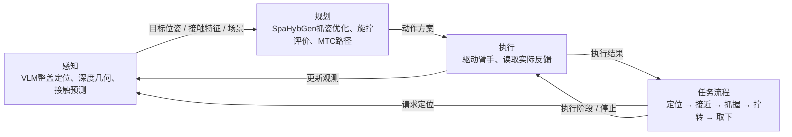

# 拧油箱盖项目合同

更新日期：2026-10-03。状态：已有模型预览、任务状态机、执行/估计接口和 mock 后端，已完成当前单场景 MTC 接近规划及 MuJoCo 运动学回放；图像感知与完整物理执行尚未接入。
本文件统一记录当前任务、装配参数、实现状态与待办。README 提供入口，预览说明记录工具用法，资产说明保留来源与转换证据；发生不一致时先核对本合同与用户最新确认，不自行覆盖。
目前仍以本文为主记录；任务代码仅镜像已确认的角度和通道目标，未确认的物理参数保持 `None`，不迁移整套机器配置。以后迁移到 `config.json` 等唯一配置源时，本文的参数表改为引用或生成内容，避免文档与配置各维护一套。

## 状态约定

- 用户确认：确认了任务要求或预览装配方式，不等于实物标定。
- 模型推导：来自所提供 CAD/网格的尺寸或坐标计算。
- 预览假设：为了当前展示选取，不能直接用于真机。
- 待确认：没有可靠交付值；以后配置使用显式空值和状态，不能以 0 或单位旋转冒充已确认值。

## 任务与阶段

| 项目 | 当前约定 | 状态 |
| --- | --- | --- |
| 唯一任务 | 拧油箱盖；油箱门默认已打开，不执行开关门或加油 | 用户最新确认（2026-09-21） |
| 操作终态 | 拧开并完全取下，结束时由手持盖；暂不做装回或放置 | 用户确认（2026-09-22）；脱离与持稳的量化判据待定义 |
| 动作分工 | 拇指、食指和中指在每段旋拧内保持抓握，由机械臂旋转；成功完成一段后可按约定松手、退开、重新观测与抓握，最终取下时持续持盖 | 用户确认分段重新抓握；流程见“分段旋拧与重新抓握”；抓持能力待验证 |
| 拧盖手部通道目标 | `[0, 0, 440, 390, 660, 0]`，严格保留顺序；按现有通道说明依次为小指、无名指、中指、食指、拇指弯曲、拇指旋转 | 用户确认数值（2026-09-22）；为通道指令值，尚未映射到当前仿真或下发硬件 |
| 位姿识别 | 独立视觉估计模块提供盖体位姿、螺纹轴线与握梁方向，支持目标位置变化 | 估计接口已有 mock 及标注来源的仿真真值输入；图像估计尚未实现，锁紧程度不可仅凭外观认定 |
| 硬件链 | 单臂 AUBO i10 → 传感器 → adapter → RH56DFX 右手 | 用户确认 |
| 机械臂力传感能力 | 机械臂本身具备力传感器 | 用户明确确认（2026-10-03）；具体测量维度、接口、量程、坐标系及标定待核对，尚未接入项目 |
| 交付 | 首轮仿真；真机后续接入 | 用户确认 |
| 油箱盖机构 | 螺纹连接；从灵巧手正对盖体的视角，逆时针旋松；225°（0.625 圈）为最紧状态下的参考解锁转角，实际初始松紧不同可提前脱离，按反馈判断取下；允许有条件的分段重新抓握，顺时针锁紧，无需按压；导程与轴向行程待确认；阻力与力矩限值暂缓细化 | 用户补充角度含义及初始松紧变化（2026-10-03）；尚未实现螺纹啮合、力反馈或开盖执行 |
| 失败处理 | 停止任务并等待人工；不自动重试、松手或恢复 | 用户确认；保持能力待控制接口确认 |
| 规划/执行 | MTC 做无接触粗运动；MuJoCo 执行局部接触与物理仿真；同一组关节只有一个控制方 | 编排与执行接口已有骨架；MTC/MuJoCo 动作尚未接入 |

全程无液体，不实现出油、流量或供油反馈。开关门、取枪、插枪、扳机操作及旧加油流程均不属于当前交付或后续开发承诺。门已打开不等于盖体已取下；组合预览默认门板相对箱体正面向外打开 135°（用户确认，2026-09-24）；避让空间尚未验证。

预期流程：位姿估计 → 接近 → 三指抓稳握梁 → 分段旋转并配合轴向柔顺拉动，持续判断抓持、旋转/轴向进度及脱离；确认脱离则提前结束旋拧并退离持盖，仅在确认盖仍由机构可靠支撑时进入计划重新抓握。执行坐标轴和角度正负号须按上述观察视角映射；转过约定角度不单独证明物理脱离成功。

### 分段旋拧与重新抓握（2026-10-03）

用户确认盖体松手后不会自行回转，并要求采用“转一段 → 松手 → 退到盖前方 → 重新识别盖体姿态 → 调整并再次抓握 → 继续旋拧”的流程。不会回转的依据为用户对机构的确认，尚未通过仿真或实物实验验证；不据此推断盖体已脱离、抓稳或能自由持起。角度含义及正常终止条件按下节“力控旋拧与反馈取盖路线”；既有固定累计角度与分段是几何实验设置，不要求真实执行转满。

每段旋拧成功并停稳、且盖体尚由机构支撑时，允许按计划松手。手根从本段末态抓握位置沿盖轴外向退开 0.100 m；这里定义的是手根沿轴位移，不是手表面与盖表面的净距，也不要求回到第一次接近时的世界位置。退开后重新通过估计接口取得盖体位姿与握梁方向，更新规划场景，在退开区域调整机械臂和手预型，再规划接近、闭合并确认抓稳，随后执行下一段。退开距离是用户确认的流程要求，路径和释放后的手指扫掠仍待验证。

累计旋转进度跨重新观测保留，按实际盖体反馈核对；不能把机械臂某个关节的命令角直接当作盖体进度，也不能在再次识别时归零。盖体朝向的角度展开与握梁可能的 180°对称歧义须结合前次观测、已确认方向及阶段反馈处理；方向无法确定时停止。仿真开发仍须标注真值来源，不计为图像识别完成。

松手重新抓握属于成功阶段之间的计划动作。任何观测、路径、抓握或旋转失败仍停止并等待人工，不以此循环自动松手、重试或恢复。末段确认脱离后持续持盖，不再进入松手循环；累计角度达标不能单独替代脱离判断。

此前用户确认的几何实验分段为 90°＋90°＋45°，累计阶段端点为 90°、180°、225°；该设置继续解释既有报告。新执行路线允许反馈触发提前结束，不将这些阶段端点作为必走流程或松手依据。当时安排的单随机场景分段与重新抓握几何实验见后文历史记录，当前开发顺序查[实施顺序与交付](#实施顺序与交付)。固定深度运动学诊断仅作几何证据；导程、轴向行程、机构支撑/脱离判据与抓持条件明确后，才能验收局部动力学执行。原 P3 单次固定抓姿诊断保留为历史基线，不用其未达到累计目标来否定分段方案。

本轮几何实现先复用当前手盖相对候选，经每次新观测重新生成世界目标；不预设重新抓握一定会复位臂构型。MTC 在退开位置规划调整与再次接近，旋拧阶段沿新到达构型连续求解；若出现首个失败则结束并保留结果，不自动改变分段角度、候选或场景。手全程保持接近预型，计划松手/抓稳仅标为未实现的物理阶段，不用几何动画代替其执行。

### 力控旋拧与反馈取盖路线

采用日期：2026-10-03。用户要求保存新的力控路线，并明确确认机械臂本身具备力传感器；硬件存在的来源为用户确认，具体能力及项目接入尚未验证。本节是当前执行路线、参数状态与后续工作的维护入口，优先于此前把固定分段累计角度作为必走流程的约定；此前工具和报告保留为几何基线。路线初次保存时未改执行实现；随后任务点 1 已迁移为反馈驱动的任务编排并通过 mock 验证，记录见[任务点 1 实施与验证](#任务点-1-实施与验证)。`TaskParameters.unlock_angle_deg` 保留参考含义，物理脱离和力控仍未验收。

**机构认识与角度角色。** 盖体初始松紧程度未知，可能在参考转角之前解除螺纹约束。盖不会自行回转不等于松手后不会轴向脱落；不能按“转过一段且没回转”推断可以松手。每段计划角度用于评价到达构型的可转范围及触发阶段判断，正常完成依据为实际脱离与持续持盖反馈。90°＋135°是用户提出的备选几何规划方案，尚未选为新固定参数；“首个 90°一定不会脱落”尚无验证依据。参考转角不单独证明脱离，也不自动定义异常情况下允许继续旋转的限值。

**控制与终止流程。**

1. 经估计接口生成目标，MTC 规划无接触接近；执行到位并停稳后交接控制，局部执行层闭合并确认抓稳。到达构型须评价后续旋转余量，不能只以到达手根目标作为筛选条件。
2. 局部执行层在保持抓握、对齐估计盖轴的条件下，按约定方向旋拧，并沿轴外向施加受限的轻拉/柔顺运动；通过反馈调节轴向运动，允许螺纹约束下的旋转与轴向配合。不采用固定轴向深度的运动学诊断代替真实螺纹动作。具体实现选原生力控还是依据力反馈的导纳/阻抗等方式，待控制接口核对后确定。
3. 旋拧期间持续判断抓持状态、盖体真实运动、轴向阻力及可用的旋转阻力反馈。仅有手根外移、单次力值降低或一定转角，均不足以证明脱离：螺纹仍啮合时可能有轴向进度，手指滑动或变形也可能产生表观位移。脱离判据应结合盖相对油箱的运动、阻力变化及抓持状态，并规定观测有效性、持续时间与阈值；当前判据为待实现设计方向，尚非已验证算法。
4. 确认脱离时立即结束旋拧，保持抓握，受控向外取出并核对持续持盖终态；不为凑满参考角度继续旋转，也不进入松手循环。
5. 到达本段规划旋转边界且尚未脱离时，先判断盖是否仍由机构可靠支撑并满足松手条件。仅在明确允许松手时，按计划释放、退开、重新识别、调整并再次抓稳后继续；未知支撑/脱离状态或任何失败均停止等待人工，不自动松手、换分支重试或恢复。退开设置仍查“分段旋拧与重新抓握”节。

**力传感器与控制能力边界。** 机械臂自带力传感器已确认，不再把“是否存在力传感硬件”列为未知。仍需核对：实机型号与传感器实现、测量的是哪些力/力矩分量、单位与量程、测量坐标系和数据时间、采样/通信能力、读取接口、零偏及安装负载补偿。是否具备原生力控、其控制模式和停止/保持行为另行核对；力传感硬件存在不自动证明这些控制能力已开放。机械臂自带传感器与装配链中 `sensor_link` 所表示传感器的关系待核对，不据此改安装变换、删除装配件或认定二者为同一设备。现有传感器显示几何仍不代表测量接口已实现。

**参数与验证边界。** 轴向目标拉力、力/力矩限值、旋转与轴向速度/加速度、柔顺参数、允许位移、检测阈值/时长以及松手支撑判据均待明确，不给“轻轻拉”擅自填数值。力控依然需要参数与有限运动边界，其作用是让动作随反馈调整、减少对未知初始松紧的固定转角依赖。导程、行程、质量惯量和接触/抓持条件仍查物理参数待办；现有角度和位姿容差不充当这些条件。力控执行与 MTC 不同时控制同组关节。

**后续实施顺序。** 先补任务层的提前脱离、允许松手、状态未知停止及持盖终态合同，并用明确标注来源的模拟阶段反馈验证编排；覆盖初始较松、第一段内脱离、重新抓握前支撑未知、抓持失效与反馈失效等情形。再在 MuJoCo 补旋转/轴向配合、支撑解除、力反馈和抓持模型，验证局部柔顺执行及脱离检测；简化或 mock 判据不计为真实物理验证。真机阶段核对并接入机械臂力反馈及控制接口、标定和负载补偿，在相关参数明确后验证。几何构型筛选仍需推进，但不替代上述执行判断。

2026-10-03 补充：用户确认本轮[功能清单与实施顺序](#功能清单与实施顺序)，将旋转裕量预判、松手前受限试拉及卸载观察纳入待开发功能。试拉方法及允许松手判据尚未验证；不以文档采用或模拟反馈通过认定其物理有效。

#### 松手前支撑检查的含义与边界

- 在旋转裕量不足前停转并保持抓握，沿盖轴外向进行受限试拉；结合实际拉力、盖相对油箱的运动及手盖滑移判断响应。机械臂没动不等于盖受力后没动，拉不动也不直接证明机构能在释放期间可靠支撑。
- “卸载观察”指减小机械臂主动施加的轴向拉力，继续保持手指抓握，回到不主动拉拽的保持状态，观察回弹、偏移或接触变化。不等于减小抓握力度、松手、断电，也不要求传感器读数强行归零。
- 卸载观察只是检查约束是否依赖主动拉力的辅助证据。手仍可能支撑盖体，卸载后不动不能单独证明松手后不会滑落；是否保留该观察步骤及具体实现需依据机构和实验结果确定。
- 区分螺纹或机构约束、偏斜卡滞、其他臂手环境接触和控制器未执行等阻力来源。检查轴向支撑时，同时核对重力引起的下沉、倾斜以及释放和退开对支撑的影响。
- 验证时比较不同剩余啮合、偏斜、摩擦和抓持条件下的检查结果与实际释放后状态，重点记录“判断可释放，但释放后滑落”的误判，明确判据适用范围。测试模型须能真实解除支撑并允许盖体自由运动，不能用固定盖体的实验验证此判据。
- 仅在有效反馈和经验证的支撑判据明确允许释放时，进入计划重新抓握。确认脱离且抓稳时保持抓握并取出；状态未知或失败时停止等待人工，不以检测滑落后再抓作为恢复方案。力反馈在手离开盖后不自动提供盖体状态。
- 试拉载荷、加载与卸载速度、允许位移、观察时长、阈值和限位前停止裕量均待明确，依赖测量、控制及机构条件。缺失时暂停相应物理实现，不以临时值冒充实物参数。

参考：[瓶盖操作的任务柔顺控制研究](https://mediatum.ub.tum.de/doc/1703739/zwajthuqme2ac4r4zwvohz4dy.Task-Based_Compliance_Control_for_Bottle_Screw_Manipulation_With_a_Dual-Arm_Robot.pdf)讨论运动规划与柔顺控制结合处理接触不确定性，仅作为方法参考；其双臂装置、控制参数和实验结果不移植为本项目证据。

### 手部通道与抓握

通道目标以本节参数表为准。顺序依据 [RH56 控制说明](../assets/reference/aviation/doc/hand/README.md)：中指为第 3 项，食指为第 4 项，拇指弯曲与旋转为第 5、6 项。其余手指也保留用户给定值，不因三指夹持而改写。

参考脚本命令范围为 0～1000，一般解释为 1000 张开、0 最大弯曲，-1 保持当前状态。数值为设备/脚本通道指令，不是关节角或握力百分比；当前模型的关节端点与耦合映射仍需核对。接近预型、抓握目标切换时机、接触点与手盖位姿尚待落实，当前目标尚未应用到仿真或硬件。

### 当前模型的预览映射约定

本轮按用户授权接入场景与抓型预览。以下映射仅为当前 MJCF 的运动学预览假设，不是 RH56 实物标定，也不使用旧航插角度端点：

- 六通道对应当前执行器 `pinky / ring / middle / index / thumb_proximal / thumb_yaw`。
- 每个驱动关节的可用区间取执行器范围、驱动关节限位、从动关节线性耦合所允许区间的交集。通道 1000 对应区间下端，0 对应上端；中间值线性插值，拇指旋转的端点方向也属未标定假设。
- 从动关节按当前 MJCF 的 `equality/joint` 关系设置，保留参考位置偏移。预览直接设置目标姿态并运行 `mj_forward`，不靠动力学自动闭合，也不修改原始限位或控制增益。
- 当前推导的端点如下，单位 rad；运行时由模型计算，此表只记录核对结果。

| 执行器 | 通道 1000 端点 | 通道 0 端点 |
| --- | --- | --- |
| pinky / ring | 0.093607306 | 1.531023368 |
| middle | 0.093607306 | 1.500000000 |
| index | 0.067150148 | 1.500000000 |
| thumb_proximal | 0.100000000 | 0.488721805 |
| thumb_yaw | 0.000000000 | 1.308000000 |

盖体估计原点选用 `cap_grip_center`（握梁几何中心），以世界坐标表达。该模型握梁长轴为局部 +Y，因此接口轴取 X=模型 +Y、Y=模型 -X、Z=模型 +Z，以满足接口的 X 沿握梁、Z 朝开口外侧约定。来源标为 `simulation_ground_truth`，时间戳使用仿真时钟；几何真值不代表锁紧/脱离反馈或图像识别成功。

### 抓取位姿搜索合同

用户授权（2026-09-24）：固定已冻结的闭合通道目标，搜索手根 `base` 相对接口盖体坐标系（原点为握梁中心，X 沿握梁，Z 朝开口外侧）的候选位姿。用户随后提出采用适度张开的接近预型，再闭合至冻结目标。接近预型由工具在模型张开端点 `[1000, 1000, 1000, 1000, 1000, 1000]` 与冻结目标之间探索，闭合进度暂采样 0、0.25、0.5、0.75；候选通道仅为仿真假设，不写入已确认实物参数或任务 `approach_channels`。拇指旋转也参与此插值，不将所有通道统一解释为张开宽度。

搜索工具将传感器、adapter 和手作为可自由摆放的局部装配副本，保留箱体、盖体和当前打开的门；不改原始模型或冻结通道。候选输出包括 `cap_from_hand`（手根在盖体系的位姿，米/XYZW）、拇指、食指和中指与握梁的最近表面距离/位置、碰撞及淘汰原因。传感器和 adapter 没有碰撞几何，明确列为未检查项。指尖参考点只用于生成候选与限定接触邻域，不能代替指腹；当前邻域是未标定的几何代理，仍需目视核对。

2026-09-24 修正：冻结的是驱动目标，不是接触后的实际关节角。空载目标形状进入握梁或发生指间重叠不能单独否决抓取；此前仅用 `qpos` 强设冻结形状的搜索是静态形状诊断，其“无几何候选”不等于无可行抓取。该诊断保留作对照，不作为接触搜索的淘汰条件。

运动学候选生成仍使用未标定的软件探索设置：末端表面接近距离 1 mm、几何穿透诊断尺度 0.1 mm、距指尖 site 的代理区域 12 mm、侧面边缘余量 1 mm；这些值只用于候选排序。分别从通道闭合进度 0.4、0.6、0.8、1.0 的空载形状生成候选，同时沿盖体外向轴探索 0/10/20/40/60 mm 的偏移，在候选位姿联合检查接近预型是否与环境穿透，再做局部接触探索。冻结目标不改写。

局部探索在独立内存场景中固定盖体和门板，固定手根位姿；不执行拧盖或机械臂运动。手指仅初始化一次到候选接近预型，之后通过 `ctrl` 向冻结目标变化，用 `mj_step` 求实际姿态，不逐帧强设手指 `qpos`。沿用源模型已有的质量、增益、力矩限制、摩擦、接触与耦合参数，并将实际编译参数写入报告；这些参数未标定，不解释为真实传感器读数或已确认力矩限值。软件探索采用 0.5 ms 步长、`implicitfast` 积分器，1 s 目标渐变、1 s 固定目标观察，末段 0.2 s 记录力与速度。以上时间仅为探索设置，不是任务验收时长。

输出实际关节角与目标误差、三指接触法向力、接触位置、实际穿透、其他手部接触和末段速度。法向力大于 `1e-6 N` 只标记数值上观测到接触，不能代替抓稳阈值。分类为三指接触已观测、接触不足、初态干涉或数值异常；抓稳/载荷/滑移、力矩安全、碰撞容差和持稳验收保持未验证。末段接触力方差或速度大小只记录，不擅自设物理通过门槛。固定盖体试验不能证明能持起盖体，也不验证螺纹脱离。

候选结果不自动写入任务抓取参数。当前用户候选的机械臂端点 IK 已单独接入，见后文对应章节；搜索产生的其他候选、接近路径和完整旋转空间仍需后续验证。

### 手动抓姿工具

2026-09-30：先在固定盖体的局部场景中人工调整手根相对位姿与接近预型，再通过冻结目标观察实际闭合。入口为 `tools/tune_cap_grasp.py`；不运行批量搜索、不驱动机械臂、不修改正式任务参数。

界面位置以盖体系毫米表示，姿态为度制固定轴 XYZ RPY（矩阵 Rz·Ry·Rx），旋转保持手根位置不变。保存使用米和 XYZW 四元数。六通道接近预型允许逐项调整，最终闭合目标只读并从现有合同镜像读取。默认预型为模型张开端点与冻结目标的中点，仅作界面起点；初始位姿用三指参考点几何生成并沿盖体外向偏移 60 mm，仅供人工调整，不是有效抓姿。

闭合复用局部接触实验的步长与渐变/观察时间。应用调姿或重置是显式的新实验初始化；闭合过程中不强设手指 qpos。初态干涉按现有探索判据阻止闭合并显示原因；该判据是软件探索规则，不是实物碰撞容差。停止按钮只暂停这个局部实验，不表示硬件停稳或保持能力。正常实验结束停留在实际末态。

保存文件记录手盖相对位姿、预型、冻结目标、模型来源、实验设置与实际采样；未闭合和中断结果分别标记，不能冒充已完成实验。重新载入只恢复候选初态，须显式重新闭合；检查工具格式、场景哈希、MuJoCo 版本及冻结目标。不兼容文件不加载，不覆盖正式参数。初始候选、接触已观测及人工保存均不代表抓稳或拧盖验收。

### 用户手动候选与凹槽修改请求（2026-09-30）

用户提供调姿截图，选定以下数值作为抓取候选：盖体系手根位置 `[-20, 75, 160] mm`，固定轴 XYZ RPY `[180, 50, 90] deg`；接近预型按原通道顺序为 `[0, 0, 800, 800, 900, 0]`。最终闭合通道仍引用任务参数表，不改写。候选使用工具的 `cap_from_hand` 格式保存，位置转为米、旋转转为 XYZW 四元数；后续世界位姿由盖体位姿与该相对变换相乘得到。

用户随后将 Y 从 78 mm 调整为 75 mm，其余位姿和预型不变。最新截图显示三指接触已观测，拇/食/中末端对握梁法向力分别约为 9.45 / 9.38 / 8.54 N，最大接触深度 0.027 mm，其他承载接触与初态干涉均为 0。这些为用户截图记录；独立重跑结果单独记录于候选文件。法向力显示为各指接触法向分量的标量和，不是同一方向的合力；盖体固定可承受不平衡反力，三指接触不等于自由持稳、可达或拧盖验收。

用户随后明确只加宽外侧入口，半径增加 50 mm。新的入口尺寸见“场景记录与有效性”，槽底、环口、通孔、深度和盖体位置保持原值。候选文件为 `artifacts/manual_grasp/user_selected_20260930.json`，重新关联加宽后的场景并核对相对位姿；先前 Y=78 mm 的接触不足结果不沿用到当前候选。

### 当前候选的机械臂 IK 与完整装配预览

2026-09-30：用户授权将已选手盖候选接回当前 i10 模型，验证当前场景端点 IK 并显示完整装配。目标手根由估计接口提供的盖体世界位姿乘以 `cap_from_hand` 得到；法兰到手根变换从模型当前固定安装链读取，取逆换算法兰目标。机器人基座为 `base_link`，法兰为 `wrist3_Link`，手根为手模型 `base`，不混淆三个坐标系。

使用当前模型的六个 i10 关节及限位进行数值 IK，不新增规划或控制依赖。软件求解设置：24 个确定性初值（随机种子 0）、每初值最多 250 次迭代；位置收敛阈值 0.1 mm、姿态收敛阈值 0.1°；旋转残差权重 0.2 m/rad、阻尼 0.01、单步关节增量范数上限 0.2 rad。这些仅为数值求解设置，不是实物标定精度或动作限值。未收敛只表示本次数值搜索未找到逆解，不证明全局不可达。

默认显示候选接近预型；可切换查看候选文件中记录的实际闭合手指姿态，不强设空载闭合目标形状。闭合姿态仅复现此前固定夹具实验的关节采样，不是在完整机械臂上重新进行接触执行。

端点检查记录当前模型启用的机器人接触对和穿透；超过 0.1 mm 单独列为几何干涉（软件诊断尺度，非物理容差）。优先展示该范围内无明显干涉且靠近预览初态的逆解。传感器/adapter 没有碰撞几何，地面碰撞在当前场景中关闭，均列为未检查；不声称完整碰撞安全。模型安装仍未标定，机械臂沿途、连续拧转空间、负载、抓稳及真机保持能力仍待验证。

预览只设置关节并运行前向计算，不插值成未经规划的轨迹，不驱动真机。求解与显示不改写原模型、冻结通道或正式任务参数。

入口 `tools/preview_cap_ik.py`，实现 `src/fuel_cap_task/arm_ik.py`。本次当前场景求得 12 组数值端点解；首选手根位置/姿态误差约 0.017 mm / 0.020°，关节顺序与数值、变换链和碰撞对保存在 `artifacts/arm_ik/current_candidate.json`。最初发现基座/肩部碰撞网格约 8.8 mm 重叠，后按 SRDF 相邻规则补齐显式排除（见下一节）。更新后原始预览及首选逆解的机器人穿透接触为 0；其他部分逆解的前臂/腕部自碰仍能检出，报告保留。结论只覆盖当前启用的碰撞几何。已生成并目视检查完整装配和手盖近景；21 项场景与 IK 检查通过。

### i10 相邻 link 碰撞排除

2026-09-30：依据当前 i10 SRDF 中 `reason="Adjacent"` 的 6 对规则，逐项验证它们也是当前 URDF 的直接父子 link，再转换为 MuJoCo 的 body-pair `contact/exclude`。同步至 i10 单体、臂盖场景及完整臂手场景；生成器重建时保留。SRDF 中另外 3 对 `Never` 非相邻规则本轮不自动导入，不扩大排除范围，不关闭任一 link 的全部碰撞。

基座固定在世界坐标系，不能依靠 MuJoCo 默认父子过滤避免该对接触，因此需显式排除；其余相邻对也显式同步以与模型语义一致。现有 RH56 排除规则保持原样；传感器/adapter 固定安装链没有碰撞几何，不视为已验证无干涉。局部手部场景拆除机械臂时同步移除引用被删除 body 的排除项。

此修改只修复碰撞过滤，保持网格、运动学、抓姿和通道不变。旧组合场景哈希失效后，当前候选已重新进行固定夹具试验、IK 报告已重新生成，不静默绕过加载检查。完整父子 link 核查记录在 `artifacts/arm_ik/parent_link_audit.json`；未发现剩余的、启用碰撞几何且未过滤的静态父级例外。传感器/adapter 无碰撞几何的记录仍标为未覆盖。23 项场景/IK/过滤回归通过。

### 有边界的随机场景

2026-09-30：用户授权按讨论范围编码。采样变量是机械臂 `base_link` 系中油箱外表面开孔中心：X∈[0,0.20] m、Y∈[-1.0,-0.80] m、Z=0.6 m（2026-10-01 随开孔提高更新），且水平距离不超过 1 m。油箱相对基线绕竖直轴偏航 ±30°，盖体相对基线绕开口轴 ±30°；保持盖体同轴与原轴向深度、门的相对打开姿态及手盖候选不变。这些是仿真测试范围，不是已验证工作空间或实物标定。

油箱偏航先绕其几何中心的竖直轴计算，再整体平移使开孔中心到达采样目标；角度单项测试保持最终开孔中心在基线位置，不表示旋转过程中油箱中心不动。不绕原始油箱局部 Z 轴侧倾，也不绕机械臂基座公转。每个场景重新编译内存模型，避免修改静态 body 后碰撞缓存不同步；不写回源场景。

默认固定随机种子 0，每类 4 个随机样本，另加 1 个原始基线，共 17 个：位置单项、油箱偏航单项、盖体朝向单项、混合变化。位置在矩形内均匀采样后按水平距离拒绝越界项；这是采样域约束，不按 IK 或碰撞结果挑样。每个合法样本复用当前 IK 设置，保留全部结果：`endpoint_clear`（启用几何下无超过诊断尺度的穿透）、`endpoint_interference`、`ik_not_found`（本次数值搜索未找到，不代表全局不可达）。逐样本写检查点；中断保留已完成记录，不自动恢复或重试。

可视化展示预型与对应端点；无逆解时显示原始机械臂姿态和目标标记，不伪造到位姿态。不迁移原场景闭合采样作为随机场景接触结果，不运行动力学或路径执行；传感器/adapter、地面碰撞等原未覆盖项保持未验证。

入口 `tools/sample_cap_scenes.py`，实现 `src/fuel_cap_task/random_scenes.py`。首次种子 0 的 17 个样本全部找到至少一个启用几何下无明显干涉的逆解；结果与全部采样参数保存在 `artifacts/random_scenes/report.json`。26 项场景/IK/采样回归通过；交互样本切换、逆解切换、视角和正常退出已实际验证；已生成17张离屏图并目视检查混合样本。有限样本端点结果不等于整个连续工作空间或路径验收。

### 油箱口提高与车体占位加高（2026-10-01）

用户要求将开孔中心距地面从 0.40 m 提高到 0.60 m；凹腔、环口、盖体及门板保持相对位姿整体上移 0.20 m。车体占位长方体高度由 0.80 m 增至 1.00 m，底面仍为世界 Z=0，宽和厚保持原值；顶部提高 0.20 m，孔位不重新居中。凹腔尺寸、环口、深度、盖体形状、门相对打开角及手盖候选不变。

实现采用原带孔体整体上移、向下延伸实体底部到地面；延伸部分为同一箱体 link 的显示与碰撞 box，不拉伸凹腔和螺纹轴向几何。新增 `tank_body_center` 几何参考系表示加高后的车体中心，供随机场景偏航使用；不能继续将开孔中心假定为车体高度中点。随机场景默认高度跟随更新，其他采样范围引用原节。

旧高度场景及其候选、IK、随机样本、P0 报告和图片的归档资产已按用户要求于 2026-10-02 删除；当前场景产物保留。重建当前 MuJoCo 场景，重新进行同一相对候选的固定夹具闭合及 IK，再派生 MoveIt 模型与审计。历史截图保留并标注原场景来源。物理安装、参数标定、路径与完整取盖仍未验证。

实际检查：世界开孔中心为 `(0, 1.0, 0.6)` m；车体外包围盒 Z 范围为 `[0, 1.0]` m，几何中心为 `(0, 1.2, 0.5)` m（网格浮点舍入误差按测试容差处理）。凹腔、环口、盖体、握梁中心和门板的世界变换均只增加 0.20 m 高度，彼此相对变换不变；机械臂安装和初始姿态不变，全部原油箱 STL 哈希不变。变更检查记录在 `artifacts/planning_model/height_change.json`。

同一相对候选已独立重跑固定夹具闭合，三指接触仍被观测，当前采样写入候选文件；用户截图仍明确标注原高度来源。重新求得 12 个端点逆解：首选误差约 0.00479 mm / 0.00471°，原覆盖下 8 个无碰撞。默认 17 个随机样本全部完成、均为原覆盖下 `endpoint_clear`，其高度从场景读取；图集已重新生成。以上仍不证明抓稳、路径或动力学执行通过。

MoveIt 模型已重新生成、构建并进行两种覆盖审计：19 个构型全部机器人 link 的 FK 对照通过，最大矩阵元素误差约 2.11e-15，KDL 19/19，原覆盖碰撞对照一致。当前原覆盖/规划覆盖环境对象数分别为 197/198；规划侧原有安装件障碍负例通过，12 个逆解中 6 个无碰撞，首选 `ik_00` 无碰撞，另外 2 个原覆盖下无碰撞分支被地面淘汰。当前报告为提高后的重跑结果，旧高度 P0 归档资产已删除；规划与 MuJoCo 的新增碰撞覆盖差异仍保留。

28 项场景测试通过（含 2 项新几何/刚性关系回归），2 项规划来源测试通过；来源哈希校验通过。实际更新并检查全景与近景图，车体底面落地；本轮未进行新的 GUI 操作验收、MTC 路径或完整取盖验证。

### 视觉估计与反馈

感知按当前路线由 VLM 定位整个盖体，经目标分割与配准深度形成目标三维范围、位姿及环境观测，以支持目标位置变化。输出盖体参考点、旋转轴、绕轴朝向、参考坐标系、时间戳、来源和有效性；需处理握梁等对称特征的朝向歧义。具体模型、相机标定、精度、工作范围和泛化验收条件仍待明确，采用路线不等于图像识别已经实现。

首轮仿真可经同一估计接口提供明确标注来源的仿真真值，但不构成视觉识别或泛化验证。识别无效时不进入抓取；实际锁紧程度、启动力矩和可靠的脱离结论不能仅凭外观认定，需独立定义初始负载条件及执行反馈。

### 规划与执行约束

- 任务层负责状态机与服务编排，不直接发送关节命令；同组关节切换控制权前确认停止和交接。
- MTC 负责无接触粗运动；MuJoCo 执行层负责局部接触、螺纹旋转/轴向配合及抓持稳定。真机后端后续接入。
- 规划通过不等于动力学通过；PlanningScene attach/detach 仅表示逻辑同步，不能替代物理抓放判据。
- 失败后停止任务及后续流程并等待人工，不自动重试、松手或恢复。停止不直接等于断电；实际保持能力须由控制器接口确认。
- 阻力与力矩限值按用户意见暂缓细化，可先推进位姿接口与运动学；物理执行验收前仍需负载假设和停止阈值，不将未知值写成零阻力或无限限值。

## 资产与坐标来源

| 资产 | 来源 / 派生入口 | 尺寸与坐标 | 状态 |
| --- | --- | --- | --- |
| i10 | `assets/robots/aubo_i10/`；[官方来源记录](hardware/aubo_i10_sources.md) | 当前使用 `wrist3_Link` 作为预览安装父坐标系 | 已接入；具体实机版本与法兰匹配待核对 |
| 传感器 | `assets/robots/sensor/source/传感器.STEP`、`传感器.STL`；`assets/robots/sensor/urdf/sensor.urdf` | 外径 75 mm，总高 33.5 mm；底面中心为原点，+Z 朝顶部 | 用户提供模型并认可外观；尺寸为模型推导 |
| adapter | `assets/robots/adapter/source/连接件.STEP`、`连接件.STL`；`assets/robots/adapter/meshes/adapter.stl` | 底盘外径 63 mm、厚 10 mm；上部凸台外径 38 mm；总高 25 mm，凸台长度 15 mm | 用户提供模型；尺寸为模型推导 |
| RH56 | `assets/reference/aviation/third_party/correlllab_rh56_controller_h12/mujoco_inspire/inspire_right.xml` | 手根入口网格内径约 38 mm；内部还有结构，不据此认定插装无干涉 | 参考模型，与当前实物一致性待核对 |

传感器网格转换：`p_sensor = (p_STL - [37.5, 37.5, 0]) × 0.001`。
adapter 网格转换：`p_adapter = (p_STL - [31.5, 31.5, 0]) × 0.001`。
输入为毫米，派生网格为米；均保留原始文件，不采用旧 FR3 安装参数。
详细网格与转换证据见 [传感器资料](../assets/robots/sensor/README.md)、[连接件资料](../assets/robots/adapter/README.md)。

## 当前装配变换

下表表示子坐标系在父坐标系中的位姿，平移单位为米，RPY 单位为弧度。RPY 按 URDF 的绕固定 X/Y/Z 轴约定；当前均为零旋转。

| 父坐标系 | 子坐标系 | xyz（m） | rpy（rad） | 来源与有效性 |
| --- | --- | --- | --- | --- |
| `wrist3_Link` | `sensor_link` | `[0, 0, 0]` | `[0, 0, 0]` | 预览假设：传感器底面接机械臂，同轴放置 |
| `sensor_link` | `sensor_output_frame` | `[0, 0, 0.0335]` | `[0, 0, 0]` | 模型顶面位置；实物方向和孔位待确认 |
| `sensor_output_frame` | `adapter` | `[0, 0, 0]` | `[0, 0, 0]` | 预览假设：连接件底面贴传感器顶面 |
| `adapter` | `rh56_provisional_mount` | `[0, 0, 0.010]` | `[0, 0, 0]` | 用户要求凸台全部插入，手根部落在底盘肩面 |
| `rh56_provisional_mount` | 手模型 `base` | `[0, 0, 0]` | `[0, 0, 0]` | 当前参考模型根坐标关系 |

**插入深度为 15 mm：连接件总高 25 mm − 底盘肩面高度 10 mm。**
这是装配位置调整，不是执行了一段插装轨迹。手安装原点距 `wrist3_Link` 沿局部 +Z 为 **43.5 mm**（33.5 + 10）；该原点不是已标定 TCP。
旧的手安装偏移 25 mm（未插入）、距法兰 58.5 mm，以及更早 40 mm 占位参数均已废弃，不能再作为当前装配值。

## 场景记录与有效性

| 项目 | 当前值 / 入口 | 有效性 |
| --- | --- | --- |
| 组合预览 | `assets/scenes/i10_rh56_fuel_cap_preview.xml` | 20 个关节、6 个手部执行器；仅 `mj_forward` |
| 油箱 | 立起后宽/高/厚 0.8/1.0/0.4 m；底面中心世界坐标 `(0, 1.2, 0)` m，开口朝 -Y | 用户指定粗模与预览布局 |
| 开孔中心 | `tank_opening_center` 世界位置 `(0, 1.0, 0.6)` m，坐标轴分别朝世界 +X/+Z/-Y | 外表面中心，不是槽底或环口端面 |
| 油箱口 | 凹槽入口直径 220 mm（半径 110 mm），槽底直径 80 mm；环口外/内径 60/50 mm，凸起 3 mm | 用户指定尺寸；2026-09-30 仅入口半径增加 50 mm，公差待交付 |
| 凹槽深度 / 腔体 | 40 mm / 50 mm 孔贯通箱体 | 软件假设与建模简化 |
| 机械臂底座 | 世界原点，整体绕世界 Z 旋转 180°；距开孔外表面水平 1 m | 预览布局，可达性未验证 |
| 油箱盖 | 同轴展示，灰色肩面贴环口；白色下部直径 40 mm、伸入 20 mm | 粗模，不代表螺纹或锁紧机构 |
| 油箱门 | 组合预览默认相对箱体正面向外打开 135°；关闭时为 0°，正对油箱时右侧铰链 | 用户确认初态（2026-09-24）及铰链侧；尺寸、质量与铰链限位仍为[场景占位参数](mjcf_inspection.md#组合场景门板)，避让空间未验证 |

当前已检查传感器独立 URDF 加载和渲染，以及组合加载、前向计算和安装位移。传感器与 adapter 仅显示、无碰撞、零密度；未交付质量惯量、接触参数或传感器测量接口。手根原有碰撞近似为实心圆柱等形状，并不保留入口空腔，后续接触验证前需处理这一差异。
未验证内部装配干涉、实际插装、载荷、抓持稳定、手门接触或完整任务；PlanningScene attach 也不能替代物理成功判据。独立开关门代码与场景已按用户要求删除。

组合场景生成器将门体参考朝向与铰链 `ref` 同时设为默认打开角（135°），使直接加载及 `mj_resetData` 后的几何姿态一致，并保持铰链读数 0 表示关闭。该初态设置不执行开门轨迹，也不代表动力学保持。仅保留组合场景门板几何和铰链，不生成独立开关门场景，不注册开关门被动力矩回调。

## 实现状态与下一步

| 状态 | 内容与验证边界 |
| --- | --- |
| 已接入 | i10 URDF/MJCF（6 关节）、RH56 参考模型（12 关节、6 执行器）、传感器与 adapter 显示几何、油箱粗模及盖体粗模 |
| 已检查 | 模型加载、前向计算、渲染和安装位移；油箱采用分段凸碰撞网格，开口未被整体凸包封闭 |
| 仅预览 | 组合含门铰链共 20 关节，只运行 `mj_forward`；`cap_twist` 为简化旋转关节，无螺纹啮合、轴向脱离或锁紧机制 |
| 局部接触探索 | `tools/search_cap_grasp.py`：候选位姿搜索与固定夹具闭合实验；空载目标重叠只作诊断，实际手指通过 `ctrl` / `mj_step` 运动，未接任务执行器 |
| 已实现骨架 | Python 异步状态机、估计/执行接口、mock 后端与 JSONL 事件记录；只验证任务编排，不驱动模型 |
| 尚未实现 | MTC/MuJoCo 执行后端、图像识别、拧盖控制与物理抓握；尚未验证带载、滑移、螺纹接触及完整流程，未接真机 |

已确认的要求不等于已实现的动作。当前开发顺序见[实施顺序与交付](#实施顺序与交付)，以下为对应的输入与验收缺口：

| 待办 | 需要落实的内容 |
| --- | --- |
| 螺纹与起始条件 | 导程、轴向行程、初始盖体位姿与锁紧状态；已确认的旋转角度不能单独推导轴向位移 |
| 抓握与运动 | SpaHybGen 的 RH56 接触区域、驱动耦合与候选表达；手盖位姿、接近预型、通道映射、速度和滑移判据；验证传矩、旋转空间与必要的重新抓握 |
| 场景 | 机械臂起始姿态、已确认门打开初态下的避让空间、预览布局的适用性，以及首轮目标位置变化范围 |
| 感知 | VLM 整盖定位、分割、RGB/深度配准、场景体素表示及目标接触范围；落实估计接口、坐标变换、识别有效性和来源，验证油箱凹腔观测下的预测表现 |
| 装配与物理模型 | i10/RH56/传感器实机型号版本，法兰匹配、传感器两面方向与孔位、绕轴角度、adapter 内部间隙和紧固方式；补全质量惯量、摩擦与碰撞 |
| 接口 | 机械臂自带力传感器已由用户确认；其测量维度、量程、单位、测量坐标系、读取接口和标定，以及与现有装配传感器模型的关系待核对；控制器停止/保持及力控能力、负载与限值在物理验收前落实 |
| 成功与验收 | 螺纹脱离判据、退离距离、持盖终态位姿、持稳时长与容差；重复次数、成功率、记录方式、失败停止与人工复位条件 |

遇到影响下一步的缺失参数，停止依赖该参数的修改并询问用户；不把临时预览值升级成实物确认值。

## 状态机与执行接口

实现位于 `src/fuel_cap_task/`，使用 Python 3.10 标准库，无 ROS 或 MuJoCo 运行依赖。任务实例只运行一次；失败或取消后由人工处理并显式新建任务，不提供自动重试/续跑。

2026-10-03 任务点 1 实施合同：保留 `interfaces.py` 中的位姿、估计和参数类型及参考角度字段，避免反馈编排变更使既有规划模型来源绑定失效；新增执行接口统一放在 `execution_contract.py`。旧执行回执不作为新状态机的有效回执，不静默推断缺失来源或停止确认。下述为本轮实施约定，实际完成及验证见本节末尾记录。

新流程：`check_ready → estimate → approach → grasp → twist`；旋拧确认脱离且抓稳、停稳时进入 `retreat → hold → completed`；到达本段边界且明确未脱离、抓稳、停稳时进入 `check_support`。支撑检查中确认脱离时仍直接取出；明确未脱离且允许释放时进入 `release → withdraw → estimate → approach → grasp → twist`。任何未知、无效、矛盾回执或失败均停止，累计进度不因重新观测归零。
失败、超时或取消：`stopping → waiting_for_operator`；停止回执分别记录运动是否已停、抓握是否保持，未知状态用 `None`，等待人工不等于已经停稳。

| 接口/阶段 | 当前职责 |
| --- | --- |
| `CapEstimator.estimate` | 返回位姿、参考系、时间戳、来源、有效性和可选置信度；无效输入不进入接近 |
| `Executor.check_ready` | 检查本后端所需参数、场景和控制器；物理后端必须在运动前拒绝缺失的必要输入 |
| `Executor.approach` | 规划及接近；反馈到位、机械臂停止、局部控制权已取得，三项满足才进入抓握 |
| `Executor.grasp` | 接收合同通道目标，返回抓稳反馈；不以指令发送成功替代抓稳 |
| `Executor.twist` | 接收当前观测、累计进度及段序号；执行器负责取得本段有限的规划边界并在提前脱离或段边界停稳返回。回执区分 `detached`、`segment_boundary`、`unknown`，含实际累计进度、当前盖体观测、脱离/抓持/停止状态；参考角度达标不作为取出条件 |
| `Executor.check_support` | 保持抓握研究试拉及卸载观察，返回当前盖体观测、累计进度、脱离状态、是否允许释放、抓持和停稳确认；允许释放必须明确未脱离且有判断依据，本轮只模拟结论，不实现物理判据 |
| `Executor.release` | 接收本次有效支撑检查回执；动作前重新核对允许释放条件，确认释放完成、机构仍可靠支撑且运动停止，失败后不自动再闭手 |
| `Executor.withdraw` | 已释放时按合同路径外退；确认到观测区域、停稳、机构仍可靠支撑以及规划控制权已取得，再获取新观测。后续 `approach` 必须用新观测更新目标和场景，并接收此前累计进度 |
| `Executor.retreat / hold` | 确认退出开口且抓持稳定，再验证持盖；正常完成后由执行器继续维持保持控制 |
| `Executor.stop_and_hold` | 停止后续运动、保留已有抓握，不额外闭手或松手；异常或无回执记录为未知并等待人工 |

估计接口的盖体局部 +Z 指向开口外侧（朝手），+X 沿握梁方向；四元数顺序为 XYZW。绕该 +Z 的正角度对应从手侧看到的逆时针。这是软件接口坐标约定，尚需在未来感知/执行适配器中映射到实际模型和控制器。

`TaskParameters` 镜像已确认的通道目标及旋转角度；导程、轴向行程、手盖位姿、接近预型、退离距离、持稳时长、角度容差均保持 `None`。速度、接触与控制器配置留给后续执行后端，不用模拟值补成实物参数。

`MotionProgress` 明确表示从任务首次抓稳建立的参考起点累计的实际盖体运动：旋转单位为度、正方向为盖局部外向 +Z，轴向进度为米且可未知；不是本段增量或臂关节命令值。每次旋拧及支撑检查回执必须保持同一参考起点，任务层保存并传入下一阶段，不重复相加。非有限、负向累计旋转或回退的累计旋转拒绝继续；真实噪声及角度歧义须在提供方明确处理，任务层不猜误差容差。当前盖体观测必须通过估计校验，并保持首次观测的参考坐标系；姿态对称消歧由提供方负责。

除停止回执外，新执行回执均携带 `FeedbackContext`（来源、时间、时钟域、有效性及说明）。确认字段仅接受严格布尔或 `None`，只有明确 `True` 才可通过对应条件；脱离、支撑和抓持分别判断。时间与来源须有明确定义，不跨时钟域比较；观测时效和检测阈值仍由后续适配器落实。支撑回执中“已脱离但允许释放”或“允许释放但未明确未脱离”是矛盾状态，拒绝释放。

任务运行必须显式提供 `RunLimits` 的最大旋拧段数和总软件等待时间，均为有限正值；它们是编排等待边界，不是允许的机械转角、力或位移。预算耗尽即停止；若已是最后允许段而仍未脱离，不为不存在的下一段释放盖体。mock 使用有限脚本，脚本耗尽抛出失败，不循环复用反馈。真实后端仍须在 `check_ready` 拒绝缺失的运动、物理判据和控制边界，不以软件预算替代这些条件。

mock 后端仅产生标记为 `mock` / `mock_no_physics` 的合成反馈，允许上述物理参数为空，不调用 `mj_step` 或硬件，也不完成图像识别。演示中的超时与延迟只用于软件流程检查，不是机械动作限值。实际后端方法需异步让出事件循环并响应取消；先结束活动操作，再请求停止确认。

事件日志记录状态变化、输入来源、请求参数、执行反馈、失败原因和停止回执。运行入口与测试命令见 [README](../README.md#状态机演示)。

### 模块边界与运行时接口检查

任务层只编排，不持有模型或发送关节命令。估计模块提供统一坐标约定的观测；MTC 完成无接触运动并停稳；执行器负责控制权交接、局部接触与完成后的持续保持。场景模块提供带来源的几何及变换，不自行证明抓稳或脱离。日志保留输入来源、失败阶段和停止确认。

运行时在进入下一阶段前检查接口：

- 估计须为 `CapEstimate`，有效标志严格为布尔 `True`；坐标系、来源与时钟域须为非空字符串。位置为三个有限实数，XYZW 四元数为四个有限实数且范数接近 1（绝对数值误差上限 `1e-6`，仅为软件表示检查，不是姿态精度指标）；不自动归一化错误输入。
- 时间戳为有限实数；允许仿真零时刻，不跨时钟域比较。可选置信度为 `[0, 1]` 内有限实数。本轮不猜测观测有效期或置信度验收阈值；这些仍由后续适配器明确。
- `check_ready` 成功返回 `None`，不就绪抛出异常。各阶段回执必须使用新执行合同中的对应类型并携带有效上下文；确认字段为严格布尔或 `None`，字符串、整数等不能充当确认。转角与可选轴向进度必须是有限实数；任务层不以角度替代脱离。停止回执继续复用原类型。
- 停止回执的两项确认仅接受布尔值或 `None`，畸形回执记录为未知并等待人工；不重新发起动作。软件等待超时须为有限正数。

上述检查和 mock 测试属于软件接口验证，不构成控制权互斥、停止保持能力、动力学或真机验收。

### 任务点 1 实施与验证

2026-10-03：用户授权开始实施。新增 `src/fuel_cap_task/execution_contract.py`，更新状态机、回执校验、mock、演示入口及相关测试。已实现提前脱离分支、段末支撑检查、有条件的重新抓握循环、累计进度保留、当前观测取出、显式段数/总等待预算和统一停止处理。停止回执仍复用旧类型；旧执行阶段回执被明确拒绝，不静默兼容。

- 41 项任务编排测试通过（原 19 项迁移及新增 22 项），覆盖提前脱离、检查中脱离、支撑未知禁止释放、矛盾/无效回执、累计进度回退、参考系变化、新观测无效、再抓失败、脚本耗尽、预算、取消、超时、事件来源及旧回执拒绝。检查实际调用顺序，释放后的失败不自动重新闭手。
- 8 项相关场景测试通过，其中仿真真值估计仍可接入显式 mock 执行；未对模型进行动力学任务执行。首次场景测试命令遗漏 `PYTHONPATH=src`，未载入测试模块，补上后 8 项通过，不作为场景或动作失败。
- 2 项规划来源校验测试通过。`interfaces.py`、原模型、规划来源清单和历史报告未改，不需要为本轮反馈合同变更重新生成模型或绑定旧报告；没有运行新 MTC 搜索。
- 命令行实际验证默认演示、提前脱离、一次重新抓握、支撑未知停止、支撑检查中脱离五个有限脚本；正常完成返回 0，支撑未知返回 1 且没有调用释放。记录与代码摘要位于 [任务编排报告](../artifacts/task_orchestration/feedback_v1/report.json)，各场景文件保存实际结果、事件和调用顺序。脚本读数仅为软件夹具，不写入正式运动参数。

支撑检查在本轮只返回合成结论，没有实现试拉、卸载、力反馈处理或可释放的物理判据。累计进度的真实估计、对称消歧、观测时效、有限局部运动、控制互斥和停止保持仍需对应后端落实。未接入真实规划执行、完整 MuJoCo 接触执行、图像或硬件，不能据本轮成功认为抓稳、脱离或完整取盖通过。

## 项目架构合同

2026-09-30：用户确认以下四模块图为当前架构基线，标志项目正式进入开发阶段。先完成可验证的闭环；完整模块图、时序图、状态图及详细接口设计留到对应功能开发时再补充。本节替代此前过细的模块拆分、目标目录和接口扩展清单；不将那些设想作为必做项。

图示为职责与主要数据流，不表示所有能力已实现，也不要求四个独立进程或 ROS 包。取下后的终态仍为持续持盖，具体任务要求见“任务与阶段”。

| 模块 | 职责 | 当前基础 |
| --- | --- | --- |
| 感知 | VLM 语义定位、整盖分割、深度几何与场景体素；SpaHybGen 网络输出空间接触特征，附目标约束及观测来源、时间和有效性 | `CapEstimator`、mock 和仿真真值可复用；VLM、图像链路、SpaHybGen 推理与感知地图均未接入 |
| 规划 | SpaHybGen 接触对齐与手部抓姿优化，接完整臂链筛选和面向旋拧的评价；MoveIt/MTC 保留无接触路径职责 | 已有模型、IK、碰撞、单场景接近及构型余量诊断可复用；RH56 新候选生成与任务载荷评价待实现 |
| 执行 | 驱动臂手、局部接触控制、读取实际反馈；内部适配 MuJoCo 和后续真机 | `Executor` 接口与 mock；运动学预览和局部接触工具尚未接入任务执行 |
| 任务流程 | 顺序调用能力，检查阶段结果；成功继续、失败停止并等待人工 | `state_machine.py` 已有流程骨架 |

日志作为公共工具，配置作为数据文件，接口作为数据结构；暂不独立建设系统。现有 `src/fuel_cap_task/` 和工具入口保留，随着具体实现需要再组织目录，不预建空包或强行迁移代码。

### 数据与必要边界

- 油箱位置、盖体初始朝向等由每次运行的观测提供，不写死为任务常量。抓姿围绕盖体坐标表达，再转换到机器人坐标。
- 标定、模型物理参数、任务要求和测试条件分别标注来源；未知值保持未知。场景初始化数字可用于测试，不能冒充实物标定。
- 盖体初始朝向与解锁相对转角分别处理；视觉位姿不能单独证明抓稳、锁紧程度或螺纹脱离。
- 保留坐标/单位明确、观测无效不动作、同组关节单一控制方、失败停止，以及实际反馈与命令值分开的要求。具体控制交接和判断方式在执行模块开发时落实。
- 仿真真值标注来源；图像估计失败不能暗中用真值替代。mock、几何预览、接触仿真与真机结果分别报告。

### 视觉与 VLM

2026-10-08：VLM 整盖语义定位已纳入当前路线。输入 RGB 图像及目标描述，输出目标检测框、匹配信息和有效性，再由分割提取盖体掩膜；定位整个盖体而非预先指定握梁。Grounding DINO 与 SAM 2 是待评价的定位/分割组合，尚未选定或接入；SAM 2 不单独承担文本语义识别。参考点、旋转轴和绕轴朝向由深度、标定与几何估计获得，不能用文字判断替代精确位姿、抓稳或脱离证据。具体采用方式见[当前技术路线](#当前技术路线)。

### 开发推进

当前开发主线改为 VLM 整盖定位、分割与深度建模、SpaHybGen 接触预测及抓姿优化、面向旋拧的构型评价、MTC 路径和局部力反馈执行，顺序见[实施顺序与交付](#实施顺序与交付)。近期先复现 SpaHybGen 自带示例，再适配 RH56 与油箱盖场景；目标感知和物理输入整理可独立推进。已有仿真观测、模型审计、MTC 路径及固定抓姿余量诊断保留为基线与可复用工具，不作为新路线已实现的证据。

现有局部接触工具用于独立实验，不代表完整执行。相机、精度及物理验收缺失项到相应开发阶段落实，不用占位值强行通过。本次技术路线确认只修改文档，不新增感知实现、控制或模型改动及仿真实验。

## 功能清单与实施顺序

更新日期：2026-10-08。用户确认以 VLM 整盖定位、SpaHybGen 接触预测与抓姿优化、旋拧能力评价为当前开发路线，保留 MTC 路径规划；替换此前以手动候选和固定抓姿构型扫描为中心的开发顺序。执行主线仍为“抓稳 → 旋拧并监测 → 裕量不足前停转 → 受限试拉与卸载观察 → 判断取出、重新抓握或停止”。旋拧中确认提前脱离时直接结束旋拧、保持抓握并取出，不要求先到旋转边界或完成支撑检查。唯一终态仍为完全取下并持续持盖，失败停止等待人工。

以下未勾选项表示该功能的完整交付或新路线迁移待完成，不否定已有接口、接近轨迹或独立工具。规划功能 P1—P4 是本节功能编号，引用时须写明“规划功能”；后文 P0—P4 仍是原规划里程碑。清单与进度只在本节维护，其他文档引用，不重复维护参数或完成状态。

### 感知功能

| 编号 | 功能点 | 输出与验收要求 |
| --- | --- | --- |
| ☐ S1 | 整盖语义定位、分割与位姿估计 | VLM 根据 RGB 与目标描述定位整个盖体，分割输出掩膜；结合有效深度与几何输出参考点、旋转轴、绕轴朝向及坐标系、时间、来源和有效性，不预先限定握梁。图像失败不能暗中切回真值 |
| ☐ S2 | 盖体运动跟踪 | 跟踪盖相对油箱的旋转和轴向位移，处理角度展开与握梁对称歧义；为旋拧、试拉及重新抓握提供观测，累计进度不因新观测归零 |
| ☐ S3 | 环境观测与场景更新 | 将已知几何和观测障碍显式接入规划场景，记录覆盖、未知区域和时效；核对坐标、自身过滤、分辨率及地图变化后的轨迹有效性 |
| ☐ S4 | 场景体素与空间接触预测 | 复用 SpaHybGen 的体素/TSDF 和预训练网络，输出接触位置置信度、方向及中心分布；候选限定在整个盖体可见表面及接触邻域，保留周边障碍，不把中心分布当作实测力矩或允许释放依据 |

### 规划功能

| 编号 | 功能点 | 输出与验收要求 |
| --- | --- | --- |
| ☐ P5 | 接触对齐与 RH56 候选抓姿生成 | 复用 SpaHybGen 手模型和抓姿优化，落实指面接触区域、独立驱动与耦合；输出手盖相对位姿、可执行手部配置及来源。新候选独立保存，不直接覆盖冻结闭合指令或正式任务参数 |
| ☐ P1 | 面向旋拧的臂手构型评价 | 对自动候选及完整臂链比较传矩裕度、方向可操作度、局部旋转空间和误差鲁棒性，检查限位、碰撞、接近、轴向检查和持盖退出空间；缺少载荷或摩擦依据时明确未评价项，不用几何高分覆盖物理约束 |
| ☐ P2 | 分段运动与裕量预判 | 预测后续运动的限位、碰撞和连续可达性，在边界前提出停转请求，保留停止和检查所需空间；实际停止裕量依赖速度、停止行为和反馈延迟，不从几何诊断直接推定 |
| ☐ P3 | 重新抓握路径规划 | 规划释放后的外退、调整与再接近，检查手指扫掠及新构型是否增加余量；按新观测更新目标与场景，不把再次到位当作复位成功 |
| ☐ P4 | 脱离后的取出规划 | 根据实际脱离位置检查保持抓握的退出路径，覆盖旋拧期间不同提前脱离位置；路径失效时停止，不释放盖体 |

SpaHybGen 提供候选，现有 IK、碰撞和旋转诊断用于筛选及对照，MTC 负责无接触接近、外退、调整和再次接近路径；规划须检查实际轨迹末态与候选的一致性。接触动作由局部执行层处理，不以优化迭代轨迹或 MTC 无接触轨迹代替；几何检查、动力学执行和真机结果分别验收。

### 执行功能

| 编号 | 功能点 | 输出与验收要求 |
| --- | --- | --- |
| ☐ E1 | 抓握与抓稳确认 | 按冻结闭合通道检查实际接触、手盖滑移和承载状态；不以闭合指令或接触已出现替代抓稳 |
| ☐ E2 | 局部柔顺旋拧 | 保持抓握，沿盖轴旋转并配合受限轴向运动，读取实际力与运动反馈；按控制接口确定实现方式，不沿用固定深度诊断作为螺纹执行 |
| ☐ E3 | 脱离检测 | 综合盖体运动、阻力变化和抓持状态，输出已脱离、未脱离或未知，并保留来源、有效性及判断依据；单次力值降低、一定角度或手根外移均不足以单独判成功 |
| ☐ E4 | 松手前支撑检查 | 停转后保持抓握，研究受限试拉及卸载观察，判断释放期间是否有可靠支撑；具体含义与限制见[松手前支撑检查](#松手前支撑检查的含义与边界)，判据须经释放实验验证 |
| ☐ E5 | 释放与再次抓握 | 仅在支撑明确且允许释放时松手；按计划路径外退、再次接近后闭合，并重新确认抓稳，不用原闭合采样证明新阶段抓稳 |
| ☐ E6 | 取出与持续持盖 | 脱离后结束旋拧，保持抓握退出开口并验证持续持稳；退出与持盖反馈分别评价，完成后保持控制持续有效 |
| ☐ E7 | 停止保持与控制交接 | 确认运动停止，记录抓握保持状态，保证同组关节只有一个控制方；未知回执如实记录，不把等待人工当作已停稳 |

### 任务流程功能

| 编号 | 功能点 | 输出与验收要求 |
| --- | --- | --- |
| ☐ T1 | 反馈驱动的阶段编排 | 串联观测、接近、抓稳、旋拧、支撑检查、重新抓握、取出和持盖；迁移现有固定角度编排，参考角度不作为必须转满的正常终止条件 |
| ☐ T2 | 分支与累计进度管理 | 脱离则取出；裕量不足则停转检查；支撑可靠且满足释放条件才重新抓握；未知或失败则停止。累计进度跨观测保留，依据实际盖体反馈核对 |
| ☐ T3 | 异常停止与事件记录 | 失败、未知、超时或取消时停止等待人工，记录输入、判断依据、阶段结果及停止回执；不自动重试、换分支、释放或恢复 |

任务层只编排并检查阶段结果。力与运动反馈处理、支撑检查和脱离判断由执行层承担；感知提供观测，规划提供运动可行性及裕量信息。任务层不直接读取一个力值决定松手，也不直接发送关节命令。

### 实施顺序与交付

以下 N1—N8 替换旧的七工作包开发顺序；历史“任务点 1/2”标题保持原编号，只用于解释既有代码和实验记录，不对应新顺序。

| 顺序 | 工作包 | 交付与前置条件 |
| --- | --- | --- |
| ☐ N1 | 复现 SpaHybGen 原始示例（当前下一步） | 在独立环境核对依赖、源码版本和权重，使用自带观测与手模型完成接触推理、抓姿优化及结果查看；保存输入输出与实际失败，不计 RH56 或油箱盖验证 |
| ☐ N2 | VLM 整盖定位、分割与深度场景 | 明确 RGB-D 来源和标定，评价语义定位与分割，构建目标三维范围、位姿及体素/TSDF；保留周边车体障碍与未知区域，人工掩膜仅作标注来源的模块对照，不替代 VLM 交付 |
| ☐ N3 | RH56 适配及油箱盖自动候选 | 明确指面接触区域、关节顺序、独立驱动和耦合，接预训练接触特征生成离线候选；验证凹腔、遮挡、尺度与坐标，评估后再决定是否微调，不预设必须重新训练 |
| ☐ N4 | 旋拧能力评价与 MTC 衔接 | 接完整臂链、硬约束与任务传矩/方向可操作度/局部运动/鲁棒性评价，规划接近及重新抓握路径并复核实际末态；与手动基线比较，不把已有固定抓姿余量等同于联合优化完成 |
| ☐ N5 | 可脱离物理模型与局部判据 | 明确旋转—轴向关系、初始啮合、支撑解除、自由盖体、质量惯量、摩擦、阻力和控制条件；验证抓稳、柔顺旋拧、脱离、受限试拉及卸载观察，重点记录判可释放但实际滑落的误判 |
| ☐ N6 | 单场景取盖物理闭环 | 串联观测、候选、MTC、抓稳、旋拧、必要的支撑检查与重新抓握、取出及持盖；接现有反馈编排，落实停止与单一控制方，未知或失败停止等待人工 |
| ☐ N7 | 场景回归与研究对照 | 保留全部样本、失败和来源，分别评价定位、接触/候选、路径、承载与终态；开展手动基线对照、任务评价约束消融和变工况实验，不以单场景或真值输入计视觉泛化通过 |
| ☐ N8 | 真机接入与实验 | 按设备能力核对相机、力反馈及控制接口、安装标定、负载补偿、停止保持和实际限制；仿真假设不直接写成硬件参数，当前任务仍只取盖并持续持盖 |

当前 N1—N8 均未完成。此前反馈合同与任务编排已经通过软件/mock 验证，见[任务点 1](#任务点-1-实施与验证)；手动候选下的初始到达与重新抓握构型已有单场景几何路径和旋转空间证据，见下方任务点 2 记录。这些成果可复用为接口、筛选工具和对照，不计新感知、自动候选或物理闭环通过。N2 与物理输入整理可并行；N3 的油箱盖场景验证依赖有效观测，N4 的载荷评价和 N5—N6 的物理验收依赖相应已知条件，缺失值保持未知。

### 任务点 2 首轮：单构型旋转余量诊断

2026-10-04 用户授权编码。本轮收缩为从当前单随机场景的已验证接近终点出发，不以历史构型比对为前置条件，不搜索或自动切换其他分支。输入绑定原接近轨迹、场景与候选；手保持接近预型，固定手盖关系和轴向深度，观测仍来自标注来源的仿真估计接口。

分别输出六个关节到下限、上限及最近限位的距离（内部 rad、展示 °），以及沿盖轴外向 Z 正向推进的已检查转角前缀。最近关节余量不能直接换算为盖体剩余转角；沿途每一步重新求完整手根位姿的连续 IK，并加密检查关节、位姿和碰撞。沿用 P3 数值尺度：默认角度步长 1°，相邻解逐关节变化上限 0.1 rad，加密关节步进不超过 0.02 rad，位置/姿态诊断阈值 0.0001 m/0.002 rad，MuJoCo 穿透诊断尺度 0.0001 m。扫描上限默认 225°，只复用历史几何诊断范围，与物理脱离及必须完成角度无关；允许显式设置有限正扫描上限和不超过默认值的正角度步长，实际设置写入报告。

连续 IK 仅以上一步为初值。首个拒绝状态保存候选关节、上下限余量及位置/姿态残差，区分数值未收敛、分支跳变、越界、碰撞和加密位姿偏差，不把 IK 未收敛判成限位或全局不可达。MuJoCo 原覆盖前缀再经现有完整规划覆盖 FCL 审计；最终可用前缀取两种检查共同通过的状态，不将扫描范围耗尽称为最大可转角。新结果独立保存并拒绝覆盖，有限离散检查不构成连续安全证明。

实际执行停止所需的角度余量、速度、反馈延迟与停止能力均未确定，本轮不生成执行停转阈值或自动允许重新抓握。轴向柔顺、闭合后的几何与抓持、螺纹脱离、支撑试拉和真机仍待对应工作包；工作包 2 的其他构型筛选和重新抓握评价保留待办。

**实现与实际验证。** 新入口 `tools/check_rotation_margin.py` 复用 `rotation_diagnostic.py` 的目标与连续 IK，新增 `rotation_margin.py` 汇总；输出 `artifacts/planning/rotation_margin_single/report.md`、`summary.json`、`joint_margins.csv`、`diagnostic.json`、`fcl_validation.json` 和启动日志。原 `check_cap_rotation.py` 及历史回放继续兼容，旧分段报告字段与解释保留，不覆写历史产物。新入口发现几何边界仍返回 0 表示完成诊断；失效来源、非法输入和运行故障返回非零。已有输出拒绝覆盖；`--summarize-only` 只汇总已完成诊断与审计，不重新求解或规划。

本轮实际以默认扫描预算运行一次：共同通过前缀到 189°，255 个状态全部通过完整 FCL 规划覆盖审计；189.5° 的加密状态在 MuJoCo 原覆盖检出 `foreArm_Link_collision_0` 与 `wrist2_Link_collision_0` 干涉，穿透约 0.119872 mm，保存完整失败关节角、上下限余量及手根残差。该拒绝状态未送入 FCL 通过前缀，不将其称为 FCL 已检查；本次停止原因是碰撞，不能归因于关节限位。与历史诊断得到相同范围，属于新算法记录方式下独立运行的结果，不是重写历史采样。

25 项规划回归通过，其中 8 项新增检查覆盖上下限及绕数、远离最近边界、微元末步、非收敛与越界的区别、失败不重试、输出不覆盖、FCL 较短/空前缀和来源/计数/余量篡改拒绝；注入审计只验证软件汇总边界，真实 FCL 结果另存。模型来源校验通过（234 输入、233 产物），diff 格式检查通过。本轮未运行动力学、GUI 或真机，也未重新规划接近或分段重新抓握。完整审计首次因默认 ROS 日志目录只读未启动；改用本轮输出内的日志后，沙箱网络接口枚举仍阻止 ROS 初始化，进程人工终止。保留两次启动日志后，仅在允许本地 ROS 初始化的环境审计同一保存诊断并成功，未重跑旋转扫描。

### 任务点 2 第二轮：重新抓握前后的旋转余量

2026-10-04 用户授权编码。本轮复用 `artifacts/planning/segmented_single_tol_020/` 中第一次成功的重新接近节点，先核对原接近轨迹、第一旋转段、该段 FCL、重新接近请求/真实 MTC 路点和验证记录的来源，并在当前模型重新复核几何；不从之后失败的状态恢复，不重新搜索 MTC 路径。工具允许显式选择另一份具有第一次成功重新接近记录的分段目录，输入失效或缺失则停止，不自动换记录。

前后两侧均固定在该节点的同一盖体姿态，保持同一候选和预型，使用各自未经归一化的原始六个关节角作为连续 IK 初值。盖体累计进度从该节点保存值继续，数值扫描内部追加角从 0 开始，输出同时记录追加角与累计角；关节绕数不通过加减整圈来改变。本轮默认共同扫描预算取历史参考扫描终点减去节点累计角（本节点为累计 90°，追加预算 135°），仅用于几何比较，不代表必须继续转满或物理脱离角。允许显式指定两侧共同的有限正追加预算和角度步长；数值检查尺度沿用上一轮诊断，不将重新接近容差自动放宽为连续旋转容差。

每侧仅进行一次独立的连续扫描，首个拒绝立即结束该侧；两侧是同一节点的离线对照，不是运行失败后的重试。原状态输入、盖体及手根目标、失败原因、逐关节上下限余量、MuJoCo/FCL 共同通过前缀均独立留档。比较“共同通过的追加转角”是否增加；扫描上限耗尽只表示该预算通过，不声称最大可转角。若起点未通过完整覆盖或数值检查，不把无可用前缀记成可靠的 0°范围，也不宣布复位有效。

仅评价这个已经规划成功节点的几何构型变化；不推断实际允许松手、抓稳、能完成全部取盖或执行停止裕量。该节点的冻结场景观测仍为仿真真值，不计在线视觉闭环。输出使用新的独立目录并拒绝覆盖；旧单构型、分段报告及算法来源绑定保持原样。

**实现与实际结果。** 入口 `tools/check_regrasp_margin.py`，核心 `src/fuel_cap_task/regrasp_margin.py`，通过节点封装复用原连续旋转扫描。原扫描和汇总模块未改，已核对上一轮单构型验证记录中的源码及全部产物哈希不变。新报告保存于 `artifacts/planning/regrasp_margin_single/`；`report.md` 为阅读入口，`summary.json`、`joint_margins.csv` 及 `before/after` 中的输入清单、独立诊断、FCL 审计和日志保留来源与逐状态证据。

本轮每侧独立计算一次，使用同一节点累计盖角和共同追加预算；没有重跑 MTC。重新接近前通过追加 99°（累计 189°），154 个状态通过完整 FCL；首个拒绝为追加 99.5°（累计 189.5°）的 MuJoCo 前臂/腕部干涉。重新接近后通过追加 73°（累计 163°），91 个状态通过完整 FCL；追加 74°（累计 164°）连续 IK 未收敛，候选 `wrist3_joint` 到模型下限 `-6.28319 rad`，位置/朝向残差约 0.027632 mm / 0.008867 rad，完整候选及余量已保存。通过末态该关节限位余量约 0.008215 rad；仅说明本次连续分支的数值过程，不证明全局不可达。

这次重新接近后的共同通过追加范围比之前少 26°，未达到增加余量的几何效果。节点起点腕三原始关节角从约 +76.034° 变为 -306.757°，最近限位距离从约 283.966° 变为 53.243°；这两个关节距离不是盖体可转角。后续需要在路径到位条件之外加入连续旋转范围筛选；本轮未自动归一化绕数、换构型或重试来替换该结论。

33 项规划回归通过，其中 8 项新增检查覆盖同盖姿态/手根目标、累计角和原始绕数、失败不重试、输入哈希与伪成功拒绝、盖姿态/目标错配、共同较短/空前缀、两侧预算一致、输出不覆盖和审计启动失败停止。单测中的注入审计只验证软件边界；实际两侧 FCL 记录另存，总计 245 个通过状态。模型来源校验通过（234 输入、233 产物），diff 格式检查通过。本轮在允许本地 ROS 初始化的环境完成一次工具调用（退出码 0），未运行 GUI、动力学或真机，未改模型、物理参数或任务编排。具体命令、源码及产物哈希另存 `validation.json`。

### 任务点 2 第三轮：重新抓握构型筛选与路径衔接

2026-10-08 用户授权编码。输入仍为第二轮的首个成功节点，同一累计盖姿态、候选和预型。新增有限离线候选搜索，保留未经归一化的六个臂关节角；加减整圈只生成待验证候选，不能当作机械臂已完成复位。每个候选独立诊断一次，连续扫描失败即结束；路径尝试用于离线筛选，不接入任务失败后的自动恢复。

本轮软件搜索预算：24 个 IK 初值（节点前、原重新接近后、零向量及固定种子 0 的 21 个限位内随机初值），每个初值求解一次；保留不同原始关节角，欧氏距离小于 0.01 rad 的重复解合并。每个解另生成单个关节 ±2π 的限位内候选，不做整圈组合穷举。候选先按最小关节边界距离排序，固定保留原前后两个对照，其余取前 10 个，总扫描数不超过 12；静态关节距离只用于有限预算预筛，最终按 MuJoCo/FCL 共同通过的追加盖角排序。未入选、数值失败和碰撞拒绝均留档，不宣称穷尽全部可行构型。

共同追加扫描预算与第二轮相同，诊断尺度沿用首轮。只有共同追加范围大于重新抓握前的候选才进入路径评价。按范围降序、静态余量降序、与原起点关节距离升序确定路径尝试顺序，每个候选最多一次 MTC 调用。先从候选沿盖轴向外连续求解已有退开距离的预抓取构型，步长 0.002 m；该过程只是构造目标及检查分支，不计规划通过。新增 MTC 入口以六个关节目标指定预抓取构型，规划实际退开、调整和直线接近；末态逐关节原始角差不超过 0.01 rad，且满足原节点位姿容差。此关节差是软件构型一致性阈值，不是硬件停止余量。路径再经 MuJoCo 原覆盖复核，并从实际 MTC 末态重新扫描、完整 FCL 审计，实际末态确实增加共同通过范围才选用；若无合格候选，如实报告未选出，不放宽参数强求成功。

结果独立保存，拒绝覆盖或自动续跑；模型、旧诊断算法及历史结果保持原样。固定深度、预型及固定手盖关系仍是运动学假设；此次不验证实际松手、抓稳、支撑、轴向柔顺、螺纹或物理取盖，也不设置执行停转阈值。初始接近构型筛选、区域回归和实际停止裕量仍待后续工作。

**实现与实际结果。** 新入口 `tools/select_regrasp_configuration.py`，核心 `src/fuel_cap_task/configuration_selection.py`；新增独立原生 `plan_selected_regrasp` 与 `selected_regrasp.launch.py`，旧规划器、旋转诊断算法及单构型/节点对照结果均保留。工具默认写入 `artifacts/planning/regrasp_selection_single/`，`report.md` 为阅读入口；`--verify-only` 只重建几何、校验来源及已保存的结果，不再求解或规划。

本轮真实运行的 24 个 IK 初值中 13 个收敛，合并及生成单关节整圈变体后共有 79 个候选，按有限预算扫描 12 个。原前后对照独立重算得到追加 99°/73°；另两个候选同样通过 99°。7 个预型下 MuJoCo 起点未发现显著干涉的候选，经完整 FCL 规划覆盖检出起点与地面碰撞，没有可用共同前缀，不能记作可靠 0°；这些状态、失败及未入选项完整保留。候选扫描 FCL 共检查 717 个状态，710 个通过。

唯一增加范围的入选候选为 `candidate_023`，来自原重新接近后构型的腕三 +2π 待验证变体。该候选共同通过追加 134°。本轮仅对其调用一次真实 MTC，退开、到指定预抓取关节构型的调整及轴向接近三段路径通过；327 个加密路径状态经完整 FCL 与 MuJoCo 原覆盖复核。实际手根末态位置/朝向误差约 0.082182 mm / 0.000160302 rad，逐关节原始角最大差约 0.000171695 rad，腕三实际到达约 +53.234°（原旧路径约 -306.757°）。这个整圈变体只用来生成候选目标，实际调整来自保存的真实规划路径，没有直接改写机械臂状态冒充复位。

从真实 MTC 末态重新扫描并完整 FCL 审计，157 个状态通过，共同追加范围仍为 134°、累计 224°：比节点前增加 35°，比原旧路径末态增加 61°。追加 135°（累计 225°）在 MuJoCo 检出前臂/腕二干涉，最大穿透约 0.743508 mm，记录完整首个拒绝状态；未将这个拒绝状态计为 FCL 已通过。最终状态为 `selected_path_and_margin_verified`，只说明这个场景、节点和有限候选集找到一条能增加几何旋转空间的路径，不证明全局最优、完整取盖或物理停止余量。

42 项规划回归通过（9 项新增检查覆盖绕数候选、真实 FK 等价但原始角不同、有限初值预算与失败记录、按共同盖角排序、构型一致性、来源变更拒绝、不覆盖和真实保存结果复核）；22 项反馈编排回归通过。新增原生规划器构建、234 输入/233 产物的模型来源校验、仅复核模式及格式检查均通过。旧单构型与节点对照验证记录中的源码及全部产物哈希再次确认不变。实际工具调用在允许本地 ROS 初始化的环境完成一次（退出码 0），各次审计和路径调用均保存日志，无同候选路径重试。详细命令、源码/产物哈希和检查记录在本轮 `validation.json`，未运行 GUI、动力学或真机，未修改模型、物理参数和任务运行时状态机。

### 任务点 2 第四轮：初始到达构型筛选

2026-10-08 用户授权编码。本轮仅复用 `artifacts/planning/random_single/approach.json` 的单随机场景、仿真起点、估计、手盖候选和预型，在第一次接近盖体的姿态下筛选机械臂构型；原场景和历史轨迹不变，不从累计 90° 节点开始，不将重新抓握结果冒充初始到达结果。

本轮有限预算沿用第三轮：24 个 IK 初值（原接近终点、原接近起点、零向量和固定种子 0 的 21 个限位内随机初值），每个求解一次；原始角距离小于 0.01 rad 的解合并，再生成各单关节 ±2π 的限位内候选，不枚举整圈组合。固定保留原接近终点作为对照，其余按最小关节限位距离降序、与原终点距离升序预筛，总共不超过 12 个旋转扫描；失败和未入选均保存。累计盖角从该场景观测初态的 0° 起算，扫描预算采用首轮 225°/1°，只是固定深度诊断范围，不是脱离条件。连续 IK、加密、碰撞和位姿尺度沿用既有诊断。

仅共同通过转角大于本轮重新检查的原接近终点的候选进入接近路径评价；沿第三轮的排序逐个独立尝试，每个候选最多一次 MTC。候选沿盖轴向外连续求解原接近距离的预抓取关节目标（0.002 m 步长），只用于构造目标；新增独立原生规划器以该关节目标规划 FixedState → MoveTo → MoveRelative 两段接近，完整起点不改变，关节绕数不取模。实际预抓取及最终原始角差分别不超过第三轮 0.01 rad 的软件构型一致性尺度。最终位姿沿用该原接近请求的 0.0001 m/0.002 rad 阈值，直线侧向检查尺度 0.0002 m，完整轴向距离和方向须核对；不沿用重新抓握放宽后的位姿容差。

真实路径经完整 FCL 与 MuJoCo 原覆盖复核，实际到达后再独立扫描并完整 FCL 审计。实际末态确实比基线增加共同通过范围才选用；如果有限候选未取得合格改进，如实报告并保留原几何基线，不自动放宽阈值或覆盖原路径。ROS 启动故障与明确规划拒绝分开，启动故障停止整轮，不假定其他候选可继续。所有路径尝试是有限离线搜索，不接入任务运行时自动重试或恢复。

输出独立保存并拒绝覆盖/自动续跑，提供只读复核模式；旧算法和三轮报告的来源绑定保留。此次不验证闭合后的几何、实际抓稳、轴向柔顺、支撑/脱离、持盖退出或停止余量；更多场景、完整初始构型的检查/取出空间以及物理闭环仍待后续阶段。

**首个实现版本的拒绝与修正。** 第一版本完成全部候选扫描，但三条增加范围的候选均未选用：首条 MTC 末态位置误差约 0.122732 mm，超出原 0.1 mm 验收阈值；第二条 MoveTo 在既定规划时限内未求得完整路径；第三条原生路径加密复核拒绝，但旧处理只有日志，没有结构化拒绝回执，工具按未完成错误停止。记录保留于 `artifacts/planning/initial_selection_single/`，`first_version_record.json` 和 `implementation_snapshot/` 保存当时算法、入口、原生源码及二进制，不将该目录计为完整通过，不自动续跑。

修正版补充原生加密失败的关节、阶段、限位及 FCL 碰撞回执，使明确几何拒绝与 ROS 启动故障区分。预抓取关节目标在原轴向连续 IK 后进行一次更严格的有限数值细化：位置目标残差 0.000001 m、朝向残差 0.00002 rad，最多 100 次，沿用原阻尼、权重、线搜索及限位；只细化最终预抓取目标，不放宽路径末态和旋转诊断验收。目标细化失败则拒绝该候选，不开始其 MTC。第二版本以独立新目录运行，每个候选在该版本仍最多一次路径调用，保留第一版失败，不把开发验证重跑计为任务运行时自动恢复。

**第二版本实现与实际结果。** 新入口 `tools/select_initial_configuration.py`，核心 `src/fuel_cap_task/initial_configuration_selection.py`；新增独立 `plan_selected_approach` / `selected_approach.launch.py`。调用保留原仿真起点，不新增退开阶段；所选预抓取关节目标经一次有限数值细化后交给真实 MoveTo，实际接近后再以新的真实轨迹作为扫描来源。输出为 `artifacts/planning/initial_selection_single_v2/`，`report.md` 为阅读入口，原始候选、失败、未入选项、真实路径和逐状态审计均保留；`--verify-only` 只复核已有输入、来源及几何，不求解 IK 或规划。筛选结果独立于正式任务参数。

第二版本的 24 个初值有 12 个收敛，原始角合并及单关节整圈候选扩展后共有 75 个，按预算扫描 12 个。原接近终点共同通过 189°，三个候选共同通过 224°；两个候选在 FCL 完整覆盖下起点与地面碰撞，未取得可用共同前缀，其余结果如实保留。候选 FCL 共检查 2292 个状态，2290 个通过。原接近终点的结果是本版本独立重新诊断，不复用旧扫描冒充新结果。

按既定排序选出 `candidate_001`，来源为原仿真起点作为 IK 初值求得的另一到达构型。只对其调用一次真实 MTC，完成 MoveTo 和轴向接近两段；136 个加密路点通过完整 FCL 与 MuJoCo 原覆盖复核，手、盖和门关节保持原态。预抓取目标细化仅用一次更新，残差约 0.000157 mm / 0.000003933 rad。实际预抓取构型最大原始关节差约 0.000075861 rad；实际接近末态最大原始关节差约 0.002093779 rad，手根位置/朝向误差约 0.075301 mm / 0.000140880 rad，均满足原验收尺度。轴向末态进度约 0.0999614 m，路径最大侧偏约 0.0687622 mm；不将显示节奏或几何进度作为控制时序。

从这条真实新路径末态独立扫描，261 个状态经完整 FCL 审计全部通过，共同通过转角到 224°，比原接近终点增加 35°。225° 在 MuJoCo 原覆盖检出前臂/腕二干涉，最大穿透约 0.743508 mm，保存失败关节角、余量和残差；该拒绝状态不计为 FCL 已通过。最终为 `selected_initial_path_and_margin_verified`，只说明当前场景的有限构型筛选找到几何改进，不证明最大范围、完整脱离、闭合抓稳或实际停止裕量。

56 项规划回归通过，14 项新增检查覆盖观测初态进度、原始绕数、有限初值与预筛、固定起点/场景请求、预抓取目标细化及失败拒绝、无改进保留原基线、运行故障停止、不覆盖、预抓取构型检查、来源绑定/候选篡改拒绝及真实保存结果复核。第二版本原生规划器构建、只读复核及格式检查通过，模型来源校验仍为 234 输入/233 产物。原三轮诊断算法、规划器源码和已保存产物哈希未变；上一轮重新抓握筛选的只读复核也通过。CMake 增加独立初次接近目标，第三轮验证记录继续保留当时的 CMake 哈希，不能宣称整个构建清单未变。

第一、第二实现版本分别运行一次独立完整工具调用（退出码 1/0），每版本的候选及路径次数、实现快照、命令、源码/产物哈希统一保存在第二版本 `validation.json`；首版保持未完成标记，不覆盖或补造缺失路点。未运行 GUI、动力学或真机，未修改模型、物理参数、正式任务参数或运行时任务编排。

### 本轮落实状态

清单初次落实只修改文档，未修改实现或进行实验。随后用户授权实施工作包 1，软件范围已完成，证据见[实施记录](#任务点-1-实施与验证)；各模块完整物理功能仍未验收，不能将模拟回执作为执行模块的物理完成证据。原规划报告和验证结果保持原有边界。

## 当前技术路线

2026-10-08：用户授权替换旧的当前路线，采用 [VLM 整盖定位、SpaHybGen 抓姿生成与 MTC 路径规划](current_technical_route.md)。主线为“RGB 与目标描述 → VLM 定位整个盖体 → 分割与配准深度 → 场景体素/TSDF → SpaHybGen 空间接触预测及 RH56 抓姿优化 → 旋拧能力与完整臂链评价 → MTC 无接触路径 → 局部力反馈执行”。本节维护采用约定、当前状态和待办；本次更新只修改文档，未安装模型、复现仓库或开展新的仿真/真机实验。

### 已采用的方法与边界

| 环节 | 当前路线约定 | 当前状态 |
| --- | --- | --- |
| 观测输入 | RGB-D 彩色/深度观测配准，深度经内参反投影形成点云，再转换到项目坐标系 | 已指定用户现有伟景相机；型号对应关系、RGB 能力、安装方式、内外参、深度有效性及精度待确认；当前目标观测仍为标注来源的仿真真值 |
| 语义定位 | VLM 输入 RGB 与目标描述，定位整个盖体，输出目标框、匹配信息及有效性；不指定握梁为唯一接触区域 | 已确认作为当前路线的一环；Grounding DINO 为待评价实现，不默认普通文字回答包含可靠像素位置，尚未接入 |
| 目标分割 | 根据语义定位提取整盖掩膜，保持 RGB 与深度配准；SAM 2 为候选，人工掩膜仅作独立对照 | 定位、分割及其接口均待实现；具体模型和阈值待评价，不从头训练 VLM |
| 几何与朝向 | 有效深度、标定及已知几何估计参考点和旋转轴，利用握梁等可区分特征估计绕轴朝向并保留歧义 | 几何估计待验证；不把掩膜/可见点均值当轴心，不凭圆形确定朝向，不用 VLM 估计松紧程度 |
| 场景与空间接触 | 复用 SpaHybGen 体素/TSDF 与预训练三维网络，预测接触位置置信度、方向和中心分布；保留盖体周边车体，限定目标接触范围 | 已核对公开说明、示例和部分核心源码；未复现、未验证油箱盖场景，中心分布不是实测六维力或传矩上限 |
| 手部候选 | 复用 SpaHybGen 手模型、指面接触对齐及可微优化，适配 RH56 的独立驱动和耦合，生成多种手盖相对候选 | RH56 不在已核对的手配置中，不能仅增加 URDF 名称；冻结闭合指令继续作为执行基线，新候选先独立保存和验证 |
| 任务构型评价 | 结合完整 i10 安装链评价硬约束、传矩裕度、方向可操作度、局部旋转/检查/退出空间和误差鲁棒性 | 现有 IK、碰撞、固定抓姿余量诊断和路径可复用；联合抓姿优化、载荷和鲁棒性尚未实现 |
| 环境感知 | 点云生成占据表示（OctoMap 为候选），与已知机器人、油箱及局部精细几何共同组成规划场景 | 当前仅有已知场景几何；未接入深度或占据地图，不宣称已考虑未知障碍 |
| 路径规划 | 保留 MoveIt/MTC，接候选构型及一致场景规划无接触接近、外退、调整和再次接近，核对实际末态与候选配置 | 已有单场景手动候选下的真实路径基线；未接自动候选和新感知地图，SpaHybGen 优化迭代序列不是机械臂执行轨迹 |
| 仿真与执行 | MuJoCo 回放规划结果，后续补局部接触执行；两边几何一致性或差异须有记录 | 当前仅运动学回放及独立局部实验；尚无完整动力学执行或实时状态桥 |
| 任务流程 | 编排感知、规划和执行，检查阶段状态；失效停止等待人工 | 状态机与 mock 已有，真实到位、抓稳、脱离和持盖反馈待接入 |

目标感知需明确参考点位置、轴方向及绕轴朝向，组成项目约定的位姿；分割掩膜或可见点云均值不直接等于旋转轴中心。目标结果与环境地图分别输出，不用盖体分割替代环境避障。后续接口细化须包含坐标、单位、来源、时间与有效性，并记录朝向歧义；无需本轮预建完整消息或新包。

机器人已知运动学及碰撞模型继续保留，点云不替代关节链、安装标定和自碰撞模型。地图分辨率、误差裕量和自身过滤须结合场景间隙验证；无深度、遮挡或未观测区域不直接判为空闲。不得通过过度过滤目标邻域来消除真实车体障碍；规划后的新观测也不自动保证原轨迹仍有效。

2026-10-02：用户补充采用路线文档中的[点云建模与避障五点注意事项](current_technical_route.md#点云建模与避障注意事项)：坐标标定、无点区域的未知性、分辨率与任务间隙、机器人自身过滤、地图更新与轨迹有效性。后续感知基线及地图接入须逐项核对，具体标定、分辨率、过滤裕量、观测时效阈值与停止条件在对应开发前落实于本合同；当前均未新增实现或验收结果，不据此宣称具备动态避障能力。

局部执行沿用[力控旋拧与反馈取盖路线](#力控旋拧与反馈取盖路线)，保留到位停止、单一控制方、抓稳、实际旋转/轴向进度、脱离及持续持盖要求；支撑未确认时不允许松手，失败或未知停止等待人工。新路线并未确认新的闭合通道或具体力控方法；冻结通道、未知物理参数及控制接口须按原合同处理。

### 相机与 SDK 当前检查（2026-10-02）

用户指定现有北京伟景智能相机作为计划用设备。照片铭牌型号为 `VZ-AR-1920-130N3K`，工作距离标注为 300–1500 mm，镜头标注为 `5mm-1/2.3-450nm`，出厂日期为 2025-04-24；这些为铭牌来源记录，不是实际精度或标定结果。用户提供的当前产品页面命名与铭牌不一致，型号对应关系待厂家或设备信息确认，不能套用 320 瞳距型号参数。

用户提供 `DetectLaser_3.6.20.119_Windows&Linux&ARM` 和本地 VzNLSDK 说明。已完成 Linux x64 库依赖检查及最小 C++ 程序的头文件编译、链接、运行时加载，未报告缺失依赖或未解析符号；未调用 SDK 函数或连接设备，不能视为相机兼容、RGB-D 采集或精度验收通过。未安装 SDK、修改项目依赖或硬件配置。

用户目前不在公司，设备不在手边，暂止于资料检查。回公司后依次确认设备身份与能力、一次静态扫描及数据约定、实际盖体观测质量；[简要交接说明](hardware/vizum_camera_sdk_notes.md)保留资料路径和验证步骤。相机安装方式、机器人外参和任务所需误差阈值仍待明确。

### 感知基线与待办

1. 明确相机或仿真 RGB-D 来源、安装视角、配准和内外参，确定盖体参考点与坐标关系；仿真渲染观测与真值分别标注，不以模型几何冒充深度采集。
2. 评价 VLM 整盖定位与分割，输出目标框、掩膜、匹配信息和无效原因；人工掩膜仅用于模块对照，不能替代自动语义定位验收。识别失败不得暗中切回真值。
3. 将掩膜与有效深度对应，获得目标三维范围、参考位姿和接触允许范围；构建 SpaHybGen 的场景体素/TSDF，同时保留凹槽、环口和门板作为障碍，不补入不可见真值点。
4. 在油箱盖场景独立评价预训练接触预测的覆盖、方向、中心及失效情况，核对体素原点、尺度、坐标变换和遮挡；依据实测表现决定是否需要新增标签或微调，不预设大规模训练。
5. 将观测场景显式接入 MTC，分别检查定位误差、环境漏检和路径结果，再落实地图变化后的轨迹有效性与停止衔接。具体指标、样本规模及阈值在对应开发前写入合同。

上述待办纳入 N2—N4，不再沿用“先完成固定抓姿路径，再将 VLM/接触网络留作远期”的开发安排。相机能力、VLM、分割、接触预测和环境地图均未通过项目验收。

## 长期研究目标与近期工作计划

### 采用依据与范围

2026-10-01：用户要求将合作公司博士编写的第五、六章技术路线落实到项目内部，暂视为最终目标。[参考原文](research_route_reference.md)独立归档；本节是项目采用方式、阶段状态和待办的唯一维护入口。原文是研究目标，不是已验证的方法或已完成成果；不据此承诺整套路线同时交付。

长期目标包括：全盖体可见表面及接触邻域的候选生成、接触对齐与臂手构型求解、面向旋拧的传矩/方向可操作度/局部运动/鲁棒性评价，以及受约束旋拧、参数估计和必要时的接触重构。原文还包含旋紧/复装及专用末端对照，保留为远期研究范围，进入实施前须明确其任务、数据和实验条件。

当前交付边界仍为旋松、取下并持盖；保持现有三指分工和冻结闭合目标，由机械臂旋转。采用长期目标不自动授权改变通道或增加复装动作。用户现已明确授权成功阶段之间松手、退开、重新观测并抓握，具体边界见“分段旋拧与重新抓握”；其他接触重构仍需先明确合同。

2026-10-08：整盖语义定位、空间接触预测及自动抓姿生成已进入当前开发主线，SpaHybGen 是优先复用对象，不再只作为远期替换候选的设想。握梁先验与手动候选保留为工程对照，模型、坐标链、接触工具、IK、路径和反馈接口继续复用；既有候选没有通过自由抓稳验收，不能称为有效或最优抓姿，也不将限定握梁搜索解释为自主发现接触区域。

### 从当前基线到最终目标

| 阶段 | 研究/工程内容 | 进入下一阶段的依据 |
| --- | --- | --- |
| 可复用工程基线 | 手动握梁候选、局部闭合、完整臂手 IK、模型审计、单场景 MTC 路径和固定抓姿旋转诊断、反馈 mock | 保留来源及验证边界，作为新方法接口与对照，不计新路线完成 |
| 当前候选生成主线 | VLM 整盖定位、分割/深度、体素/TSDF、SpaHybGen 预训练接触特征和 RH56 抓姿优化 | 原示例复现、RH56 耦合和坐标核对、油箱盖观测下的候选结果；标签不预先限定握梁 |
| 当前任务驱动评价 | 候选接完整臂链，评价传矩、方向可操作度、局部行程及误差；MTC 验证实际接近与重新抓握路径 | 载荷、摩擦、驱动限制有依据，硬约束先筛除；运动学检查与物理承载分别验收 |
| 当前物理闭环与研究验证 | 抓稳、旋转—轴向约束、柔顺执行、支撑/脱离及持续持盖，比较手动基线、约束消融和变工况 | 完整取盖终态、实际反馈和误判记录，未知条件不能用学习输出替代 |
| 受约束协同与远期扩展 | 轴线及轴向关系估计、分段旋拧、接触重构；后续旋紧/复装和专用末端对照 | 明确触发、保持接触、切换成功及失败停止条件；具备相应设备/数据后实施对照，不虚构基线结果 |

阶段允许共享工具和交叉研究，但未知物理条件不能被学习输出或运动学结果替代。已有 VLM 的使用与接触网络训练分开评估；无需从头训练 VLM，也不预先引入训练平台。初段运动评价服务初始构型筛选，完整取盖交付仍需覆盖全部约定进度和终态。

### 近期工作计划：复现与接入 SpaHybGen

当前下一步为[实施顺序与交付](#实施顺序与交付)中的 N1：在独立环境复现 SpaHybGen 自带观测、预训练权重和原手模型的接触预测及抓姿优化，保存源码/权重来源和实际结果。复现原示例不依赖当前实物相机、未知导程或载荷阈值；不以原模型示例成功代替 RH56、油箱盖、视觉或物理验收。

后续按 N2—N8 推进整盖感知、RH56 自动候选、旋拧能力与 MTC 衔接、物理判据、取盖闭环及研究实验；VLM/深度接口和机构物理输入可独立整理。旧的“优先补规划”安排已撤下，下面的 P0—P4 和任务点 1/2 实施记录仅解释既有工具、来源和验证边界，不再规定当前开发顺序。MTC 保留为新候选的无接触路径规划器，逐角度扫描可作为几何诊断，不替代接触生成或完整任务能力评价。

### P0 MoveIt 规划模型建立（2026-10-01）

用户确认 MTC 规划、MuJoCo 仿真与回放，RViz 仅为可选调试窗口；本次授权先核对并建立规划模型，不实现 MTC 路径或动力学执行。

- 环境已核对：ROS 2 Humble，MoveIt 2 的本机 Debian 版本为 2.5.9，MTC 为 0.1.3；不新增系统依赖。完整包修订号由生成清单记录。
- 规划描述由当前已编译 MuJoCo 组合场景派生为 URDF/SRDF，保留 body/link 名、六个 i10 关节、固定安装链及十二个手部关节。六个手部线性耦合转换为 URDF mimic；这是运动学关系，不等价于 MuJoCo 软约束下的实际接触变形。
- 主动规划组 `arm` 为 `base_link` 到手根 `base` 的串联链，只含六个臂关节；手部单独分组，在接近规划时保持给定预型。预型读取现有候选，不重复维护通道值。URDF 的手部 velocity/effort 均用 0 作为禁止本阶段手部轨迹执行的配置，不解释为硬件能力；手部速度/力矩仍未知。机械臂速度/effort 仅保留来源 URDF 的未标定模型值，未批准用于执行；加速度和时间参数化留待后续。
- 关节位置范围以当前编译模型为依据，手部驱动范围额外取现有通道映射的可用交集。生成时核对 i10 源 URDF 与 MJCF 的坐标、轴和限位；源模型序列化舍入差异记录，不隐式改写原模型。
- 规划几何对照保留 MuJoCo 现有碰撞网格的逐 geom 凸包与基本形状，不将整个油箱凹腔整体凸化。新增传感器/adapter 碰撞使用现有显示几何的派生网格并记录近似；地面使用当前世界地平面。原场景不修改，原候选/报告哈希保持有效。
- 碰撞分为原有覆盖的对照模式与增加安装件/地面的规划模式。原有排除与必要的 MuJoCo 父子过滤显式记录；安装件仅对固定装配内部配对单独说明，不能据此豁免安装件与其他臂节、手指或环境的碰撞。固定基座与地面支承接触单独记录；其余地面碰撞保持启用。内部插装干涉及实物安装仍未验证。
- 使用 KDL 臂部 IK 插件；搜索分辨率 0.005、超时 0.05 s 为软件核查设置，非执行限值。本步只检查插件加载及已知 FK 目标的求解，不形成路径或到位结论。
- FK 审计覆盖初始预览、已有 IK 分支和确定性关节样本，核对所有机器人 link；平移及旋转矩阵元素数值误差阈值均为 1e-8，位置限位源文件舍入比较阈值为 1e-5 rad，碰撞对照仍采用既有诊断尺度。输出碰撞差异而非要求通过修改排除强行一致。

用户补充的通用环境入口为 `~/mujoco-env/bin/activate`，实测 MuJoCo 3.8.1，缺少 trimesh；当前候选记录及项目 `.venv` 为 MuJoCo 3.13.0。本次派生保留后者，不升级或混用两个环境。凸包使用系统已有 SciPy 1.8.0 在独立进程计算，未新增依赖。

模型输出位于 `src/i10_rh56_moveit_config/`，生成入口 `tools/build_moveit_model.py`，来源校验入口 `tools/check_moveit_model_sources.py`，无窗口审计入口 `audit.launch.py`。场景 JSON 是当前基线快照，动态观测到 PlanningScene 的同步留到下一阶段。

审计增加两类负例：超出臂关节上限的状态必须被拒绝；在传感器/adapter 原点放置边长 0.08 m 的临时障碍盒，要求对应 link 的碰撞被检出，之后删除测试障碍。已知目标 IK 测试使用原解各关节偏移 0.01 rad 后截回限位作为初值，位姿矩阵最大元素误差小于 1e-4 计为找回；这些仅为软件测试设置，不是任务动作参数。规划模型默认不启动 RViz、控制器或模拟执行，不将静态关节状态发布器伪装成执行反馈。

#### P0 首次验证结果（原高度场景，历史记录；归档资产已删除）

- `colcon build --packages-select i10_rh56_moveit_config` 通过；默认无需 RViz，未启动任何控制器。实际加载 MoveIt RobotModel、KDL 与 FCL PlanningScene，两种覆盖模式分别正常退出。
- 19 个构型包括当前预览、已有 12 个 IK 分支和 6 个确定性臂手构型样本；每个检查全部 24 个机器人 link。两种覆盖模式均通过 FK、关节顺序、位置限位与 6 个 mimic 检查，最大变换矩阵元素误差约 2.11e-15。KDL 在两种模式均找回 19/19 个已知 FK 目标；不是新抓姿搜索或路径可达性证明。
- 原覆盖模式含 196 个环境对象，与 MuJoCo 的超过既有诊断尺度的碰撞 body 对在全部 19 个构型一致。规划模式增加地面后含 197 个对象，并启用传感器/adapter 表面网格；对应两个障碍物注入检查通过。安装件碰撞只在 MoveIt 侧补充，MuJoCo 原场景保持不变；后续执行前仍须同步或明确差异。
- 当前预览和首选 `ik_00` 在规划覆盖下未检出碰撞。已有 12 个 IK 分支中，原覆盖下 6 个无碰撞，规划覆盖下剩 4 个；新增地面在 6 个分支中检出碰撞，其中 2 个此前原覆盖下无碰撞。其余原有前臂/腕部自碰仍能检出。没有修改排除规则使失败分支通过，也不将有限构型检查解释为路径安全。
- 首次报告归档资产已按用户要求删除；当前同名报告为提高后的重跑结果，见“油箱口提高与车体占位加高”。报告包含输入及生成文件哈希；生成清单保留源 URDF 与 MJCF 舍入差异、网格对应关系和排除原因。
- 来源失效检查的 2 项测试通过（覆盖输入变更、产物变更、源文件缺失）；26 项既有场景/IK/采样回归及 19 项任务编排测试通过。非法覆盖参数的启动实测返回非零，防止审计失败被误认为成功。
- 本轮未做 MTC 路径、实时场景/关节状态同步、动力学执行、随机场景路径回归或真机验证。手部 mimic 不代表实际闭合采样；安装件内部干涉、实物标定和物理负载仍未验证。下一步为 P1，需先明确起始姿态和接近设置。

实现参照本机 Humble API 及官方 [URDF/SRDF](https://moveit.picknik.ai/humble/doc/examples/urdf_srdf/urdf_srdf_tutorial.html)、[KDL 配置](https://moveit.picknik.ai/humble/doc/examples/kinematics_configuration/kinematics_configuration_tutorial.html)；实际版本以生成清单为准。

### 本次文档落实记录

仅归档参考原文、确立暂定长期目标和近期规划里程碑，更新入口及协作交接；没有改变模型、候选、正式任务参数、控制实现或既有实验报告。文档检查不构成新增仿真或真机验证。

## 将来迁移为唯一配置合同

迁移时保留合同版本、字段标识、值、单位、父/子坐标系、来源、确认状态和验证范围。
建议按硬件/资产、装配变换、场景、任务、验收分组；未确认值显式保留为空，预览值单独标识。
例如插入深度应由连接件总高与肩面高度推导，手到法兰距离由变换链推导，不能再维护独立可编辑副本。
配置成为唯一可编辑数值源后，模型生成与任务读取同一份配置，文档引用或生成摘要，并检查单位、坐标链和必填项；本轮不实施这一代码改造。

## 工具与来源入口

- [模型预览与排障](mjcf_inspection.md)：启动、重建、既有验证及占位门历史记录。
- [资产索引](../assets/README.md)、[硬件照片](../assets/hardware_photos/README.md)、[i10 官方来源](hardware/aubo_i10_sources.md)。
- [航插参考资产](../assets/reference/aviation/README.md)：保留 RH56 资料与来源；FR3 安装、航插抓姿及历史验证不作为本项目基线。

2026-09-24：补充模块边界与运行时接口检查，校验实现位于 `src/fuel_cap_task/validation.py`，已接入状态机。执行 `PYTHONPATH=src python3 -m unittest discover -s tests -v`，19 项软件行为测试通过，覆盖畸形估计/反馈拒绝、停止回执未知、取消和超时。未修改现有模型，未进行动力学或真机验证。

### P1：MTC 接近与 MuJoCo 运动学回放（2026-10-01）

用户确认本轮仿真起点为六个 i10 关节 `[0, -0.5, 1.2, 0, 0, 0] rad`（顺序沿用模型合同）；抓取前手根目标由当前候选沿估计盖体系外向 Z 轴退开 0.100 m，再直线接近候选。手部全程保持候选中的预型。数值只用于本轮仿真，不是实物标定或正式任务初态。

规划采用 MTC FixedState → MoveTo（OMPL RRTConnect）→ MoveRelative（CartesianPath）。不启用起点碰撞修复，不启用控制用时间参数化；未知加速度不以默认值代替。笛卡尔采样步长 0.002 m，相对关节跳变阈值 1.5，导出后逐关节最大 0.02 rad 加密复核全机器人 FCL 碰撞与限位；终点位置/方向复核容差为 0.0001 m/0.002 rad，轴向段横向偏差诊断容差 0.0002 m，MuJoCo 穿透诊断容差沿用 0.0001 m；离散验证不等于连续安全证明。回放时长由界面指定，仅为显示节奏；设置 qpos 并运行 mj_forward，不调用 mj_step 或执行控制器。

本轮实际结果：MTC 找到完整两段路径，抓取前运动导出 217 个加密路点、轴向接近 51 个路点。规划全覆盖 FCL 路点复核通过，MuJoCo 原有启用几何未检出机器人穿透，终点位置误差约 0.093 mm、方向误差约 0.007°；轴向段最大横向偏差约 0.093 mm，实际轴向进度约 0.100004 m。手部、盖体和门板关节保持不变。不是视觉估计、动力学执行、闭合抓稳或完整取盖验收。

产物为 `artifacts/planning/approach_request.json`、`approach.json`、`replay_validation.json` 和 `views/index.html`（含 APNG 动画）。回放入口 `tools/replay_cap_approach.py --view`。实际完成一次完整 GUI 回放并正常退出（退出码 0）；显示时长不作为执行时间。4 项规划/回放检查、28 项场景检查、19 项编排测试通过。越界起点负例返回非零，输出标记为未完成而非沿用旧成功报告；旧来源、错误关节顺序、预型不匹配、不连续/非有限轨迹和起点不符均被拒绝。

此交付为 P1 当前单场景几何规划基线，不将 17 个随机场景的端点结果升级为路径验证。后续 P2 随机场景路径回归、P3 旋转空间诊断和 P4 局部执行衔接仍待开展。没有实时状态桥或机械臂控制器，保留一组关节只能有一个控制方的交接要求。

### P2 前置单样本：随机场景 MTC 接近（2026-10-02）

用户审阅后授权先生成一个新混合随机场景并完成一次规划，不运行既有 17 场景回归。采样范围、油箱绕几何中心偏航和盖体同轴旋转沿用“有边界的随机场景”；采用独立随机种子 20261002，在任何 IK 或路径检查前固定样本，不按规划结果换样或自动重试。采样域约束的拒绝采样仅用于满足原水平距离边界。

本轮统一仿真起点沿用 P1 六关节状态 `[0, -0.5, 1.2, 0, 0, 0] rad`，候选手根沿估计盖体系外向 Z 轴退开 0.100 m 后轴向接近；预型和最终闭合目标不变。仅为本轮仿真设置。每次重新经估计接口生成目标，并从同一 MuJoCo 场景的各 geom 世界变换生成完整规划障碍快照（含既有规划地面及安装件覆盖），不修改源模型。保存采样、观测、场景快照及来源；回放重建同一随机场景并校验快照。规划及验证阈值沿用 P1；仅运动学回放，不执行闭合、旋转、attach 或动力学控制。失败保留场景、阶段和原因并停止，不用超时证明不存在路径。

产物独立存放于 `artifacts/planning/random_single/`；原 P1 和 17 样本结果保留。本轮一个样本不能计为完整 P2 回归或成功率估计。

实际样本：开孔基座系位置 `(0.0278913654, -0.9794973189, 0.6000000000)` m，油箱偏航 `-17.0390698965°`，盖体绕轴朝向变化 `+16.5230239398°`。完整 198 个规划障碍对象的位姿由各自源 geom 更新；形状、碰撞覆盖及排除规则不变。盖体观测标记 `simulation_ground_truth`，门随箱体保持相对打开姿态。

实际 MTC 一次搜索获得完整路径，MoveTo/MoveRelative 分别导出 151/51 个加密路点，完整规划覆盖 FCL 检查通过。MuJoCo 原覆盖复核通过，202 个路点中未检出机器人穿透；终点位置误差约 0.096697 mm、姿态误差约 0.004622°；轴向段最大横向偏差约 0.092674 mm，终点轴向进度约 0.0999724 m。预型、盖体和门关节相对本样本初态不变。模型新增规划覆盖与 MuJoCo 原覆盖的差异继续保留。

已保存 `approach_request.json`（含种子、样本、观测、规划场景快照及来源）、`approach.json`、`replay_validation.json`、`planning.log` 和 `views/index.html`（APNG 与静态帧）。首次沙箱内 ROS 因无法枚举网络接口退出，未进入规划，日志另存 `ros_sandbox_startup_failure.log`；沙箱外同一样本正常规划退出，不算路径失败后重试。实际 GUI 完整回放后正常退出（退出码 0），终态图已目视核对。

规划包构建通过；7 项规划/来源/回放测试、27 项现存场景测试通过（历史场景对比测试已随归档删除，本轮无该项）；新增测试覆盖独立采样复现、全场景几何同步、错误形状/排除/场景/目标/轴线/种子拒绝。既有单场景 P1 回放检查仍通过。本轮未运行任务编排测试、动力学执行或真机验证；没有闭合抓稳、旋转、取下和持盖验收。完整 P2 多场景回归与 P3/P4 仍待开展。

### 中文注释与来源维护（2026-10-02）

按用户要求，将此前展示的随机场景、端点 IK、MTC 规划、场景加载、回放和对应规划测试中的英文注释及文档字符串改为中文。用户背景和 T 型能力协作偏好记录在 AGENTS.md，不作为任务参数。

Python 源码去除文档字符串后的 AST 核对一致，C++ 去除注释后的代码核对一致。因 `arm_ik.py` 属于模型来源，重新生成规划模型清单；233 项生成产物中仅 `config/provenance.json` 的哈希变化，全部模型、场景及几何产物哈希不变。原 P1 与单随机样本的请求、轨迹报告显式记录来源重新绑定说明，重新核对回放并更新其验证文件；沿用原规划路点，没有重新运行 MTC 搜索，也没有新增物理执行结果。

2026-10-02 补充分段阅读注释：在上述流程的六个核心文件中解释随机采样坐标、箱体变换、手根目标、MTC 两段运动及回放检查；仅新增中文注释。Python AST 与去注释 C++ 代码核对一致，重新生成后全部模型和场景产物仍未变化，仅来源清单哈希更新。已有 P1/单随机样本报告标注本次来源绑定维护并刷新回放验证；不计新增规划搜索或物理验证。

### P3 首轮：当前到达构型的固定深度旋转诊断（2026-10-02）

用户要求直接继续开发。沿用单随机场景的已验证接近终点，不重新采样或自动切换 IK 分支。绕估计盖体系外向 +Z 按本合同机构角度推进；使用模型实际关节轴核对正方向，不把单腕关节转动等同于绕盖轴转动。盖体参考点轴向位置固定，手盖相对位姿采用当前候选作为假设。

本轮先做接近预型包络的运动学初筛：手指保持该场景接近预型，未做闭合，不使用原固定夹具闭合状态冒充新场景抓型。假设固定手盖关系仅用于生成目标，不证明物理抓稳；闭合后几何、螺纹轴向关系、自由持盖及载荷仍待验证。转角步长 1°，每一步只以上一步臂状态为 IK 初值，最大每关节相邻解变化 0.1 rad；加密检查步进不超过 0.02 rad。IK 采用已有阻尼/权重/限位与线搜索方法，最多 250 次迭代，位置/姿态诊断阈值 0.0001 m/0.002 rad；软件数值设置不作为硬件指标。

分别记录连续 IK、关节限位余量、MuJoCo 原覆盖机器人接触和 MoveIt/FCL 完整规划覆盖。盖体几何随每个角度同步，不放开手盖/手车体碰撞；不自动尝试其他构型来覆盖本分支失败。FCL 检查涉及机器人的碰撞，不证明盖体与环境之间的螺纹或世界对象接触有效。沿途有限采样不构成连续安全证明。到第一个失败位置保存原因和已通过前缀，预览只展示已检查前缀并保留失败标记。入口和产物独立放在旋转诊断工具及 `artifacts/planning/rotation_single/`，不覆盖接近报告。完整 P3 多分支评价不计为已完成。

#### P3 首轮实际结果

单分支连续跟踪到 189°，共保存 255 个加密检查状态；189.5°的加密状态在 MuJoCo 原覆盖下检出 `foreArm_Link_collision_0` 与 `wrist2_Link_collision_0` 穿透约 0.119872 mm，超过原诊断尺度 0.1 mm，立即停止并返回非零，没有完成目标转角，也没有换分支/重试。此为有限采样的首次检出位置，不表示数学意义上最早碰撞角度或绝对最大可转角。未采集首次失败状态的完整关节数组，只保留该次实际接触与角度记录；后续工具已补充失败状态保存，不重跑原试验来伪造历史采样。

同一 255 状态前缀另经完整规划覆盖 MoveIt/FCL 审计，全部通过，覆盖传感器、adapter 和地面；未对 MuJoCo 已拒绝的状态冒称 FCL 检查通过。前缀手根位置误差最大约 0.096697 mm、方向误差最大约 0.023725°；最小臂关节限位余量约 3.532628 rad。当前主要检出限制为臂自碰，不能推断其他分支或带轴向运动的轨迹也必然失败。

入口 `tools/check_cap_rotation.py`、`rotation_audit.launch.py` 与 `tools/preview_cap_rotation.py`；产物 `artifacts/planning/rotation_single/diagnostic.json`、`fcl_validation.json`、`summary.json`、`fcl_audit.log`、`views/index.html`。诊断按步写检查点；审计报告绑定诊断哈希，回放再核对原接近轨迹、场景、盖体几何、手预型及路点。失败后动画只显示共同通过的 0～189°前缀，保留未达目标与失败原因。实际 GUI 一轮预览正常退出（退出码 0），终态图已目视核对；GUI 正常不表示目标旋转通过。

规划包构建通过；11 项规划/来源/旋转/回放测试和 27 项既有场景测试通过，模型来源校验通过。新增测试检查偏轴手根绕盖轴运动、固定手盖关系、模型实际轴方向、构型跳变停止、不重试及失效报告拒绝。本轮未运行任务编排测试，没有闭合、螺纹运动、自由持盖或真机验证。结论为当前一个到达构型的预型几何初筛未完成约定转角，完整 P3 多分支评价与 P4 执行仍待开展；后续需比较其他初始构型及其接近路径，再明确闭合与实际局部执行条件。

### 分段旋拧首轮几何实验结果（2026-10-03）

入口 `tools/check_segmented_rotation.py`，核心 `src/fuel_cap_task/segmented_rotation.py`；MTC 重新接近任务为 FixedState → MoveRelative 外退 → MoveTo 调整 → MoveRelative 接近。当前只运行现有单随机场景，使用上节确认的分段设置，不改正式任务状态机、手盖候选、冻结闭合目标或模型。报告保存在 `artifacts/planning/segmented_single/`。

- 第一段旋转到累计 90°，102 个状态通过 MuJoCo 原覆盖检查与 MoveIt/FCL 完整覆盖复核。第一轮重新接近的外退、调整、轴向接近分别保存 51、232、51 个真实 MTC 路点，FCL 和 MuJoCo 复核通过；末态位置误差约 0.064428 mm、方向误差约 0.0000887575 rad。
- 第二段旋转到累计 180°，113 个状态通过两种覆盖检查。旋转和第一次重新接近共 549 个路点保留为通过前缀。
- 第二轮重新接近中 MTC 找到三段解并完成路点 FCL 加密检查，但末态位姿校验报 `Endpoint pose mismatch`，程序返回 1，输出不能回放；立即停止，末段未开展。不能将该结果归因于碰撞、证明路径不存在或声称完成累计目标。该次未保存具体末态误差或拒绝路点，日志保留实际错误；随后已补充未来失败的误差日志及独立 `mtc_endpoint_rejected_no_replay` 记录，未重跑该失败阶段来补造历史数据。

首次 Python 复核因元组与 JSON 数组比较误报“不完整”，保存于 `validation_failure_before_fix.json`。修正输入归一化后，显式核对原阶段哈希并复用同一 MTC 轨迹继续，未重新规划第一轮来替换结果。工具默认拒绝覆盖已有报告；专用恢复选项只允许这个已记录格式误报，不允许恢复规划、接触或物理失败。

每轮重新接近请求使用旋转后估计接口的新盖体姿态及同场景几何快照。此静态几何实验在规划外退前读冻结盖体快照，并在已通过的外退末态再次调用估计接口、核对相同姿态；保存为 `regrasp_1_validation.json`。尚未实现运动执行后在线观测、更新场景再规划的实时闭环，也未解决真实视觉中的角度展开/对称歧义。手全程保持接近预型，没有实际松手、闭合、抓稳反馈、螺纹轴向运动或脱离验收。

下一步先查清第二轮末态精度问题，再评价剩余段及必要的重新抓握候选/构型；不降低验收阈值或自动更换分段角度来使报告通过。全流程失败状态保留，等待用户决定下一轮。

本轮验证：规划包构建通过，11 项既有规划/来源/回放回归与 5 项新增分段检查通过，模型来源校验（234 输入、233 产物）及 diff 格式检查通过。新增检查覆盖累计角度、新估计与盖几何同步、失败不续跑、错误阶段拒绝、通过前缀与摘要篡改拒绝及非臂/盖状态保持。未重跑任务编排与场景测试，未修改其实现或模型。已导出 `views/index.html`、`segmented.png` 及静态帧，通过前缀的 GUI 完整回放正常退出，末态图已目视核对；首次沙箱无法访问 WSLg 显示服务，随后沙箱外仅复核与渲染同一保存前缀，没有重跑规划。

### 分段旋拧第二轮：放宽位姿容差（2026-10-03）

用户明确授权将本轮手根目标位置误差上限改为 0.0002 m（0.2 mm）、朝向误差上限改为 0.005 rad，并用同一单随机场景重新实验一次。新请求及报告显式保存容差，供 MTC 末态检查、MuJoCo 分段位姿复核及查看器一致使用。连续 IK 仍可使用原有更严格的收敛条件；碰撞规则、0.0001 m 穿透诊断尺度、关节限位、加密步进、场景、候选、起点和分段设置不改。此为仿真几何验收设置，不是实物标定或控制精度。

本轮独立产物目录 `artifacts/planning/segmented_single_tol_020/`，保留首轮报告及其原容差。未携带新容差字段的历史请求/报告继续按原位姿设置解释，不将放宽后的代码默认值用于改写历史结论。MTC 搜索结果可能有随机差异，不将重跑结果的变化全部归因于容差调整。遇首个失败仍停止，不再自动重试。

#### 第二轮实际结果

本轮只执行一次新的完整分段几何实验，未恢复或覆盖首轮。第一段累计到 90°的 102 个状态通过 MuJoCo 原覆盖与 FCL 完整覆盖检查；第一次重新接近的三段 MTC 路径及 MuJoCo 复核通过，末态位置误差约 0.087983 mm、朝向误差约 0.0000867652 rad，均在本轮容差内。

第二段在累计 164°时报告连续 IK 未收敛，立即停止；已检查前缀到累计 163°，第二段保留 91 个状态并通过两种覆盖复核。两段前缀与第一次重新接近共保存 648 个路点；第二次重新接近与末段未开展，本轮无法验证新容差是否能使首轮第二次重新接近的末点通过。

重新规划后的第一次接近末态中，部分臂关节角与首轮相差约一整圈；累计 163°的 `wrist3_joint`（数组最后一项）限位余量约 0.008215 rad（约 0.47°）。这提示当前到达构型的关节行程可能限制后续连续求解，不将 IK 未收敛直接等同于全局不可达或碰撞。尚未保存本次 164°求解失败的残差及候选关节数组；随后已补充未来 IK 失败的记录，不重跑本次失败来补造历史数据。连续 IK 仍使用原更严格的数值收敛条件，未自动放宽求解器、变更关节绕数或改分支继续。

构建通过，16 项已有规划检查及新增容差边界检查通过（共 17 项不同检查）；模型来源校验通过。报告、请求和旋转段显式保存位姿容差，旧请求和首轮回放仍用旧阈值。已导出通过前缀的动画及静态帧；仅为固定深度、预型手的运动学实验，没有松手、闭合、螺纹脱离或真机验证。

第二轮通过前缀 GUI 一次完整回放正常退出，末态静态图已目视核对；动画入口为 `artifacts/planning/segmented_single_tol_020/views/index.html`。本轮没有再次规划重试。
