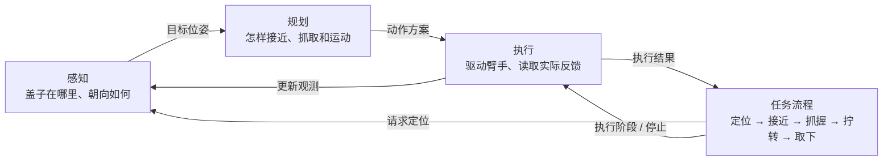

# 拧油箱盖项目合同

更新日期：2026-10-01。状态：已有模型预览、任务状态机、执行/估计接口和 mock 后端，已完成当前单场景 MTC 接近规划及 MuJoCo 运动学回放；图像感知与完整物理执行尚未接入。
本文件统一记录当前任务、装配参数、实现状态与待办。README 提供入口，预览说明记录工具用法，资产说明保留来源与转换证据；发生不一致时先核对本合同与用户最新确认，不自行覆盖。
目前仍以本文为主记录；任务代码仅镜像已确认的角度和通道目标，未确认的物理参数保持 `None`，不迁移整套机器配置。以后迁移到 `config.json` 等唯一配置源时，本文的参数表改为引用或生成内容，避免文档与配置各维护一套。

## 状态约定

- 用户确认：确认了任务要求或预览装配方式，不等于实物标定。
- 模型推导：来自所提供 CAD/网格的尺寸或坐标计算。
- 预览假设：为了当前展示选取，不能直接用于真机。
- 待确认：没有可靠交付值；以后配置使用显式空值和状态，不能以 0 或单位旋转冒充已确认值。

## 任务与阶段

| 项目 | 当前约定 | 状态 |
| --- | --- | --- |
| 唯一任务 | 拧油箱盖；油箱门默认已打开，不执行开关门或加油 | 用户最新确认（2026-09-21） |
| 操作终态 | 拧开并完全取下，结束时由手持盖；暂不做装回或放置 | 用户确认（2026-09-22）；脱离与持稳的量化判据待定义 |
| 动作分工 | 拇指、食指和中指握紧盖体握梁后保持抓握，由机械臂完成旋转和取下 | 用户确认动作分工；可达性、连续转动范围与抓持能力待验证 |
| 拧盖手部通道目标 | `[0, 0, 440, 390, 660, 0]`，严格保留顺序；按现有通道说明依次为小指、无名指、中指、食指、拇指弯曲、拇指旋转 | 用户确认数值（2026-09-22）；为通道指令值，尚未映射到当前仿真或下发硬件 |
| 位姿识别 | 独立视觉估计模块提供盖体位姿、螺纹轴线与握梁方向，支持目标位置变化 | 估计接口已有 mock 及标注来源的仿真真值输入；图像估计尚未实现，锁紧程度不可仅凭外观认定 |
| 硬件链 | 单臂 AUBO i10 → 传感器 → adapter → RH56DFX 右手 | 用户确认 |
| 交付 | 首轮仿真；真机后续接入 | 用户确认 |
| 油箱盖机构 | 螺纹连接；从灵巧手正对盖体的视角，逆时针拧转 225°（0.625 圈）解锁取下，顺时针锁紧，无需按压；导程与轴向行程待确认；阻力与力矩限值暂缓细化 | 用户确认机构、方向与取下角度（2026-09-22）；尚未实现螺纹啮合或开盖执行 |
| 失败处理 | 停止任务并等待人工；不自动重试、松手或恢复 | 用户确认；保持能力待控制接口确认 |
| 规划/执行 | MTC 做无接触粗运动；MuJoCo 执行局部接触与物理仿真；同一组关节只有一个控制方 | 编排与执行接口已有骨架；MTC/MuJoCo 动作尚未接入 |

全程无液体，不实现出油、流量或供油反馈。开关门、取枪、插枪、扳机操作及旧加油流程均不属于当前交付或后续开发承诺。门已打开不等于盖体已取下；组合预览默认门板相对箱体正面向外打开 135°（用户确认，2026-09-24）；避让空间尚未验证。

预期流程：位姿估计 → 接近 → 拇指与食指抓稳握梁 → 机械臂旋转并配合轴向移动 → 确认螺纹脱离 → 退离并持盖。执行坐标轴和角度正负号须按上述观察视角映射；转过约定角度不单独证明物理脱离成功。

### 手部通道与抓握

通道目标以本节参数表为准。顺序依据 [RH56 控制说明](../assets/reference/aviation/doc/hand/README.md)：中指为第 3 项，食指为第 4 项，拇指弯曲与旋转为第 5、6 项。其余手指也保留用户给定值，不因三指夹持而改写。

参考脚本命令范围为 0～1000，一般解释为 1000 张开、0 最大弯曲，-1 保持当前状态。数值为设备/脚本通道指令，不是关节角或握力百分比；当前模型的关节端点与耦合映射仍需核对。接近预型、抓握目标切换时机、接触点与手盖位姿尚待落实，当前目标尚未应用到仿真或硬件。

### 当前模型的预览映射约定

本轮按用户授权接入场景与抓型预览。以下映射仅为当前 MJCF 的运动学预览假设，不是 RH56 实物标定，也不使用旧航插角度端点：

- 六通道对应当前执行器 `pinky / ring / middle / index / thumb_proximal / thumb_yaw`。
- 每个驱动关节的可用区间取执行器范围、驱动关节限位、从动关节线性耦合所允许区间的交集。通道 1000 对应区间下端，0 对应上端；中间值线性插值，拇指旋转的端点方向也属未标定假设。
- 从动关节按当前 MJCF 的 `equality/joint` 关系设置，保留参考位置偏移。预览直接设置目标姿态并运行 `mj_forward`，不靠动力学自动闭合，也不修改原始限位或控制增益。
- 当前推导的端点如下，单位 rad；运行时由模型计算，此表只记录核对结果。

| 执行器 | 通道 1000 端点 | 通道 0 端点 |
| --- | --- | --- |
| pinky / ring | 0.093607306 | 1.531023368 |
| middle | 0.093607306 | 1.500000000 |
| index | 0.067150148 | 1.500000000 |
| thumb_proximal | 0.100000000 | 0.488721805 |
| thumb_yaw | 0.000000000 | 1.308000000 |

盖体估计原点选用 `cap_grip_center`（握梁几何中心），以世界坐标表达。该模型握梁长轴为局部 +Y，因此接口轴取 X=模型 +Y、Y=模型 -X、Z=模型 +Z，以满足接口的 X 沿握梁、Z 朝开口外侧约定。来源标为 `simulation_ground_truth`，时间戳使用仿真时钟；几何真值不代表锁紧/脱离反馈或图像识别成功。

### 抓取位姿搜索合同

用户授权（2026-09-24）：固定已冻结的闭合通道目标，搜索手根 `base` 相对接口盖体坐标系（原点为握梁中心，X 沿握梁，Z 朝开口外侧）的候选位姿。用户随后提出采用适度张开的接近预型，再闭合至冻结目标。接近预型由工具在模型张开端点 `[1000, 1000, 1000, 1000, 1000, 1000]` 与冻结目标之间探索，闭合进度暂采样 0、0.25、0.5、0.75；候选通道仅为仿真假设，不写入已确认实物参数或任务 `approach_channels`。拇指旋转也参与此插值，不将所有通道统一解释为张开宽度。

搜索工具将传感器、adapter 和手作为可自由摆放的局部装配副本，保留箱体、盖体和当前打开的门；不改原始模型或冻结通道。候选输出包括 `cap_from_hand`（手根在盖体系的位姿，米/XYZW）、拇指、食指和中指与握梁的最近表面距离/位置、碰撞及淘汰原因。传感器和 adapter 没有碰撞几何，明确列为未检查项。指尖参考点只用于生成候选与限定接触邻域，不能代替指腹；当前邻域是未标定的几何代理，仍需目视核对。

2026-09-24 修正：冻结的是驱动目标，不是接触后的实际关节角。空载目标形状进入握梁或发生指间重叠不能单独否决抓取；此前仅用 `qpos` 强设冻结形状的搜索是静态形状诊断，其“无几何候选”不等于无可行抓取。该诊断保留作对照，不作为接触搜索的淘汰条件。

运动学候选生成仍使用未标定的软件探索设置：末端表面接近距离 1 mm、几何穿透诊断尺度 0.1 mm、距指尖 site 的代理区域 12 mm、侧面边缘余量 1 mm；这些值只用于候选排序。分别从通道闭合进度 0.4、0.6、0.8、1.0 的空载形状生成候选，同时沿盖体外向轴探索 0/10/20/40/60 mm 的偏移，在候选位姿联合检查接近预型是否与环境穿透，再做局部接触探索。冻结目标不改写。

局部探索在独立内存场景中固定盖体和门板，固定手根位姿；不执行拧盖或机械臂运动。手指仅初始化一次到候选接近预型，之后通过 `ctrl` 向冻结目标变化，用 `mj_step` 求实际姿态，不逐帧强设手指 `qpos`。沿用源模型已有的质量、增益、力矩限制、摩擦、接触与耦合参数，并将实际编译参数写入报告；这些参数未标定，不解释为真实传感器读数或已确认力矩限值。软件探索采用 0.5 ms 步长、`implicitfast` 积分器，1 s 目标渐变、1 s 固定目标观察，末段 0.2 s 记录力与速度。以上时间仅为探索设置，不是任务验收时长。

输出实际关节角与目标误差、三指接触法向力、接触位置、实际穿透、其他手部接触和末段速度。法向力大于 `1e-6 N` 只标记数值上观测到接触，不能代替抓稳阈值。分类为三指接触已观测、接触不足、初态干涉或数值异常；抓稳/载荷/滑移、力矩安全、碰撞容差和持稳验收保持未验证。末段接触力方差或速度大小只记录，不擅自设物理通过门槛。固定盖体试验不能证明能持起盖体，也不验证螺纹脱离。

候选结果不自动写入任务抓取参数。当前用户候选的机械臂端点 IK 已单独接入，见后文对应章节；搜索产生的其他候选、接近路径和完整旋转空间仍需后续验证。

### 手动抓姿工具

2026-09-30：先在固定盖体的局部场景中人工调整手根相对位姿与接近预型，再通过冻结目标观察实际闭合。入口为 `tools/tune_cap_grasp.py`；不运行批量搜索、不驱动机械臂、不修改正式任务参数。

界面位置以盖体系毫米表示，姿态为度制固定轴 XYZ RPY（矩阵 Rz·Ry·Rx），旋转保持手根位置不变。保存使用米和 XYZW 四元数。六通道接近预型允许逐项调整，最终闭合目标只读并从现有合同镜像读取。默认预型为模型张开端点与冻结目标的中点，仅作界面起点；初始位姿用三指参考点几何生成并沿盖体外向偏移 60 mm，仅供人工调整，不是有效抓姿。

闭合复用局部接触实验的步长与渐变/观察时间。应用调姿或重置是显式的新实验初始化；闭合过程中不强设手指 qpos。初态干涉按现有探索判据阻止闭合并显示原因；该判据是软件探索规则，不是实物碰撞容差。停止按钮只暂停这个局部实验，不表示硬件停稳或保持能力。正常实验结束停留在实际末态。

保存文件记录手盖相对位姿、预型、冻结目标、模型来源、实验设置与实际采样；未闭合和中断结果分别标记，不能冒充已完成实验。重新载入只恢复候选初态，须显式重新闭合；检查工具格式、场景哈希、MuJoCo 版本及冻结目标。不兼容文件不加载，不覆盖正式参数。初始候选、接触已观测及人工保存均不代表抓稳或拧盖验收。

### 用户手动候选与凹槽修改请求（2026-09-30）

用户提供调姿截图，选定以下数值作为抓取候选：盖体系手根位置 `[-20, 75, 160] mm`，固定轴 XYZ RPY `[180, 50, 90] deg`；接近预型按原通道顺序为 `[0, 0, 800, 800, 900, 0]`。最终闭合通道仍引用任务参数表，不改写。候选使用工具的 `cap_from_hand` 格式保存，位置转为米、旋转转为 XYZW 四元数；后续世界位姿由盖体位姿与该相对变换相乘得到。

用户随后将 Y 从 78 mm 调整为 75 mm，其余位姿和预型不变。最新截图显示三指接触已观测，拇/食/中末端对握梁法向力分别约为 9.45 / 9.38 / 8.54 N，最大接触深度 0.027 mm，其他承载接触与初态干涉均为 0。这些为用户截图记录；独立重跑结果单独记录于候选文件。法向力显示为各指接触法向分量的标量和，不是同一方向的合力；盖体固定可承受不平衡反力，三指接触不等于自由持稳、可达或拧盖验收。

用户随后明确只加宽外侧入口，半径增加 50 mm。新的入口尺寸见“场景记录与有效性”，槽底、环口、通孔、深度和盖体位置保持原值。候选文件为 `artifacts/manual_grasp/user_selected_20260930.json`，重新关联加宽后的场景并核对相对位姿；先前 Y=78 mm 的接触不足结果不沿用到当前候选。

### 当前候选的机械臂 IK 与完整装配预览

2026-09-30：用户授权将已选手盖候选接回当前 i10 模型，验证当前场景端点 IK 并显示完整装配。目标手根由估计接口提供的盖体世界位姿乘以 `cap_from_hand` 得到；法兰到手根变换从模型当前固定安装链读取，取逆换算法兰目标。机器人基座为 `base_link`，法兰为 `wrist3_Link`，手根为手模型 `base`，不混淆三个坐标系。

使用当前模型的六个 i10 关节及限位进行数值 IK，不新增规划或控制依赖。软件求解设置：24 个确定性初值（随机种子 0）、每初值最多 250 次迭代；位置收敛阈值 0.1 mm、姿态收敛阈值 0.1°；旋转残差权重 0.2 m/rad、阻尼 0.01、单步关节增量范数上限 0.2 rad。这些仅为数值求解设置，不是实物标定精度或动作限值。未收敛只表示本次数值搜索未找到逆解，不证明全局不可达。

默认显示候选接近预型；可切换查看候选文件中记录的实际闭合手指姿态，不强设空载闭合目标形状。闭合姿态仅复现此前固定夹具实验的关节采样，不是在完整机械臂上重新进行接触执行。

端点检查记录当前模型启用的机器人接触对和穿透；超过 0.1 mm 单独列为几何干涉（软件诊断尺度，非物理容差）。优先展示该范围内无明显干涉且靠近预览初态的逆解。传感器/adapter 没有碰撞几何，地面碰撞在当前场景中关闭，均列为未检查；不声称完整碰撞安全。模型安装仍未标定，机械臂沿途、连续拧转空间、负载、抓稳及真机保持能力仍待验证。

预览只设置关节并运行前向计算，不插值成未经规划的轨迹，不驱动真机。求解与显示不改写原模型、冻结通道或正式任务参数。

入口 `tools/preview_cap_ik.py`，实现 `src/fuel_cap_task/arm_ik.py`。本次当前场景求得 12 组数值端点解；首选手根位置/姿态误差约 0.017 mm / 0.020°，关节顺序与数值、变换链和碰撞对保存在 `artifacts/arm_ik/current_candidate.json`。最初发现基座/肩部碰撞网格约 8.8 mm 重叠，后按 SRDF 相邻规则补齐显式排除（见下一节）。更新后原始预览及首选逆解的机器人穿透接触为 0；其他部分逆解的前臂/腕部自碰仍能检出，报告保留。结论只覆盖当前启用的碰撞几何。已生成并目视检查完整装配和手盖近景；21 项场景与 IK 检查通过。

### i10 相邻 link 碰撞排除

2026-09-30：依据当前 i10 SRDF 中 `reason="Adjacent"` 的 6 对规则，逐项验证它们也是当前 URDF 的直接父子 link，再转换为 MuJoCo 的 body-pair `contact/exclude`。同步至 i10 单体、臂盖场景及完整臂手场景；生成器重建时保留。SRDF 中另外 3 对 `Never` 非相邻规则本轮不自动导入，不扩大排除范围，不关闭任一 link 的全部碰撞。

基座固定在世界坐标系，不能依靠 MuJoCo 默认父子过滤避免该对接触，因此需显式排除；其余相邻对也显式同步以与模型语义一致。现有 RH56 排除规则保持原样；传感器/adapter 固定安装链没有碰撞几何，不视为已验证无干涉。局部手部场景拆除机械臂时同步移除引用被删除 body 的排除项。

此修改只修复碰撞过滤，保持网格、运动学、抓姿和通道不变。旧组合场景哈希失效后，当前候选已重新进行固定夹具试验、IK 报告已重新生成，不静默绕过加载检查。完整父子 link 核查记录在 `artifacts/arm_ik/parent_link_audit.json`；未发现剩余的、启用碰撞几何且未过滤的静态父级例外。传感器/adapter 无碰撞几何的记录仍标为未覆盖。23 项场景/IK/过滤回归通过。

### 有边界的随机场景

2026-09-30：用户授权按讨论范围编码。采样变量是机械臂 `base_link` 系中油箱外表面开孔中心：X∈[0,0.20] m、Y∈[-1.0,-0.80] m、Z=0.6 m（2026-10-01 随开孔提高更新），且水平距离不超过 1 m。油箱相对基线绕竖直轴偏航 ±30°，盖体相对基线绕开口轴 ±30°；保持盖体同轴与原轴向深度、门的相对打开姿态及手盖候选不变。这些是仿真测试范围，不是已验证工作空间或实物标定。

油箱偏航先绕其几何中心的竖直轴计算，再整体平移使开孔中心到达采样目标；角度单项测试保持最终开孔中心在基线位置，不表示旋转过程中油箱中心不动。不绕原始油箱局部 Z 轴侧倾，也不绕机械臂基座公转。每个场景重新编译内存模型，避免修改静态 body 后碰撞缓存不同步；不写回源场景。

默认固定随机种子 0，每类 4 个随机样本，另加 1 个原始基线，共 17 个：位置单项、油箱偏航单项、盖体朝向单项、混合变化。位置在矩形内均匀采样后按水平距离拒绝越界项；这是采样域约束，不按 IK 或碰撞结果挑样。每个合法样本复用当前 IK 设置，保留全部结果：`endpoint_clear`（启用几何下无超过诊断尺度的穿透）、`endpoint_interference`、`ik_not_found`（本次数值搜索未找到，不代表全局不可达）。逐样本写检查点；中断保留已完成记录，不自动恢复或重试。

可视化展示预型与对应端点；无逆解时显示原始机械臂姿态和目标标记，不伪造到位姿态。不迁移原场景闭合采样作为随机场景接触结果，不运行动力学或路径执行；传感器/adapter、地面碰撞等原未覆盖项保持未验证。

入口 `tools/sample_cap_scenes.py`，实现 `src/fuel_cap_task/random_scenes.py`。首次种子 0 的 17 个样本全部找到至少一个启用几何下无明显干涉的逆解；结果与全部采样参数保存在 `artifacts/random_scenes/report.json`。26 项场景/IK/采样回归通过；交互样本切换、逆解切换、视角和正常退出已实际验证；已生成17张离屏图并目视检查混合样本。有限样本端点结果不等于整个连续工作空间或路径验收。

### 油箱口提高与车体占位加高（2026-10-01）

用户要求将开孔中心距地面从 0.40 m 提高到 0.60 m；凹腔、环口、盖体及门板保持相对位姿整体上移 0.20 m。车体占位长方体高度由 0.80 m 增至 1.00 m，底面仍为世界 Z=0，宽和厚保持原值；顶部提高 0.20 m，孔位不重新居中。凹腔尺寸、环口、深度、盖体形状、门相对打开角及手盖候选不变。

实现采用原带孔体整体上移、向下延伸实体底部到地面；延伸部分为同一箱体 link 的显示与碰撞 box，不拉伸凹腔和螺纹轴向几何。新增 `tank_body_center` 几何参考系表示加高后的车体中心，供随机场景偏航使用；不能继续将开孔中心假定为车体高度中点。随机场景默认高度跟随更新，其他采样范围引用原节。

旧场景、候选闭合、IK、随机样本和 P0 报告归档于 `artifacts/scene_history/20261001_height_040/`；不沿用为新场景结果。重建当前 MuJoCo 场景，重新进行同一相对候选的固定夹具闭合及 IK，再派生 MoveIt 模型与审计。历史截图保留并标注原场景来源。物理安装、参数标定、路径与完整取盖仍未验证。

实际检查：世界开孔中心为 `(0, 1.0, 0.6)` m；车体外包围盒 Z 范围为 `[0, 1.0]` m，几何中心为 `(0, 1.2, 0.5)` m（网格浮点舍入误差按测试容差处理）。凹腔、环口、盖体、握梁中心和门板的世界变换均只增加 0.20 m 高度，彼此相对变换不变；机械臂安装和初始姿态不变，全部原油箱 STL 哈希不变。变更检查记录在 `artifacts/planning_model/height_change.json`。

同一相对候选已独立重跑固定夹具闭合，三指接触仍被观测，当前采样写入候选文件；用户截图仍明确标注原高度来源。重新求得 12 个端点逆解：首选误差约 0.00479 mm / 0.00471°，原覆盖下 8 个无碰撞。默认 17 个随机样本全部完成、均为原覆盖下 `endpoint_clear`，其高度从场景读取；图集已重新生成。以上仍不证明抓稳、路径或动力学执行通过。

MoveIt 模型已重新生成、构建并进行两种覆盖审计：19 个构型全部机器人 link 的 FK 对照通过，最大矩阵元素误差约 2.11e-15，KDL 19/19，原覆盖碰撞对照一致。当前原覆盖/规划覆盖环境对象数分别为 197/198；规划侧原有安装件障碍负例通过，12 个逆解中 6 个无碰撞，首选 `ik_00` 无碰撞，另外 2 个原覆盖下无碰撞分支被地面淘汰。当前报告覆盖旧报告，旧高度 P0 结果保存在上述历史目录；规划与 MuJoCo 的新增碰撞覆盖差异仍保留。

28 项场景测试通过（含 2 项新几何/刚性关系回归），2 项规划来源测试通过；来源哈希校验通过。实际更新并检查全景与近景图，车体底面落地；本轮未进行新的 GUI 操作验收、MTC 路径或完整取盖验证。

### 视觉估计与反馈

位姿识别独立成模块，以支持目标位置变化。建议输出盖体位姿、螺纹轴线、握梁方向、参考坐标系、时间戳及有效性/置信度；需处理对称握梁的朝向歧义。首轮是否包含图像识别与位置泛化验收，以及相机、标定、精度和工作范围，仍待明确。

首轮仿真可经同一估计接口提供明确标注来源的仿真真值，但不构成视觉识别或泛化验证。识别无效时不进入抓取；实际锁紧程度、启动力矩和可靠的脱离结论不能仅凭外观认定，需独立定义初始负载条件及执行反馈。

### 规划与执行约束

- 任务层负责状态机与服务编排，不直接发送关节命令；同组关节切换控制权前确认停止和交接。
- MTC 负责无接触粗运动；MuJoCo 执行层负责局部接触、螺纹旋转/轴向配合及抓持稳定。真机后端后续接入。
- 规划通过不等于动力学通过；PlanningScene attach/detach 仅表示逻辑同步，不能替代物理抓放判据。
- 失败后停止任务及后续流程并等待人工，不自动重试、松手或恢复。停止不直接等于断电；实际保持能力须由控制器接口确认。
- 阻力与力矩限值按用户意见暂缓细化，可先推进位姿接口与运动学；物理执行验收前仍需负载假设和停止阈值，不将未知值写成零阻力或无限限值。

## 资产与坐标来源

| 资产 | 来源 / 派生入口 | 尺寸与坐标 | 状态 |
| --- | --- | --- | --- |
| i10 | `assets/robots/aubo_i10/`；[官方来源记录](hardware/aubo_i10_sources.md) | 当前使用 `wrist3_Link` 作为预览安装父坐标系 | 已接入；具体实机版本与法兰匹配待核对 |
| 传感器 | `assets/robots/sensor/source/传感器.STEP`、`传感器.STL`；`assets/robots/sensor/urdf/sensor.urdf` | 外径 75 mm，总高 33.5 mm；底面中心为原点，+Z 朝顶部 | 用户提供模型并认可外观；尺寸为模型推导 |
| adapter | `assets/robots/adapter/source/连接件.STEP`、`连接件.STL`；`assets/robots/adapter/meshes/adapter.stl` | 底盘外径 63 mm、厚 10 mm；上部凸台外径 38 mm；总高 25 mm，凸台长度 15 mm | 用户提供模型；尺寸为模型推导 |
| RH56 | `assets/reference/aviation/third_party/correlllab_rh56_controller_h12/mujoco_inspire/inspire_right.xml` | 手根入口网格内径约 38 mm；内部还有结构，不据此认定插装无干涉 | 参考模型，与当前实物一致性待核对 |

传感器网格转换：`p_sensor = (p_STL - [37.5, 37.5, 0]) × 0.001`。
adapter 网格转换：`p_adapter = (p_STL - [31.5, 31.5, 0]) × 0.001`。
输入为毫米，派生网格为米；均保留原始文件，不采用旧 FR3 安装参数。
详细网格与转换证据见 [传感器资料](../assets/robots/sensor/README.md)、[连接件资料](../assets/robots/adapter/README.md)。

## 当前装配变换

下表表示子坐标系在父坐标系中的位姿，平移单位为米，RPY 单位为弧度。RPY 按 URDF 的绕固定 X/Y/Z 轴约定；当前均为零旋转。

| 父坐标系 | 子坐标系 | xyz（m） | rpy（rad） | 来源与有效性 |
| --- | --- | --- | --- | --- |
| `wrist3_Link` | `sensor_link` | `[0, 0, 0]` | `[0, 0, 0]` | 预览假设：传感器底面接机械臂，同轴放置 |
| `sensor_link` | `sensor_output_frame` | `[0, 0, 0.0335]` | `[0, 0, 0]` | 模型顶面位置；实物方向和孔位待确认 |
| `sensor_output_frame` | `adapter` | `[0, 0, 0]` | `[0, 0, 0]` | 预览假设：连接件底面贴传感器顶面 |
| `adapter` | `rh56_provisional_mount` | `[0, 0, 0.010]` | `[0, 0, 0]` | 用户要求凸台全部插入，手根部落在底盘肩面 |
| `rh56_provisional_mount` | 手模型 `base` | `[0, 0, 0]` | `[0, 0, 0]` | 当前参考模型根坐标关系 |

**插入深度为 15 mm：连接件总高 25 mm − 底盘肩面高度 10 mm。**
这是装配位置调整，不是执行了一段插装轨迹。手安装原点距 `wrist3_Link` 沿局部 +Z 为 **43.5 mm**（33.5 + 10）；该原点不是已标定 TCP。
旧的手安装偏移 25 mm（未插入）、距法兰 58.5 mm，以及更早 40 mm 占位参数均已废弃，不能再作为当前装配值。

## 场景记录与有效性

| 项目 | 当前值 / 入口 | 有效性 |
| --- | --- | --- |
| 组合预览 | `assets/scenes/i10_rh56_fuel_cap_preview.xml` | 20 个关节、6 个手部执行器；仅 `mj_forward` |
| 油箱 | 立起后宽/高/厚 0.8/1.0/0.4 m；底面中心世界坐标 `(0, 1.2, 0)` m，开口朝 -Y | 用户指定粗模与预览布局 |
| 开孔中心 | `tank_opening_center` 世界位置 `(0, 1.0, 0.6)` m，坐标轴分别朝世界 +X/+Z/-Y | 外表面中心，不是槽底或环口端面 |
| 油箱口 | 凹槽入口直径 220 mm（半径 110 mm），槽底直径 80 mm；环口外/内径 60/50 mm，凸起 3 mm | 用户指定尺寸；2026-09-30 仅入口半径增加 50 mm，公差待交付 |
| 凹槽深度 / 腔体 | 40 mm / 50 mm 孔贯通箱体 | 软件假设与建模简化 |
| 机械臂底座 | 世界原点，整体绕世界 Z 旋转 180°；距开孔外表面水平 1 m | 预览布局，可达性未验证 |
| 油箱盖 | 同轴展示，灰色肩面贴环口；白色下部直径 40 mm、伸入 20 mm | 粗模，不代表螺纹或锁紧机构 |
| 油箱门 | 组合预览默认相对箱体正面向外打开 135°；关闭时为 0°，正对油箱时右侧铰链 | 用户确认初态（2026-09-24）及铰链侧；尺寸、质量与铰链限位仍为[场景占位参数](mjcf_inspection.md#组合场景门板)，避让空间未验证 |

当前已检查传感器独立 URDF 加载和渲染，以及组合加载、前向计算和安装位移。传感器与 adapter 仅显示、无碰撞、零密度；未交付质量惯量、接触参数或传感器测量接口。手根原有碰撞近似为实心圆柱等形状，并不保留入口空腔，后续接触验证前需处理这一差异。
未验证内部装配干涉、实际插装、载荷、抓持稳定、手门接触或完整任务；PlanningScene attach 也不能替代物理成功判据。独立开关门代码与场景已按用户要求删除。

组合场景生成器将门体参考朝向与铰链 `ref` 同时设为默认打开角（135°），使直接加载及 `mj_resetData` 后的几何姿态一致，并保持铰链读数 0 表示关闭。该初态设置不执行开门轨迹，也不代表动力学保持。仅保留组合场景门板几何和铰链，不生成独立开关门场景，不注册开关门被动力矩回调。

## 实现状态与下一步

| 状态 | 内容与验证边界 |
| --- | --- |
| 已接入 | i10 URDF/MJCF（6 关节）、RH56 参考模型（12 关节、6 执行器）、传感器与 adapter 显示几何、油箱粗模及盖体粗模 |
| 已检查 | 模型加载、前向计算、渲染和安装位移；油箱采用分段凸碰撞网格，开口未被整体凸包封闭 |
| 仅预览 | 组合含门铰链共 20 关节，只运行 `mj_forward`；`cap_twist` 为简化旋转关节，无螺纹啮合、轴向脱离或锁紧机制 |
| 局部接触探索 | `tools/search_cap_grasp.py`：候选位姿搜索与固定夹具闭合实验；空载目标重叠只作诊断，实际手指通过 `ctrl` / `mj_step` 运动，未接任务执行器 |
| 已实现骨架 | Python 异步状态机、估计/执行接口、mock 后端与 JSONL 事件记录；只验证任务编排，不驱动模型 |
| 尚未实现 | MTC/MuJoCo 执行后端、图像识别、拧盖控制与物理抓握；尚未验证带载、滑移、螺纹接触及完整流程，未接真机 |

已确认的要求不等于已实现的动作。后续按以下缺口推进：

| 待办 | 需要落实的内容 |
| --- | --- |
| 螺纹与起始条件 | 导程、轴向行程、初始盖体位姿与锁紧状态；已确认的旋转角度不能单独推导轴向位移 |
| 抓握与运动 | 手盖位姿、接触点、接近预型、通道到当前模型的映射、速度、滑移判据；验证连续转动范围与可达性，若单次抓握不足再反馈动作限制 |
| 场景 | 机械臂起始姿态、已确认门打开初态下的避让空间、预览布局的适用性，以及首轮目标位置变化范围 |
| 感知 | 明确首轮视觉交付范围，落实估计接口、坐标变换、识别有效性和反馈来源 |
| 装配与物理模型 | i10/RH56/传感器实机型号版本，法兰匹配、传感器两面方向与孔位、绕轴角度、adapter 内部间隙和紧固方式；补全质量惯量、摩擦与碰撞 |
| 接口 | 传感器功能、量程、单位、测量坐标系、接口和标定；控制器停止/保持能力，负载与限值暂缓项在物理验收前落实 |
| 成功与验收 | 螺纹脱离判据、退离距离、持盖终态位姿、持稳时长与容差；重复次数、成功率、记录方式、失败停止与人工复位条件 |

遇到影响下一步的缺失参数，停止依赖该参数的修改并询问用户；不把临时预览值升级成实物确认值。

## 状态机与执行接口

实现位于 `src/fuel_cap_task/`，使用 Python 3.10 标准库，无 ROS 或 MuJoCo 运行依赖。任务实例只运行一次；失败或取消后由人工处理并显式新建任务，不提供自动重试/续跑。

正常流程：`check_ready → estimate → approach → grasp → twist → retreat → hold → completed`。
失败、超时或取消：`stopping → waiting_for_operator`；停止回执分别记录运动是否已停、抓握是否保持，未知状态用 `None`，等待人工不等于已经停稳。

| 接口/阶段 | 当前职责 |
| --- | --- |
| `CapEstimator.estimate` | 返回位姿、参考系、时间戳、来源、有效性和可选置信度；无效输入不进入接近 |
| `Executor.check_ready` | 检查本后端所需参数、场景和控制器；物理后端必须在运动前拒绝缺失的必要输入 |
| `Executor.approach` | 规划及接近；反馈到位、机械臂停止、局部控制权已取得，三项满足才进入抓握 |
| `Executor.grasp` | 接收合同通道目标，返回抓稳反馈；不以指令发送成功替代抓稳 |
| `Executor.twist` | 返回盖体实际转角、轴向进度（可选）、转角达标、螺纹解除和抓稳反馈；后面三项都满足才退离 |
| `Executor.retreat / hold` | 确认退出开口且抓持稳定，再验证持盖；正常完成后由执行器继续维持保持控制 |
| `Executor.stop_and_hold` | 停止后续运动、保留已有抓握，不额外闭手或松手；异常或无回执记录为未知并等待人工 |

估计接口的盖体局部 +Z 指向开口外侧（朝手），+X 沿握梁方向；四元数顺序为 XYZW。绕该 +Z 的正角度对应从手侧看到的逆时针。这是软件接口坐标约定，尚需在未来感知/执行适配器中映射到实际模型和控制器。

`TaskParameters` 镜像已确认的通道目标及旋转角度；导程、轴向行程、手盖位姿、接近预型、退离距离、持稳时长、角度容差均保持 `None`。速度、接触与控制器配置留给后续执行后端，不用模拟值补成实物参数。

mock 后端仅产生标记为 `mock` / `mock_no_physics` 的合成反馈，允许上述物理参数为空，不调用 `mj_step` 或硬件，也不完成图像识别。演示中的超时与延迟只用于软件流程检查，不是机械动作限值。实际后端方法需异步让出事件循环并响应取消；先结束活动操作，再请求停止确认。

事件日志记录状态变化、输入来源、请求参数、执行反馈、失败原因和停止回执。运行入口与测试命令见 [README](../README.md#状态机演示)。

### 模块边界与运行时接口检查

任务层只编排，不持有模型或发送关节命令。估计模块提供统一坐标约定的观测；MTC 完成无接触运动并停稳；执行器负责控制权交接、局部接触与完成后的持续保持。场景模块提供带来源的几何及变换，不自行证明抓稳或脱离。日志保留输入来源、失败阶段和停止确认。

运行时在进入下一阶段前检查接口：

- 估计须为 `CapEstimate`，有效标志严格为布尔 `True`；坐标系、来源与时钟域须为非空字符串。位置为三个有限实数，XYZW 四元数为四个有限实数且范数接近 1（绝对数值误差上限 `1e-6`，仅为软件表示检查，不是姿态精度指标）；不自动归一化错误输入。
- 时间戳为有限实数；允许仿真零时刻，不跨时钟域比较。可选置信度为 `[0, 1]` 内有限实数。本轮不猜测观测有效期或置信度验收阈值；这些仍由后续适配器明确。
- `check_ready` 成功返回 `None`，不就绪抛出异常。各阶段回执必须使用对应反馈类型，确认字段严格为布尔值；字符串、整数等不能充当确认。转角与可选轴向进度必须是有限实数；角度达标和螺纹解除仍由执行器独立判断，任务层不以角度替代脱离。
- 停止回执的两项确认仅接受布尔值或 `None`，畸形回执记录为未知并等待人工；不重新发起动作。软件等待超时须为有限正数。

上述检查和 mock 测试属于软件接口验证，不构成控制权互斥、停止保持能力、动力学或真机验收。

## 项目架构合同

2026-09-30：用户确认以下四模块图为当前架构基线，标志项目正式进入开发阶段。先完成可验证的闭环；完整模块图、时序图、状态图及详细接口设计留到对应功能开发时再补充。本节替代此前过细的模块拆分、目标目录和接口扩展清单；不将那些设想作为必做项。

图示为职责与主要数据流，不表示所有能力已实现，也不要求四个独立进程或 ROS 包。取下后的终态仍为持续持盖，具体任务要求见“任务与阶段”。

| 模块 | 职责 | 当前基础 |
| --- | --- | --- |
| 感知 | RGB-D 目标提取、位姿估计、坐标转换及环境占据表示，输出目标与环境观测的来源、时间和有效性 | `CapEstimator` 接口、mock 和仿真真值能力；图像估计及感知地图接入待实现 |
| 规划 | 抓姿候选、逆运动学、避碰与运动轨迹；无接触运动使用 MoveIt/MTC | 已有离线抓姿探索、端点逆解、有边界采样、MoveIt 模型审计及 P1 单场景 MTC 接近路径；随机场景路径回归待实现 |
| 执行 | 驱动臂手、局部接触控制、读取实际反馈；内部适配 MuJoCo 和后续真机 | `Executor` 接口与 mock；运动学预览和局部接触工具尚未接入任务执行 |
| 任务流程 | 顺序调用能力，检查阶段结果；成功继续、失败停止并等待人工 | `state_machine.py` 已有流程骨架 |

日志作为公共工具，配置作为数据文件，接口作为数据结构；暂不独立建设系统。现有 `src/fuel_cap_task/` 和工具入口保留，随着具体实现需要再组织目录，不预建空包或强行迁移代码。

### 数据与必要边界

- 油箱位置、盖体初始朝向等由每次运行的观测提供，不写死为任务常量。抓姿围绕盖体坐标表达，再转换到机器人坐标。
- 标定、模型物理参数、任务要求和测试条件分别标注来源；未知值保持未知。场景初始化数字可用于测试，不能冒充实物标定。
- 盖体初始朝向与解锁相对转角分别处理；视觉位姿不能单独证明抓稳、锁紧程度或螺纹脱离。
- 保留坐标/单位明确、观测无效不动作、同组关节单一控制方、失败停止，以及实际反馈与命令值分开的要求。具体控制交接和判断方式在执行模块开发时落实。
- 仿真真值标注来源；图像估计失败不能暗中用真值替代。mock、几何预览、接触仿真与真机结果分别报告。

### 视觉与 VLM

优先建立图像到盖体位姿的基线，VLM 目前不是必要依赖。需要目标语义或区域提示时，可在感知模块内部尝试接入，并由几何估计验证；不让文字判断直接充当精确位姿、抓稳证据或关节命令。不预先选模型、建训练平台或增加模型依赖。

### 开发推进

观测接口已支持有边界随机场景的仿真真值输入。P0 模型审计及 P1 单场景 MTC 接近规划和 MuJoCo 回放已完成，具体证据见相应记录；P2 路径回归、P3 旋转空间评价和 P4 局部执行衔接仍待实施。用户同时确认下节当前技术路线，RGB-D 图像估计和环境感知作为近期独立工作推进，不以 VLM 或接触网络训练作为路径规划前置条件。

现有局部接触工具用于独立实验，不代表完整执行。相机、精度及物理验收缺失项到相应开发阶段落实，不用占位值强行通过。本次技术路线确认只修改文档，不新增感知实现、控制或模型改动及仿真实验。

## 当前技术路线

2026-10-01：用户确认采用 [RGB-D 感知、MTC 规划与 MuJoCo 仿真路线](current_technical_route.md)。该文档与合作方博士总体路线在 `doc/` 同级归档，记录当前工程方法；总体路线仍为暂定长期研究目标。本节统一维护采用约定、当前状态和待办，不在路线文档重复维护任务数值或验证结果。

### 已采用的方法与边界

| 环节 | 当前路线约定 | 当前状态 |
| --- | --- | --- |
| 观测输入 | RGB-D 彩色/深度观测配准，深度经内参反投影形成点云，再转换到项目坐标系 | 相机型号、安装方式、内外参、深度有效性及精度待确认；当前目标观测仍为标注来源的仿真真值 |
| 目标提取 | 二维分割提取整个盖体，结合有效深度与已知几何估计参考点及旋转轴 | 图像链路待实现；二维 U-Net 为候选，可先用人工掩膜或简单分割验证基线，不预建训练平台 |
| 绕轴朝向 | 由 RGB 中握梁等非旋转对称特征估计，必要时结合深度；保留对称导致的朝向歧义 | 特征及歧义处理待验证；当前手动候选保持工程基线地位 |
| 几何与 PnP | 圆形凹槽/环口辅助中心及平面估计；使用车体参考推算盖体前核对同轴和轴向偏移。PnP 仅在可靠二维—三维关键点对应成立时评价 | 不将圆周任意点配对，也不凭圆形确定绕轴朝向；实际装配关系与几何估计方法待验证 |
| 环境感知 | 点云生成占据表示（OctoMap 为候选），与已知机器人、油箱及局部精细几何共同组成规划场景 | 当前仅有已知场景几何；未接入深度或占据地图，不宣称已考虑未知障碍 |
| 规划 | MoveIt/MTC 组织无接触运动，输入目标观测与一致的场景；保存模型、观测及场景来源 | P1 单场景两段接近已实现；当前 FixedState 场景仍为固定描述，不自动订阅新感知地图 |
| 仿真与执行 | MuJoCo 回放规划结果，后续补局部接触执行；两边几何一致性或差异须有记录 | 当前仅运动学回放及独立局部实验；尚无完整动力学执行或实时状态桥 |
| 任务流程 | 编排感知、规划和执行，检查阶段状态；失效停止等待人工 | 状态机与 mock 已有，真实到位、抓稳、脱离和持盖反馈待接入 |

目标感知需明确参考点位置、轴方向及绕轴朝向，组成项目约定的位姿；分割掩膜或可见点云均值不直接等于旋转轴中心。目标结果与环境地图分别输出，不用盖体分割替代环境避障。后续接口细化须包含坐标、单位、来源、时间与有效性，并记录朝向歧义；无需本轮预建完整消息或新包。

机器人已知运动学及碰撞模型继续保留，点云不替代关节链、安装标定和自碰撞模型。地图分辨率、误差裕量和自身过滤须结合场景间隙验证；无深度、遮挡或未观测区域不直接判为空闲。不得通过过度过滤目标邻域来消除真实车体障碍；规划后的新观测也不自动保证原轨迹仍有效。

执行算法与详细流程可以后续确定，但保留观测有效性、到位停止、控制交接、允许闭合、抓稳、旋转/轴向进度、脱离及持续持盖的判断要求。交接位置和条件待确认，不把本轮接近距离视为固定控制切换点；未知物理参数、冻结通道、单一控制方及失败停止规则不变。

### 感知基线与待办

1. 明确相机或仿真深度来源、安装视角、RGB/深度配准和内外参；确定盖体参考点与已知几何关系，不用占位值代替标定。
2. 先用人工掩膜或简单分割贯通图像/深度到三维目标，再接已有候选与 MTC；评价位置、轴线、朝向误差及失效情况。图像估计失败不得暗中切回真值。
3. 在受控场景中增加挡路障碍，分别使用已知几何和观测所得占据表示规划，检查障碍检出、漏检、路径或失败结果。仿真深度观测与仿真真值独立标注，真值仅作对照，不直接补入不可见点。
4. 基线成立后独立评价二维 U-Net、可靠关键点条件下的 PnP，以及真实相机静态观测；后续再确定地图更新、轨迹失效和停止衔接方法。

以上为待实施方向，不替代 P2—P4 的规划与执行计划，也不表示已选定相机、训练网络或完成未知障碍避让。具体数据规模、评价阈值、地图分辨率和物理执行条件在对应开发前写入合同。

## 长期研究目标与近期工作计划

### 采用依据与范围

2026-10-01：用户要求将合作公司博士编写的第五、六章技术路线落实到项目内部，暂视为最终目标。[参考原文](research_route_reference.md)独立归档；本节是项目采用方式、阶段状态和待办的唯一维护入口。原文是研究目标，不是已验证的方法或已完成成果；不据此承诺整套路线同时交付。

长期目标包括：全盖体可见表面及接触邻域的候选生成、接触对齐与臂手构型求解、面向旋拧的传矩/方向可操作度/局部运动/鲁棒性评价，以及受约束旋拧、参数估计和必要时的接触重构。原文还包含旋紧/复装及专用末端对照，保留为远期研究范围，进入实施前须明确其任务、数据和实验条件。

当前交付边界仍为旋松、取下并持盖；保持现有三指分工和冻结闭合目标，由机械臂旋转。采用长期目标不自动授权改变通道、增加复装动作或执行中换抓。先完成当前闭环，再依据结果决定扩展；相关具体要求需先更新合同。

当前握梁先验与手动候选定位为工程和实验基线。模型、坐标链、接触工具、IK、场景采样和任务接口供后续自动候选复用；手动候选本身不被提升为有效或最优抓姿。扩大到全表面后，保留当前方法作对照，不将限定握梁搜索的结果称为自主发现握梁区域。

### 从当前基线到最终目标

| 阶段 | 研究/工程内容 | 进入下一阶段的依据 |
| --- | --- | --- |
| 当前基线 | 握梁先验、固定抓姿候选、局部闭合、完整臂手端点 IK、有限随机场景、P1 单场景接近规划与回放 | 当前单场景几何路径已有证据；随机场景路径和完整物理执行仍缺，见各实现记录 |
| 近期规划与执行闭环 | 无接触接近规划、旋转空间分析、局部接触与螺纹约束执行、脱离后持盖 | 分别验证路径、抓稳、进度和终态；明确模型假设与失败原因 |
| 任务驱动构型优化 | 保留握梁基线，比较不同初始手盖位姿及机械臂逆解；引入方向行程、传矩及误差评价 | 载荷、摩擦、驱动限制有依据；硬约束先筛除，不用综合高分覆盖约束失败 |
| 全表面候选与学习式预测 | 先建立几何候选对照，再研究 VLM/分割/深度、体素、三维 U-Net 接触预测与对齐 | 明确标签含义、来源与有效性，区分几何贴合和任务可承载；独立测试，避免标签预先限定握梁后宣称自主发现 |
| 受约束协同与远期扩展 | 轴线及轴向关系估计、分段旋拧、接触重构；后续旋紧/复装和专用末端对照 | 明确触发、保持接触、切换成功及失败停止条件；具备相应设备/数据后实施对照，不虚构基线结果 |

阶段允许共享工具和交叉研究，但未知物理条件不能被学习输出或运动学结果替代。已有 VLM 的使用与接触网络训练分开评估；无需从头训练 VLM，也不预先引入训练平台。初段运动评价服务初始构型筛选，完整取盖交付仍需覆盖全部约定进度和终态。

### 近期工作计划：优先补规划

当前已有 P0 模型审计和 P1 当前候选的单场景接近规划与回放证据，见相应记录；既有随机样本仍只有端点结果，不能计为路径回归。下表保留规划优先的里程碑，下一项规划工作为 P2；当前技术路线中的感知基线可独立推进，相应参数明确前不修改依赖它们的实现。

| 顺序 | 工作与交付 | 验证要求与依赖 |
| --- | --- | --- |
| P0 规划模型与场景核对（已完成本轮模型审计） | 检查现有 ROS 2/MoveIt/MTC 环境与依赖版本；建立匹配当前 i10、完整安装链、手预型和环境的规划模型，核对关节顺序、限位、基座/法兰/手根变换与碰撞规则 | 与当前 MuJoCo 模型做代表构型的前向位姿比对；核对门、油箱及目标变换。补充传感器/adapter 和地面碰撞覆盖，几何代理须标来源；覆盖不全时只能报告部分几何验证。具体软件版本在接入时核对，不按旧 FR3 配置直接替换名称 |
| P1 当前场景无接触接近路径（已完成单场景几何基线） | 从明确的仿真起始关节状态，经抓取前位姿，到局部闭合开始前的候选预型位姿；用 MoveIt/MTC 规划无接触粗运动及适用的受限接近段；保存路径、起终状态、场景/候选来源和失败原因，提供离线回放 | 已确认设置及实际结果见 P1 节；软件探索值不写成实物参数。检查沿途关节限位、自碰及环境干涉；记录检查分辨率，端点无碰撞或简单关节插值不算规划通过。预期接触由局部执行层处理，不全局放开手盖/手车体碰撞 |
| P2 有边界场景的路径回归 | 将既有随机场景作为固定回归集，逐场景重新使用观测生成目标和规划场景；记录完整结果与检查点 | 区分无逆解、逆解干涉、路径搜索失败及无效输入；不以规划超时证明不存在路径，不按成功筛除样本。仍是有限样本，不声称整个区域通过；新增场景不复用旧闭合结果作接触证据 |
| P3 初始构型的旋转空间评价 | 从已有多个 IK 分支出发，检查沿约定旋转方向的关节连续性、行程余量和环境干涉；比较初始构型对后续旋转的影响，先形成运动学分析报告 | 绕估计盖轴推进对象位姿，再由固定手盖关系求手根目标，不能把转动手腕单关节等同于绕盖轴旋转。沿途跟踪连续解，拒绝分支跳变。导程/轴向关系未知时，只能做明确标注“固定轴向深度”的诊断，不是螺纹轨迹或完整旋拧通过；完整约束轨迹待参数明确 |
| P4 规划与局部执行衔接 | 将规划结果接入执行后端：无接触段到位并停止后交接控制；补接触保持、旋转/轴向配合、脱离与持盖反馈，再串联现有状态机 | 时间参数化和执行需要速度/加速度等条件；物理测试前明确阻力、驱动/力矩边界及停止条件。端点规划、attach 和角度达标均不能替代抓稳/脱离证据；同组关节单一控制方，失败停止等待人工 |

P0/P1 不依赖启动力矩和导程；P3 的完整螺纹轨迹、P4 的物理验收依赖缺失条件，届时询问并暂停相应部分，不用零阻力、零导程或无限限值补齐。当前单场景起始姿态和接近设置已由用户确认并记录在 P1 节，不自动作为其他场景或真机的设置。有限离散检查不能声称数学意义上的连续无碰撞证明。

图像估计与上述规划共用现有观测接口。近期另需明确相机/深度来源、标定和目标位姿基线，评估对称朝向歧义及误差；规划可以先用标明来源的仿真真值开发，不能将其计为图像感知完成。后续候选来源可从人工、几何替换到网络预测，规划与执行仍需独立验证。

### P0 MoveIt 规划模型建立（2026-10-01）

用户确认 MTC 规划、MuJoCo 仿真与回放，RViz 仅为可选调试窗口；本次授权先核对并建立规划模型，不实现 MTC 路径或动力学执行。

- 环境已核对：ROS 2 Humble，MoveIt 2 的本机 Debian 版本为 2.5.9，MTC 为 0.1.3；不新增系统依赖。完整包修订号由生成清单记录。
- 规划描述由当前已编译 MuJoCo 组合场景派生为 URDF/SRDF，保留 body/link 名、六个 i10 关节、固定安装链及十二个手部关节。六个手部线性耦合转换为 URDF mimic；这是运动学关系，不等价于 MuJoCo 软约束下的实际接触变形。
- 主动规划组 `arm` 为 `base_link` 到手根 `base` 的串联链，只含六个臂关节；手部单独分组，在接近规划时保持给定预型。预型读取现有候选，不重复维护通道值。URDF 的手部 velocity/effort 均用 0 作为禁止本阶段手部轨迹执行的配置，不解释为硬件能力；手部速度/力矩仍未知。机械臂速度/effort 仅保留来源 URDF 的未标定模型值，未批准用于执行；加速度和时间参数化留待后续。
- 关节位置范围以当前编译模型为依据，手部驱动范围额外取现有通道映射的可用交集。生成时核对 i10 源 URDF 与 MJCF 的坐标、轴和限位；源模型序列化舍入差异记录，不隐式改写原模型。
- 规划几何对照保留 MuJoCo 现有碰撞网格的逐 geom 凸包与基本形状，不将整个油箱凹腔整体凸化。新增传感器/adapter 碰撞使用现有显示几何的派生网格并记录近似；地面使用当前世界地平面。原场景不修改，原候选/报告哈希保持有效。
- 碰撞分为原有覆盖的对照模式与增加安装件/地面的规划模式。原有排除与必要的 MuJoCo 父子过滤显式记录；安装件仅对固定装配内部配对单独说明，不能据此豁免安装件与其他臂节、手指或环境的碰撞。固定基座与地面支承接触单独记录；其余地面碰撞保持启用。内部插装干涉及实物安装仍未验证。
- 使用 KDL 臂部 IK 插件；搜索分辨率 0.005、超时 0.05 s 为软件核查设置，非执行限值。本步只检查插件加载及已知 FK 目标的求解，不形成路径或到位结论。
- FK 审计覆盖初始预览、已有 IK 分支和确定性关节样本，核对所有机器人 link；平移及旋转矩阵元素数值误差阈值均为 1e-8，位置限位源文件舍入比较阈值为 1e-5 rad，碰撞对照仍采用既有诊断尺度。输出碰撞差异而非要求通过修改排除强行一致。

用户补充的通用环境入口为 `~/mujoco-env/bin/activate`，实测 MuJoCo 3.8.1，缺少 trimesh；当前候选记录及项目 `.venv` 为 MuJoCo 3.13.0。本次派生保留后者，不升级或混用两个环境。凸包使用系统已有 SciPy 1.8.0 在独立进程计算，未新增依赖。

模型输出位于 `src/i10_rh56_moveit_config/`，生成入口 `tools/build_moveit_model.py`，来源校验入口 `tools/check_moveit_model_sources.py`，无窗口审计入口 `audit.launch.py`。场景 JSON 是当前基线快照，动态观测到 PlanningScene 的同步留到下一阶段。

审计增加两类负例：超出臂关节上限的状态必须被拒绝；在传感器/adapter 原点放置边长 0.08 m 的临时障碍盒，要求对应 link 的碰撞被检出，之后删除测试障碍。已知目标 IK 测试使用原解各关节偏移 0.01 rad 后截回限位作为初值，位姿矩阵最大元素误差小于 1e-4 计为找回；这些仅为软件测试设置，不是任务动作参数。规划模型默认不启动 RViz、控制器或模拟执行，不将静态关节状态发布器伪装成执行反馈。

#### P0 首次验证结果（原高度场景，已归档）

- `colcon build --packages-select i10_rh56_moveit_config` 通过；默认无需 RViz，未启动任何控制器。实际加载 MoveIt RobotModel、KDL 与 FCL PlanningScene，两种覆盖模式分别正常退出。
- 19 个构型包括当前预览、已有 12 个 IK 分支和 6 个确定性臂手构型样本；每个检查全部 24 个机器人 link。两种覆盖模式均通过 FK、关节顺序、位置限位与 6 个 mimic 检查，最大变换矩阵元素误差约 2.11e-15。KDL 在两种模式均找回 19/19 个已知 FK 目标；不是新抓姿搜索或路径可达性证明。
- 原覆盖模式含 196 个环境对象，与 MuJoCo 的超过既有诊断尺度的碰撞 body 对在全部 19 个构型一致。规划模式增加地面后含 197 个对象，并启用传感器/adapter 表面网格；对应两个障碍物注入检查通过。安装件碰撞只在 MoveIt 侧补充，MuJoCo 原场景保持不变；后续执行前仍须同步或明确差异。
- 当前预览和首选 `ik_00` 在规划覆盖下未检出碰撞。已有 12 个 IK 分支中，原覆盖下 6 个无碰撞，规划覆盖下剩 4 个；新增地面在 6 个分支中检出碰撞，其中 2 个此前原覆盖下无碰撞。其余原有前臂/腕部自碰仍能检出。没有修改排除规则使失败分支通过，也不将有限构型检查解释为路径安全。
- 首次报告已归档于 `artifacts/scene_history/20261001_height_040/artifacts/planning_model/`；当前同名报告为提高后的重跑结果，见“油箱口提高与车体占位加高”。报告包含输入及生成文件哈希；生成清单保留源 URDF 与 MJCF 舍入差异、网格对应关系和排除原因。
- 来源失效检查的 2 项测试通过（覆盖输入变更、产物变更、源文件缺失）；26 项既有场景/IK/采样回归及 19 项任务编排测试通过。非法覆盖参数的启动实测返回非零，防止审计失败被误认为成功。
- 本轮未做 MTC 路径、实时场景/关节状态同步、动力学执行、随机场景路径回归或真机验证。手部 mimic 不代表实际闭合采样；安装件内部干涉、实物标定和物理负载仍未验证。下一步为 P1，需先明确起始姿态和接近设置。

实现参照本机 Humble API 及官方 [URDF/SRDF](https://moveit.picknik.ai/humble/doc/examples/urdf_srdf/urdf_srdf_tutorial.html)、[KDL 配置](https://moveit.picknik.ai/humble/doc/examples/kinematics_configuration/kinematics_configuration_tutorial.html)；实际版本以生成清单为准。

### 本次文档落实记录

仅归档参考原文、确立暂定长期目标和近期规划里程碑，更新入口及协作交接；没有改变模型、候选、正式任务参数、控制实现或既有实验报告。文档检查不构成新增仿真或真机验证。

## 将来迁移为唯一配置合同

迁移时保留合同版本、字段标识、值、单位、父/子坐标系、来源、确认状态和验证范围。
建议按硬件/资产、装配变换、场景、任务、验收分组；未确认值显式保留为空，预览值单独标识。
例如插入深度应由连接件总高与肩面高度推导，手到法兰距离由变换链推导，不能再维护独立可编辑副本。
配置成为唯一可编辑数值源后，模型生成与任务读取同一份配置，文档引用或生成摘要，并检查单位、坐标链和必填项；本轮不实施这一代码改造。

## 工具与来源入口

- [模型预览与排障](mjcf_inspection.md)：启动、重建、既有验证及占位门历史记录。
- [资产索引](../assets/README.md)、[硬件照片](../assets/hardware_photos/README.md)、[i10 官方来源](hardware/aubo_i10_sources.md)。
- [航插参考资产](../assets/reference/aviation/README.md)：保留 RH56 资料与来源；FR3 安装、航插抓姿及历史验证不作为本项目基线。

2026-09-24：补充模块边界与运行时接口检查，校验实现位于 `src/fuel_cap_task/validation.py`，已接入状态机。执行 `PYTHONPATH=src python3 -m unittest discover -s tests -v`，19 项软件行为测试通过，覆盖畸形估计/反馈拒绝、停止回执未知、取消和超时。未修改现有模型，未进行动力学或真机验证。

### P1：MTC 接近与 MuJoCo 运动学回放（2026-10-01）

用户确认本轮仿真起点为六个 i10 关节 `[0, -0.5, 1.2, 0, 0, 0] rad`（顺序沿用模型合同）；抓取前手根目标由当前候选沿估计盖体系外向 Z 轴退开 0.100 m，再直线接近候选。手部全程保持候选中的预型。数值只用于本轮仿真，不是实物标定或正式任务初态。

规划采用 MTC FixedState → MoveTo（OMPL RRTConnect）→ MoveRelative（CartesianPath）。不启用起点碰撞修复，不启用控制用时间参数化；未知加速度不以默认值代替。笛卡尔采样步长 0.002 m，相对关节跳变阈值 1.5，导出后逐关节最大 0.02 rad 加密复核全机器人 FCL 碰撞与限位；终点位置/方向复核容差为 0.0001 m/0.002 rad，轴向段横向偏差诊断容差 0.0002 m，MuJoCo 穿透诊断容差沿用 0.0001 m；离散验证不等于连续安全证明。回放时长由界面指定，仅为显示节奏；设置 qpos 并运行 mj_forward，不调用 mj_step 或执行控制器。

本轮实际结果：MTC 找到完整两段路径，抓取前运动导出 217 个加密路点、轴向接近 51 个路点。规划全覆盖 FCL 路点复核通过，MuJoCo 原有启用几何未检出机器人穿透，终点位置误差约 0.093 mm、方向误差约 0.007°；轴向段最大横向偏差约 0.093 mm，实际轴向进度约 0.100004 m。手部、盖体和门板关节保持不变。不是视觉估计、动力学执行、闭合抓稳或完整取盖验收。

产物为 `artifacts/planning/approach_request.json`、`approach.json`、`replay_validation.json` 和 `views/index.html`（含 APNG 动画）。回放入口 `tools/replay_cap_approach.py --view`。实际完成一次完整 GUI 回放并正常退出（退出码 0）；显示时长不作为执行时间。4 项规划/回放检查、28 项场景检查、19 项编排测试通过。越界起点负例返回非零，输出标记为未完成而非沿用旧成功报告；旧来源、错误关节顺序、预型不匹配、不连续/非有限轨迹和起点不符均被拒绝。

此交付为 P1 当前单场景几何规划基线，不将 17 个随机场景的端点结果升级为路径验证。后续 P2 随机场景路径回归、P3 旋转空间诊断和 P4 局部执行衔接仍待开展。没有实时状态桥或机械臂控制器，保留一组关节只能有一个控制方的交接要求。
