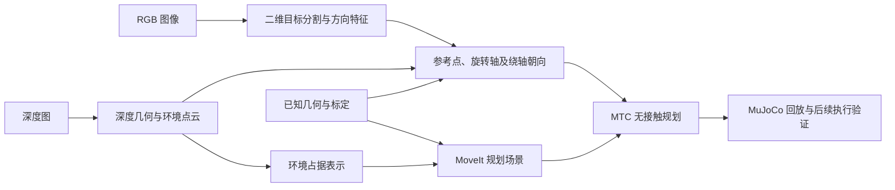

# 当前技术路线：RGB-D 感知、MTC 规划与 MuJoCo 仿真

确认日期：2026-10-01。本文归档用户在讨论后采用的当前工程路线，与同目录的[合作方博士总体路线](research_route_reference.md)同级保存。总体路线暂视为长期研究目标，本文描述当前闭环的技术方向；当前需求、参数、实现状态及待办以[项目合同](assembly_contract.md#当前技术路线)为唯一维护入口。

## 路线概述

感知采用 RGB-D 相机获取彩色与深度观测，利用二维分割提取整个盖体区域，结合深度和已知几何估计参考点及旋转轴，利用握梁等非旋转对称特征估计绕轴朝向；同时构建周围环境的占据表示，供 MoveIt/MTC 进行无接触运动规划。规划结果在 MuJoCo 中回放，并逐步接入局部接触执行及任务状态判定。

本路线沿用“感知、规划、执行、任务流程”四模块架构。当前任务为旋松、完全取下并持盖；握梁先验与手动候选作为工程基线。长期全表面候选、任务驱动构型优化和接触重构仍按总体路线研究，不将当前握梁基线称为自主发现有效抓取区域。

图示为技术方向，不表示全部已实现；任务流程负责调用各模块并检查结果，不直接发送关节命令。

## 感知：目标位姿与环境几何分开输出

RGB 图像用于目标分割、握梁方向或关键点识别。深度图经相机内参反投影形成三维点；RGB 与深度须配准，才能提取目标像素对应的有效深度。普通二维 U-Net 处理图像或组织成图像的 RGB-D 输入，不直接处理无序点云；它与总体路线中的三维体素接触预测网络分别评估。

目标感知明确输出三类量：参考点位置、旋转轴方向、绕轴朝向，并附坐标系、时间、来源和有效性。完整位姿按项目坐标约定组成；分割掩膜或可见点云的均值不能直接充当旋转轴中心。参考点与盖体、握梁及候选抓姿之间的变换需要几何依据。

凹槽或环口的边界与局部深度可辅助估计中心及平面方向；圆形的旋转对称性不能独立确定盖体绕轴朝向。凹槽属于车体，使用其位姿推算盖体时，须核对同轴关系和轴向偏移。局部几何拟合应区分环口、凹槽侧壁和盖体凸起，不将不同表面混合为一个平面。

绕轴朝向优先研究 RGB 图像中的握梁或其他可区分特征，必要时结合深度验证。对称握梁可能存在相差 180° 的朝向假设，须保留歧义并通过几何、运动学及任务约定处理，不直接输出未经验证的唯一朝向。

二维 U-Net 是分割候选，PnP 是具备可靠二维—三维关键点对应时的位姿估计候选，均不是当前强制依赖。圆周任意采样点不能直接作为 PnP 对应点。首个基线可以使用人工掩膜或简单分割，先验证 RGB-D 到三维目标再到规划的链路，之后独立替换分割算法。VLM 暂为感知内部可选实现。

环境感知使用周围点云构建占据表示，例如 OctoMap，补充位置不固定或不规则的障碍物；机器人本体仍使用已知运动学及碰撞模型，油箱口附近保留必要的精细几何。无深度或不可见区域不直接判为空闲空间，需记录观测覆盖与时效。地图分辨率、自身过滤和误差裕量须结合实际间隙、标定及观测质量验证，不照搬教程数值。

## 规划、仿真及执行边界

MoveIt/MTC 根据目标观测和规划场景组织无接触粗运动及适用的受限接近段。目标估计与障碍地图需要一致的坐标和时间信息；每次规划保存所用观测、模型与场景来源。新增感知地图需显式接入当前 PlanningScene，不因相机发布数据而自动生效。

MuJoCo 用于规划轨迹可视化及后续接触执行验证。运动学回放与动力学执行分别验收；规划侧占据表示与仿真侧障碍几何须同步或明确差异。既有图像估计、真值观测、几何规划、接触仿真与真机结果不得混报。

执行方法及任务流程细节按开发阶段完善。提前保留感知有效性、到位停止、单一控制方交接、允许闭合、抓稳、旋转/轴向进度、脱离和持续持盖的判断要求。控制交接不固定绑定某一接近距离；需在停止并确认状态后交接。失败停止并等待人工，不自动重试、松手或恢复。

## 与长期研究路线的关系

当前 RGB-D、坐标链、环境表示及规划接口，为长期空间接触表征和臂手构型优化提供基础。二维目标分割、环境占据地图与三维接触预测分别承担目标提取、避障和候选接触预测职责，不因都使用体素或网络而视为同一模块。

后续可以替换候选来源，从人工和几何候选扩展到全表面预测；运动学、碰撞、任务载荷、局部运动及执行验证仍需独立完成。旋紧、复装和执行中接触重构作为远期扩展，进入实施前先明确合同。

## 技术依据

- [U-Net 原论文](https://arxiv.org/abs/1505.04597)：图像分割方法参考，不代表本项目已训练或选定模型。
- [OpenCV PnP 文档](https://docs.opencv.org/4.12.0/d5/d1f/calib3d_solvePnP.html)：二维—三维对应点、相机内参及位姿求解条件。
- [MoveIt Humble 感知与规划场景说明](https://moveit.picknik.ai/humble/doc/concepts/planning_scene_monitor.html)：深度/点云输入及占据地图的碰撞检查接入。
