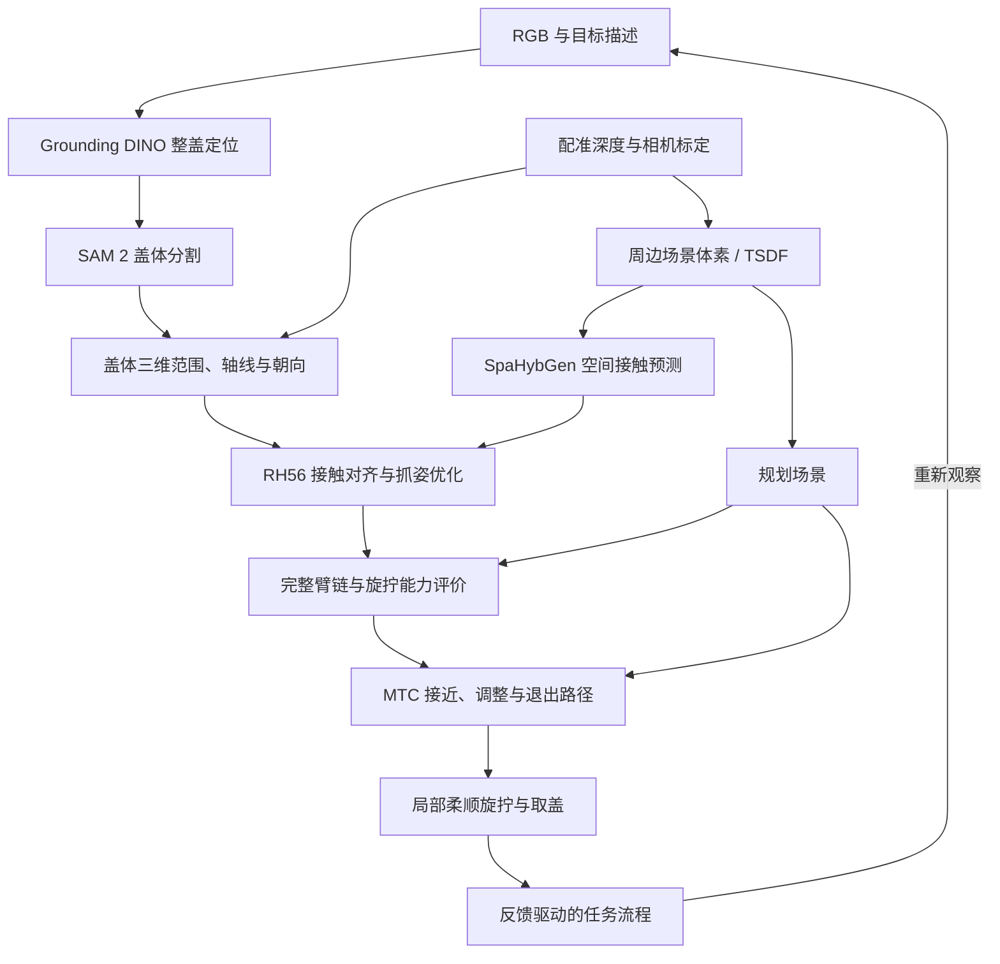

# 油箱盖技术路线

从图像找到盖体，结合深度恢复三维几何，生成 RH56 抓姿，再评价机械臂能否接近和旋拧，最后用力与运动反馈完成取盖。

当前进度、参数和下一步统一见[项目说明](assembly_contract.md)。

## 数据流

## 整盖定位与分割

Grounding DINO 根据 RGB 和目标描述给出整盖框，SAM 2 根据框输出掩膜。目标包括握梁和盖面，抓取区域在后续步骤选择。

本机使用微调检测器和现有 SAM 2，入口见[图像操作说明](grounded_sam_perception.md)。人工框与点提示用于检查分割边界，也可整理成定位训练数据。

## 深度、位姿与场景

通过相机内参，将掩膜内有效深度反投影为可见盖体点云；结合几何估计旋转轴和绕轴朝向。握梁有助于判断朝向，其 180° 对称性需要结合连续观测处理。

盖体点云用于确定目标范围，周边点云保留凹槽、环口和门板等障碍。场景转换为 SpaHybGen 的体素/TSDF，并将观测障碍与已知几何接入规划场景。每份空间数据说明原点、尺度、轴顺序和到机器人坐标系的变换。

### 点云建模与避障

1. 配准 RGB 与深度，标定相机内外参；随臂相机使用采集时刻的关节状态。
2. 遮挡、无效深度和视野外区域保留为未知，关键区域需要补充观察。
3. 根据凹腔间隙、深度噪声和计算量选择分辨率，油箱口保留精细几何。
4. 用机器人模型过滤自身点，保留紧邻机器人表面的盖体和车体点。
5. 路径绑定规划时的场景；新观测影响路径时重新检查有效性。

## 空间接触与 RH56 抓姿

SpaHybGen 网络预测接触位置、方向和中心分布。优化器调整手根位姿和六个独立驱动角，让指面与预测接触对齐；十二关节由驱动耦合展开，优化过程检查共同限位。

接触范围覆盖整个可见盖体及其邻域。候选保存手盖相对位姿、关节配置、接触采样和优化指标，随后检查自碰和车体干涉。网络的中心分布描述几何特征，传矩能力另由任务力学评价。

## 构型评价与路径

抓姿接入 i10、传感器、adapter 和手的完整运动链，先筛限位、可达性与碰撞，再比较传矩裕度、方向可操作度、可转空间和误差鲁棒性。

MTC 规划无接触接近、外退、调整、再次接近和取出路径。筛选时检查实际路径末态，再从实际到达构型评价旋转空间。手动抓姿与现有几何工具作为对照。

## 柔顺旋拧与任务流程

抓稳后，机械臂沿盖轴旋转并配合受限轴向轻拉。执行层根据盖体实际运动、阻力变化和抓持状态判断是否脱离；脱离后保持抓握并取出。

到达旋转边界仍未脱离时，先检查机构支撑，再决定是否松手重新抓握。状态未知或失败时停止等待人工。任务层管理阶段和累计进度，执行层处理接触控制及反馈判断。

研究依据见[合作方路线](research_route_reference.md)，操作入口见 [README](../README.md)。
