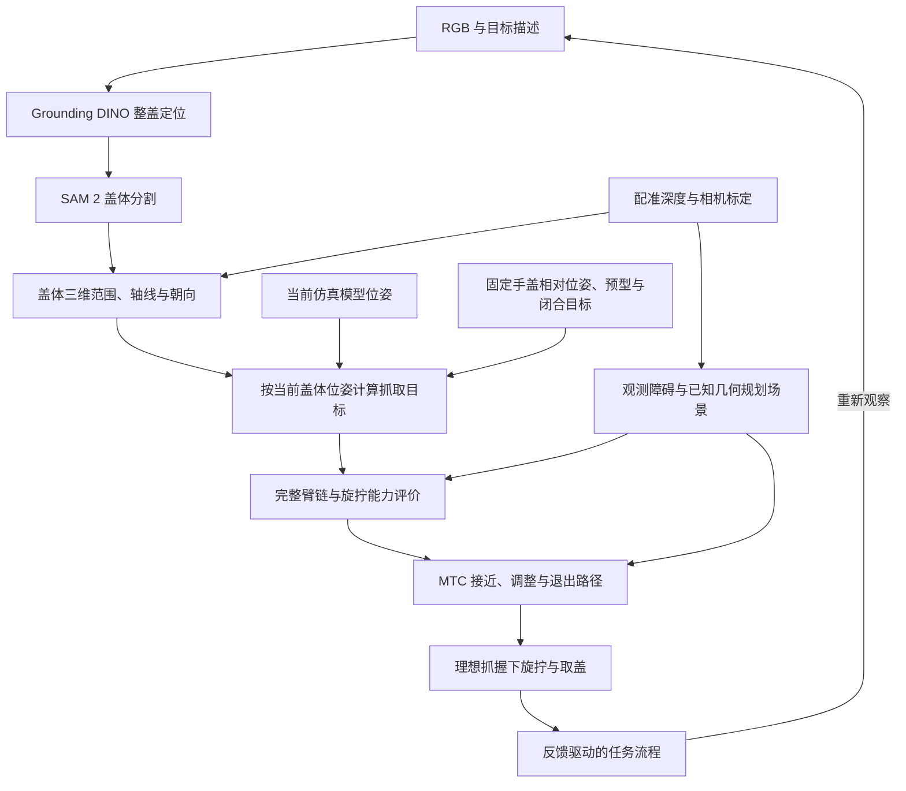

# 油箱盖技术路线

从图像找到盖体，结合深度恢复三维几何，套用固定的手盖相对抓姿，再评价机械臂能否接近和旋拧，最后按模型反馈完成取盖。当前采用理想可靠抓握，先接通运动与任务流程；SpaHybGen 自动抓姿、接触可靠性与真机传感器判据在后续升级。

工程里程碑、阶段依赖、交付物和验收指标见[工程计划](assembly_contract.md#工程计划)；当前进度与参数也在该文件维护。

真机采用左臂观察、右臂旋拧：左臂到油箱口正前方停稳采集，再让位并停稳，右臂随后接近和作业。相机观测先用采集时的左臂法兰位姿转换到左臂基座，再经两基座固定变换传到右臂规划坐标系。原有配置与状态采集属于左臂；设备对应、坐标公式和待确认项见[双臂分工与坐标传递](assembly_contract.md#双臂分工与坐标传递)。当前可运行仿真仍为旋拧单臂模型，双臂与 T 型架场景、让位交接尚待接入。

## 数据流

## 整盖定位与分割

Grounding DINO 根据 RGB 和目标描述给出整盖框，SAM 2 根据框输出掩膜。目标包括握梁和盖面，抓取区域在后续步骤选择。

本机使用微调检测器和现有 SAM 2，入口见[图像操作说明](grounded_sam_perception.md)。人工框与点提示用于检查分割边界，也可整理成定位训练数据。

## 深度、位姿与场景

通过相机内参，将掩膜内有效深度反投影为可见盖体点云；结合几何估计旋转轴和绕轴朝向。握梁有助于判断朝向，其 180° 对称性需要结合连续观测处理。

盖体点云用于确定目标范围，周边点云保留凹槽、环口和门板等障碍，将观测障碍与已知几何接入规划场景。场景表示根据路径检查需要选择，每份空间数据说明原点、尺度、轴顺序和到机器人坐标系的变换。SpaHybGen 专用体素/TSDF 在后续升级时接入。

现有观测重建入口见[RGB-D 点云](rgbd_point_cloud.md)，从点归组到表面网格的计算与交互查看见[点云转体素](point_cloud_voxelization.md)。

### 点云建模与避障

1. 核对 RGB 与深度配准及左臂相机内外参；首版按[停稳采集约定](assembly_contract.md#停稳采集与机器人位姿记录)，保存左臂采集前后状态，用采集时的左臂法兰变换恢复观测，再经两基座固定变换接入右臂规划场景。左臂让位后继续使用保存的采集姿态。
2. 遮挡、无效深度和视野外区域保留为未知，关键区域需要补充观察。
3. 根据凹腔间隙、深度噪声和计算量选择分辨率，油箱口保留精细几何。
4. 用机器人模型过滤自身点，保留紧邻机器人表面的盖体和车体点。
5. 路径绑定规划时的场景；新观测影响路径时重新检查有效性。

## 固定相对抓姿

当前仿真位姿由 [MujocoCapEstimator.read()](../src/fuel_cap_task/mujoco_scene.py) 提供：根据 `data.qpos` 调用 `mj_forward` 更新坐标，直接读取统一盖体系 `cap_grip_center` 的世界位置和旋转，再把 MuJoCo 的 WXYZ 四元数改为接口的 XYZW。模型、抓姿和接口统一采用 X 沿握梁、Z 朝外。返回的 `CapEstimate` 同时包含仿真时间、来源及有效性，复制后的快照不随场景后续运动改变。异步 `estimate()` 复用同一读取逻辑，输入输出和查看命令见[盖体坐标系](assembly_contract.md#盖体坐标系)。

当前从[已选候选](assembly_contract.md#手动候选)读取手根相对盖体的位姿、接近预型和闭合目标。`GraspPreparation` 保存同一次观测的手根、法兰和接近目标，供预览、MTC 请求和回放检查复用；数值 IK 使用法兰目标，MTC 使用世界系手根目标。接近预型与闭合目标分别适配到现有任务参数，执行后端及抓握连接待 E3 接入，接口见[盖体坐标系](assembly_contract.md#盖体坐标系)。

固定抓姿仍需检查自碰、车体干涉和阶段几何；不满足时返回失败。抓握连接假设可靠，承载与传矩能力在后续接触验证中评价。现有规划工具已经使用该候选，观测输入和新执行模型的适配按 E2 继续完成。

## 后续自动抓姿升级

现已接通[油箱盖离线生成](cap_spahybgen_migration.md)：从仿真 RGB-D 和人工整盖标注生成接触预测、RH56 候选及独立手几何评价。当前 16 个候选均存在干涉，尚未接入任务执行。当前可运行任务继续使用固定抓姿。

SpaHybGen 网络预测接触位置、方向和中心分布，优化器调整手根位姿和六驱动角，让指面与预测接触对齐。后续在匹配的局部体素/TSDF 上生成候选，经耦合、限位、自碰和环境检查后接入同一评价流程，并与固定抓姿比较。网络损失和中心分布的含义保持与任务传矩能力分别评价。

## 构型评价与路径

抓姿接入 i10、传感器、adapter 和手的完整运动链，筛选限位、可达性与碰撞，检查连续可转空间和螺纹轴向行程。传矩裕度、实际抓持和载荷鲁棒性在后续接触验证中评价。

MTC 规划无接触接近、外退、调整、再次接近和取出路径。固定手盖关系下仍可筛选不同机械臂构型；检查实际路径末态，再从实际到达构型评价旋转空间。

## 模型旋拧与任务流程

建立固定手盖连接后，机械臂沿盖轴旋转，啮合阶段采用[项目说明中的机构参数](assembly_contract.md#螺纹运动与拔出参数)轴向随动。仿真支持不同初始剩余啮合行程，较松初态会提前脱开；当前执行层按来源明确的模型反馈切换阶段。确认螺纹退出啮合并停稳后保持连接，从当前位置按项目约定的拔出距离沿轴向外移动，再确认盖体已离开开口。

到达旋转边界仍未脱离时，先检查机构支撑，再决定是否松手重新抓握。状态未知或失败时停止等待人工。任务层管理阶段和累计进度，执行层处理机构动作与模型反馈判断。

当前支撑反馈也由模型提供。后续接触与真机版本再实现连续柔顺旋拧、实际抓持检测及传感器脱开判据。

研究依据见[合作方路线](research_route_reference.md)，操作入口见 [README](../README.md)。
