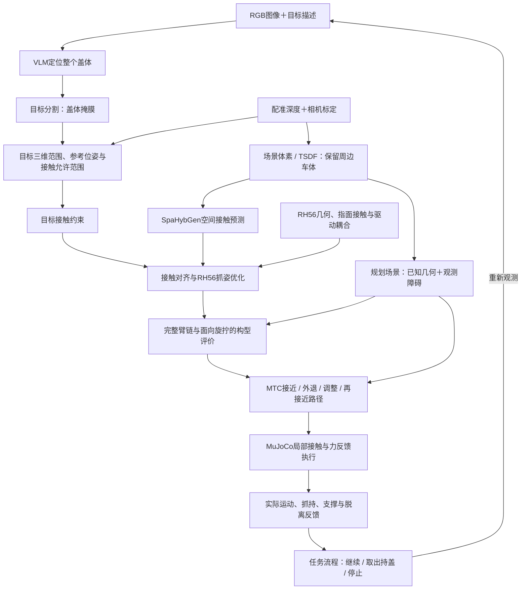

# 当前技术路线：VLM 整盖定位、SpaHybGen 抓姿生成与 MTC 路径规划

确认日期：2026-10-08。用户授权用本路线替换旧的当前工程路线，保留 MTC。本文说明方法与模块关系；参数、采用状态、待办与验收统一维护在[项目合同](assembly_contract.md#当前技术路线)。[合作方博士路线](research_route_reference.md)保留原文，第五章的空间接触与抓取优化是本路线的直接研究依据。

## 路线概述

主线为“RGB 与目标描述 → VLM 定位整个盖体 → 目标分割与配准深度 → 场景体素/TSDF → SpaHybGen 接触预测与 RH56 抓姿优化 → 面向旋拧的臂手构型评价 → MTC 无接触路径 → 局部力反馈执行”。整盖候选生成进入当前开发范围，手动握梁候选和固定抓姿构型诊断保留为实验对照与可复用工具。

任务仍只旋松、完全取下油箱盖，并由手持续持盖；油箱门默认已打开。首次交付仿真，真机后续接入。新路线尚未实现，不能把既有运动学回放或 mock 成功当作新方法或物理取盖通过。

图示表达职责和数据流，不表示体素自动成为 PlanningScene，也不把分段循环作为失败恢复。感知提供目标、接触特征和场景；规划生成候选、评价能力并求无接触路径；执行承担接触控制和物理判据；任务层编排并检查反馈，不直接发送关节命令。

## VLM：根据任务定位整个盖体

输入 RGB 图像和目标描述，例如“找到油箱开口中需要旋松取出的盖体，包含中央握梁和周围盖面”。输出目标检测框、语义匹配信息及有效性，再由分割模块获得盖体像素掩膜。VLM 解决目标身份与图像位置；三维参考点、盖轴及绕轴朝向由深度、标定和几何估计获得。

可评价 Grounding DINO 的文本目标定位与 SAM 2 的提示分割组合；具体模型在开发时核对，尚未选定或接入。SAM 2 不单独承担文本语义识别，也不要求从头训练一个能聊天的多模态大模型。人工掩膜可作为模块对照，须标注来源，不计 VLM 交付。定位失败或歧义未解决时输出无效，不暗中回退到仿真真值。

目标定位覆盖整个盖体，不提前指定握梁为唯一抓取区域。VLM 不输出可靠的锁紧程度、精确载荷、抓稳或允许松手结论，不承担关节控制。

## 分割、深度与场景表示

RGB/深度配准和内外参是像素到三维点的依据。由整盖掩膜形成目标三维范围和接触允许范围，同时用周边深度与已知几何保留凹槽、环口、门板等障碍。掩膜用于确定接触目标，不把盖体以外的深度全部删除。

参考点、旋转轴和绕轴朝向分开估计，附坐标系、时间、来源、有效性与歧义。可见点云均值不等于轴心；圆形边界不能确定绕轴朝向。利用车体环口推算盖体时须核对同轴关系与轴向偏移；握梁可辅助朝向估计，但其对称性仍可能产生多个假设。

建立 SpaHybGen 所需体素或 TSDF，核对体积原点、尺度、轴顺序、分辨率及到机器人坐标系的变换。模型输入体素、目标接触范围和规划占据地图有不同职责，应显式转换与同步。仿真 RGB-D 观测与真值分别标注，未知或遮挡区域不由不可见真值点补齐。

## SpaHybGen：空间接触特征与候选抓姿

优先复用 SpaHybGen 的预训练网络、手模型和可微优化框架。网络以体素/TSDF 为输入，输出接触位置置信度、接触方向和中心相关分布；接触特征再与具体手表面及运动学对齐，优化手的整体位姿和关节配置。[推理代码](https://github.com/wangzivector/SpaHybGen/blob/main/src/spahybgen/inference.py)、[抓姿优化代码](https://github.com/wangzivector/SpaHybGen/blob/main/src/spahybgen/optimization.py)

代码中的 `wren_vol` 是中心相关的空间分布，标签由接触几何插值得到，不能当成传感器六维力、物理质心或旋拧传矩上限。[标签生成代码](https://github.com/wangzivector/SpaHybGen/blob/main/src/spahybgen/grasptip.py)

RH56 适配需落实 URDF/网格、指面接触区域、关节顺序、独立驱动和耦合关系。优化器已有按手模型定制的运动学约束入口，但软损失不保证所有输出均符合实物耦合，仍需显式验证可执行性。新候选输出手盖相对位姿、手部配置和来源，先离线保存；既有冻结闭合通道继续作为执行基线，采用本路线不直接授权改写正式指令。

目标接触限制在整个盖体可见表面及其接触邻域，保留车体环境约束。原预训练模型在油箱凹腔、遮挡和任务尺度下的表现须实测；先复现与评价，再决定是否需要新增标签或微调。

## 面向旋拧的构型评价与 MTC

候选接入完整 i10 → 传感器 → adapter → RH56 运动链，先检查驱动可执行性、限位、碰撞和可达性，再评价任务传矩裕度、旋拧方向可操作度、局部旋转行程、误差鲁棒性，以及试拉与持盖退出空间。未知载荷、摩擦和驱动限值明确标为未评价，不能用接触置信度或力闭合相关分数替代承载验证。

MTC 保留无接触路径职责，规划接近、允许释放后的外退、调整和再次接近，核对实际末态是否保持候选构型及关节绕数。已有 IK、FCL/MuJoCo 几何检查和旋转诊断继续作为筛选与对照。SpaHybGen 的优化迭代序列不是可执行运动轨迹；端点可达、路径通过和物理抓稳分别验证。

## 局部执行与任务反馈

沿用合同的[力控旋拧与反馈取盖路线](assembly_contract.md#力控旋拧与反馈取盖路线)：抓稳后旋拧并配合受限轴向柔顺，根据实际盖体运动、阻力及抓持反馈判断脱离。参考转角不作为每次必须转满的目标；提前确认脱离时结束旋拧、取出并持续持盖。

裕量不足前停转；仅在可靠机构支撑及释放条件已经确认时，允许计划重新抓握。受限试拉和卸载观察为待验证方法；卸载是在保持抓握时减小主动轴向拉力，不能单凭卸载后不动允许松手。需要可脱离物理模型、实际释放实验和误判记录。

运动停止后确认控制交接，同组关节只有一个控制方；失败、状态未知或取消停止等待人工，不自动重试、松手或恢复。模型参数、力传感读取/控制接口、负载补偿与停止保持能力按合同核对。

## 点云建模与避障注意事项

1. **坐标标定。** 核对 RGB/深度配准、相机内参及到机器人坐标系的外参；随臂相机需使用采集时刻的关节状态，显示正常不能代替标定。
2. **无点区域。** 遮挡、视野之外或无效深度保持未知；已知几何补充与实际观测分别标注，关键空间覆盖不足时补充观察或停止。
3. **分辨率与间隙。** 体素和占据地图分辨率依据任务间隙、噪声和计算条件验证；油箱口保留必要精细几何，不照搬原示例参数。
4. **自身过滤。** 按模型、采集时间和变换过滤机器人点，仍保留自碰检查；不得一并删除邻近盖体或车体障碍。
5. **地图与轨迹有效性。** 规划绑定场景快照，新地图不自动修改旧轨迹；关键观测失效或变化影响路径时按合同停止，静态验证不计动态避障完成。

## 实施入口与博士路线的关系

当前开发顺序统一见[合同实施顺序](assembly_contract.md#实施顺序与交付)。近期入口是用原手模型、自带观测与预训练权重复现[无硬件示例](https://github.com/wangzivector/SpaHybGen/blob/main/scripts/generation_pipeline_test.py)，然后适配 RH56 与油箱盖场景；VLM/深度感知与物理输入整理可并行推进。研究方法与工程取盖闭环分别验收。

本路线直接推进第五章的整盖目标提取、空间接触表征、接触对齐与抓姿生成。第五章的任务载荷/传矩、方向可操作度及鲁棒性仍需补充，第六章的轴向约束估计、分段旋拧与接触重构也不由 SpaHybGen 自动解决。既有整手释放再抓是工程对照，不等于完整接触重构研究。旋紧、复装及专用末端对照保留为远期扩展。

## 复用资料

- [SpaHybGen 官方仓库](https://github.com/wangzivector/SpaHybGen)：接触预测、手模型、优化与复现入口；原环境及 ROS Melodic 部署需独立核对，与本项目 ROS 2 Humble 分开适配。
- [Grounding DINO 官方仓库](https://github.com/IDEA-Research/GroundingDINO)：文本引导目标定位候选。
- [SAM 2 官方仓库](https://github.com/facebookresearch/sam2)：提示分割候选。

上述资料是拟复用依据，不是本项目已运行或兼容通过的声明。模型、代码版本、权重、数据、依赖与使用条件在实际引入时记录，当前状态只维护在合同。
